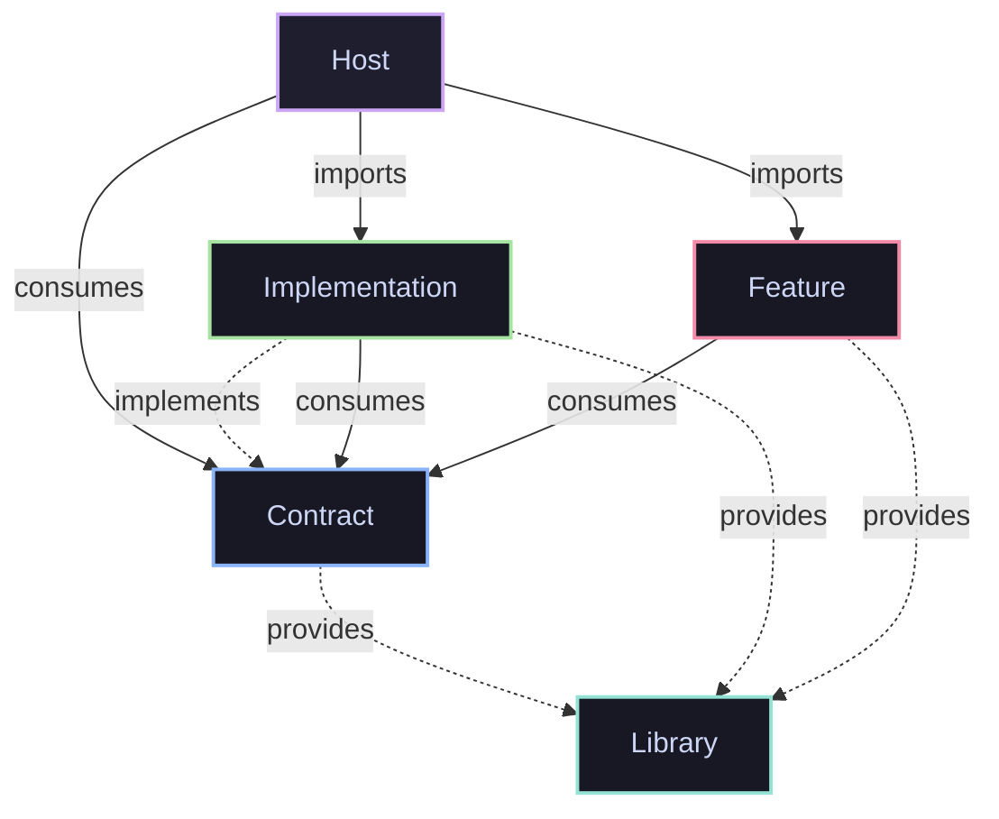

<h1 align="center">❄️ nixconf</h1>

<p align="center">Declarative multi-host infrastructure, capability contracts, and modular NixOS configuration repository powered by pure-Nix evaluation.</p>

## Architecture Overview

The repository architecture is governed by five first-class, symmetrical primitives:

- **Hosts (`host`)**: Declarative target host definitions binding concrete hardware configurations, platform architectures, active implementations, and enabled system features into bootable NixOS systems.
- **Contracts (`contract`)**: Pure capability interfaces defining shared option schemas, custom types, and configuration contracts decoupled from any specific service provider or backend implementation.
- **Implementations (`implementation`)**: Concrete capability providers satisfying contract interfaces by translating abstract capability options into provider-specific NixOS services, packages, and system configurations.
- **Features (`feature`)**: Reusable system configurations, applications, desktop environments, development toolchains, and services that consume contracts to integrate with the host system.
- **Libraries (`lib`)**: Pure reusable helper functions, data types, calculations, and configuration presets exported across the repository.




<details>
<summary>Full Architecture Diagram (Click to expand)</summary>




</details>

```mermaid
flowchart TD
    subgraph Hosts["Hosts"]
        host__astrolabe["astrolabe"]:::hostNode
        host__x240["x240"]:::hostNode
    end

    subgraph Contracts["Contracts"]
        contract__backup(["backup"]):::contractNode
        contract__default_user(["default-user"]):::contractNode
        contract__home(["home"]):::contractNode
        contract__persistence(["persistence"]):::contractNode
        contract__resources(["resources"]):::contractNode
        contract__reverse_proxy(["reverse-proxy"]):::contractNode
        contract__secrets(["secrets"]):::contractNode
        contract__wayland(["wayland"]):::contractNode
    end

    subgraph Implementations["Implementations"]
        impl__caddy["caddy"]:::implNode
        impl__cgroups["cgroups"]:::implNode
        impl__hjem["hjem"]:::implNode
        impl__impermanence["impermanence"]:::implNode
        impl__lw["lw"]:::implNode
        impl__restic["restic"]:::implNode
        impl__sops["sops"]:::implNode
        impl__uwsm["uwsm"]:::implNode
    end

    subgraph Features["Features"]
        feature__antigravity["antigravity"]:::featureNode
        feature__audio["audio"]:::featureNode
        feature__bitwarden["bitwarden"]:::featureNode
        feature__cosmic["cosmic"]:::featureNode
        feature__cursor["cursor"]:::featureNode
        feature__direnv["direnv"]:::featureNode
        feature__disko["disko"]:::featureNode
        feature__dolphin["dolphin"]:::featureNode
        feature__fonts["fonts"]:::featureNode
        feature__foot["foot"]:::featureNode
        feature__git["git"]:::featureNode
        feature__greetd["greetd"]:::featureNode
        feature__helium["helium"]:::featureNode
        feature__labwc["labwc"]:::featureNode
        feature__locale["locale"]:::featureNode
        feature__nix["nix"]:::featureNode
        feature__noctalia["noctalia"]:::featureNode
        feature__ssh["ssh"]:::featureNode
        feature__tack["tack"]:::featureNode
        feature__ttyd["ttyd"]:::featureNode
        feature__user["user"]:::featureNode
        feature__vaultwarden["vaultwarden"]:::featureNode
        feature__vivaldi["vivaldi"]:::featureNode
        feature__vscode["vscode"]:::featureNode
        feature__wifi_eduroam["wifi-eduroam"]:::featureNode
    end

    subgraph Libraries["Libraries"]
        lib__backup(["lib: backup"]):::libNode
        lib__bitwarden(["lib: bitwarden"]):::libNode
        lib__default_user(["lib: default-user"]):::libNode
        lib__disko(["lib: disko"]):::libNode
        lib__home(["lib: home"]):::libNode
        lib__lw(["lib: lw"]):::libNode
        lib__persistence(["lib: persistence"]):::libNode
        lib__primitive(["lib: primitive"]):::libNode
        lib__resources(["lib: resources"]):::libNode
        lib__reverse_proxy(["lib: reverse-proxy"]):::libNode
        lib__secrets(["lib: secrets"]):::libNode
        lib__sops(["lib: sops"]):::libNode
        lib__user(["lib: user"]):::libNode
        lib__wayland(["lib: wayland"]):::libNode
    end


    host__astrolabe -->|"imports"| impl__caddy
    host__astrolabe -->|"imports"| impl__cgroups
    host__astrolabe -->|"imports"| impl__impermanence
    host__astrolabe -->|"imports"| impl__lw
    host__astrolabe -->|"imports"| impl__restic
    host__astrolabe -->|"imports"| impl__sops
    host__astrolabe -->|"imports"| feature__disko
    host__astrolabe -->|"imports"| feature__git
    host__astrolabe -->|"imports"| feature__locale
    host__astrolabe -->|"imports"| feature__nix
    host__astrolabe -->|"imports"| feature__ssh
    host__astrolabe -->|"imports"| feature__ttyd
    host__astrolabe -->|"imports"| feature__vaultwarden
    host__x240 -->|"imports"| impl__cgroups
    host__x240 -->|"imports"| impl__hjem
    host__x240 -->|"imports"| impl__impermanence
    host__x240 -->|"imports"| impl__lw
    host__x240 -->|"imports"| impl__sops
    host__x240 -->|"imports"| impl__uwsm
    host__x240 -->|"imports"| feature__antigravity
    host__x240 -->|"imports"| feature__audio
    host__x240 -->|"imports"| feature__bitwarden
    host__x240 -->|"imports"| feature__cursor
    host__x240 -->|"imports"| feature__direnv
    host__x240 -->|"imports"| feature__disko
    host__x240 -->|"imports"| feature__dolphin
    host__x240 -->|"imports"| feature__fonts
    host__x240 -->|"imports"| feature__foot
    host__x240 -->|"imports"| feature__git
    host__x240 -->|"imports"| feature__greetd
    host__x240 -->|"imports"| feature__labwc
    host__x240 -->|"imports"| feature__locale
    host__x240 -->|"imports"| feature__nix
    host__x240 -->|"imports"| feature__noctalia
    host__x240 -->|"imports"| feature__ssh
    host__x240 -->|"imports"| feature__tack
    host__x240 -->|"imports"| feature__vivaldi
    host__x240 -->|"imports"| feature__vscode
    host__x240 -->|"imports"| feature__wifi_eduroam
    impl__caddy -.->|"implements"| contract__reverse_proxy
    impl__cgroups -.->|"implements"| contract__resources
    impl__hjem -.->|"implements"| contract__home
    impl__impermanence -.->|"implements"| contract__persistence
    impl__lw -.->|"implements"| contract__default_user
    impl__restic -.->|"implements"| contract__backup
    impl__sops -.->|"implements"| contract__secrets
    impl__uwsm -.->|"implements"| contract__wayland
    host__astrolabe -->|"consumes (reverse-proxy.domain)"| contract__reverse_proxy
    host__x240 -->|"consumes (wayland.enable)"| contract__wayland
    feature__antigravity -->|"consumes (persistence.users)"| contract__persistence
    feature__bitwarden -->|"consumes (persistence.users)"| contract__persistence
    feature__cosmic -->|"consumes (persistence.users, persistence.directories)"| contract__persistence
    feature__direnv -->|"consumes (persistence.users)"| contract__persistence
    feature__dolphin -->|"consumes (persistence.users)"| contract__persistence
    feature__foot -->|"consumes (home.shared, home.users)"| contract__home
    feature__foot -->|"consumes (persistence.users)"| contract__persistence
    feature__git -->|"consumes"| contract__default_user
    feature__git -->|"consumes (home.users, home.shared)"| contract__home
    feature__helium -->|"consumes (home.shared, home.users)"| contract__home
    feature__helium -->|"consumes (persistence.users)"| contract__persistence
    feature__labwc -->|"consumes (home.shared.xdg.config, home.users, home.shared)"| contract__home
    feature__labwc -->|"consumes (persistence.users)"| contract__persistence
    feature__labwc -->|"consumes (wayland.compositors.labwc, wayland.compositors)"| contract__wayland
    feature__locale -->|"consumes (home.shared.sessionVariables, home.shared)"| contract__home
    feature__nix -->|"consumes (secrets.files)"| contract__secrets
    feature__noctalia -->|"consumes (persistence.users)"| contract__persistence
    feature__ssh -->|"consumes (default-user.enable, default-user.username)"| contract__default_user
    feature__ssh -->|"consumes (persistence.files, persistence.enable)"| contract__persistence
    feature__ssh -->|"consumes (secrets.files)"| contract__secrets
    feature__ttyd -->|"consumes (resources.enable)"| contract__resources
    feature__ttyd -->|"consumes (reverse-proxy.enable)"| contract__reverse_proxy
    feature__vaultwarden -->|"consumes (backup.enable)"| contract__backup
    feature__vaultwarden -->|"consumes (persistence.enable)"| contract__persistence
    feature__vaultwarden -->|"consumes (resources.enable)"| contract__resources
    feature__vaultwarden -->|"consumes (reverse-proxy.domain)"| contract__reverse_proxy
    feature__vivaldi -->|"consumes (persistence.users)"| contract__persistence
    feature__vscode -->|"consumes (persistence.users)"| contract__persistence
    feature__wifi_eduroam -->|"consumes (secrets.files)"| contract__secrets
    impl__caddy -->|"consumes (persistence.directories, persistence.enable)"| contract__persistence
    impl__caddy -->|"consumes (resources.services.caddy, resources.enable, resources.services)"| contract__resources
    impl__cgroups -->|"consumes (resources.enable)"| contract__resources
    impl__hjem -->|"consumes (home.enable)"| contract__home
    impl__impermanence -->|"consumes (persistence.users)"| contract__persistence
    impl__lw -->|"consumes (home.users)"| contract__home
    impl__lw -->|"consumes (persistence.users)"| contract__persistence
    impl__lw -->|"consumes (secrets.files.default-user-password-hash, secrets.files)"| contract__secrets
    impl__restic -->|"consumes (resources.services.restic-backups-main, resources.enable, resources.services)"| contract__resources
    impl__restic -->|"consumes (secrets.files)"| contract__secrets
    impl__sops -->|"consumes (secrets.defaultFile, secrets.enable, secrets.files)"| contract__secrets
    impl__uwsm -->|"consumes (wayland.compositors, wayland.enable)"| contract__wayland
    contract__backup -.->|"provides"| lib__backup
    contract__default_user -.->|"provides"| lib__default_user
    contract__home -.->|"provides"| lib__home
    contract__persistence -.->|"provides"| lib__persistence
    contract__resources -.->|"provides"| lib__resources
    contract__reverse_proxy -.->|"provides"| lib__reverse_proxy
    contract__secrets -.->|"provides"| lib__secrets
    contract__wayland -.->|"provides"| lib__wayland
    impl__lw -.->|"provides"| lib__lw
    impl__sops -.->|"provides"| lib__sops
    feature__bitwarden -.->|"provides"| lib__bitwarden
    feature__disko -.->|"provides"| lib__disko
    feature__user -.->|"provides"| lib__user

classDef hostNode fill:#1e1e2e,stroke:#cba6f7,stroke-width:2px,color:#cdd6f4;
classDef contractNode fill:#181825,stroke:#89b4fa,stroke-width:2px,color:#cdd6f4;
classDef implNode fill:#181825,stroke:#a6e3a1,stroke-width:2px,color:#cdd6f4;
classDef featureNode fill:#181825,stroke:#f38ba8,stroke-width:2px,color:#cdd6f4;
classDef libNode fill:#181825,stroke:#94e2d5,stroke-width:2px,color:#cdd6f4;
classDef optNode fill:#11111b,stroke:#fab387,stroke-width:1px,color:#cdd6f4;
classDef typeNode fill:#11111b,stroke:#f9e2af,stroke-width:1px,color:#cdd6f4;
classDef fnNode fill:#181825,stroke:#94e2d5,stroke-width:1px,color:#cdd6f4;
classDef pkgNode fill:#181825,stroke:#b4befe,stroke-width:1px,color:#cdd6f4;
classDef shellNode fill:#181825,stroke:#f5c2e7,stroke-width:1px,color:#cdd6f4;

```

## Core Nix Stack

The repository infrastructure is structured around four foundational components:

- **`tack`**: Declarative input pinning and lockfile orchestration tool (`.tack/pins.toml` and `.tack/pins.lock.json`), decoupling external flake inputs from repository code while enabling deterministic updates:
  ```bash
  # Update all pinned inputs
  tack update

  # Update a specific pinned input
  tack update nixpkgs

  # Add a new input pin
  tack add github:owner/repo

  # Remove an input pin
  tack rm repo
  ```

- **`flake.nix`**: Minimal transparent entrypoint evaluating flake inputs via `import ./.tack`.

- **`flake-parts`**: Hercules CI modular framework (`mkFlake`) partitioning options, per-system packages, devshells, and automated checks.

- **`import-tree`**: Automated dendritic module discovery that recursively scans and imports all `.nix` files under `primitives/`, `meta/`, and `modules/` as top-level flake-parts modules.

## Configuration Catalog

<details>
<summary><h3>Primitives</h3></summary>

Foundational abstractions governing components across the repository, declared in [`primitives/`](primitives/). See [Primitives Documentation](docs/PRIMITIVES.md) for full specifications.

| Primitive | Description | Source File |
| :--- | :--- | :--- |
| **`primitive`** | Meta-primitive defining how primitives are constructed and registered. | [`primitives/primitive.nix`](primitives/primitive.nix) |
| **`host`** | Declarative NixOS target machines binding hardware, platform, and enabled features. | [`primitives/host.nix`](primitives/host.nix) |
| **`contract`** | Abstract capability interfaces defining shared option schemas decoupled from backends. | [`primitives/contract.nix`](primitives/contract.nix) |
| **`implementation`** | Concrete capability providers satisfying contract interfaces with services and packages. | [`primitives/implementation.nix`](primitives/implementation.nix) |
| **`feature`** | Reusable system configurations and desktop services consuming contracts. | [`primitives/feature.nix`](primitives/feature.nix) |
| **`lib`** | Pure reusable helper functions, data types, calculations, and presets. | [`primitives/lib.nix`](primitives/lib.nix) |

</details>

<details>
<summary><h3>Hosts</h3></summary>

Master registry of target hosts declared via `options.host` in [`primitives/host.nix`](primitives/host.nix). See [Hosts Documentation](docs/HOSTS.md) for full metadata.

| Host | Description | System | Docs |
| :--- | :--- | :--- | :--- |
| [`astrolabe`](docs/hosts/astrolabe.md) | Headless VPS Server (adje.app public edge and core services). | `x86_64-linux` | [More →](docs/hosts/astrolabe.md) |
| [`x240`](docs/hosts/x240.md) | ThinkPad Laptop Workstation (Desktop graphical workstation). | `x86_64-linux` | [More →](docs/hosts/x240.md) |

### Host Installation & Deployment

Target hosts in this configuration are partitioned declaratively with Disko, persisted through Impermanence, and configured via Nix flakes. Host-specific copy-paste commands are documented on each host's deep-dive page:
- [`astrolabe`](docs/hosts/astrolabe.md#installation): Headless public edge and VPS server.
- [`x240`](docs/hosts/x240.md#installation): Graphical workstation laptop.

#### Prerequisites & Requirements

Before installing a host, verify:
1. **Architecture & Firmware**: 64-bit x86 target system booted in UEFI mode with network connectivity.
2. **Disko Partitioning**: The disk definition in the host configuration matches the physical disk device path (e.g. `/dev/sda` or `/dev/nvme0n1`).
3. **SOPS Age Private Key**: The host's age decryption key must be placed at `/persist/var/lib/sops-nix/key.txt` with permissions `0400` so secrets decrypt on first boot.

#### Track 1: Remote Automated Deployment via `nixos-anywhere`

For headless cloud instances or network-accessible hosts booted into a live environment:

```bash
# 1. Obtain and verify SSH root access to target IP
ssh root@<TARGET-IP>

# 2. Deploy system, format partitions via Disko, and copy SOPS secret key
nix run github:nix-community/nixos-anywhere -- \
  --flake .#<HOST> \
  --copy-secret /path/to/host-key.txt /persist/var/lib/sops-nix/key.txt \
  root@<TARGET-IP>
```

#### Track 2: Local Host Installation (NixOS Live ISO)

For bare-metal physical hosts booted from a standard NixOS Live ISO USB drive:

```bash
# 1. Elevate to root in the live environment
sudo -i

# 2. Clone repository to live memory
git clone https://github.com/LW-54/nixconf /tmp/nixconf
cd /tmp/nixconf

# 3. Format disk and mount partitions declaratively via Disko
nix --extra-experimental-features 'nix-command flakes' run github:nix-community/disko -- \
  --mode zap_create_mount \
  --flake .#<HOST>

# 4. Provision SOPS age secret key on mounted persistence volume
mkdir -p /mnt/persist/var/lib/sops-nix
chmod 0700 /mnt/persist/var/lib/sops-nix
cp /path/to/host-key.txt /mnt/persist/var/lib/sops-nix/key.txt
chmod 0400 /mnt/persist/var/lib/sops-nix/key.txt

# 5. Install the NixOS system configuration to /mnt
nixos-install --flake .#<HOST> --no-root-passwd

# 6. Reboot into the installed system
reboot
```

#### Track 3: Host Configuration Maintenance & Rebuild

To apply configuration changes on a running system:

```bash
# Local rebuild and activation
sudo nixos-rebuild switch --flake .#<HOST>

# Remote rebuild and activation over SSH
nixos-rebuild switch --flake .#<HOST> --target-host root@<TARGET-IP>
```

</details>

<details>
<summary><h3>Contracts</h3></summary>

Pure capability interfaces declared via `options.contract` in [`primitives/contract.nix`](primitives/contract.nix). See [Contracts Documentation](docs/CONTRACTS.md) for full capability specifications.

| Contract | Description | Implementations | Docs |
| :--- | :--- | :--- | :--- |
| [`backup`](docs/contracts/backup.md) | Automated snapshot backup configuration, inclusion paths, exclusions, and retention rules. | [`restic`](docs/implementations/restic.md) | [More →](docs/contracts/backup.md) |
| [`default-user`](docs/contracts/default-user.md) | Default primary user account identification, credentials, and configuration injection. | [`lw`](docs/implementations/lw.md) | [More →](docs/contracts/default-user.md) |
| [`home`](docs/contracts/home.md) | Declarative user home dotfile tree, XDG directory specifications, and session environment. | [`hjem`](docs/implementations/hjem.md) | [More →](docs/contracts/home.md) |
| [`persistence`](docs/contracts/persistence.md) | Declarative state preservation across ephemeral reboots for system and user directories. | [`impermanence`](docs/implementations/impermanence.md) | [More →](docs/contracts/persistence.md) |
| [`resources`](docs/contracts/resources.md) | System resource limits, cgroup slices, memory/CPU quotas, and power-aware throttling. | [`cgroups`](docs/implementations/cgroups.md) | [More →](docs/contracts/resources.md) |
| [`reverse-proxy`](docs/contracts/reverse-proxy.md) | Declarative HTTP/TLS reverse proxy virtual host ingress and routing management. | [`caddy`](docs/implementations/caddy.md) | [More →](docs/contracts/reverse-proxy.md) |
| [`secrets`](docs/contracts/secrets.md) | Declarative encrypted secrets provisioning, filesystem mounting, and permission management. | [`sops`](docs/implementations/sops.md) | [More →](docs/contracts/secrets.md) |
| [`wayland`](docs/contracts/wayland.md) | Wayland compositor registration, session targets, and graphical environment management. | [`uwsm`](docs/implementations/uwsm.md) | [More →](docs/contracts/wayland.md) |

</details>

<details>
<summary><h3>Implementations</h3></summary>

Concrete contract providers declared via `options.implementation` in [`primitives/implementation.nix`](primitives/implementation.nix). See [Implementations Documentation](docs/IMPLEMENTATIONS.md) for provider assignments.

| Implementation | Description | Contract | Docs |
| :--- | :--- | :--- | :--- |
| [`caddy`](docs/implementations/caddy.md) | Automated TLS virtual host reverse proxy implementation using Caddy. | [`reverse-proxy`](docs/contracts/reverse-proxy.md) | [More →](docs/implementations/caddy.md) |
| [`cgroups`](docs/implementations/cgroups.md) | Systemd control groups slice hierarchy and resource quotas implementation. | [`resources`](docs/contracts/resources.md) | [More →](docs/implementations/cgroups.md) |
| [`hjem`](docs/implementations/hjem.md) | Lightweight declarative home directory files and XDG environment manager. | [`home`](docs/contracts/home.md) | [More →](docs/implementations/hjem.md) |
| [`impermanence`](docs/implementations/impermanence.md) | Ephemeral root filesystem with persistent state bind-mounts via Impermanence. | [`persistence`](docs/contracts/persistence.md) | [More →](docs/implementations/impermanence.md) |
| [`lw`](docs/implementations/lw.md) | Primary human user account orchestration and identity provisioning. | [`default-user`](docs/contracts/default-user.md) | [More →](docs/implementations/lw.md) |
| [`restic`](docs/implementations/restic.md) | Automated encrypted remote backups using Restic and systemd timers. | [`backup`](docs/contracts/backup.md) | [More →](docs/implementations/restic.md) |
| [`sops`](docs/implementations/sops.md) | Declarative encrypted secrets provisioning using SOPS and age keys. | [`secrets`](docs/contracts/secrets.md) | [More →](docs/implementations/sops.md) |
| [`uwsm`](docs/implementations/uwsm.md) | Universal Wayland Session Manager integration for desktop environments. | [`wayland`](docs/contracts/wayland.md) | [More →](docs/implementations/uwsm.md) |

</details>

<details>
<summary><h3>Features</h3></summary>

Reusable system services and applications declared via `options.feature` in [`primitives/feature.nix`](primitives/feature.nix). See [Features Documentation](docs/FEATURES.md) for exported outputs.

| Feature | Description | Docs |
| :--- | :--- | :--- |
| [`antigravity`](docs/features/antigravity.md) | Google Antigravity IDE, agentic workflow tools, and CLI runtime. | [More →](docs/features/antigravity.md) |
| [`audio`](docs/features/audio.md) | PipeWire sound server and real-time audio processing stack. | [More →](docs/features/audio.md) |
| [`bitwarden`](docs/features/bitwarden.md) | Bitwarden password manager CLI wrapper, desktop application, and vault retrieval helpers. | [More →](docs/features/bitwarden.md) |
| [`cosmic`](docs/features/cosmic.md) | Next-generation COSMIC desktop environment and greeter. | [More →](docs/features/cosmic.md) |
| [`cursor`](docs/features/cursor.md) | XCursor theme configuration and icon assets. | [More →](docs/features/cursor.md) |
| [`direnv`](docs/features/direnv.md) | Per-directory declarative shell environment integration via nix-direnv. | [More →](docs/features/direnv.md) |
| [`disko`](docs/features/disko.md) | Declarative disk partitioning and filesystem layouts via Disko. | [More →](docs/features/disko.md) |
| [`dolphin`](docs/features/dolphin.md) | KDE Dolphin file manager with Wayland integration and isolated runtime plugins. | [More →](docs/features/dolphin.md) |
| [`fonts`](docs/features/fonts.md) | System typography and developer monospace font packages. | [More →](docs/features/fonts.md) |
| [`foot`](docs/features/foot.md) | Fast, lightweight Wayland terminal emulator with server-client architecture. | [More →](docs/features/foot.md) |
| [`git`](docs/features/git.md) | Git version control system, global/per-user configuration, and Bitwarden SSH key agent shell. | [More →](docs/features/git.md) |
| [`greetd`](docs/features/greetd.md) | Lightweight console greeter and graphical session launcher via tuigreet. | [More →](docs/features/greetd.md) |
| [`helium`](docs/features/helium.md) | Helium web browser with custom runtime flags and enterprise policy management. | [More →](docs/features/helium.md) |
| [`labwc`](docs/features/labwc.md) | Labwc stacking Wayland compositor with window manager keybindings and XDG autostart. | [More →](docs/features/labwc.md) |
| [`locale`](docs/features/locale.md) | System internationalization, time zone, and language locale configuration. | [More →](docs/features/locale.md) |
| [`nix`](docs/features/nix.md) | Nix package manager daemon settings, binary caches, garbage collection, and nix-ld. | [More →](docs/features/nix.md) |
| [`noctalia`](docs/features/noctalia.md) | Noctalia shell environment, status bar, app launcher, and wallpaper manager. | [More →](docs/features/noctalia.md) |
| [`ssh`](docs/features/ssh.md) | OpenSSH server daemon hardening, authorized key distribution, and master SSH key agent shell. | [More →](docs/features/ssh.md) |
| [`tack`](docs/features/tack.md) | Flake input pinning and lockfile orchestration tool. | [More →](docs/features/tack.md) |
| [`ttyd`](docs/features/ttyd.md) | Web terminal server bridging browser sessions to system shells via ttyd. | [More →](docs/features/ttyd.md) |
| [`user`](docs/features/user.md) | Normal user account helper functions and querying utilities. | [More →](docs/features/user.md) |
| [`vaultwarden`](docs/features/vaultwarden.md) | Self-hosted Bitwarden compatible password manager server. | [More →](docs/features/vaultwarden.md) |
| [`vivaldi`](docs/features/vivaldi.md) | Vivaldi web browser with Widevine and proprietary media codecs. | [More →](docs/features/vivaldi.md) |
| [`vscode`](docs/features/vscode.md) | Visual Studio Code editor environment and persistence. | [More →](docs/features/vscode.md) |
| [`wifi-eduroam`](docs/features/wifi-eduroam.md) | Eduroam WPA2-Enterprise 802.1X wireless networking integration via NetworkManager. | [More →](docs/features/wifi-eduroam.md) |

</details>

<details>
<summary><h3>Libraries</h3></summary>

Pure reusable helper functions, data types, calculations, and presets declared via `options.lib` in [`primitives/lib.nix`](primitives/lib.nix). See [Library Documentation](docs/LIB.md) for full function signatures and docstrings.

| Library Namespace | Description | Docs |
| :--- | :--- | :--- |
| [`flake.lib.backup`](docs/lib/backup.md) | Library helpers and constructors for the 'backup' capability contract. | [More →](docs/lib/backup.md) |
| [`flake.lib.bitwarden`](docs/lib/bitwarden.md) | Bitwarden password manager CLI wrapper, desktop application, and vault retrieval helpers. | [More →](docs/lib/bitwarden.md) |
| [`flake.lib.default-user`](docs/lib/default-user.md) | Library helpers and constructors for the 'default-user' capability contract. | [More →](docs/lib/default-user.md) |
| [`flake.lib.disko`](docs/lib/disko.md) | Declarative disk partitioning and filesystem layouts via Disko. | [More →](docs/lib/disko.md) |
| [`flake.lib.home`](docs/lib/home.md) | Library helpers and constructors for the 'home' capability contract. | [More →](docs/lib/home.md) |
| [`flake.lib.lw`](docs/lib/lw.md) | Primary human user account orchestration and identity provisioning. | [More →](docs/lib/lw.md) |
| [`flake.lib.persistence`](docs/lib/persistence.md) | Library helpers and constructors for the 'persistence' capability contract. | [More →](docs/lib/persistence.md) |
| [`flake.lib.primitive`](docs/lib/primitive.md) | Primitives framework helper functions, option constructors, and utilities. | [More →](docs/lib/primitive.md) |
| [`flake.lib.resources`](docs/lib/resources.md) | Library helpers and constructors for the 'resources' capability contract. | [More →](docs/lib/resources.md) |
| [`flake.lib.reverse-proxy`](docs/lib/reverse-proxy.md) | Library helpers and constructors for the 'reverse-proxy' capability contract. | [More →](docs/lib/reverse-proxy.md) |
| [`flake.lib.secrets`](docs/lib/secrets.md) | Library helpers and constructors for the 'secrets' capability contract. | [More →](docs/lib/secrets.md) |
| [`flake.lib.sops`](docs/lib/sops.md) | Declarative encrypted secrets provisioning using SOPS and age keys. | [More →](docs/lib/sops.md) |
| [`flake.lib.user`](docs/lib/user.md) | Normal user account helper functions and querying utilities. | [More →](docs/lib/user.md) |
| [`flake.lib.wayland`](docs/lib/wayland.md) | Library helpers and constructors for the 'wayland' capability contract. | [More →](docs/lib/wayland.md) |

</details>

<details>
<summary><h3>Packages</h3></summary>

Executable packages exported on `flake.packages`. See [Packages Documentation](docs/PACKAGES.md) for the full catalog.

#### [`antigravity`](docs/PACKAGES.md#antigravity)
Google Antigravity

```bash
nix run .#antigravity
```

#### [`antigravity-cli`](docs/PACKAGES.md#antigravity-cli)
Google Antigravity CLI - Describe what you need, and Antigravity handles the rest

```bash
nix run .#antigravity-cli
```

#### [`antigravity-ide`](docs/PACKAGES.md#antigravity-ide)
Google Antigravity IDE

```bash
nix run .#antigravity-ide
```

#### [`bw`](docs/PACKAGES.md#bw)
Bitwarden CLI wrapper providing automated server configuration and session management.

```bash
nix run .#bw
```

#### [`diagrams`](docs/PACKAGES.md#diagrams)
Unified documentation generator, validation test runner, and synchronization toolchain.

```bash
nix run .#diagrams
```

#### [`docs`](docs/PACKAGES.md#docs)
Unified documentation generator, validation test runner, and synchronization toolchain.

```bash
nix run .#docs
```

#### [`dolphin`](docs/PACKAGES.md#dolphin)
Dolphin file manager wrapper bundled with QtWayland plugins and breeze theme assets.

```bash
nix run .#dolphin
```

#### [`foot`](docs/PACKAGES.md#foot)
Fast, lightweight and minimalistic Wayland terminal emulator

```bash
nix run .#foot
```

#### [`git`](docs/PACKAGES.md#git)
Distributed version control system

```bash
nix run .#git
```

#### [`nixconf-json`](docs/PACKAGES.md#nixconf-json)
Exported Labeled Property Graph (LPG) representation of repository architecture in JSON format.

```bash
nix run .#nixconf-json
```


</details>

<details>
<summary><h3>DevShells</h3></summary>

Interactive shell environments exported on `flake.devShells`. See [DevShells Documentation](docs/DEVSHELLS.md) for administrative environments.

#### [`github-ssh`](docs/DEVSHELLS.md#github-ssh)
Development shell configured with Bitwarden-authenticated GitHub SSH deploy keys.

```bash
nix develop .#github-ssh
```

#### [`master-ssh`](docs/DEVSHELLS.md#master-ssh)
Administrative development shell configured with Bitwarden-managed master SSH private keys.

```bash
nix develop .#master-ssh
```

#### [`sops-admin`](docs/DEVSHELLS.md#sops-admin)
Administrative secret editing shell with Bitwarden-authenticated master SOPS age key.

```bash
nix develop .#sops-admin
```

#### [`sops-host`](docs/DEVSHELLS.md#sops-host)
Host-level development shell configured to decrypt local host SOPS secrets.

```bash
nix develop .#sops-host
```


</details>

## Documentation

Comprehensive documentation is generated directly from Nix evaluation using the pure-Nix Labeled Property Graph (LPG) pipeline.

- [Hosts Documentation](docs/HOSTS.md): Target host declarations, architecture specs, and hardware manifests.
- [Contracts Documentation](docs/CONTRACTS.md): Pure capability interfaces, schema options, and custom types.
- [Implementations Documentation](docs/IMPLEMENTATIONS.md): Provider implementations satisfying capability contracts.
- [Features Documentation](docs/FEATURES.md): Modular system services, applications, and desktop environments.
- [Modules Documentation](docs/MODULES.md): Directory of all exported NixOS modules.
- [Packages Documentation](docs/PACKAGES.md): Executable packages exported across platforms.
- [DevShells Documentation](docs/DEVSHELLS.md): Administrative and development shell environments.
- [Library Documentation](docs/LIB.md): Flake library functions, type signatures, and RFC 145 docstrings.
- [Documentation Pipeline Reference](docs/DOCS.md): Pure-Nix LPG graph IR and documentation generator guide.
- [Documentation Gaps & TODOs](docs/TODO.md): Automated repository-wide register tracking missing docstrings and documentation tasks.

To re-generate or verify documentation integrity, use the `docs` CLI package:

```bash
nix run .#docs -- --write
nix run .#docs -- --check
```

## License

This project is licensed under the [MIT License](LICENSE).
