<div align="center">

# nixconf

A modular, functional NixOS infrastructure built on declarative capability contracts, selective implementations, and evaluation-time policy verification.

[](https://nixos.org)
[](https://flake.parts)
[](https://github.com/kamadorueda/alejandra)
[](LICENSE)

</div>

---

## Architecture Overview

```mermaid
flowchart TD
    subgraph Hosts["Machine Hosts (Concrete Systems)"]
        Astrolabe["astrolabe<br/><i>VPS Host (Headless Server)</i>"]
        X240["x240<br/><i>Laptop Host (Desktop Workstation)</i>"]
    end

    subgraph Contracts["modules/contracts/ (Pure Capability Schemas)"]
        RP["reverse-proxy"]
        RES["resources"]
        PERS["persistence"]
        BCK["backup"]
        HOME["home"]
        SEC["secrets"]
        WAYLAND["wayland"]
        DEFUSER["default-user"]
    end

    subgraph Implementations["modules/implementations/ (Selective Contract Implementations)"]
        CADDY["caddy"]
        CGROUPS["cgroups"]
        IMPERM["impermanence"]
        RESTIC["restic"]
        HJEM["hjem"]
        SOPS["sops"]
        UWSM["uwsm"]
        DEFUSER_IMPL["default-user (lw)"]
    end

    subgraph ServerFeatures["modules/features/ (Server Services)"]
        VW["vaultwarden"]
        TTYD["ttyd"]
    end

    subgraph CoreFeatures["modules/features/ (Core System Features)"]
        USER["user"]
        SSH["ssh"]
        NIX["nix"]
        LOCALE["locale"]
        WIFI["wifi-eduroam"]
    end

    subgraph DesktopFeatures["modules/features/ (Desktop & User Applications)"]
        GIT["git"]
        FOOT["foot"]
        BITWARDEN["bitwarden"]
        DOLPHIN["dolphin"]
        VIVALDI["vivaldi"]
        VSCODE["vscode"]
        LABWC["labwc"]
        COSMIC["cosmic"]
        NOCTALIA["noctalia"]
    end

    %% Host -> Selective Implementations (Zero-bloat: only required implementers)
    Astrolabe --> CADDY
    Astrolabe --> RESTIC
    Astrolabe --> CGROUPS
    Astrolabe --> IMPERM
    Astrolabe --> SOPS

    X240 --> CGROUPS
    X240 --> HJEM
    X240 --> IMPERM
    X240 --> SOPS
    X240 --> UWSM

    %% Host -> Features
    Astrolabe --> USER
    Astrolabe --> SSH
    Astrolabe --> NIX
    Astrolabe --> LOCALE
    Astrolabe --> GIT
    Astrolabe --> VW
    Astrolabe --> TTYD

    X240 --> USER
    X240 --> SSH
    X240 --> NIX
    X240 --> LOCALE
    X240 --> WIFI
    X240 --> GIT
    X240 --> FOOT
    X240 --> BITWARDEN
    X240 --> LABWC
    X240 --> DOLPHIN
    X240 --> VIVALDI
    X240 --> VSCODE
    X240 --> NOCTALIA

    %% Implementations -> Contracts (Implementations materialize abstract contracts)
    CADDY -.->|implements| RP
    CGROUPS -.->|implements| RES
    IMPERM -.->|implements| PERS
    RESTIC -.->|implements| BCK
    HJEM -.->|implements| HOME
    SOPS -.->|implements| SEC
    UWSM -.->|implements| WAYLAND
    DEFUSER_IMPL -.->|implements| DEFUSER

    %% Server Features -> Contracts (Consumers)
    VW -->|consumes| RP
    VW -->|consumes| RES
    VW -->|consumes| PERS
    VW -->|consumes| BCK

    TTYD -->|consumes| RP
    TTYD -->|consumes| RES

    %% Core Features -> Contracts (Consumers)
    USER -->|consumes| SEC
    SSH -->|consumes| SEC
    SSH -->|consumes| PERS
    NIX -->|consumes| SEC
    NIX -->|consumes| PERS
    WIFI -->|consumes| SEC

    %% Desktop Features -> Contracts (Consumers)
    GIT -->|consumes| HOME
    FOOT -->|consumes| HOME
    FOOT -->|consumes| PERS
    BITWARDEN -->|consumes| HOME
    BITWARDEN -->|consumes| PERS
    DOLPHIN -->|consumes| HOME
    DOLPHIN -->|consumes| PERS
    VIVALDI -->|consumes| HOME
    VIVALDI -->|consumes| PERS
    VSCODE -->|consumes| HOME
    VSCODE -->|consumes| PERS
    LABWC -->|consumes| WAYLAND
    LABWC -->|consumes| HOME
    LABWC -->|consumes| PERS
    COSMIC -->|consumes| WAYLAND
    COSMIC -->|consumes| HOME
    COSMIC -->|consumes| PERS
    NOCTALIA -->|consumes| HOME

    %% Styling & Classes
    classDef hostNode fill:#1e1e2e,stroke:#cba6f7,stroke-width:2px,color:#cdd6f4;
    classDef contractNode fill:#181825,stroke:#89b4fa,stroke-width:2px,color:#cdd6f4;
    classDef implNode fill:#181825,stroke:#a6e3a1,stroke-width:2px,color:#cdd6f4;
    classDef featureNode fill:#181825,stroke:#f38ba8,stroke-width:2px,color:#cdd6f4;

    class Astrolabe,X240 hostNode;
    class RP,RES,PERS,BCK,HOME,SEC,WAYLAND contractNode;
    class CADDY,CGROUPS,IMPERM,RESTIC,HJEM,SOPS,UWSM implNode;
    class VW,TTYD,USER,SSH,NIX,LOCALE,WIFI,GIT,FOOT,BITWARDEN,DOLPHIN,VIVALDI,VSCODE,LABWC,COSMIC,NOCTALIA featureNode;
```




---

## Architectural Invariants

- **Pure Capability Contracts as First-Class Options**: Contracts in `modules/contracts/` (`options.flake.backup`, `options.flake.home`, `options.flake.persistence`, `options.flake.resources`, `options.flake.reverse-proxy`, `options.flake.secrets`, `options.flake.wayland`) declare abstract options with zero runtime or software dependencies. They are constructed using the canonical `flake.lib.mkContract` interface:
  ```nix
  flake.lib.mkContract = {
    name,
    option,
    mkOption,
    mkConfig,
  }: {
    options.flake.${name} = option;
    config.flake.lib.${name} = {
      inherit mkOption mkConfig;
    };
  };
  ```
- **Zero Host Bloat**: Implementations in `modules/implementations/` (Caddy, Restic, Impermanence, Hjem, SOPS, systemd cgroups, UWSM) are selectively imported by hosts. A server host never evaluates desktop/Wayland dependencies; a laptop never pulls web-server daemons.
- **Decoupled Implementations (No Option Bindings)**: Implementations do not declare local module option bindings (e.g. no `options.backup = self.backup`). Instead, capabilities are accessed directly through `config.flake.<contract>` everywhere.
- **Native Multi-User Decoupling**: No monolithic `config.user` global state. Features configure multi-user environments dynamically or target declared accounts via `flake.lib.user` helpers.
- **Zero Bloat Verification**: Invariants are asserted directly within modules during configuration evaluation.

---

## Fleet Machine Matrix

| Host | Machine Role | Target Architecture | Primary Implementations | Key Services & Workloads |
| :--- | :--- | :--- | :--- | :--- |
| **`astrolabe`** | Headless VPS Server | `x86_64-linux` | Caddy, Restic, Impermanence, SOPS, cgroups | `adje.app` Reverse Proxy, Vaultwarden, Web TTY, Automated S3/B2 Backups |
| **`x240`** | ThinkPad Laptop Workstation | `x86_64-linux` | UWSM, Hjem, Impermanence, SOPS, cgroups | Labwc / COSMIC Wayland Desktop, Eduroam WiFi, Audio, Developer Tooling |

---

## Capability Contracts & Implementations

| Capability Contract (`options.flake.<name>`) | Concrete Implementation (`modules/implementations/`) | System Role | Consumer Features |
| :--- | :--- | :--- | :--- |
| **`reverse-proxy`** | `caddy` | Automated TLS virtual host reverse proxying | `vaultwarden`, `ttyd` |
| **`resources`** | `cgroups` | cgroups v2 hierarchical slices, weights & quotas | `vaultwarden`, `ttyd`, `restic` |
| **`persistence`** | `impermanence` | Ephemeral root filesystem persistence | `ssh`, `nix`, `vaultwarden`, `foot`, `dolphin`, etc. |
| **`backup`** | `restic` | Deduplicated remote snapshot backups & pruning | `vaultwarden` |
| **`home`** | `hjem` | Declarative per-user dotfiles & XDG directories | `git`, `foot`, `bitwarden`, `labwc`, `locale`, etc. |
| **`secrets`** | `sops` | Age-encrypted secrets management | `user`, `ssh`, `nix`, `wifi-eduroam`, `restic` |
| **`wayland`** | `uwsm` | Systemd Wayland graphical session orchestration | `labwc`, `cosmic` |
| **`default-user`** | `default-user` (`lw`) | Primary user account, groups, persistence & identity orchestration | `git`, `ssh`, `persistence`, `home` |

---

## Quick Reference & Cheatsheet

### Building & Deploying Hosts

```bash
# Rebuild and switch current system
sudo nixos-rebuild switch --flake .

# Build a specific host's system closure
nix build .#nixosConfigurations.astrolabe.config.system.build.toplevel
nix build .#nixosConfigurations.x240.config.system.build.toplevel

# Test-build in a local VM
nixos-rebuild build-vm --flake .#astrolabe
```

### Verification & Quality Checks

```bash
# Verify flake evaluation and buildable outputs
nix flake check

# Format all Nix files across the repository
nix fmt .

# Inspect evaluated contract configuration
nix eval .#nixosConfigurations.astrolabe.config.flake.resources
nix eval .#nixosConfigurations.astrolabe.config.flake.backup
```

### Secrets & Credentials Management

```bash
# Open host-level decrypted development shell
nix develop .#sops-host

# Open admin Bitwarden-authenticated shell (decrypts age key on the fly)
nix develop .#sops-admin

# Edit encrypted SOPS secret file
sops secrets/backup/restic.yaml
```

### Diagram Generation & Documentation

```bash
# Print raw Mermaid diagram syntax to stdout
nix run .#diagrams

# Regenerate and synchronize architecture diagram in README.md (also run via git pre-commit hook)
nix run .#diagrams -- --readme
```

---

## Repository Structure

```text
.
├── .githooks/             # Git hooks (pre-commit diagram synchronization)
├── flake.nix              # Minimal flake-parts entrypoint using import-tree
├── modules/
│   ├── contracts/         # Pure capability schemas (backup, home, persistence, etc.)
│   ├── implementations/   # Concrete contract implementers (caddy, hjem, impermanence, etc.)
│   ├── features/          # System services, applications, and desktop features
│   ├── hosts/             # Concrete machine configurations (astrolabe, x240)
│   ├── meta/              # Architecture documentation, diagrams, and contract framework
│   │   └── docs/          # Architecture diagrams and documentation generators
│   └── parts.nix          # Supported systems and Alejandra formatter setup
├── secrets/               # SOPS age-encrypted secrets for hosts and users
└── .github/workflows/     # CI verification and binary cache push workflows
```

---

## License

This project is licensed under the [MIT License](LICENSE).
