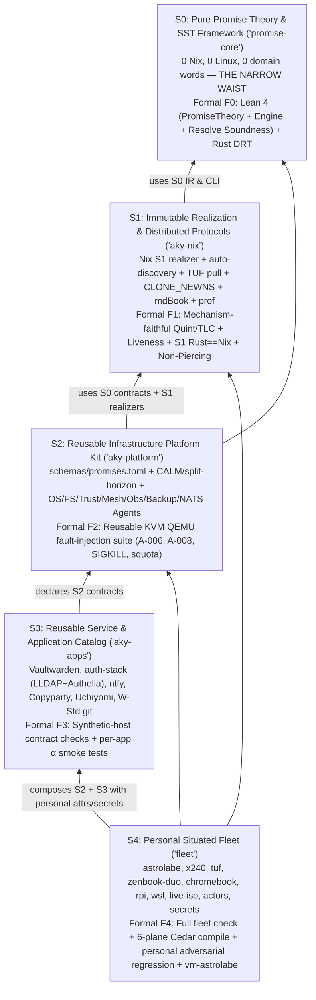

<!-- abstract:start -->
## Executive Abstract

Conducts an unvarnished, first-principles audit of Antikythera (`W2.1`, [`EXP-0015`](../experiments/EXP-0015-w2-full-platform-pure-primitive-integration-skeleton.md)) covering four essential questions before Phase 4 implementation:

1. **Concrete End-to-End Mechanics**: Four complete step-by-step traces — adding a brand-new stateful app (`Uchiyomi` / `Vaultwarden`), onboarding a heterogeneous host (`zenbook-duo` / `rpi`), compile-time vs. 3 AM runtime failure handling, and ephemeral human vs. AI `aky with` sessions — showing exactly how one promise cascades across all planes.
2. **Honest Strengths & Weaknesses Audit**: Balances 6 genuine structural strengths against **7 real weaknesses** (`S1` dual-implementation maintenance under `ERG-L2`, `P-Explicit` re-export verbosity on deep stacks like `obs-hub`, unverified imperative `interior.nix` side effects, untyped JSON payloads until `ERG-L2`, atomic principal auth blind spot on `actor-gha-ci`, cognitive footprint of 15 integrated tools, and Phase-4-deferred KVM tests `A-006`/`A-008`).
3. **Brutal Formal Verification Audit**: Evaluates [`v2/formal/`](../../v2/formal/) against **CertiKOS Certified Abstraction Layers** (Gu et al., POPL 2015), **AWS Cedar VGD** (Cutler et al., OOPSLA 2024), and **Amazon TLA+** (Newcombe et al., CACM 2015) — exposing **6 concrete formal gaps**: (1) vacuous/tautological Quint invariants in `capability_session.qnt` & `lifecycle_recovery.qnt`, (2) missing Lean 4 **Progress & Preservation (`checkAgentTree → resolveTree`)** type-soundness proof, (3) dead `HandlerRule` formal code & disconnected `Spacetime` DRT, (4) missing temporal **liveness** proofs & missing TLC run on `triadic_pull.qnt` in CI, (5) pure Promise Theory conflated with stack extensions in `Aky/Spec/`, and (6) `Agent.atomic` auth-principal blind spot.
4. **Literature-Backed 5-Scope Certified Stratification (`S0`–`S4`) & Repo Extraction Strategy**: Synthesizes **Parnas (1979)** (*Family of Programs & Acyclic Uses Relation*), **Akhshabi & Dovrolis (2011)** (*Hourglass Narrow Waist*), **CertiKOS CAL (2015)** (*per-scope formal verification*), and **Potvin & Levenberg (CACM 2016) + Fowler** (*Library Extraction Timing*) to define **5 clean, independently useful scopes (`S0` Pure Promise Theory Framework → `S1` Nix/Distributed Realization Engine → `S2` Reusable Platform Kit → `S3` App/Service Catalog → `S4` Personal Fleet)**, recommending an **extract-ready fenced workspace during Phase 4** (or immediate 2-repo Framework vs. Personal Fleet split) graduating into **3 clean independent repos (`promise-core` ← `antikythera` ← `fleet`)** once `S0` stabilizes — capturing strict scope purity with zero premature lockstep churn.
<!-- abstract:end -->

# RES-0025: Full Architectural Audit, End-to-End Walkthroughs, Formal Review & Scope Stratification

---

## 1. Philosophy & How It Works End-to-End (Four Concrete Walkthroughs)

### Core Philosophy in One Paragraph
Traditional infrastructure-as-code (and NixOS module systems) is **imperative and global**: modules reach into a shared global `config` tree to command each other (`services.caddy.virtualHosts.*`, `environment.persistence.*`, `sops.secrets.*`), which couples unrelated subsystems, busts build caches, and turns security/state invariants into tribal knowledge. Antikythera replaces global mutation with **Burgess & Bergstra's Promise Theory** (*Autonomy*: an agent ONLY makes promises about its own behavior — `+b` what it offers/declares, `-b` what it voluntarily uses/observes — bounded by a non-piercing surface $\Sigma$!) combined with **Hard Enforcement** (Dolstra immutable closures, Cedar `L3+` `forbid`-dominant policies, TUF supply-chain signing, and Linux kernel isolation).

---

### Walkthrough A — Adding a Brand-New Stateful Web App (`Uchiyomi`) End-to-End
Suppose you want to deploy a brand-new manga server **`uchiyomi`** on `astrolabe` (public HTTPS, encrypted secret, durable SQLite/library directory, health check, RAM cap, docs).

1. **What You Write (ONLY 2 files for `uchiyomi`, +1 line in `astrolabe`)**:
   - You create `agents/uchiyomi/agent.toml` (with `ERG-L2` ~25 lines, raw ~75 lines) declaring **strictly `uchiyomi`'s own autonomous promises** — **ZERO edits** to Caddy, SOPS, Impermanence, Btrfs, Restic, `aky-pull`, `vmalert`, `Perses`, or `mdBook`:
     - **`+http:route "uchiyomi"`** (`Partitioned`, `tags = ["zone:public"]`, `payload = { subdomain = "read", port = 4567 }`)
     - **`+state:persist "/var/lib/uchiyomi"`** (`Broadcast`, `tags = ["survives-reboot", "backup-required", "btrfs-snapshot", "single-auth-writer"]`, `payload = { path = "/var/lib/uchiyomi", prepare_cmd = "sqlite3-backup" }`)
     - **`+secret:claim "uchiyomi-auth"`** (`Broadcast`, `tags = ["class:auth", "env:prod"]`)
     - **`+probe "uchiyomi-alive"`** (`Broadcast`, `tags = ["http", "advisory", "tier1"]`, `payload = { target = "http://127.0.0.1:4567/health", slo = 0.995 }`)
     - **`+doc:link "uchiyomi"`** (`Broadcast`, `tags = ["doc:sst-near"]`, `payload = { adrs = ["ADR-0014"], runbooks = ["backup-restore-drill"] }`)
     - **`-proxy:public`**, **`-secrets:runtime`**, **`-storage:durable`**, **`-backup:provider` (`offhost`)**, **`-ram` (`256 MiB`, `priority = 1`)**
   - You create `agents/uchiyomi/interior.nix` returning a pure NixOS attrset `{ nixos = { services.uchiyomi = { enable = true; port = 4567; ... }; }; }` (no `{ config, ... }:` backdoor!).
   - You add `{ agent = "uchiyomi" }` to `agents/astrolabe/agent.toml`.

2. **What Happens Automatically at T + 5 ms (`aky check` + `aky project` + `aky graph`, ZERO Nix eval!)**:
   - **`B3` Binding Verifier**: Proves `caddy-public` (and ONLY `caddy-public`, never `caddy-mesh`) matches `uchiyomi`'s `Partitioned` route; proves `trust-sops`, `fs-impermanence`, `fs-btrfs-btrbk`, `backup-restic`, `obs-perses`, `obs-vmalert`, `obs-fluent-node`, and `docs-mdbook` all bind without conflict; proves `astrolabe`'s total RAM demand stays well under `11,264 MiB`.
   - **Declarative Invariants**: Proves `/var/lib/uchiyomi` satisfies CALM (`single-auth-writer`) and `http:route` satisfies `split-horizon-disjoint-zones`.
   - **Cedar `L3+` Structural Auth**: Checks `isAuthorized(astrolabe, "read-secret", uchiyomi-auth)` → **`Allow`**. (`aky project read-secret` automatically emits `.sops.yaml` granting ONLY `astrolabe` decryption rights to `uchiyomi-auth`!)
   - **SST $\gamma(3,4)$ Spine (`aky graph`)**: Auto-updates `CONTAINS`, `FOLLOWS`, `EXPRESSES`, and `NEAR` links (`mdBook` docs update out-of-Git on next build).

3. **What Happens Automatically at Nix Evaluation (`lib/realize.nix`, `S1`-equivalent to Rust!)**:
   - **`caddy-public`** auto-adds `read.adje.app -> 127.0.0.1:4567`.
   - **`trust-sops`** auto-adds `sops.secrets."uchiyomi-auth"`.
   - **`fs-impermanence`** auto-adds `/var/lib/uchiyomi` to `environment.persistence."/persist".directories`.
   - **`fs-btrfs-btrbk`** auto-adds `/var/lib/uchiyomi` to local Btrfs snapshots.
   - **`backup-restic`** auto-adds `/var/lib/uchiyomi` (with `sqlite3-backup` hook) to R2 WORM + `hbox` backups.
   - **`obs-vmalert` + `obs-perses`** auto-generate MWMBR SLO alerts & dashboard panels for `uchiyomi-alive`.
   - **`gitops-aky-pull`** sees `uchiyomi-alive` is tagged `advisory` (not `critical`), so a bug in `uchiyomi` won't roll back `vaultwarden`/`sshd`, whereas marking it `critical` would automatically promote it to a rollback gate!
   - **Cache Isolation**: `x240`, `tuf`, `rpi`, `wsl`, `live-iso`, and standalone `git` `.drv` hashes stay **100% bit-for-bit identical** (`0` cross-host rebuilds!).

4. **What Happens in CI → Production (`P-AkyPull`)**:
   - PR passes `aky check`, `s1-binding-equiv`, `dix` closure diff, `gitleaks`, and QEMU `vm-astrolabe`.
   - On merge to `main`, GitHub Actions builds `astrolabe`, uploads NARs via OIDC to `niks3` → Cloudflare R2 (`antikythera-cache`), and signs the TUF Snapshot Manifest (`epoch = E+1`).
   - Within 5 min, `astrolabe`'s `aky-pull.timer` fetches directly from R2 CDN (zero dependency on local `niks3` write server!), verifies TUF signature + `E+1 > max_seen_epoch`, persists `max_seen_epoch = E+1` to `/persist/var/lib/aky-pull`, activates atomically, runs all `critical` $\alpha$ probes, and commits!

---

### Walkthrough B — Onboarding a New Heterogeneous Host (`zenbook-duo` or `rpi`)
1. Write `agents/zenbook-duo/agent.toml` (`attributes = ["auth:principal", "role:workstation", "role:mesh-member", "posture:roaming", "env:dev"]`, `profiles = ["base-workstation"]`, RAM `32768`, hostname `"zenbook-duo"`, exterior uses `mesh:control`, `cache:cdn`, `obs-ingest`).
2. Add `{ agent = "zenbook-duo" }` to `agents/fleet/agent.toml`. **ZERO edits to `flake.nix`!**
3. `lib/realize.nix` auto-discovers `nixosConfigurations.zenbook-duo` from `target:os.payload.arch = "x86_64-linux"`, automatically injects `obs.astrolabe.tailnet.ts.net:9428` from `astrolabe`'s `Π_ext` into `obs-fluent-node` and `https://cache.adje.app` from `ext-cloudflare-r2` into `gitops-aky-pull`, and `aky project` automatically restricts `zenbook-duo` to roaming secrets only.
4. Boot untrusted `live-iso` (0 prod secrets) → format LUKS2+TPM2-PIN → generate host key → verify custody → commit pubkey → converge to $g_0$.

---

### Walkthrough C — When Things Break (Compile-Time Rejection vs. 3 AM Runtime Failure)
- **Compile-Time (`4 ms`, zero Nix)**:
  - Wire `vaultwarden` onto roaming `x240` → `aky check` immediately rejects with `UnauthorizedPromise { binding_id: "ab-read-secret", principal_id: "x240", key: "vaultwarden-master" }`.
  - Tag `obs-perses` with `["zone:public", "zone:mesh"]` → rejected simultaneously by `split-horizon-disjoint-zones` AND `OverlappingPartitionHandlers`.
  - Exceed `rpi`'s `1,024 MiB` RAM supply → rejected by `BudgetExceeded`.
- **Runtime (3 AM bad `nixpkgs` or kernel panic on `astrolabe`)**:
  - If `vaultwarden` fails `/alive` after switch → `P-AkyPull` rolls back atomically to `lastHealthy`, records `failedEpochs`, and fires `notify-ntfy`.
  - If the kernel panics before userspace → `systemd-boot.bootCounting` reboots into `lastHealthy`, `/persist/var/lib/aky-pull` remembers `max_seen_epoch = E+1`, refuses to re-pull `E+1` (no infinite boot loop!), and alerts while awaiting `E+2`.
  - If `tailscaled` fails completely → `caddy-public` (`vault.adje.app`) and public `sshd` (baked break-glass key) stay **100% online** because they have zero dependency on `tailscaled`!

---

### Walkthrough D — Ephemeral Human Session (`aky with`) vs. Attenuated AI Session
- Human runs `aky with sops-root github-cli` → `aky` synthesizes a transient Superagent (`attributes = ["auth:principal", "actor:human", "role:session", "mode:online"]`, `contains = [cap-runtime, cap-sops-root, cap-github-cli]`), verifies `B3` + Cedar in `< 2 ms`, enters an isolated Linux user+mount namespace (`CLONE_NEWNS`) with a private RAM `tmpfs` and `PR_SET_PDEATHSIG(SIGKILL)` `ssh-agent`. On shell exit, TTL expiry, or `kill -9`, the kernel atomically unmounts the private `tmpfs` with zero host residue.
- Trying `aky with breakglass github-cli` fails **twice**: Cedar `forbid-online-session-from-breakglass` AND `DuplicateOffer` on `Exclusive` `slot:ssh-agent`.
- AI bot (`actor-aky-agent-bot`, `actor:ai-agent`) runs `aky with obs-mcp` → allowed ONLY `obs-mcp-ro` (read-only Biscuit MCP); trying `cap-sops-root` or `cap-github-cli` is blocked by Cedar `forbid` both at check time and runtime.

---

## 2. Candid Strengths & Weaknesses Audit of Current `W2.1`

### Genuine Strengths
1. **Zero-Domain-String Mathematical Core**: All 8 modules of [`v2/crates/aky-core/src/`](../../v2/crates/aky-core/src/) and [`v2/formal/lean/Aky/Spec/`](../../v2/formal/lean/Aky/Spec/) contain **0 domain strings** (mechanically guarded by [`core_kernel_contains_zero_domain_strings`](../../v2/crates/aky-core/src/lib.rs#L17-L57)).
2. **True Multi-Scale Uniformity**: Processes/capabilities, devShells, standalone tools, service daemons, domain stacks (`auth-stack`, `obs-hub`), hosts (`astrolabe`..`live-iso`), CI/AI actors, external platforms, and the entire `fleet` all use ONE 7-field `AgentManifest` and ONE 4-cardinality `B3` algebra.
3. **Zero Ghost Offers & Single-Source Security**: Flipping `secret:claim`, `cap:claim`, `nats:claim`, and `agent:class` to declaring `+b` offers deleted all ghost host/session offers (`cap-admin-session` `47 → 10` LOC) and unified 6 security planes under ONE Cedar policy file.
4. **Empirical Cache Isolation & Resource Headroom**: Verified `0` cross-host `.drv` cache busts (`EXP-0015`), `−852 to −902 MiB` steady RAM saved on `astrolabe`, `~89.5 MiB` on `1 GiB` RPi, and `\$0.26–\$0.68/mo` R2 cost.
5. **Zero-Hardcoding Flake Auto-Discovery**: Adding a new host or devShell requires `0` edits to [`v2/flake.nix`](../../v2/flake.nix).
6. **Sub-10ms Static Feedback Loop**: Verifying all `63` agents / `14` superagents + Cedar auth + CALM + split-horizon takes **`5.59 ms`** without launching Nix.

### Genuine Weaknesses & Architectural Tension Points (Honest Critique!)
| # | Weakness | Concrete Evidence in `W2.1` | Impact & How to Address |
| :---: | :--- | :--- | :--- |
| **W-1** | **`S1` Dual-Evaluator Maintenance Risk** | [`fleet.rs`](../../v2/crates/aky-core/src/fleet.rs) (Rust) and [`realize.nix`](../../v2/lib/realize.nix) (Nix) duplicate `evalAttrExpr`, `expandChildren`, `bindChildUses`, and `resolveTree`. Adding `ERG-L2` desugaring duplicates the desugarer too! | Mitigated today by `s1-binding-equiv`, **but** worth watching: keep `ERG-L2` desugaring minimal (~80 LOC) OR evaluate whether Layer-1 `schemas/promises.toml` compiles into a tiny checked-in / deterministic Layer-0 IR JSON (`aky lock` vs. pure parallel Nix desugarer). |
| **W-2** | **`P-Explicit` Re-Export Friction on Deep Stacks** | [`obs-hub/agent.toml`](../../v2/agents/obs-hub/agent.toml) is **`211` lines raw** (`12` of its `20` promises re-export children's `state:persist` & `probe`). Adding a 7th service inside `obs-hub` requires editing both the leaf AND `obs-hub`. | Inherent trade-off of `Π_ext ⊥ Interior` (buying compositional substitution & cache isolation). `ERG-L2` shrinks `obs-hub` from `211 → ~55` lines; rule of thumb: **only wrap a Dressed Superagent when hiding real internal protocols** (`obs-hub`, `auth-stack`), use transparent `profiles` otherwise. |
| **W-3** | **Imperative Side Effects Inside `interior.nix` Are Unverified Statically** | `assertNonPiercingNixos` blocks `{ config, ... }:`, **but** an atomic `interior.nix` can still write arbitrary NixOS options (e.g., use 4 GiB RAM while declaring `ram = 64`, or open an undeclared firewall port). | Promise Theory verifies *declared contracts*; bridging contracts to OS truth MUST be enforced by **runtime confinement** (`MemoryMax=` generated from `ram`, tmpfs impermanence wiping undeclared `/var/lib/*`, firewall allowlists generated from `http:route`/`mesh:service`, and QEMU inspection tests). |
| **W-4** | **Untyped Promise `payload` Until `ERG-L2`** | `PromiseSpec.payload` is untyped `serde_json::Value`; a typo like `port = "8222"` passes `aky check` and only fails in Nix. | Closed cleanly by `ERG-L2` (`schemas/promises.toml` payload schema validation inside `aky check`!). |
| **W-5** | **Atomic Principal Auth Blind Spot (`actor-gha-ci`)** | [`checkAgentTree`](../../v2/formal/lean/Aky/Spec/Binding.lean#L219-L234) runs `isScopeAuthValid` on `Agent.superagent`, NOT `Agent.atomic`! Atomic [`actor-gha-ci`](../../v2/agents/actor-gha-ci/agent.toml) (`attributes = ["auth:principal", ...]`) was audited by `aky project`, NOT directly by `aky check`. | **Concrete kernel bug caught by this audit!** Fix in Lean + Rust: check `isScopeAuthValid` on `Agent.atomic` whenever `principalFilter.eval ext.attributes` matches! |
| **W-6** | **Total Cognitive Surface Area Across 15 ADRs** | Even after deleting Attic/Cachix/B2/Alloy/Grafana, the full stack integrates Lean 4, Quint, Rust, Nix, Tailscale, R2, `niks3`, Restic, `btrbk`, `git-annex`, NATS, VictoriaStack, Perses, DuckDB, and mdBook. | Manageable ONLY if **cleanly stratified into independent scopes (`S0`–`S4`)** so working on `S4` (adding `uchiyomi`) never requires thinking about `S0` Lean proofs or `S1` realizer internals! |
| **W-7** | **`W2.1` Interiors Are Still Metadata Stubs (`A-006`/`A-008` Unrun in KVM)** | Most `v2/agents/*/interior.nix` currently emit `/etc/aky/*.json` rather than booting real `tailscaled`/`sops-nix`/`niks3`/`Perses` services in KVM QEMU. | Expected for Phase 3 (`W2` is an architectural integration skeleton); real NixOS modules + KVM QEMU gates are Phase 4 Wave 1. |

---

## 3. Brutal Formal Verification Audit ("Is It Up to Standards? Is It Useful?")

Measuring [`v2/formal/`](../../v2/formal/) ruthlessly against **CertiKOS Certified Abstraction Layers** (Gu et al., POPL 2015), **AWS Cedar VGD** (Cutler et al., OOPSLA 2024), and **Amazon TLA+** (Newcombe et al., CACM 2015):

### What Already Earns Real Engineering Value
- **AWS Cedar VGD Differential Testing (`514/514`, `0` divergences)**: Already caught 4 real bugs during `W2`/`W2.1` development (`O-1`..`O-4`) and guarantees our Rust verifier cannot drift silently from our proved Lean 4 spec.
- **High-Value Core Theorems**: `forbid_overrides_permit`, `delegation_respects_delegatee_forbid`, `isScopeValid_perm` (order-invariance), `broadcast_subscriber_non_interference`, `stCompose_assoc`, `near_never_forges_causality_or_containment`, and `checkAgentTree_substitution_invariant`.
- **`triadic_pull.qnt`**: Models real distributed hazards (compromised mirror, forged closure, mid-switch crash, `failedEpochs` boot-loop suppression, `niks3` write-server outage).

### 6 Concrete Formal-Methods Gaps (Where We Are NOT Yet Up to Top Standards!)

| Gap | Exact Diagnosis in [`v2/formal/`](../../v2/formal/) | Why It Matters (Literature Standard) | Concrete Fix (Scoped Cleanly by `S0`–`S4`!) |
| :---: | :--- | :--- | :--- |
| **F-1: Vacuous / Tautological Quint Models** | In [`capability_session.qnt`](../../v2/formal/quint/capability_session.qnt), `secretResidueOnHost` is initialized to `false` and hardcoded to `false` in EVERY action! `invZeroResidueOnHost` is true by tautology — TLC cannot falsify a bug! Similarly [`lifecycle_recovery.qnt`](../../v2/formal/quint/lifecycle_recovery.qnt) hardcodes `isoHasProdSecrets: false`. | **Newcombe et al. (CACM 2015)**: Formal models only add value when they model the *actual failure mechanism* so TLC produces concrete counterexamples on naive designs and verifies the hardened mechanism. | Model explicit `cleanupMode ∈ {"userspace_drop", "kernel_mount_ns"}` & `tmpfsLocation ∈ {"host_run", "private_ns"}`: prove TLC **falsifies** `"userspace_drop"` on `SIGKILL` (finding the exact leak trace!) and **verifies** `"kernel_mount_ns"` (`0` violations)! Same for `lifecycle_recovery.qnt` (model encrypted Vaultwarden vs. cold `recovery.sops.yaml` so TLC falsifies the Vaultwarden DR deadlock!). |
| **F-2: Missing Progress & Preservation (`checkAgentTree → resolveTree`)** | Lean 4 proves properties of `checkAgentTree` (the *checker*), but **never specifies or verifies `resolveTree` / `bindChildUses` (the *evaluator*)**! | **Wright & Felleisen (1994); CompCert; CertiKOS**: The defining theorem of a verified static analyzer is **Type Soundness (Progress)**: *"if `checkAgentTree` accepts a closed tree, `resolveTree` ALWAYS succeeds without runtime missing-promise errors AND respects non-piercing scope!"* | Add pure `Aky.Spec.Resolve` (`resolveTree`) to Lean 4 (`S0`), prove **`valid_closed_tree_resolves_safely`**, and lock Rust `resolve_target_bindings` directly into `aky-oracle` DRT! |
| **F-3: Dead Formal Code (`HandlerRule`) & Un-DRT'd `Spacetime`** | `HandlerRule` / `evalStratified` in [`Aky/Spec/Binding.lean`](../../v2/formal/lean/Aky/Spec/Binding.lean#L43-L250) is never called by Rust or Nix (`stratum_rules: []`). Conversely, Rust [`spacetime.rs`](../../v2/crates/aky-core/src/spacetime.rs) is NOT wired into `aky-oracle` DRT! | Dead specs rot and create false confidence; un-DRT'd Rust modules (`spacetime.rs`) lack equivalence assurance. | Remove or cleanly separate unused `HandlerRule` until multi-stratum codegen actually exists; wire `projectAgentSST` + `stCompose` + `impactCone` into `Aky/Oracle/Protocol.lean` DRT! |
| **F-4: Missing Temporal Liveness & Missing TLC on `triadic_pull.qnt` in CI** | [`v2/flake.nix`](../../v2/flake.nix#L126-L132) runs only `quint test` (simulation) on `triadic_pull.qnt` (not TLC!) and ZERO Quint models verify **temporal liveness** (`eventually` convergence after network heal). | Safety alone is trivially satisfied by a system that does nothing forever! Real distributed specs check **Safety + Liveness** under weak fairness. | Add a bounded TLC run of `triadic_pull.qnt` (`HOSTS = {"astrolabe"}`, `MAX_EPOCH = 3`) in `quint-check` + explicit temporal liveness invariants (`eventuallyHealthyConvergence`). |
| **F-5: Pure Promise Theory Conflated with Stack Policy in `Aky/Spec/`** | `Aky/Spec/Agency.lean` mixes universal Burgess Promise Theory (Agents, Promises, Polarity, Scope, Imposition rejection, Assessments, Superagent Non-Piercing) directly with our specific stack extensions (`Budgeted` priority-0 OOM, `AttrExpr` Cedar `AuthBinding`). | **Bergstra & Burgess (*Static Theory of Promises*, 2008–2014); Parnas (1979)**: Conflating universal calculus with stack-specific policy prevents reusing the pure theory independently. | Split `S0`'s Lean 4 cleanly into `PromiseTheory/*` (pure Burgess/Bergstra calculus: Autonomy, Imposition vs. Cooperation, Conditional Law, Superagent Scale-Invariance, SST $\gamma(3,4)$) ← `PromiseEngine/*` (`B3` Binding, `AttrExpr`, Cedar/Biscuit, `Resolve` Soundness)! |
| **F-6: Atomic Principal Auth & Tight Outbound Sinks** | `checkAgentTree` skips `isScopeAuthValid` on `Agent.atomic` (missing `actor-gha-ci`); `outboundFromExterior` matches by `ptype` rather than exact exported keys/tags. | Every `auth:principal` boundary (atomic OR superagent) should be uniformly audited. | Add 2-line `isScopeAuthValid` check to `Agent.atomic` in `Binding.lean` + `binding.rs` + tighten `outboundFromExterior` key/tag matching. |

---

## 4. Literature-Backed 5-Scope Certified Stratification (`S0`–`S4`)

### Theoretical Grounding
Four classic computer-science results converge on the exact right scope architecture:
1. **David Parnas (1979, *Designing Software for Ease of Extension and Contraction*)**: Design a system as a **family of programs** structured by a **strictly acyclic "uses" relation** (`S0 ← S1 ← S2 ← S3 ← S4`), where every lower scope forms a **complete, independently useful minimal subset** completely ignorant of higher scopes.
2. **Akhshabi & Dovrolis (2011, *Hourglass Architecture / Narrow Waist*)**: Layered ecosystems achieve maximal reuse and longevity when they converge on a **small, ultra-stable, formally verified "narrow waist"** (`S0`: Pure Promise Theory + SST + Cedar + Verified IR) while allowing rapid innovation above (`S1`–`S4`) and diverse backends below (Nix, Kubernetes, containers, Wasm, human orgs).
3. **Gu et al. (POPL 2015 / OSDI 2016, *CertiKOS Certified Abstraction Layers*)**: Formal verification scales **horizontally and vertically across scopes** when **each scope $S_k$ owns its own formal layer $F_k$** (specification + local proofs + refinement/conformance check against $S_{k-1}$'s interface), rather than stuffing all formal methods into one monolithic folder.
4. **Potvin & Levenberg (CACM 2016) & Martin Fowler (*MonolithFirst / Library Extraction Timing*)**: *Code storage (monorepo vs. polyrepo) is NOT the same as architectural modularity!* Splitting into 5 polyrepos **before** `S0`/`S1` APIs stabilize triggers severe **versioning tax & lockstep `flake.lock` churn** — whereas **strictly fenced, independently buildable sub-flakes/workspaces** give 100% hard scope isolation *immediately* and make graduating `S0` (and `S1`) into standalone public GitHub repos a 1-command `git subtree split` once mature!

---

### The 5 Clean Certified Scopes (`S0`–`S4`)

| Scope | Candidate Standalone Name | What Lives Here (Strict Parnas Boundary) | Per-Scope Formal Pillar (`CertiKOS CAL`) | Completely Different Use Cases Enabled! |
| :---: | :--- | :--- | :--- | :--- |
| **`S0`** | **`promise-core`** *(Narrow Waist — Universal Promise Theory Framework)* | Pure Lean 4 (`PromiseTheory` + `Engine` + `Resolve`), pure `std::fs`-free Wasm-ready Rust `promise-core` crate, `promise-cli` (`check`, `resolve`, `explain`, `blast-radius`, `project`, `graph`, `drt`), Layer-0 IR spec, and **data-driven `ERG-L2` schema desugarer** (taking ANY user `schemas/*.toml`!). **ZERO Nix, ZERO Linux, ZERO domain words!** | **`F0` (Static Mathematical Truth)**: Lean 4 proofs (`0 sorryAx`), **Progress & Preservation (`checkAgentTree → resolveTree`)**, `Agent → SST` DRT, `ERG-L2` desugaring totality, AWS Cedar DRT (`0` divergences). | Kubernetes/Nomad topology verifier, Terraform/IaC policy checker, microservice architecture linter, multi-agent AI capability governance, human org design modeling, or NixOS (`S1`)! |
| **`S1`** | **`aky-nix`** *(Nix & Linux Realization Runtime)* | Zero-IFD pure-Nix `lib/realize.nix` (auto-discovering `nixosConfigurations`, `W-Std` packages, `pkgs.mkShellNoCC` `devShells`), `assertNonPiercingNixos`, `aky-pull` TUF convergence daemon, `aky with` Linux `CLONE_NEWNS` supervisor, `aky doc` `mdBook` SST generator, `aky prof` Nix build/eval profiler, and `aky` unified CLI wrapping `promise-cli`. **ZERO opinions on Tailscale, Restic, VictoriaMetrics, or Vaultwarden!** | **`F1` (Distributed & OS Mechanism Safety + Liveness)**: Mechanism-faithful Quint/TLC + temporal liveness (`triadic_pull.qnt`, `capability_session.qnt` falsifying userspace `Drop` vs. verifying `CLONE_NEWNS`, `lifecycle_recovery.qnt`), Nix `S1` Rust == Nix equivalence, `assertNonPiercingNixos` proof tests. | **Any NixOS user/team** wanting formal non-piercing NixOS composition, TUF pull deployments, `CLONE_NEWNS` ephemeral secret shells, and `mdBook` doc extraction — with *their own* choice of mesh, backup, or monitoring stack! |
| **`S2`** | **`aky-platform`** *(Reusable Self-Hosted Infrastructure Kit)* | User-space `schemas/promises.toml` (`state:persist`, `probe`, `http:route`, `secret:claim`, `mesh:service`, `ram`, `doc:link`), reusable `policies/platform.toml` (`CALM`, `split-horizon`), orthogonal substrates (`target-nixos-*`, `fs-*`), Trust (`trust-sops`, `cap-*`), Mesh (`mesh-tailscale`, `caddy-{public,mesh}`), GitOps/Cache (`gitops-aky-pull`, `cache-niks3`, `cache-harmonia-dev`), Storage/Compute (`backup-restic`, `sync-git-annex`, `compute-nats-*`), Observability (`obs-hub`, `obs-fluent-node`), Docs (`docs-mdbook`), `dev-*` shells. **ZERO personal hostnames, domains, or keys!** | **`F2` (Runtime OS Contract Verification)**: Reusable KVM QEMU fault-injection test suite verifying `A-006` offline boot, `A-008` `P-AkyPull` boot-counting rollback, `COL-FluentNode` `SIGKILL` recovery, Restic `keepDaily > wormLockDays`, Btrfs `squota` enforcement, and generic Cedar policy unit tests. | **Any self-hoster / homelab / small-team operator** wanting a turnkey, low-RAM (`~1 GiB` VPS / `~89 MiB` RPi), `< \$2/mo` R2, formally verified NixOS platform! |
| **`S3`** | **`aky-apps`** *(Portable Verified App & Service Catalog)* | Pure, personal-data-free Service Agents & Domain Stacks (`vaultwarden`, `auth-stack` [`lldap`+`authelia`], `notify-ntfy`, `copyparty`, `uchiyomi`, standalone `W-Std` `git`, etc.) written strictly against `S2` contracts. | **`F3` (Per-App Conformance)**: Synthetic minimal-host `aky check` + per-app $\alpha$ health probe VM smoke tests. | Community-shareable catalog of non-piercing NixOS service Agents & standalone `nix run` CLI apps! |
| **`S4`** | **`fleet`** *(Your Personal Situated Fleet)* | `fleet`, `astrolabe` (`adje.app`), `x240`, `tuf`, `zenbook-duo`, `chromebook`, `rpi`, `wsl`, `live-iso`, `actor-{lw,gha-ci,aky-agent-bot}`, personal `policies/fleet.toml`, encrypted `secrets/*.sops.yaml` (incl. cold `recovery.sops.yaml`), and one-off hardware quirks. | **`F4` (Living Fleet Gate)**: Full `aky check` + 6-plane Cedar projection (`sops`, `policy.hujson`, NATS) + `aky graph` + personal adversarial regression suite + full `vm-astrolabe` / `vm-x240` QEMU gates. | Your clean, minimal personal infrastructure repository — purely *consuming* `S0`–`S3` without carrying any framework plumbing! |

---

### Repository Topology Analysis (When & How to Split Repos!)

| Topology Option | Structure | Pros | Cons (Potvin & Levenberg / Fowler) | Verdict |
| :--- | :--- | :--- | :--- | :--- |
| **Option T-A: Immediate 5 Polyrepos** | 5 separate GitHub repos (`promise-core`, `aky-nix`, `aky-platform`, `aky-apps`, `fleet`) from Day 1 of Phase 4 | Maximum physical isolation immediately | **Severe premature extraction tax!** Every Phase-4 iteration across `S0`/`S1`/`S2` requires 3–5 chained commits, `flake.lock` bumps, and CI runs; slows solo developer dramatically. | **Not Recommended Now** *(premature)* |
| **Option T-B: Strictly Fenced Stratified Monorepo → Graduate to 3 Repos at `v1.0`** *(Recommended for Phase 4 velocity + zero pollution!)* | **One repo** during Phase 4 with **5 independently buildable sub-flakes/directories** (`scopes/s0-promise-core/`, `scopes/s1-aky-nix/`, `scopes/s2-platform/`, `scopes/s3-apps/`, `scopes/s4-fleet/`) + hard CI isolation check (`cd scopes/s0-promise-core && nix flake check` runs with **0 access** to `s1..s4`!). After Wave 5 (`M1-Sunset`) stabilizes, `git subtree split` graduates **`promise-core` (`S0`)** and **`antikythera` (`S1+S2+S3`)** into standalone public repos, leaving **`fleet` (`S4`)** tiny! | **Best of both worlds!** Zero lockstep churn during active Phase 4 development + 100% hard mechanical scope isolation enforced by independent sub-flakes + effortless 1-command repo split when APIs mature! | Requires maintaining clean sub-flake boundaries inside the workspace (trivial and enforces good hygiene!). | **Recommended (Default)** |
| **Option T-C: Immediate 2-Repo Split (Public Framework `S0..S3` Fenced + Private/Personal `S4` Fleet)** | **Repo 1 (`LW-54/antikythera`)**: fenced `s0-promise-core` + `s1-aky-nix` + `s2-platform` + `s3-apps` (100% public, zero personal data!). **Repo 2 (`LW-54/fleet`)**: strictly `S4` personal hosts, domains, and `secrets/*.sops.yaml`, pinning `antikythera` as 1 flake input! Later split `s0-promise-core` out to `LW-54/promise-core` when mature. | Immediate hard separation between **open-source reusable engineering (`S0..S3`)** and **personal hosts/secrets (`S4`)**; forces you from Day 1 to eat your own dogfood as a pure consumer of Antikythera; only 1 lock boundary (`fleet → antikythera`) instead of 5! | Minor 1-hop `nix flake update antikythera` when changing `S2` platform contracts while testing on `astrolabe` (easily bypassed locally with `--override-input antikythera path:../antikythera`). | **Strong Alternative** *(great if you want public framework + private/separate fleet from Day 1!)* |

---

## 5. Summary of Actionable Decisions Before Locking `ADR-0017`

1. **Formal Verification Upgrades (Before or Early in Phase 4)**:
   - Close all **6 Formal Gaps (`F-1`–`F-6`)**: replace vacuous Quint invariants with real falsifiable mechanism models (`userspace_drop` vs. `CLONE_NEWNS`, Vaultwarden DR deadlock vs. `recovery.sops.yaml`), add bounded TLC + temporal liveness to `triadic_pull.qnt`, add Lean 4 **`resolveTree` Progress & Preservation**, wire `Spacetime` into DRT & remove dead `HandlerRule`, and fix `Agent.atomic` principal auth (`actor-gha-ci`)!
2. **Adopt the 5-Scope Certified Stratification (`S0`–`S4`)** with per-scope formal verification (`F0`–`F4`), keeping **`S0` (`promise-core`)** as the universal, Nix-free Narrow Waist.
3. **Choose Repository Topology (`T-B` Fenced Stratified Monorepo → 3-Repo Graduation at `v1.0` vs. `T-C` Immediate 2-Repo Framework + Personal Fleet Split vs. `T-A` Immediate Polyrepos)**.
