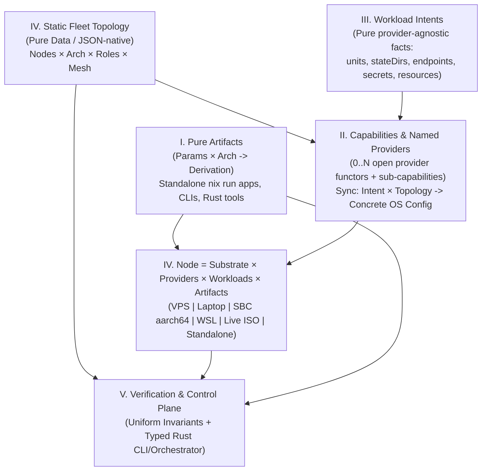

<!-- abstract:start -->
## Executive Abstract

Derives the foundational primitives and composition algebra of `nixconf` v2 from a complete blank sheet (zero presuppositions of current `primitives/`, `modules/`, `meta/`, `flake-parts`, or `dendritic`). Rather than Nix-file organizational buckets, first-principles domain analysis reveals **five orthogonal, irreducible primitive categories**: (1) **Artifacts** (standalone platform-indexed packages/wrapped apps runnable anywhere via `nix run`), (2) **Capabilities & Named Providers** (open, multi-instance polymorphic interfaces supporting 0..N simultaneous backends & sub-component swapping), (3) **Workload Intents & Synchronizations** ($O(N+M)$ declarative projection eliminating N×M service glue), (4) **Substrates, Nodes & Static Fleet Topology** (orthogonal arch × OS-form-factor × static JSON-native fleet graph eliminating cross-host eval coupling), and (5) **Verification & Control Plane** (uniform invariants + typed Rust execution layer). Explores a 6-dimension Zwicky morphological space (Pure Nix vs Nickel/CUE vs Hybrid Nix+Rust; Raw `evalModules` vs `flake-parts`+partitions vs `clan-core`; Standard `flake.lock` vs `.tack` vs `npins`), validated empirically via `EXP-0001` (175ms multi-provider prototype), and presents 3 crisp architectural forks for user co-design under the `B > E > D > A > C` priority hierarchy.
<!-- abstract:end -->

# RFD-0001: Fundamental Ontology, Primitives & Composition Algebra

## 1. Fundamental Problem Statement

Design the irreducible core primitives and composition algebra for a long-lived personal & multi-host infrastructure system that must simultaneously deliver:
- **Standalone universal portability (`QA-09`)**: tools, wrapped applications, and dev environments runnable anywhere (`nix run`) with zero host coupling.
- **Heterogeneous fleet portability (`QA-03`)**: `x86_64` VPS, bare-metal laptops (including hybrid GPU & dual-screen OLED), tablet/Chromebook (unknown arch/OS), `aarch64` Raspberry Pi, diskless/bootloader-less `NixOS-WSL`, and ephemeral Live USB ISOs.
- **Deep component & sub-component polymorphism (`QA-02`)**: cleanly swapping backends *and* running multiple implementations of the same capability concurrently on one host.
- **Zero-entanglement clarity (`QA-01`, `X1`–`X3`)**: simple, precise, orthogonal primitives with no shallow DSL wrappers, no hidden global backchannels, and no $O(N \times M)$ service glue.
- **Priority ordering**: **Reliability (`B`) > Capability Richness (`E`) > Low Maintenance / Dependency Risk (`D`) > Elegance (`A`, reconciling the above) > Iteration Speed (`C`)**.

---

## 2. Formal Shape of the Underlying Problem: Five Irreducible Primitive Categories

Stepping back from Nix syntax entirely, any declarative fleet + portable-tooling system consists of **five mathematically orthogonal categories** (not one monolithic "module" bucket):

### Category I — Pure Artifacts (`Params × Platform → Derivation`)
- **Essence**: Context-free, immutable, pre-configured executables, wrapped apps (`nix-wrapper-modules`), dev environments, compiled Rust binaries, and system images (`isoImage`, `sdImage`, WSL tarball).
- **Operational Principle**: Depends ONLY on `pkgs` + explicit parameters — **zero** reference to NixOS, systemd, hosts, or `$HOME`.
- **Emergent Corollary**: Every portable tool (`git`, `foot`, `micro`, `zed`, `agy`, `nixprof`, etc.) is usable standalone from *anywhere* via `nix run`, and hosts merely reference the exact same artifact (eliminating host-vs-standalone duplication forever).

### Category II — Capabilities, Sub-Capabilities & Named Providers (Open Polymorphism)
- **Essence**: A **Capability** is a typed interface (Daniel Jackson *Concept* / ML *Signature*). A **Provider** is an open, first-class parameterized module/functor implementing a Capability (or a composable **Sub-Capability**).
- **Why v1 failed**: Modeling contracts as global singletons forced 1:1 lock-in (`noConflict = length <= 1`) and fused 7,300 LOC of Grafana JSON into the `monitoring` contract.
- **Emergent Corollaries**:
  1. **Multi-instance by construction**: A host instantiates `0, 1, or N` named instances per capability (e.g., `ingress.public = caddy` AND `ingress.mesh = tailscaleServe`; `backup.offsite = restic` AND `backup.local = btrfsSnapshots`).
  2. **Sub-component swapping**: Composite domains decompose into orthogonal sub-capabilities (e.g., `telemetry` = `collector` × `metricsStore` × `logStore` × `alertRouter` × `visualizer`), so swapping Grafana → Perses or Alloy → Vector touches *only* that sub-provider.
  3. **Test mocking without `isTest` hacks**: Testing swaps `secrets.default` from `sops` → `mock` cleanly with zero conditional branches in workloads.

### Category III — Workload Intents & Declarative Synchronizations ($O(N + M)$)
- **Essence**: Services/workloads declare **pure facts (Intent)** — `units`, `stateDirs` (`persist`, `backup`), `endpoints` (`port`, `exposure`, `auth`, `healthPath`), `secrets`, `metrics`, `resources` — with zero knowledge of which providers exist.
- **Synchronizations**: Each active Provider projects over the Workload Intent registry automatically.
- **Emergent Corollary**: Wiring drops from **$O(N \times M)$** manual per-service glue (`mkOption`/`mkConfig` repeated 6× per service) to **$O(N + M)$**. Adding Tailscale mesh exposure or automated update policies requires writing **one** Synchronization, touching zero service files. *(Empirically verified in `EXP-0001` at 175ms with zero recursion.)*

### Category IV — Orthogonal Substrates & Pure Static Fleet Topology
- **Substrates**: Factor every target into `Arch` (`x86_64-linux` | `aarch64-linux`) × `Substrate` (`nixos-baremetal` | `nixos-vps` | `nixos-sbc` | `nixos-wsl` | `nixos-iso` | `standalone-user`) × hardware quirk modules (hybrid GPU, dual OLED, tablet sensors). Bootloader, disk partitioning (`disko`), and `impermanence` belong strictly to substrates that have them — never forced onto WSL or Live ISOs.
- **Pure Static Fleet Topology**: A lightweight, `nixpkgs`-free static data record (exportable to JSON in <2ms) declaring nodes, architectures, roles, domains, mesh addresses, public keys, and service relationships.
- **Emergent Corollary**: Zero cross-host NixOS evaluation coupling (eliminating `hub.nix` / `storage/cli.nix` dragging in every host), and a single source of truth shared cleanly between Nix, Rust CLI tooling, CI matrices, `.sops.yaml` / secret recipients, and mesh ACLs.

### Category V — Uniform Verification & Typed Control Plane
- **Essence**: Explicit boundary between **pure declarative evaluation** (Nix) and **typed imperative execution / static analysis / orchestration** (Rust consuming the exported JSON topology & manifests).
- **Emergent Corollary**: Eliminates 5,327 LOC of Nix graph code (`meta/graph/`), overlapping Bash wrappers, and untyped `internal.*` backchannels while enabling uniform verification across *all* layers (detailed in `RFD-0002` and `RFD-0003`).

---

## 3. Morphological Design Space (Zwicky Box)

| Dimension | Option A | Option B | Option C | Option D |
| :--- | :--- | :--- | :--- | :--- |
| **D1: Authoring & Execution Mediums** | **Pure Nix** for everything (config + analysis + scripts) | **Hybrid Seam: Pure Nix (builds/OS/Intent+Sync) + Pure Static Data (JSON-exportable Topology) + Typed Rust (CLI/graph/orchestration)** | **Nickel (`organist`)** compiling to Nix | **CUE** lattice compiling to Nix/JSON |
| **D2: Nix Composition Engine** | **Minimal Native `lib.evalModules`** + explicit imports (zero `flake-parts`, zero `import-tree`, zero 3-pass `primitives/` compiler) | **`flake-parts` + `partitions`** (standard flake module framework isolating dev/CI inputs into a sub-flake lock) | **Dendritic + `import-tree`** (flat auto-imported file tree) | **Adopt `clan-core`** (upstream NixOS fleet framework) |
| **D3: Capability Polymorphism** | Singleton contracts (1:1 like v1) | **Open Named Multi-Instance Providers + Sub-Capabilities** (0..N first-class provider functors) | Raw NixOS options only (no capability abstraction) | — |
| **D4: Service ↔ Capability Wiring** | Manual per-service helpers (`mkOption`/`mkConfig`) | **Declarative Workload Intent + Capability Synchronizations** ($O(N+M)$) | Monolithic opinionated service wrappers | — |
| **D5: Standalone Portability Layer** | Host-first NixOS modules + ad-hoc duplicate packages | **Artifact-first (`nix-wrapper-modules`)** + thin user file binding (`hjem` on NixOS, optional standalone `home-manager`/profile on non-NixOS) | Full `home-manager` for all user configs everywhere | — |
| **D6: Dependency Pinning & Lock** | **Standard `flake.nix` + `flake.lock`** (+ optional `partitions` sub-lock) | **`.tack/`** (`pins.toml` + `pins.lock.json` + vendored loader) | **`npins`** (non-flake core + thin `flake.nix` shim) | — |

### 3.1 Cross-Consistency Assessment (CCA — Pruning Dominated / Contradictory Regions)
1. **`D1=CUE` × NixOS**: Pruned — CUE is non-Turing-complete and cannot express lazy `pkgs` derivations or NixOS module fixed-points; adds a third language with no capability gain over Nix `lib.types` + Rust `serde`.
2. **`D1=Nickel (organist)` × Priority `B > E > D`**: Pruned — High translation impedance into 80k+ dynamic `nixpkgs` modules and immature ecosystem maintenance risk.
3. **`D2=clan-core` × (`QA-03` WSL + `QA-09` Standalone `nix run` + `X6` Low lock-in)**: Pruned — Deep `clan.core` module/Python CLI lock-in, weak WSL & standalone-package fit. *(We borrow Clan's best ideas — static Inventory & Named Multi-Instance Services — directly in ~150 LOC of native Nix we fully own!)*
4. **`D2=Dendritic/import-tree` × Anti-Entanglement (`AUD-0001`)**: Pruned — Empirically caused 226 untyped `internal.*` globals in v1 by erasing explicit module import graphs.
5. **`D3=Singleton` × `QA-02` (Multi-Instance & Sub-Component Swapping)**: Pruned — Mathematically incapable of concurrent providers (`caddy` + `tailscale-serve`, `restic` + `btrfs`).
6. **`D6=.tack` × (`QA-06` GitOps/Update Bots + `QA-09` `nix run github:...` + `X6` Standards)**: Heavily penalized — invisible to `nix flake metadata`, `nix flake update`, Renovate/Dependabot, and GitOps pull controllers; depends on a young 1,082-LOC vendored loader (`manic-systems/tack`).

---

## 4. Pareto Frontier: Three Serious Candidate Architectures

After CCA pruning, **three genuinely distinct, non-dominated candidates** remain on the Pareto frontier:

### Candidate 1 — **"Lean Native Algebra + Rust Control Plane"** *(Recommended)*
- **Profile**: `D1=Hybrid (Nix + JSON Topology + Rust)`, `D2=Minimal Native lib.evalModules + explicit imports (NO flake-parts, NO import-tree, NO 3-pass compiler)`, `D3=Open Named Multi-Instance Providers + Sub-Capabilities`, `D4=Declarative Intent + Synchronizations`, `D5=Artifact-First (nix-wrapper-modules) + thin OS/Home binding`, `D6=Standard flake.nix + flake.lock`.
- **What it looks like**:
  - Clean, transparent top-level `flake.nix` (~60–80 LOC) exporting standard `packages`, `devShells`, `nixosConfigurations`, `nixosModules`, `checks`, `lib` across `["x86_64-linux" "aarch64-linux"]`.
  - **Zero** `flake-parts`, **zero** `import-tree`, **zero** `flake-schemas`, **zero** `.tack/`, **zero** 4,874-LOC `primitives/` compiler, **zero** 226 `internal.*` globals!
  - Every dependency between files is an **explicit, visible Nix import or function argument** — crystal clear to both humans and LLMs.
  - Core Intent + Synchronization + Multi-Provider algebra is ~200–350 LOC of pure, readable `nixpkgs.lib.evalModules` code (proven in `EXP-0001`).
  - Static `topology` is pure data shared seamlessly with a unified Rust control-plane workspace (for verification, graph/impact queries, provisioning, profiling, and LLM introspection).

### Candidate 2 — **"Partitioned `flake-parts` + Intent/Sync + Rust Control Plane"**
- **Profile**: Identical to Candidate 1 on `D1`, `D3`, `D4`, `D5`, **except** `D2=flake-parts + partitions` and `D6=Split flake.lock (root + dev/flake.lock)`.
- **Key difference vs Candidate 1**:
  - Uses `flake-parts` (`perSystem`) and isolates heavy dev/CI/tooling inputs into a `dev/` partition so external `nix run github:LW-54/nixconf#git` consumers get a minimal root `flake.lock`.
  - **Trade-off**: Adds `flake-parts` abstraction layer + two `flake.lock` files to keep updated + known `nix flake check` partition quirks (`RES-0003`).

### Candidate 3 — **"Ultra-Minimal Vanilla NixOS (No Intent/Sync Layer)"**
- **Profile**: `D1=Hybrid (Nix + Rust)`, `D2=Plain flake.nix`, `D3=Raw NixOS options only (no capability abstraction)`, `D4=Direct upstream NixOS modules`, `D5=Artifact-first wrappers`, `D6=Standard flake.lock`.
- **Key difference vs Candidate 1**:
  - Zero custom Intent/Capability/Synchronization layer at all — services write raw `services.caddy.*`, `environment.persistence.*`, `services.restic.*` directly.
  - **Trade-off**: Lowest abstraction count, **but** loses swappable/multi-instance capabilities (`QA-02`), leaks impermanence/Caddy/SOPS directly into every service (breaking WSL/ISO/mock-test reuse), and brings back $O(N \times M)$ manual edits when adding Tailscale or changing monitoring/backup backends.

---

## 5. ATAM Trade-Off Matrix (Weighted by `B > E > D > A > C`)

| Candidate | Reliability (`B`, #1) | Capability Richness (`E`, #2) | Low Maint / Dep Risk (`D`, #3) | Elegance (`A`, reconciler) | Speed (`C`, #5) | Key Sensitivity & Trade-Off Points |
| :--- | :---: | :---: | :---: | :---: | :---: | :--- |
| **C1: Lean Native Algebra + Rust** | **High** | **High** | **Highest** (drops `flake-parts`, `import-tree`, `flake-schemas`, `.tack`) | **Highest** (~250 LOC core, explicit imports, zero globals) | **High** (`EXP-0001`: 175ms) | Requires disciplined explicit module exports & tiny `forAllSystems` helper (~15 LOC); single root `flake.lock` includes dev inputs (negligible with lazy flake eval, or split later only if needed). |
| **C2: Partitioned `flake-parts` + Rust** | Medium-High | **High** | Medium (extra framework + dual `flake.lock`) | Medium-High | High | Cleaner consumer `flake.lock` if external users import `nixconf` as a library, at the cost of dual lockfile maintenance & `flake-parts` indirection. |
| **C3: Vanilla NixOS (No Intent/Sync)** | Medium-High | **Low-Medium** (loses multi-provider & sub-component swap) | High (zero custom core) | Low-Medium (entangles services with impermanence/Caddy/SOPS) | High | Adding Tailscale or WSL forces conditional spaghetti across every service; loses `QA-02` & `QA-03`. |

---

## 6. Recommendation & Open Decision Forks for Co-Design

### Current Recommendation: **Candidate 1 (Lean Native Algebra + Rust Control Plane)**
- Achieves the rare mathematical win where **removing ~8,000+ LOC of indirection** (`primitives/` 3-pass compiler, `import-tree`, `flake-parts`, `flake-schemas`, `.tack/`, `internal.*` backchannels) **simultaneously increases** reliability (`B`), capability power (`E` — multi-provider, sub-component swap, WSL/ISO/`aarch64`/standalone), maintainability (`D`), and conceptual elegance (`A`).

### Three Concrete Decision Forks to Ratify Before Moving to `RFD-0002` & `RFD-0003`
1. **Core Architecture Choice**: **Candidate 1** (Lean Native `evalModules` + 5 primitive categories + Rust control plane), **Candidate 2** (same + `flake-parts` partitions), or **Candidate 3** (raw NixOS without Intent/Sync)?
2. **Input Pinning & Lockfile (`D6`)**: Switch to **standard `flake.nix` + `flake.lock`** (unlocking `nix flake update`, Renovate/GitOps bots, `nix run github:...`, removing 1,082 LOC `.tack/`), OR keep `.tack/` (if recursive `[all_follow]` / `[signers]` outweighs standard GitOps/ecosystem compatibility)?
3. **Standalone User Layer (`D5`)**: Adopt **Artifact-First (`nix-wrapper-modules`)** for everything wrappable, plus a minimal OS file-projection layer (`hjem` on NixOS, optional standalone `home-manager` or profile only if/when needed on non-NixOS like Chromebook Crostini)?

---

## 7. Decision & Lineage Log
- `2026-11-23`: Drafted in `discussion` status following `AUD-0001..0004`, `RES-0003`, and `EXP-0001`.
