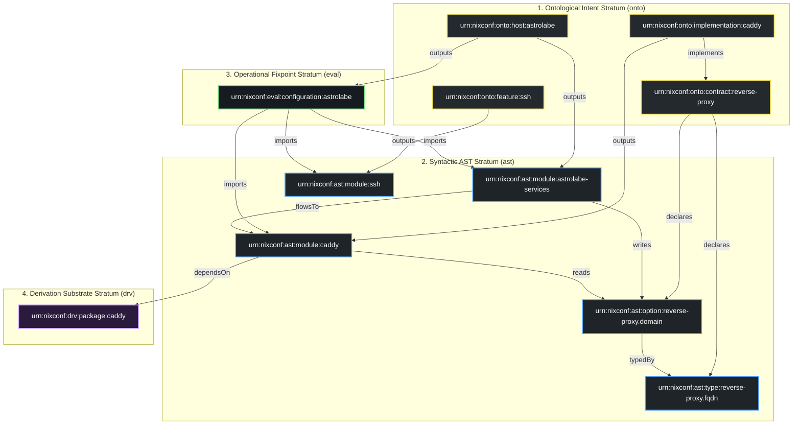

# Semantic Code Property Graph (CPG) Architecture

This document describes the unified Semantic Code Property Graph (CPG) of `nixconf`, merging Abstract Syntax Tree (AST), Control Flow Graph (CFG), and Program Dependence Graph (PDG) representations directly from evaluated Nix expressions.

Raw serialized graph dataset: [`docs/cpg.json`](cpg.json).

[← Back to Main README](../README.md)

---

## 1. Graph Metrics Overview

The complete semantic graph extracted from pure Nix evaluation:

| Dimension | Metric | Description |
| :--- | :--- | :--- |
| **Total Nodes** | **252** | Deduplicated primitives, hosts, configurations, modules, options, types, packages, devShells, and functions. |
| **Total Edges** | **467** | Directed relationships across Ontological, AST, Eval, and Derivation strata. |
| **Relations** | **10** | Canonical Computer Science relation predicates (`contains`, `declares`, `dependsOn`, `flowsTo`, `implements`, `imports`, `outputs`, `reads`, `typedBy`, `writes`). |
| **Strata** | **4** | Ontological Intent (`onto`), Syntactic AST (`ast`), Operational Fixpoint (`eval`), Derivation Substrate (`drv`). |
| **Evaluation** | **100% Pure** | Zero `--impure` dependencies, zero regex text-scanning, zero heuristic disk path reads. |

---

## 2. Relation Predicate Breakdown

Every edge in the CPG represents an exact computer science relation across the four strata:

| Relation | Stratum | Count | Description | Nix Implementation Grounding |
| :--- | :---: | :---: | :--- | :--- |
| **`outputs`** | AST / Eval / Drv | 120 | Flake artifact or component emission | Primitives outputting standard configurations, modules, packages, devShells, and functions |
| **`imports`** | Eval | 68 | Compilation unit composition | Evaluated NixOS configurations importing concrete NixOS modules |
| **`contains`** | Onto | 61 | Lexical parent-child containment | Primitives containing declared instances |
| **`writes`** | Eval | 62 | Option value definition (Def / Store) | Module fixpoint definition extracted via `definitionsWithLocations` |
| **`declares`** | AST | 52 | Interface specification declaration | Contracts declaring public options and custom types |
| **`flowsTo`** | Eval | 40 | End-to-end data dependence channel | Directed channel connecting option writer to consuming implementation |
| **`reads`** | Eval | 22 | Option value inspection (Use / Load) | Consumer implementation reading contract options |
| **`typedBy`** | AST | 11 | Option type-system binding | Contract options bound to custom submodule types |
| **`implements`** | Onto | 8 | Contract fulfillment | Explicit architectural relationship in `primitives/implementation.nix` |
| **`dependsOn`** | Drv | 23 | Software package dependency | Modules and devShells depending on executable packages |

---

## 3. The Four-Strata Architecture



---

## 4. Node Classification

The graph indexes **252 nodes** partitioned into distinct functional roles:

| Node Category | Count | Example Canonical URNs | Description |
| :--- | :---: | :--- | :--- |
| **NixOS Modules** | 59 | `urn:nixconf:ast:module:ssh`, `urn:nixconf:ast:module:caddy` | Composable NixOS system modules exported on `flake.nixosModules`. |
| **Library Functions** | 45 | `urn:nixconf:ast:function:stripLeadingIndentation` | Pure library helper functions with RFC 145 docstring metadata. |
| **Contract Options** | 41 | `urn:nixconf:ast:option:persistence.directories` | Public contract interface options with types and descriptions. |
| **Features** | 26 | `urn:nixconf:onto:feature:ssh`, `urn:nixconf:onto:feature:git` | High-level system and desktop capability bundles. |
| **Library Symbols** | 12 | `urn:nixconf:ast:symbol:defaultLayout` | Exported library values and constants. |
| **Custom Types** | 11 | `urn:nixconf:ast:type:persistence.user` | RFC-typed submodule types defined in contracts. |
| **Exported Packages** | 11 | `urn:nixconf:drv:package:caddy`, `urn:nixconf:drv:package:git` | Executable packages and derivations exported on `flake.packages`. |
| **Library Submodules** | 17 | `urn:nixconf:onto:lib:core`, `urn:nixconf:onto:lib:parser` | Library namespaces grouping functions and symbols. |
| **Implementations** | 8 | `urn:nixconf:onto:implementation:caddy` | Concrete capability provider implementations. |
| **Contracts** | 8 | `urn:nixconf:onto:contract:reverse-proxy` | Typed contract interfaces. |
| **Primitives** | 6 | `urn:nixconf:onto:primitive:host` | Meta-primitives defining schema construction rules. |
| **Exported DevShells** | 4 | `urn:nixconf:drv:devShell:master-ssh` | Interactive development and administrative shells. |
| **Target Hosts** | 2 | `urn:nixconf:onto:host:astrolabe`, `urn:nixconf:onto:host:x240` | Root evaluated target machine wrappers. |
| **Configurations** | 2 | `urn:nixconf:eval:configuration:astrolabe` | Evaluated NixOS system configurations on `flake.nixosConfigurations`. |

---

## 5. Inspecting the Graph

### A. Raw JSON Dataset
Inspect the complete dataset using `jq`:
```bash
# General summary
jq '{nodeCount: (.nodes | length), edgeCount: (.edges | length), relations: (.indices.byRelation | map_values(length))}' docs/cpg.json

# Find all modules that write to options
jq '.edges[] | select(.relation == "writes") | {source, target, file: .meta.file}' docs/cpg.json

# Inspect outgoing edges for a specific configuration
jq '.indices.outgoing["urn:nixconf:eval:configuration:astrolabe"]' docs/cpg.json
```

### B. Command-Line Graph Queries (via Nix)
Query graph metrics and slices on the fly using pure evaluation:
```bash
# Print all edge relations and counts
nix eval --apply 'f: builtins.mapAttrs (_: es: builtins.length es) (f {}).indices.byRelation' .#lib.graph.buildCPG --json

# Forward slice from a configuration (trace reachable dependencies)
nix eval --apply 'f: (f.graph.forwardSlice { cpg = f.graph.buildCPG {}; nodeId = "urn:nixconf:eval:configuration:astrolabe"; maxDepth = 2; }).nodeIds' .#lib --json

# Backward slice from an option (trace all writers and consumers)
nix eval --apply 'f: (f.graph.backwardSlice { cpg = f.graph.buildCPG {}; nodeId = "urn:nixconf:ast:option:reverse-proxy.domain"; maxDepth = 2; }).nodeIds' .#lib --json
```
