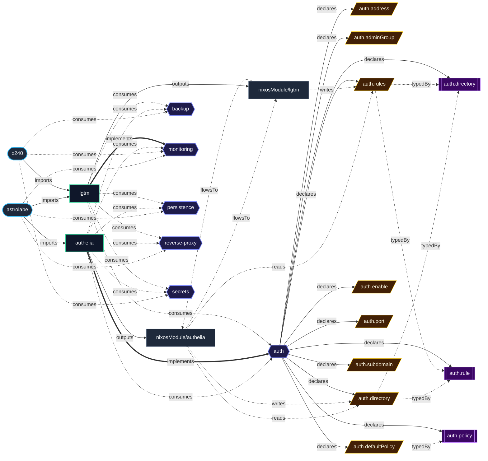

# Contract: `auth`

Declarative single sign-on (SSO), forward authentication, access control policy, and LDAP directory contract.

[← Back to Contracts Documentation](README.md) | [← Back to Main README](../../README.md)

- **Contract**: `auth`
- **Definition File**: [`modules/contracts/auth/default.nix`](../../modules/contracts/auth/default.nix)

<details>
<summary>Architecture Diagram (click to expand)</summary>



</details>

## Outputs

### NixOS Modules

| Module | Description | Docs |
| :--- | :--- | :--- |
| [`auth`](../modules/auth.md) | Declarative single sign-on (SSO), forward authentication, access control policy, and LDAP directory contract. | [More →](../modules/auth.md) |

### Library Helpers

| Symbol | Type | Description | Docs |
| :--- | :--- | :--- | :--- |
| [`mkConfig`](../lib/auth.md#mkConfig) | `auth.mkConfig :: AttrSet -> AttrSet` | Auto-derived configuration binding helper for the 'auth' contract. | [More →](../lib/auth.md#mkConfig) |
| [`mkOption`](../lib/auth.md#mkOption) | `auth.mkOption :: AttrSet -> AttrSet` | Auto-derived option constructor for the 'auth' contract. | [More →](../lib/auth.md#mkOption) |

### Custom Types

- `directory`: submodule
- `policy`: one of "bypass", "one_factor", "two_factor", "deny"
- `rule`: submodule

## Option Schema Definitions

| Option | Type | Default | Description |
| :--- | :--- | :--- | :--- |
| `auth.address` | `string` | `"127.0.0.1"` | Local bind address for the SSO authentication server. |
| `auth.adminGroup` | `string` | `"lldap_admin"` | Directory group name granted administrative privileges across integrated services. |
| `auth.defaultPolicy` | `one of "bypass", "one_factor", "two_factor", "deny"` | `"one_factor"` | Default access control policy enforced across SSO-protected virtual hosts. |
| `auth.directory` | `submodule` | `{ }` | Backing LDAP directory service configuration and administrative account settings. |
| `auth.enable` | `boolean` | `false` | Whether to enable centralized authentication, directory, and single sign-on contract. |
| `auth.port` | `16 bit unsigned integer; between 0 and 65535 (both inclusive)` | `22210` | Local TCP port on which the SSO authentication server listens. |
| `auth.rules` | `attribute set of (submodule)` | `{ }` | Attribute set of explicit access control rules evaluated before the fallback domain policy. |
| `auth.subdomain` | `string` | `"auth"` | Subdomain prefix under `reverse-proxy.domain` exposing the SSO login portal. |

## Fulfilling Implementations

Providers satisfying the `auth` contract capability:

| Implementation | Description | Definition | Docs |
| :--- | :--- | :--- | :--- |
| [`authelia`](../implementations/authelia.md) | Centralized SSO, forward authentication, 2FA, and LDAP directory implementation using Authelia and LLDAP. | [`modules/implementations/authelia/default.nix`](../../modules/implementations/authelia/default.nix) | [More →](../implementations/authelia.md) |

## Contract Consumers

Modules and instances configuring options under the `auth` contract capability:


### Implementations

<details>
<summary><code><a href="../implementations/authelia.md">authelia</a></code></summary>

**Configures options**: `auth.directory`

```nix
# modules/implementations/authelia/default.nix
...
130: message = "implementation.authelia currently requires `auth.directory.enable = true` (LLDAP backend).";
...
134: message = "auth.subdomain and auth.directory.subdomain must be distinct virtual host prefixes.";
...
138: auth.directory.adminEmail = lib.mkDefault "leonardwilsonb@gmail.com";
...
227: endpoints.authz.forward-auth.implementation = "ForwardAuth";
...
492: caddy-forward-auth = {
493: description = "Verify Caddyfile enforces forward_auth on protected services";
494: script = lib.optionalString (config.reverse-proxy.enable or false) (
495: self.lib.testing.mkInspectFile {
...
521: _unauth = machine.succeed(
...
```

</details>


<details>
<summary><code><a href="../implementations/lgtm.md">lgtm</a></code></summary>

**Configures options**: `auth.rules`

```nix
config = {
  auth.rules = ...;
};
```

</details>
