# Contract: `backup`

Automated snapshot backup configuration, inclusion paths, exclusions, and retention rules.

[← Back to Contracts Documentation](../CONTRACTS.md) | [← Back to Main README](../../README.md)

## Metadata

- **Contract Name**: `backup`
- **Description**: Automated snapshot backup configuration, inclusion paths, exclusions, and retention rules.
- **Definition File**: [`modules/contracts/backup.nix`](../../modules/contracts/backup.nix)

## Architecture Diagram

```mermaid
flowchart TD
    subgraph Hosts["Hosts"]
        urn__nixconf__onto__host__astrolabe["astrolabe"]:::hostNode
    end

    subgraph Contracts["Contracts"]
        urn__nixconf__onto__contract__backup(["backup"]):::contractNode
        urn__nixconf__onto__contract__default_user(["default-user"]):::contractNode
        urn__nixconf__onto__contract__home(["home"]):::contractNode
        urn__nixconf__onto__contract__persistence(["persistence"]):::contractNode
        urn__nixconf__onto__contract__resources(["resources"]):::contractNode
        urn__nixconf__onto__contract__reverse_proxy(["reverse-proxy"]):::contractNode
        urn__nixconf__onto__contract__secrets(["secrets"]):::contractNode
        urn__nixconf__onto__contract__wayland(["wayland"]):::contractNode
    end

    subgraph Features["Features"]
        urn__nixconf__onto__feature__vaultwarden["vaultwarden"]:::featureNode
    end

    subgraph OtherNodes["Other Entities"]
        urn__nixconf__ast__module__restic["restic"]
        urn__nixconf__ast__module__vaultwarden["vaultwarden"]
        urn__nixconf__ast__option__backup_enable[/"backup.enable: boolean"/]:::optNode
        urn__nixconf__ast__option__backup_exclude[/"backup.exclude: list of string"/]:::optNode
        urn__nixconf__ast__option__backup_paths[/"backup.paths: list of absolute path"/]:::optNode
        urn__nixconf__ast__option__backup_pruneOpts[/"backup.pruneOpts: list of string"/]:::optNode
        urn__nixconf__ast__option__backup_timerConfig[/"backup.timerConfig: attribute set of anything"/]:::optNode
        urn__nixconf__onto__implementation__restic["restic"]:::implNode
        urn__nixconf__onto__primitive__contract["contract"]
        urn__nixconf__onto__primitive__feature["feature"]
        urn__nixconf__onto__primitive__implementation["implementation"]
    end


    urn__nixconf__ast__module__restic -.->|"reads"| urn__nixconf__ast__option__backup_enable
    urn__nixconf__ast__module__restic -.->|"reads"| urn__nixconf__ast__option__backup_exclude
    urn__nixconf__ast__module__restic -.->|"reads"| urn__nixconf__ast__option__backup_paths
    urn__nixconf__ast__module__restic -.->|"reads"| urn__nixconf__ast__option__backup_pruneOpts
    urn__nixconf__ast__module__restic -.->|"reads"| urn__nixconf__ast__option__backup_timerConfig
    urn__nixconf__ast__module__restic -->|"writes"| urn__nixconf__ast__option__backup_enable
    urn__nixconf__ast__module__vaultwarden ==>|"flowsTo"| urn__nixconf__ast__module__restic
    urn__nixconf__ast__module__vaultwarden ==>|"flowsTo"| urn__nixconf__ast__module__restic
    urn__nixconf__ast__module__vaultwarden -->|"writes"| urn__nixconf__ast__option__backup_exclude
    urn__nixconf__ast__module__vaultwarden -->|"writes"| urn__nixconf__ast__option__backup_paths
    urn__nixconf__onto__contract__backup --- urn__nixconf__ast__option__backup_enable
    urn__nixconf__onto__contract__backup --- urn__nixconf__ast__option__backup_exclude
    urn__nixconf__onto__contract__backup --- urn__nixconf__ast__option__backup_paths
    urn__nixconf__onto__contract__backup --- urn__nixconf__ast__option__backup_pruneOpts
    urn__nixconf__onto__contract__backup --- urn__nixconf__ast__option__backup_timerConfig
    urn__nixconf__onto__feature__vaultwarden -->|"outputs"| urn__nixconf__ast__module__vaultwarden
    urn__nixconf__onto__feature__vaultwarden -->|"consumes"| urn__nixconf__onto__contract__backup
    urn__nixconf__onto__feature__vaultwarden -->|"consumes"| urn__nixconf__onto__contract__backup
    urn__nixconf__onto__feature__vaultwarden -->|"consumes"| urn__nixconf__onto__contract__persistence
    urn__nixconf__onto__feature__vaultwarden -->|"consumes"| urn__nixconf__onto__contract__persistence
    urn__nixconf__onto__feature__vaultwarden -->|"consumes"| urn__nixconf__onto__contract__resources
    urn__nixconf__onto__feature__vaultwarden -->|"consumes"| urn__nixconf__onto__contract__reverse_proxy
    urn__nixconf__onto__host__astrolabe -->|"consumes"| urn__nixconf__onto__contract__reverse_proxy
    urn__nixconf__onto__host__astrolabe -->|"imports"| urn__nixconf__onto__feature__vaultwarden
    urn__nixconf__onto__host__astrolabe -->|"imports"| urn__nixconf__onto__implementation__restic
    urn__nixconf__onto__implementation__restic -->|"outputs"| urn__nixconf__ast__module__restic
    urn__nixconf__onto__implementation__restic -->|"consumes"| urn__nixconf__onto__contract__backup
    urn__nixconf__onto__implementation__restic -->|"consumes"| urn__nixconf__onto__contract__resources
    urn__nixconf__onto__implementation__restic -->|"consumes"| urn__nixconf__onto__contract__secrets
    urn__nixconf__onto__implementation__restic -.->|"implements"| urn__nixconf__onto__contract__backup
    urn__nixconf__onto__implementation__restic -.->|"implements"| urn__nixconf__onto__contract__backup
    urn__nixconf__onto__primitive__contract --- urn__nixconf__onto__contract__backup
    urn__nixconf__onto__primitive__contract --- urn__nixconf__onto__contract__default_user
    urn__nixconf__onto__primitive__contract --- urn__nixconf__onto__contract__home
    urn__nixconf__onto__primitive__contract --- urn__nixconf__onto__contract__persistence
    urn__nixconf__onto__primitive__contract --- urn__nixconf__onto__contract__resources
    urn__nixconf__onto__primitive__contract --- urn__nixconf__onto__contract__reverse_proxy
    urn__nixconf__onto__primitive__contract --- urn__nixconf__onto__contract__secrets
    urn__nixconf__onto__primitive__contract --- urn__nixconf__onto__contract__wayland
    urn__nixconf__onto__primitive__feature --- urn__nixconf__onto__feature__vaultwarden
    urn__nixconf__onto__primitive__implementation --- urn__nixconf__onto__implementation__restic

classDef hostNode fill:#1e1e2e,stroke:#cba6f7,stroke-width:2px,color:#cdd6f4;
classDef contractNode fill:#181825,stroke:#89b4fa,stroke-width:2px,color:#cdd6f4;
classDef implNode fill:#181825,stroke:#a6e3a1,stroke-width:2px,color:#cdd6f4;
classDef featureNode fill:#181825,stroke:#f38ba8,stroke-width:2px,color:#cdd6f4;
classDef libNode fill:#181825,stroke:#94e2d5,stroke-width:2px,color:#cdd6f4;
classDef optNode fill:#11111b,stroke:#fab387,stroke-width:1px,color:#cdd6f4;
classDef typeNode fill:#11111b,stroke:#f9e2af,stroke-width:1px,color:#cdd6f4;
classDef fnNode fill:#181825,stroke:#94e2d5,stroke-width:1px,color:#cdd6f4;
classDef pkgNode fill:#181825,stroke:#b4befe,stroke-width:1px,color:#cdd6f4;
classDef shellNode fill:#181825,stroke:#f5c2e7,stroke-width:1px,color:#cdd6f4;

```




## Option Schema Definitions

| Option Path | Type | Default | Example | Description |
| :--- | :--- | :--- | :--- | :--- |
| `options.backup.enable` | `boolean` | `` | `1` | Whether to enable system backup automation contract. |
| `options.backup.exclude` | `list of string` | `[ ... ]` | `[ ... ]` | List of glob patterns, file paths, or directories to explicitly exclude from backup snapshots (e.g. cache directories, transient sockets). |
| `options.backup.paths` | `list of absolute path` | `[ ... ]` | `[ ... ]` | List of absolute filesystem directory or file paths to include in the backup snapshot. Aggregated across all active service modules via `mkConfig`. |
| `options.backup.pruneOpts` | `list of string` | `[ ... ]` | *none* | Command-line argument rules passed to the backup backend pruning command to enforce snapshot retention and prevent unbounded remote storage usage. |
| `options.backup.timerConfig` | `attribute set of anything` | `{ ... }` | *none* | Systemd timer specification governing when automated backup snapshots run. Defaults to executing daily at 04:00 with persistence enabled. |


## Outputs

### Custom Submodule Types

*No custom types declared directly on this contract.*

### Library Helpers

| Symbol | Description | Docs |
| :--- | :--- | :--- |
| [`flake.lib.backup.defaultPruneOpts`](../lib/backup.md#defaultPruneOpts) | Contract option constructor / binding helper | [More →](../lib/backup.md#defaultPruneOpts) |
| [`flake.lib.backup.defaultTimerConfig`](../lib/backup.md#defaultTimerConfig) | Contract option constructor / binding helper | [More →](../lib/backup.md#defaultTimerConfig) |


## Implementations

Providers satisfying the `backup` contract capability:

| Implementation | Description | Docs |
| :--- | :--- | :--- |
| [`restic`](../implementations/restic.md) | Automated encrypted remote backups using Restic and systemd timers. | [More →](../implementations/restic.md) |

## Contract Consumers

Modules configuring options under the `backup` contract capability:

### Hosts

*No hosts configure this contract directly.*

### Implementations

<details>
<summary><code><a href="../implementations/restic.md">restic</a></code></summary>

Configures options: *general contract configuration*

```nix
config = {

};

```

</details>


### Features

<details>
<summary><code><a href="../features/vaultwarden.md">vaultwarden</a></code></summary>

Configures options: *general contract configuration*

```nix
config = {

};

```

</details>


<details>
<summary><code><a href="../features/vaultwarden.md">vaultwarden</a></code></summary>

Configures options: *general contract configuration*

```nix
config = {

};

```

</details>

