# Contract: `backup`

Declarative multi-provider backup contract separating per-provider schedules/retention, host vs shared repository scopes, per-service units, and boot-time most-recent auto-restore.

[← Back to Contracts Documentation](README.md) | [← Back to Main README](../../README.md)

- **Contract**: `backup`
- **Definition File**: [`modules/contracts/backup/default.nix`](../../modules/contracts/backup/default.nix)

```mermaid
flowchart LR
  urn__nixconf__ast__module__rclone["nixosModule/rclone"]:::defaultNode
    urn__nixconf__ast__module__restic["nixosModule/restic"]:::defaultNode
    urn__nixconf__ast__module__uchiyomi["nixosModule/uchiyomi"]:::defaultNode
    urn__nixconf__ast__module__vaultwarden["nixosModule/vaultwarden"]:::defaultNode
    urn__nixconf__ast__option__backup_destinations[/"backup.destinations"/]:::optNode
    urn__nixconf__ast__option__backup_enable[/"backup.enable"/]:::optNode
    urn__nixconf__ast__option__backup_exclude[/"backup.exclude"/]:::optNode
    urn__nixconf__ast__option__backup_paths[/"backup.paths"/]:::optNode
    urn__nixconf__ast__option__backup_pruneOpts[/"backup.pruneOpts"/]:::optNode
    urn__nixconf__ast__option__backup_timerConfig[/"backup.timerConfig"/]:::optNode
    urn__nixconf__ast__option__backup_units[/"backup.units"/]:::optNode
    urn__nixconf__ast__type__backup_destination[["backup.destination"]]:::typeNode
    urn__nixconf__ast__type__backup_destinationOverride[["backup.destinationOverride"]]:::typeNode
    urn__nixconf__ast__type__backup_retention[["backup.retention"]]:::typeNode
    urn__nixconf__ast__type__backup_schedule[["backup.schedule"]]:::typeNode
    urn__nixconf__ast__type__backup_unit[["backup.unit"]]:::typeNode
    urn__nixconf__onto__contract__backup{{"backup"}}:::contractNode
    urn__nixconf__onto__contract__persistence{{"persistence"}}:::contractNode
    urn__nixconf__onto__contract__reverse_proxy{{"reverse-proxy"}}:::contractNode
    urn__nixconf__onto__contract__secrets{{"secrets"}}:::contractNode
    urn__nixconf__onto__contract__storage{{"storage"}}:::contractNode
    urn__nixconf__onto__feature__uchiyomi("uchiyomi"):::featureNode
    urn__nixconf__onto__feature__vaultwarden("vaultwarden"):::featureNode
    urn__nixconf__onto__host__astrolabe(["astrolabe"]):::hostNode
    urn__nixconf__onto__host__x240(["x240"]):::hostNode
    urn__nixconf__onto__implementation__rclone["rclone"]:::implNode
    urn__nixconf__onto__implementation__restic["restic"]:::implNode

    urn__nixconf__ast__module__rclone -.->|flowsTo| urn__nixconf__ast__module__restic
    urn__nixconf__ast__module__rclone -.->|writes| urn__nixconf__ast__option__backup_exclude
    urn__nixconf__ast__module__restic -.->|flowsTo| urn__nixconf__ast__module__rclone
    urn__nixconf__ast__module__restic -.->|reads| urn__nixconf__ast__option__backup_enable
    urn__nixconf__ast__module__restic -.->|reads| urn__nixconf__ast__option__backup_exclude
    urn__nixconf__ast__module__restic -.->|reads| urn__nixconf__ast__option__backup_paths
    urn__nixconf__ast__module__restic -.->|reads| urn__nixconf__ast__option__backup_units
    urn__nixconf__ast__module__uchiyomi -.->|flowsTo| urn__nixconf__ast__module__rclone
    urn__nixconf__ast__module__uchiyomi -.->|flowsTo| urn__nixconf__ast__module__restic
    urn__nixconf__ast__module__uchiyomi -.->|writes| urn__nixconf__ast__option__backup_enable
    urn__nixconf__ast__module__uchiyomi -.->|writes| urn__nixconf__ast__option__backup_exclude
    urn__nixconf__ast__module__uchiyomi -.->|writes| urn__nixconf__ast__option__backup_paths
    urn__nixconf__ast__module__uchiyomi -.->|writes| urn__nixconf__ast__option__backup_units
    urn__nixconf__ast__module__vaultwarden -.->|flowsTo| urn__nixconf__ast__module__restic
    urn__nixconf__ast__module__vaultwarden -.->|writes| urn__nixconf__ast__option__backup_enable
    urn__nixconf__ast__module__vaultwarden -.->|writes| urn__nixconf__ast__option__backup_exclude
    urn__nixconf__ast__module__vaultwarden -.->|writes| urn__nixconf__ast__option__backup_paths
    urn__nixconf__ast__module__vaultwarden -.->|writes| urn__nixconf__ast__option__backup_units
    urn__nixconf__ast__option__backup_destinations -.->|typedBy| urn__nixconf__ast__type__backup_destination
    urn__nixconf__ast__option__backup_destinations -.->|typedBy| urn__nixconf__ast__type__backup_destinationOverride
    urn__nixconf__ast__option__backup_destinations -.->|typedBy| urn__nixconf__ast__type__backup_retention
    urn__nixconf__ast__option__backup_destinations -.->|typedBy| urn__nixconf__ast__type__backup_schedule
    urn__nixconf__ast__option__backup_destinations -.->|typedBy| urn__nixconf__ast__type__backup_unit
    urn__nixconf__ast__option__backup_units -.->|typedBy| urn__nixconf__ast__type__backup_destination
    urn__nixconf__ast__option__backup_units -.->|typedBy| urn__nixconf__ast__type__backup_destinationOverride
    urn__nixconf__ast__option__backup_units -.->|typedBy| urn__nixconf__ast__type__backup_retention
    urn__nixconf__ast__option__backup_units -.->|typedBy| urn__nixconf__ast__type__backup_schedule
    urn__nixconf__ast__option__backup_units -.->|typedBy| urn__nixconf__ast__type__backup_unit
    urn__nixconf__onto__contract__backup -->|declares| urn__nixconf__ast__option__backup_destinations
    urn__nixconf__onto__contract__backup -->|declares| urn__nixconf__ast__option__backup_enable
    urn__nixconf__onto__contract__backup -->|declares| urn__nixconf__ast__option__backup_exclude
    urn__nixconf__onto__contract__backup -->|declares| urn__nixconf__ast__option__backup_paths
    urn__nixconf__onto__contract__backup -->|declares| urn__nixconf__ast__option__backup_pruneOpts
    urn__nixconf__onto__contract__backup -->|declares| urn__nixconf__ast__option__backup_timerConfig
    urn__nixconf__onto__contract__backup -->|declares| urn__nixconf__ast__option__backup_units
    urn__nixconf__onto__contract__backup -->|declares| urn__nixconf__ast__type__backup_destination
    urn__nixconf__onto__contract__backup -->|declares| urn__nixconf__ast__type__backup_destinationOverride
    urn__nixconf__onto__contract__backup -->|declares| urn__nixconf__ast__type__backup_retention
    urn__nixconf__onto__contract__backup -->|declares| urn__nixconf__ast__type__backup_schedule
    urn__nixconf__onto__contract__backup -->|declares| urn__nixconf__ast__type__backup_unit
    urn__nixconf__onto__feature__uchiyomi -->|outputs| urn__nixconf__ast__module__uchiyomi
    urn__nixconf__onto__feature__uchiyomi -.->|consumes| urn__nixconf__onto__contract__backup
    urn__nixconf__onto__feature__uchiyomi -.->|consumes| urn__nixconf__onto__contract__persistence
    urn__nixconf__onto__feature__uchiyomi -.->|consumes| urn__nixconf__onto__contract__reverse_proxy
    urn__nixconf__onto__feature__uchiyomi -.->|consumes| urn__nixconf__onto__contract__storage
    urn__nixconf__onto__feature__vaultwarden -->|outputs| urn__nixconf__ast__module__vaultwarden
    urn__nixconf__onto__feature__vaultwarden -.->|consumes| urn__nixconf__onto__contract__backup
    urn__nixconf__onto__feature__vaultwarden -.->|consumes| urn__nixconf__onto__contract__persistence
    urn__nixconf__onto__feature__vaultwarden -.->|consumes| urn__nixconf__onto__contract__reverse_proxy
    urn__nixconf__onto__host__astrolabe -.->|consumes| urn__nixconf__onto__contract__persistence
    urn__nixconf__onto__host__astrolabe -.->|consumes| urn__nixconf__onto__contract__reverse_proxy
    urn__nixconf__onto__host__astrolabe -->|imports| urn__nixconf__onto__feature__uchiyomi
    urn__nixconf__onto__host__astrolabe -->|imports| urn__nixconf__onto__feature__vaultwarden
    urn__nixconf__onto__host__astrolabe -->|imports| urn__nixconf__onto__implementation__rclone
    urn__nixconf__onto__host__astrolabe -->|imports| urn__nixconf__onto__implementation__restic
    urn__nixconf__onto__host__x240 -->|imports| urn__nixconf__onto__implementation__rclone
    urn__nixconf__onto__implementation__rclone -->|outputs| urn__nixconf__ast__module__rclone
    urn__nixconf__onto__implementation__rclone -.->|consumes| urn__nixconf__onto__contract__backup
    urn__nixconf__onto__implementation__rclone -.->|consumes| urn__nixconf__onto__contract__persistence
    urn__nixconf__onto__implementation__rclone -.->|consumes| urn__nixconf__onto__contract__secrets
    urn__nixconf__onto__implementation__rclone ==>|implements| urn__nixconf__onto__contract__storage
    urn__nixconf__onto__implementation__restic -->|outputs| urn__nixconf__ast__module__restic
    urn__nixconf__onto__implementation__restic -.->|consumes| urn__nixconf__onto__contract__persistence
    urn__nixconf__onto__implementation__restic -.->|consumes| urn__nixconf__onto__contract__secrets
    urn__nixconf__onto__implementation__restic -.->|consumes| urn__nixconf__onto__contract__storage
    urn__nixconf__onto__implementation__restic ==>|implements| urn__nixconf__onto__contract__backup


    click urn__nixconf__ast__module__rclone href "../modules/rclone.md" "rclone"
    click urn__nixconf__ast__module__restic href "../modules/restic.md" "restic"
    click urn__nixconf__ast__module__uchiyomi href "../modules/uchiyomi.md" "uchiyomi"
    click urn__nixconf__ast__module__vaultwarden href "../modules/vaultwarden.md" "vaultwarden"
    click urn__nixconf__ast__option__backup_destinations href "backup.md" "backup.destinations"
    click urn__nixconf__ast__option__backup_enable href "backup.md" "backup.enable"
    click urn__nixconf__ast__option__backup_exclude href "backup.md" "backup.exclude"
    click urn__nixconf__ast__option__backup_paths href "backup.md" "backup.paths"
    click urn__nixconf__ast__option__backup_pruneOpts href "backup.md" "backup.pruneOpts"
    click urn__nixconf__ast__option__backup_timerConfig href "backup.md" "backup.timerConfig"
    click urn__nixconf__ast__option__backup_units href "backup.md" "backup.units"
    click urn__nixconf__ast__type__backup_destination href "backup.md" "backup.destination"
    click urn__nixconf__ast__type__backup_destinationOverride href "backup.md" "backup.destinationOverride"
    click urn__nixconf__ast__type__backup_retention href "backup.md" "backup.retention"
    click urn__nixconf__ast__type__backup_schedule href "backup.md" "backup.schedule"
    click urn__nixconf__ast__type__backup_unit href "backup.md" "backup.unit"
    click urn__nixconf__onto__contract__backup href "backup.md" "backup"
    click urn__nixconf__onto__contract__persistence href "persistence.md" "persistence"
    click urn__nixconf__onto__contract__reverse_proxy href "reverse-proxy.md" "reverse-proxy"
    click urn__nixconf__onto__contract__secrets href "secrets.md" "secrets"
    click urn__nixconf__onto__contract__storage href "storage.md" "storage"
    click urn__nixconf__onto__feature__uchiyomi href "../features/uchiyomi.md" "uchiyomi"
    click urn__nixconf__onto__feature__vaultwarden href "../features/vaultwarden.md" "vaultwarden"
    click urn__nixconf__onto__host__astrolabe href "../hosts/astrolabe.md" "astrolabe"
    click urn__nixconf__onto__host__x240 href "../hosts/x240.md" "x240"
    click urn__nixconf__onto__implementation__rclone href "../implementations/rclone.md" "rclone"
    click urn__nixconf__onto__implementation__restic href "../implementations/restic.md" "restic"

  %% Semantic Visual Classes
  classDef hostNode fill:#1e293b,stroke:#38bdf8,stroke-width:2px,color:#f8fafc;
  classDef contractNode fill:#1e1b4b,stroke:#818cf8,stroke-width:2px,color:#f8fafc;
  classDef implNode fill:#0f172a,stroke:#34d399,stroke-width:2px,color:#f8fafc;
  classDef featureNode fill:#134e4a,stroke:#2dd4bf,stroke-width:2px,color:#f8fafc;
  classDef optNode fill:#422006,stroke:#facc15,stroke-width:1px,color:#fefce8;
  classDef typeNode fill:#3b0764,stroke:#c084fc,stroke-width:1px,color:#faf5ff;
  classDef pkgNode fill:#4c0519,stroke:#fb7185,stroke-width:1px,color:#fff1f2;
  classDef devShellNode fill:#451a03,stroke:#fb923c,stroke-width:1px,color:#fff7ed;
  classDef drvNode fill:#18181b,stroke:#a1a1aa,stroke-width:1px,color:#f4f4f5;
  classDef defaultNode fill:#1e293b,stroke:#64748b,stroke-width:1px,color:#f8fafc;
```

<details>
<summary>Architecture Diagram (click to expand)</summary>



</details>

## Outputs

### NixOS Modules

| Module | Description | Docs |
| :--- | :--- | :--- |
| [`backup`](../modules/backup.md) | Declarative multi-provider backup contract separating per-provider schedules/retention, host vs shared repository scopes, per-service units, and boot-time most-recent auto-restore. | [More →](../modules/backup.md) |

### Library Helpers

| Symbol | Type | Description | Docs |
| :--- | :--- | :--- | :--- |
| [`defaultPruneOpts`](../lib/backup.md#defaultPruneOpts) | `defaultPruneOpts :: [String]` | Default restic snapshot retention arguments (`--keep-daily 7 --keep-weekly 4 --keep-monthly 6`). | [More →](../lib/backup.md#defaultPruneOpts) |
| [`defaultTimerConfig`](../lib/backup.md#defaultTimerConfig) | `defaultTimerConfig :: Attrs` | Default systemd timer configuration (`hourly`) for backup jobs. | [More →](../lib/backup.md#defaultTimerConfig) |
| [`mkConfig`](../lib/backup.md#mkConfig) | `backup.mkConfig :: AttrSet -> AttrSet` | Auto-derived configuration binding helper for the 'backup' contract. | [More →](../lib/backup.md#mkConfig) |
| [`mkOption`](../lib/backup.md#mkOption) | `backup.mkOption :: AttrSet -> AttrSet` | Auto-derived option constructor for the 'backup' contract. | [More →](../lib/backup.md#mkOption) |
| [`retentionToPruneOpts`](../lib/backup.md#retentionToPruneOpts) | `retentionToPruneOpts :: Retention -> [String]` | Convert a structured retention policy attrset into `restic forget --prune` CLI flags. | [More →](../lib/backup.md#retentionToPruneOpts) |
| [`scheduleToTimerConfig`](../lib/backup.md#scheduleToTimerConfig) | `scheduleToTimerConfig :: Schedule -> Attrs` | Convert a structured backup schedule attrset into systemd `timerConfig` attributes. | [More →](../lib/backup.md#scheduleToTimerConfig) |

### Custom Types

- `destination`: submodule
- `destinationOverride`: submodule
- `retention`: submodule
- `schedule`: submodule
- `unit`: submodule

## Option Schema Definitions

| Option | Type | Default | Description |
| :--- | :--- | :--- | :--- |
| `backup.destinations` | `attribute set of (submodule)` | `{ }` | Named backup destinations parameterized by backing storage slice, `host`/`shared` scope, priority, schedule, and per-tier retention. |
| `backup.enable` | `boolean` | `false` | Whether to enable declarative backup configuration. |
| `backup.exclude` | `list of string` | `[ ]` | Global exclusion patterns applied across backup units. |
| `backup.paths` | `list of string` | `[ ]` | Host-level filesystem paths included in synthetic `system` backups when not claimed by any declared `backup.units` entry. |
| `backup.pruneOpts` | `list of string` | `[ ... ]` | Fallback restic prune arguments used by legacy monolithic backup targets. |
| `backup.timerConfig` | `attribute set of anything` | `{ ... }` | Fallback systemd timer configuration used by legacy monolithic backup targets. |
| `backup.units` | `attribute set of (submodule)` | `{ }` | Logical backup units with independent paths, scopes, destination overrides, and boot-time most-recent auto-restore configuration. |

## Fulfilling Implementations

Providers satisfying the `backup` contract capability:

| Implementation | Description | Definition | Docs |
| :--- | :--- | :--- | :--- |
| [`restic`](../implementations/restic.md) | Multi-provider restic backup implementation backed by rclone storage slices, per-provider schedules/retention, and boot-time most-recent auto-restore. | [`modules/implementations/restic/default.nix`](../../modules/implementations/restic/default.nix) | [More →](../implementations/restic.md) |

## Contract Consumers

Modules and instances configuring options under the `backup` contract capability:


### Implementations

<details>
<summary><code><a href="../implementations/rclone.md">rclone</a></code></summary>

**Configures options**: `backup.exclude`

```nix
# modules/implementations/rclone/default.nix
...
58: backup.exclude = ["/var/cache/rclone"];
...
```

</details>


### Features

<details>
<summary><code><a href="../features/uchiyomi.md">uchiyomi</a></code></summary>

**Configures options**: `backup.enable`, `backup.exclude`, `backup.paths`, `backup.units`

```nix
# modules/features/uchiyomi.nix
...
274: (self.lib.backup.mkConfig {inherit config cfg;})
...
```

</details>


<details>
<summary><code><a href="../features/vaultwarden.md">vaultwarden</a></code></summary>

**Configures options**: `backup.enable`, `backup.exclude`, `backup.paths`, `backup.units`

```nix
# modules/features/vaultwarden.nix
...
47: (self.lib.backup.mkConfig {inherit config cfg;})
...
```

</details>
