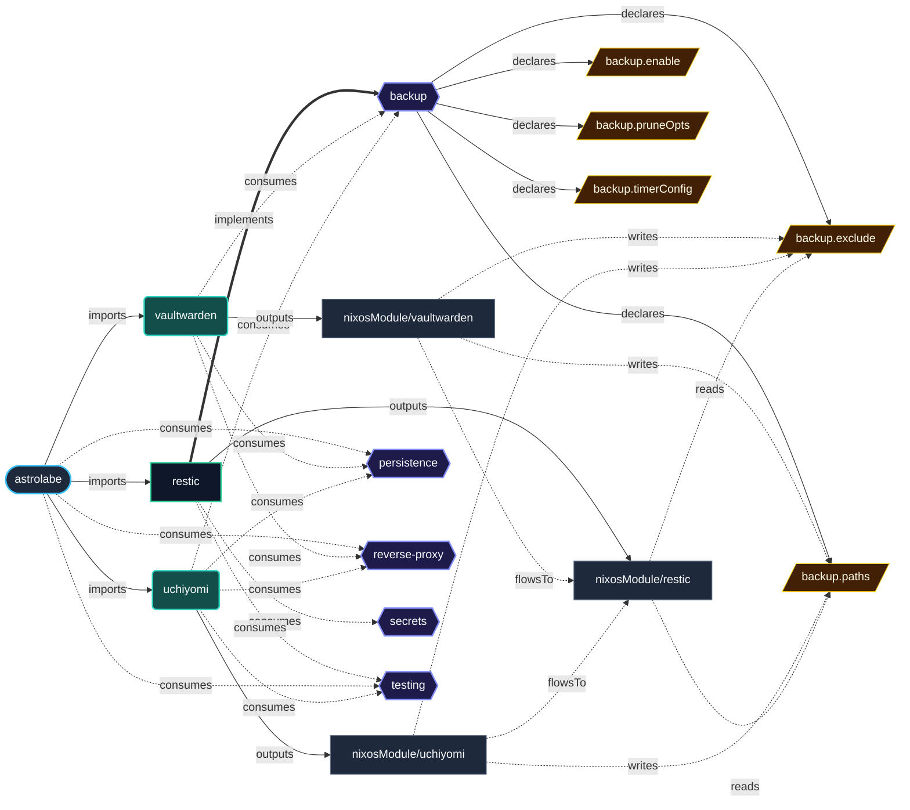

# Contract: `backup`

Automated snapshot backup configuration, inclusion paths, exclusions, and retention rules.

[← Back to Contracts Documentation](README.md) | [← Back to Main README](../../README.md)

- **Contract**: `backup`
- **Definition File**: [`modules/contracts/backup.nix`](../../modules/contracts/backup.nix)

<details>
<summary>Architecture Diagram (click to expand)</summary>



</details>

## Outputs

### NixOS Modules

| Module | Description | Docs |
| :--- | :--- | :--- |
| [`backup`](../modules/backup.md) | Automated snapshot backup configuration, inclusion paths, exclusions, and retention rules. | [More →](../modules/backup.md) |

### Library Helpers

| Symbol | Type | Description | Docs |
| :--- | :--- | :--- | :--- |
| [`defaultPruneOpts`](../lib/backup.md#defaultPruneOpts) | `defaultPruneOpts :: [String]` | Default snapshot retention rules passed to the backup backend pruning command. Preserves 7 daily, 4 weekly, and 12 monthly snapshots. | [More →](../lib/backup.md#defaultPruneOpts) |
| [`defaultTimerConfig`](../lib/backup.md#defaultTimerConfig) | `defaultTimerConfig :: AttrSet` | Default systemd timer configuration for automated backup operations. Executes daily at 04:00 with persistent timer catch-up. | [More →](../lib/backup.md#defaultTimerConfig) |
| [`mkConfig`](../lib/backup.md#mkConfig) | `backup.mkConfig :: AttrSet -> AttrSet` | Auto-derived configuration binding helper for the 'backup' contract. | [More →](../lib/backup.md#mkConfig) |
| [`mkOption`](../lib/backup.md#mkOption) | `backup.mkOption :: AttrSet -> AttrSet` | Auto-derived option constructor for the 'backup' contract. | [More →](../lib/backup.md#mkOption) |

## Option Schema Definitions

| Option | Type | Default | Description |
| :--- | :--- | :--- | :--- |
| `backup.enable` | `boolean` | `false` | Whether to enable system backup automation contract. |
| `backup.exclude` | `list of string` | `[ ]` | List of glob patterns, file paths, or directories to explicitly exclude from backup snapshots (e.g. cache directories, transient sockets). |
| `backup.paths` | `list of absolute path` | `[ ]` | List of absolute filesystem directory or file paths to include in the backup snapshot. Aggregated across all active service modules via `mkConfig`. |
| `backup.pruneOpts` | `list of string` | `[ ... ]` | Command-line argument rules passed to the backup backend pruning command to enforce snapshot retention and prevent unbounded remote storage usage. |
| `backup.timerConfig` | `attribute set of anything` | `{ ... }` | Systemd timer specification governing when automated backup snapshots run. Defaults to executing daily at 04:00 with persistence enabled. |

## Fulfilling Implementations

Providers satisfying the `backup` contract capability:

| Implementation | Description | Definition | Docs |
| :--- | :--- | :--- | :--- |
| [`restic`](../implementations/restic.md) | Automated encrypted remote backups using Restic and systemd timers. | [`modules/implementations/restic.nix`](../../modules/implementations/restic.nix) | [More →](../implementations/restic.md) |

## Contract Consumers

Modules and instances configuring options under the `backup` contract capability:


### Features

<details>
<summary><code><a href="../features/uchiyomi.md">uchiyomi</a></code></summary>

**Configures options**: `backup.exclude`, `backup.paths`

```nix
# modules/features/uchiyomi.nix
...
216: (self.lib.backup.mkConfig {inherit config cfg;})
...
```

</details>


<details>
<summary><code><a href="../features/vaultwarden.md">vaultwarden</a></code></summary>

**Configures options**: `backup.exclude`, `backup.paths`

```nix
# modules/features/vaultwarden.nix
...
44: (self.lib.backup.mkConfig {inherit config cfg;})
...
```

</details>
