# Contract: `default-user`

Default primary user account identification, credentials, and configuration injection.

[← Back to Contracts Documentation](../CONTRACTS.md) | [← Back to Main README](../../README.md)

## Metadata

- **Contract Name**: `default-user`
- **Description**: Default primary user account identification, credentials, and configuration injection.
- **Definition File**: [`modules/contracts/default-user.nix`](../../modules/contracts/default-user.nix)

## Architecture Diagram

```mermaid
flowchart TD
    subgraph Hosts["Hosts"]
        urn__nixconf__onto__host__astrolabe["astrolabe"]:::hostNode
        urn__nixconf__onto__host__x240["x240"]:::hostNode
    end

    subgraph Contracts["Contracts"]
        urn__nixconf__onto__contract__backup(["backup"]):::contractNode
        urn__nixconf__onto__contract__default_user(["default-user"]):::contractNode
        urn__nixconf__onto__contract__home(["home"]):::contractNode
        urn__nixconf__onto__contract__persistence(["persistence"]):::contractNode
        urn__nixconf__onto__contract__resources(["resources"]):::contractNode
        urn__nixconf__onto__contract__reverse_proxy(["reverse-proxy"]):::contractNode
        urn__nixconf__onto__contract__secrets(["secrets"]):::contractNode
        urn__nixconf__onto__contract__wayland(["wayland"]):::contractNode
    end

    subgraph OtherNodes["Other Entities"]
        urn__nixconf__ast__module__lw["lw"]
        urn__nixconf__ast__option__default_user_email[/"default-user.email: string"/]:::optNode
        urn__nixconf__ast__option__default_user_enable[/"default-user.enable: boolean"/]:::optNode
        urn__nixconf__ast__option__default_user_fullName[/"default-user.fullName: null or string"/]:::optNode
        urn__nixconf__ast__option__default_user_githubUsername[/"default-user.githubUsername: string"/]:::optNode
        urn__nixconf__ast__option__default_user_modules[/"default-user.modules: list of module"/]:::optNode
        urn__nixconf__ast__option__default_user_username[/"default-user.username: string"/]:::optNode
        urn__nixconf__onto__implementation__lw["lw"]:::implNode
        urn__nixconf__onto__primitive__contract["contract"]
        urn__nixconf__onto__primitive__implementation["implementation"]
    end


    urn__nixconf__ast__module__lw -.->|"reads"| urn__nixconf__ast__option__default_user_email
    urn__nixconf__ast__module__lw -.->|"reads"| urn__nixconf__ast__option__default_user_email
    urn__nixconf__ast__module__lw -.->|"reads"| urn__nixconf__ast__option__default_user_enable
    urn__nixconf__ast__module__lw -.->|"reads"| urn__nixconf__ast__option__default_user_enable
    urn__nixconf__ast__module__lw -.->|"reads"| urn__nixconf__ast__option__default_user_fullName
    urn__nixconf__ast__module__lw -.->|"reads"| urn__nixconf__ast__option__default_user_fullName
    urn__nixconf__ast__module__lw -.->|"reads"| urn__nixconf__ast__option__default_user_githubUsername
    urn__nixconf__ast__module__lw -.->|"reads"| urn__nixconf__ast__option__default_user_githubUsername
    urn__nixconf__ast__module__lw -.->|"reads"| urn__nixconf__ast__option__default_user_modules
    urn__nixconf__ast__module__lw -.->|"reads"| urn__nixconf__ast__option__default_user_modules
    urn__nixconf__ast__module__lw -.->|"reads"| urn__nixconf__ast__option__default_user_username
    urn__nixconf__ast__module__lw -.->|"reads"| urn__nixconf__ast__option__default_user_username
    urn__nixconf__ast__module__lw -->|"writes"| urn__nixconf__ast__option__default_user_email
    urn__nixconf__ast__module__lw -->|"writes"| urn__nixconf__ast__option__default_user_email
    urn__nixconf__ast__module__lw -->|"writes"| urn__nixconf__ast__option__default_user_githubUsername
    urn__nixconf__ast__module__lw -->|"writes"| urn__nixconf__ast__option__default_user_githubUsername
    urn__nixconf__ast__module__lw -->|"writes"| urn__nixconf__ast__option__default_user_username
    urn__nixconf__ast__module__lw -->|"writes"| urn__nixconf__ast__option__default_user_username
    urn__nixconf__onto__contract__default_user --- urn__nixconf__ast__option__default_user_email
    urn__nixconf__onto__contract__default_user --- urn__nixconf__ast__option__default_user_enable
    urn__nixconf__onto__contract__default_user --- urn__nixconf__ast__option__default_user_fullName
    urn__nixconf__onto__contract__default_user --- urn__nixconf__ast__option__default_user_githubUsername
    urn__nixconf__onto__contract__default_user --- urn__nixconf__ast__option__default_user_modules
    urn__nixconf__onto__contract__default_user --- urn__nixconf__ast__option__default_user_username
    urn__nixconf__onto__host__astrolabe -->|"consumes"| urn__nixconf__onto__contract__reverse_proxy
    urn__nixconf__onto__host__astrolabe -->|"imports"| urn__nixconf__onto__implementation__lw
    urn__nixconf__onto__host__x240 -->|"consumes"| urn__nixconf__onto__contract__wayland
    urn__nixconf__onto__host__x240 -->|"imports"| urn__nixconf__onto__implementation__lw
    urn__nixconf__onto__implementation__lw -->|"outputs"| urn__nixconf__ast__module__lw
    urn__nixconf__onto__implementation__lw -->|"consumes"| urn__nixconf__onto__contract__default_user
    urn__nixconf__onto__implementation__lw -->|"consumes"| urn__nixconf__onto__contract__default_user
    urn__nixconf__onto__implementation__lw -->|"consumes"| urn__nixconf__onto__contract__default_user
    urn__nixconf__onto__implementation__lw -->|"consumes"| urn__nixconf__onto__contract__home
    urn__nixconf__onto__implementation__lw -->|"consumes"| urn__nixconf__onto__contract__persistence
    urn__nixconf__onto__implementation__lw -->|"consumes"| urn__nixconf__onto__contract__secrets
    urn__nixconf__onto__implementation__lw -.->|"implements"| urn__nixconf__onto__contract__default_user
    urn__nixconf__onto__implementation__lw -.->|"implements"| urn__nixconf__onto__contract__default_user
    urn__nixconf__onto__primitive__contract --- urn__nixconf__onto__contract__backup
    urn__nixconf__onto__primitive__contract --- urn__nixconf__onto__contract__default_user
    urn__nixconf__onto__primitive__contract --- urn__nixconf__onto__contract__home
    urn__nixconf__onto__primitive__contract --- urn__nixconf__onto__contract__persistence
    urn__nixconf__onto__primitive__contract --- urn__nixconf__onto__contract__resources
    urn__nixconf__onto__primitive__contract --- urn__nixconf__onto__contract__reverse_proxy
    urn__nixconf__onto__primitive__contract --- urn__nixconf__onto__contract__secrets
    urn__nixconf__onto__primitive__contract --- urn__nixconf__onto__contract__wayland
    urn__nixconf__onto__primitive__implementation --- urn__nixconf__onto__implementation__lw

classDef hostNode fill:#1e1e2e,stroke:#cba6f7,stroke-width:2px,color:#cdd6f4;
classDef contractNode fill:#181825,stroke:#89b4fa,stroke-width:2px,color:#cdd6f4;
classDef implNode fill:#181825,stroke:#a6e3a1,stroke-width:2px,color:#cdd6f4;
classDef featureNode fill:#181825,stroke:#f38ba8,stroke-width:2px,color:#cdd6f4;
classDef libNode fill:#181825,stroke:#94e2d5,stroke-width:2px,color:#cdd6f4;
classDef optNode fill:#11111b,stroke:#fab387,stroke-width:1px,color:#cdd6f4;
classDef typeNode fill:#11111b,stroke:#f9e2af,stroke-width:1px,color:#cdd6f4;
classDef fnNode fill:#181825,stroke:#94e2d5,stroke-width:1px,color:#cdd6f4;
classDef pkgNode fill:#181825,stroke:#b4befe,stroke-width:1px,color:#cdd6f4;
classDef shellNode fill:#181825,stroke:#f5c2e7,stroke-width:1px,color:#cdd6f4;

```




## Option Schema Definitions

| Option Path | Type | Default | Example | Description |
| :--- | :--- | :--- | :--- | :--- |
| `options.default-user.email` | `string` | *null* | `alice@example.com` | Primary email address associated with the default user. |
| `options.default-user.enable` | `boolean` | `1` | `1` | Whether to enable system default user contract. |
| `options.default-user.fullName` | `null or string` | *null* | `Alice Smith` | Display name / GECOS description of the default user. |
| `options.default-user.githubUsername` | `string` | *null* | `alice` | GitHub username of the default user. |
| `options.default-user.modules` | `list of module` | `[ ... ]` | `[ ... ]` | Arbitrary NixOS configuration modules contributed by other features for the default user, evaluated and merged into the system when enabled. |
| `options.default-user.username` | `string` | *null* | `alice` | Username of the default user account. |


## Outputs

### Custom Submodule Types

*No custom types declared directly on this contract.*

### Library Helpers

| Symbol | Description | Docs |
| :--- | :--- | :--- |
| [`flake.lib.default-user.forDefaultUser`](../lib/default-user.md#forDefaultUser) | Contract option constructor / binding helper | [More →](../lib/default-user.md#forDefaultUser) |


## Implementations

Providers satisfying the `default-user` contract capability:

| Implementation | Description | Docs |
| :--- | :--- | :--- |
| [`lw`](../implementations/lw.md) | Primary human user account orchestration and identity provisioning. | [More →](../implementations/lw.md) |

## Contract Consumers

Modules configuring options under the `default-user` contract capability:

### Hosts

*No hosts configure this contract directly.*

### Implementations

<details>
<summary><code><a href="../implementations/lw.md">lw</a></code></summary>

Configures options: *general contract configuration*

```nix
config = {

};

```

</details>


<details>
<summary><code><a href="../implementations/lw.md">lw</a></code></summary>

Configures options: *general contract configuration*

```nix
config = {

};

```

</details>


<details>
<summary><code><a href="../implementations/lw.md">lw</a></code></summary>

Configures options: *general contract configuration*

```nix
config = {

};

```

</details>


### Features

*No features configure this contract.*
