# Contract: `default-user`

Default primary user account identification, credentials, and configuration injection.

[← Back to Contracts Documentation](../CONTRACTS.md) | [← Back to Main README](../../README.md)

## Metadata

- **Contract Name**: `default-user`
- **Description**: Default primary user account identification, credentials, and configuration injection.
- **Definition File**: [`modules/contracts/default-user.nix`](../../modules/contracts/default-user.nix)

## Architecture Diagram

```mermaid
flowchart TD
    subgraph Hosts["Hosts"]
        host__astrolabe["astrolabe"]:::hostNode
        host__x240["x240"]:::hostNode
    end

    subgraph Contracts["Contracts"]
        contract__default_user(["default-user"]):::contractNode
        contract__home(["home"]):::contractNode
        contract__persistence(["persistence"]):::contractNode
        contract__secrets(["secrets"]):::contractNode
    end

    subgraph Implementations["Implementations"]
        impl__lw["lw"]:::implNode
    end

    subgraph Features["Features"]
        feature__git["git"]:::featureNode
        feature__ssh["ssh"]:::featureNode
    end

    subgraph Libraries["Libraries"]
        lib__default_user(["lib: default-user"]):::libNode
        lib__lw(["lib: lw"]):::libNode
    end

    subgraph ContractOptions["Contract Options"]
        opt__default_user_email[/"default-user.email: string"/]:::optNode
        opt__default_user_enable[/"default-user.enable: boolean"/]:::optNode
        opt__default_user_fullName[/"default-user.fullName: null or string"/]:::optNode
        opt__default_user_githubUsername[/"default-user.githubUsername: string"/]:::optNode
        opt__default_user_modules[/"default-user.modules: list of module"/]:::optNode
        opt__default_user_username[/"default-user.username: string"/]:::optNode
    end

    subgraph Functions["Library Functions"]
        fn__default_user_forDefaultUser(["default-user.forDefaultUser"]):::fnNode
        fn__default_user_mkConfig(["default-user.mkConfig"]):::fnNode
        fn__default_user_mkOption(["default-user.mkOption"]):::fnNode
    end


    host__astrolabe -->|"imports"| impl__lw
    host__astrolabe -->|"imports"| feature__git
    host__astrolabe -->|"imports"| feature__ssh
    host__x240 -->|"imports"| impl__lw
    host__x240 -->|"imports"| feature__git
    host__x240 -->|"imports"| feature__ssh
    impl__lw -.->|"implements"| contract__default_user
    feature__git -->|"consumes"| contract__default_user
    feature__git -->|"consumes (home.users, home.shared)"| contract__home
    feature__ssh -->|"consumes (default-user.enable, default-user.username)"| contract__default_user
    feature__ssh -->|"consumes (persistence.files, persistence.enable)"| contract__persistence
    feature__ssh -->|"consumes (secrets.files)"| contract__secrets
    impl__lw -->|"consumes (home.users)"| contract__home
    impl__lw -->|"consumes (persistence.users)"| contract__persistence
    impl__lw -->|"consumes (secrets.files.default-user-password-hash, secrets.files)"| contract__secrets
    contract__default_user -.->|"provides"| lib__default_user
    impl__lw -.->|"provides"| lib__lw
    contract__default_user --- opt__default_user_email
    contract__default_user --- opt__default_user_enable
    contract__default_user --- opt__default_user_fullName
    contract__default_user --- opt__default_user_githubUsername
    contract__default_user --- opt__default_user_modules
    contract__default_user --- opt__default_user_username
    lib__default_user -->|"exports"| fn__default_user_forDefaultUser
    lib__default_user -->|"exports"| fn__default_user_mkConfig
    lib__default_user -->|"exports"| fn__default_user_mkOption

classDef hostNode fill:#1e1e2e,stroke:#cba6f7,stroke-width:2px,color:#cdd6f4;
classDef contractNode fill:#181825,stroke:#89b4fa,stroke-width:2px,color:#cdd6f4;
classDef implNode fill:#181825,stroke:#a6e3a1,stroke-width:2px,color:#cdd6f4;
classDef featureNode fill:#181825,stroke:#f38ba8,stroke-width:2px,color:#cdd6f4;
classDef libNode fill:#181825,stroke:#94e2d5,stroke-width:2px,color:#cdd6f4;
classDef optNode fill:#11111b,stroke:#fab387,stroke-width:1px,color:#cdd6f4;
classDef typeNode fill:#11111b,stroke:#f9e2af,stroke-width:1px,color:#cdd6f4;
classDef fnNode fill:#181825,stroke:#94e2d5,stroke-width:1px,color:#cdd6f4;
classDef pkgNode fill:#181825,stroke:#b4befe,stroke-width:1px,color:#cdd6f4;
classDef shellNode fill:#181825,stroke:#f5c2e7,stroke-width:1px,color:#cdd6f4;

```




## Option Schema Definitions

| Option Path | Type | Default | Example | Description |
| :--- | :--- | :--- | :--- | :--- |
| `options.default-user.email` | `string` | *null* | `alice@example.com` | Primary email address associated with the default user. |
| `options.default-user.enable` | `boolean` | `1` | `1` | Whether to enable system default user capability contract. |
| `options.default-user.fullName` | `null or string` | *null* | `Alice Smith` | Display name / GECOS description of the default user. |
| `options.default-user.githubUsername` | `string` | *null* | `alice` | GitHub username of the default user. |
| `options.default-user.modules` | `list of module` | `[ ... ]` | `[ ... ]` | Arbitrary NixOS configuration modules contributed by other features for the default user, evaluated and merged into the system when enabled. |
| `options.default-user.username` | `string` | *null* | `alice` | Username of the default user account. |


## Outputs

### Custom Submodule Types

*No custom types declared directly on this contract.*

### Library Helpers

| Symbol | Description | Docs |
| :--- | :--- | :--- |
| [`flake.lib.default-user.forDefaultUser`](../lib/default-user.md#forDefaultUser) | Contract option constructor / binding helper | [More →](../lib/default-user.md#forDefaultUser) |
| [`flake.lib.default-user.mkConfig`](../lib/default-user.md#mkConfig) | Contract option constructor / binding helper | [More →](../lib/default-user.md#mkConfig) |
| [`flake.lib.default-user.mkOption`](../lib/default-user.md#mkOption) | Contract option constructor / binding helper | [More →](../lib/default-user.md#mkOption) |


## Implementations

Providers satisfying the `default-user` contract capability:

| Implementation | Description | Docs |
| :--- | :--- | :--- |
| [`lw`](../implementations/lw.md) | Primary human user account orchestration and identity provisioning. | [More →](../implementations/lw.md) |

## Contract Consumers

Modules configuring options under the `default-user` contract capability:

### Hosts

*No hosts configure this contract directly.*

### Implementations

*No implementations configure this contract.*

### Features

<details>
<summary><code><a href="../features/git.md">git</a></code></summary>

Configures options: `default-user.email`, `default-user.enable`, `default-user.githubUsername`, `default-user.username`

```nix
git.users = lib.mkIf (config.default-user.enable or false) {
  ${config.default-user.username}.settings.user = {
    name = config.default-user.githubUsername;
    email = config.default-user.email;
  };
};
```

</details>


<details>
<summary><code><a href="../features/ssh.md">ssh</a></code></summary>

Configures options: `default-user.enable`, `default-user.username`

```nix
default = ["root"] ++ lib.optional (config.default-user.enable or false) config.default-user.username;
```

</details>

