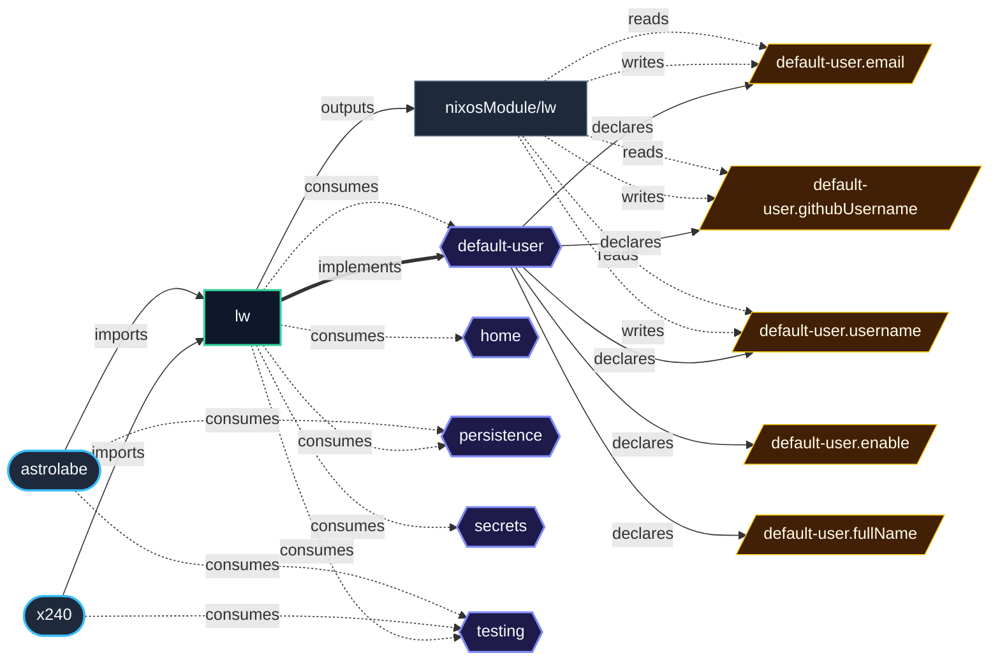

# Contract: `default-user`

Default primary user account identification, credentials, and configuration injection.

[← Back to Contracts Documentation](README.md) | [← Back to Main README](../../README.md)

- **Contract**: `default-user`
- **Definition File**: [`modules/contracts/default-user.nix`](../../modules/contracts/default-user.nix)

<details>
<summary>Architecture Diagram (click to expand)</summary>



</details>

## Outputs

### NixOS Modules

| Module | Description | Docs |
| :--- | :--- | :--- |
| [`default-user`](../modules/default-user.md) | Default primary user account identification, credentials, and configuration injection. | [More →](../modules/default-user.md) |

## Option Schema Definitions

| Option | Type | Default | Description |
| :--- | :--- | :--- | :--- |
| `default-user.email` | `string` | *null* | Primary email address associated with the default user. |
| `default-user.enable` | `boolean` | `true` | Whether to enable system default user contract. |
| `default-user.fullName` | `null or string` | *null* | Display name / GECOS description of the default user. |
| `default-user.githubUsername` | `string` | *null* | GitHub username of the default user. |
| `default-user.username` | `string` | *null* | Username of the default user account. |

## Fulfilling Implementations

Providers satisfying the `default-user` contract capability:

| Implementation | Description | Definition | Docs |
| :--- | :--- | :--- | :--- |
| [`lw`](../implementations/lw.md) | Primary human user account orchestration and identity provisioning. | [`modules/implementations/lw.nix`](../../modules/implementations/lw.nix) | [More →](../implementations/lw.md) |

## Contract Consumers

Modules and instances configuring options under the `default-user` contract capability:


### Implementations

<details>
<summary><code><a href="../implementations/lw.md">lw</a></code></summary>

**Configures options**: `default-user.email`, `default-user.githubUsername`, `default-user.username`

```nix
# modules/implementations/lw.nix
...
56: default-user = {
57: username = Identity.username.value;
58: githubUsername = Identity.githubUsername.value;
59: email = Identity.email.value;
...
```

</details>
