# Contract: `home`

Declarative user home dotfile tree, XDG directory specifications, and session environment.

[← Back to Contracts Documentation](README.md) | [← Back to Main README](../../README.md)

- **Contract**: `home`
- **Definition File**: [`modules/contracts/home.nix`](../../modules/contracts/home.nix)

```mermaid
flowchart LR
  urn__nixconf__ast__module__foot["nixosModule/foot"]:::defaultNode
    urn__nixconf__ast__module__git["nixosModule/git"]:::defaultNode
    urn__nixconf__ast__module__hjem["nixosModule/hjem"]:::defaultNode
    urn__nixconf__ast__module__labwc["nixosModule/labwc"]:::defaultNode
    urn__nixconf__ast__module__locale["nixosModule/locale"]:::defaultNode
    urn__nixconf__ast__module__lw["nixosModule/lw"]:::defaultNode
    urn__nixconf__ast__option__home_enable[/"home.enable"/]:::optNode
    urn__nixconf__ast__option__home_shared[/"home.shared"/]:::optNode
    urn__nixconf__ast__option__home_users[/"home.users"/]:::optNode
    urn__nixconf__ast__type__home_file[["home.file"]]:::typeNode
    urn__nixconf__ast__type__home_files[["home.files"]]:::typeNode
    urn__nixconf__ast__type__home_relativeHomePath[["home.relativeHomePath"]]:::typeNode
    urn__nixconf__ast__type__home_userHome[["home.userHome"]]:::typeNode
    urn__nixconf__ast__type__home_xdg[["home.xdg"]]:::typeNode
    urn__nixconf__drv__devShell__github_ssh["devShell/github-ssh"]:::devShellNode
    urn__nixconf__drv__package__foot[("package/foot")]:::pkgNode
    urn__nixconf__drv__package__git[("package/git")]:::pkgNode
    urn__nixconf__onto__contract__default_user{{"default-user"}}:::contractNode
    urn__nixconf__onto__contract__home{{"home"}}:::contractNode
    urn__nixconf__onto__contract__persistence{{"persistence"}}:::contractNode
    urn__nixconf__onto__contract__secrets{{"secrets"}}:::contractNode
    urn__nixconf__onto__contract__wayland{{"wayland"}}:::contractNode
    urn__nixconf__onto__feature__foot("foot"):::featureNode
    urn__nixconf__onto__feature__git("git"):::featureNode
    urn__nixconf__onto__feature__labwc("labwc"):::featureNode
    urn__nixconf__onto__feature__locale("locale"):::featureNode
    urn__nixconf__onto__host__astrolabe(["astrolabe"]):::hostNode
    urn__nixconf__onto__host__x240(["x240"]):::hostNode
    urn__nixconf__onto__implementation__hjem["hjem"]:::implNode
    urn__nixconf__onto__implementation__lw["lw"]:::implNode

    urn__nixconf__ast__module__foot -->|dependsOn| urn__nixconf__drv__package__foot
    urn__nixconf__ast__module__foot -.->|flowsTo| urn__nixconf__ast__module__hjem
    urn__nixconf__ast__module__foot -.->|writes| urn__nixconf__ast__option__home_shared
    urn__nixconf__ast__module__foot -.->|writes| urn__nixconf__ast__option__home_users
    urn__nixconf__ast__module__git -->|dependsOn| urn__nixconf__drv__package__git
    urn__nixconf__ast__module__git -.->|flowsTo| urn__nixconf__ast__module__hjem
    urn__nixconf__ast__module__git -.->|writes| urn__nixconf__ast__option__home_shared
    urn__nixconf__ast__module__git -.->|writes| urn__nixconf__ast__option__home_users
    urn__nixconf__ast__module__hjem -.->|reads| urn__nixconf__ast__option__home_shared
    urn__nixconf__ast__module__hjem -.->|reads| urn__nixconf__ast__option__home_users
    urn__nixconf__ast__module__labwc -.->|flowsTo| urn__nixconf__ast__module__hjem
    urn__nixconf__ast__module__labwc -.->|writes| urn__nixconf__ast__option__home_shared
    urn__nixconf__ast__module__labwc -.->|writes| urn__nixconf__ast__option__home_users
    urn__nixconf__ast__module__locale -.->|flowsTo| urn__nixconf__ast__module__hjem
    urn__nixconf__ast__module__locale -.->|writes| urn__nixconf__ast__option__home_shared
    urn__nixconf__ast__module__lw -.->|flowsTo| urn__nixconf__ast__module__hjem
    urn__nixconf__ast__module__lw -.->|writes| urn__nixconf__ast__option__home_users
    urn__nixconf__ast__option__home_shared -.->|typedBy| urn__nixconf__ast__type__home_userHome
    urn__nixconf__ast__option__home_shared -.->|typedBy| urn__nixconf__ast__type__home_xdg
    urn__nixconf__ast__option__home_users -.->|typedBy| urn__nixconf__ast__type__home_userHome
    urn__nixconf__ast__option__home_users -.->|typedBy| urn__nixconf__ast__type__home_xdg
    urn__nixconf__onto__contract__home -->|declares| urn__nixconf__ast__option__home_enable
    urn__nixconf__onto__contract__home -->|declares| urn__nixconf__ast__option__home_shared
    urn__nixconf__onto__contract__home -->|declares| urn__nixconf__ast__option__home_users
    urn__nixconf__onto__contract__home -->|declares| urn__nixconf__ast__type__home_file
    urn__nixconf__onto__contract__home -->|declares| urn__nixconf__ast__type__home_files
    urn__nixconf__onto__contract__home -->|declares| urn__nixconf__ast__type__home_relativeHomePath
    urn__nixconf__onto__contract__home -->|declares| urn__nixconf__ast__type__home_userHome
    urn__nixconf__onto__contract__home -->|declares| urn__nixconf__ast__type__home_xdg
    urn__nixconf__onto__feature__foot -->|outputs| urn__nixconf__ast__module__foot
    urn__nixconf__onto__feature__foot -->|outputs| urn__nixconf__drv__package__foot
    urn__nixconf__onto__feature__foot -.->|consumes| urn__nixconf__onto__contract__home
    urn__nixconf__onto__feature__foot -.->|consumes| urn__nixconf__onto__contract__persistence
    urn__nixconf__onto__feature__git -->|outputs| urn__nixconf__ast__module__git
    urn__nixconf__onto__feature__git -->|outputs| urn__nixconf__drv__devShell__github_ssh
    urn__nixconf__onto__feature__git -->|outputs| urn__nixconf__drv__package__git
    urn__nixconf__onto__feature__git -.->|consumes| urn__nixconf__onto__contract__home
    urn__nixconf__onto__feature__labwc -->|outputs| urn__nixconf__ast__module__labwc
    urn__nixconf__onto__feature__labwc -.->|consumes| urn__nixconf__onto__contract__home
    urn__nixconf__onto__feature__labwc -.->|consumes| urn__nixconf__onto__contract__persistence
    urn__nixconf__onto__feature__labwc -.->|consumes| urn__nixconf__onto__contract__wayland
    urn__nixconf__onto__feature__locale -->|outputs| urn__nixconf__ast__module__locale
    urn__nixconf__onto__feature__locale -.->|consumes| urn__nixconf__onto__contract__home
    urn__nixconf__onto__host__astrolabe -.->|consumes| urn__nixconf__onto__contract__persistence
    urn__nixconf__onto__host__astrolabe -->|imports| urn__nixconf__onto__feature__git
    urn__nixconf__onto__host__astrolabe -->|imports| urn__nixconf__onto__feature__locale
    urn__nixconf__onto__host__astrolabe -->|imports| urn__nixconf__onto__implementation__lw
    urn__nixconf__onto__host__x240 -.->|consumes| urn__nixconf__onto__contract__wayland
    urn__nixconf__onto__host__x240 -->|imports| urn__nixconf__onto__feature__foot
    urn__nixconf__onto__host__x240 -->|imports| urn__nixconf__onto__feature__git
    urn__nixconf__onto__host__x240 -->|imports| urn__nixconf__onto__feature__labwc
    urn__nixconf__onto__host__x240 -->|imports| urn__nixconf__onto__feature__locale
    urn__nixconf__onto__host__x240 -->|imports| urn__nixconf__onto__implementation__hjem
    urn__nixconf__onto__host__x240 -->|imports| urn__nixconf__onto__implementation__lw
    urn__nixconf__onto__implementation__hjem -->|outputs| urn__nixconf__ast__module__hjem
    urn__nixconf__onto__implementation__hjem ==>|implements| urn__nixconf__onto__contract__home
    urn__nixconf__onto__implementation__lw -->|outputs| urn__nixconf__ast__module__lw
    urn__nixconf__onto__implementation__lw -.->|consumes| urn__nixconf__onto__contract__default_user
    urn__nixconf__onto__implementation__lw -.->|consumes| urn__nixconf__onto__contract__home
    urn__nixconf__onto__implementation__lw -.->|consumes| urn__nixconf__onto__contract__persistence
    urn__nixconf__onto__implementation__lw -.->|consumes| urn__nixconf__onto__contract__secrets
    urn__nixconf__onto__implementation__lw ==>|implements| urn__nixconf__onto__contract__default_user


    click urn__nixconf__ast__module__foot href "../modules/foot.md" "foot"
    click urn__nixconf__ast__module__git href "../modules/git.md" "git"
    click urn__nixconf__ast__module__hjem href "../modules/hjem.md" "hjem"
    click urn__nixconf__ast__module__labwc href "../modules/labwc.md" "labwc"
    click urn__nixconf__ast__module__locale href "../modules/locale.md" "locale"
    click urn__nixconf__ast__module__lw href "../modules/lw.md" "lw"
    click urn__nixconf__ast__option__home_enable href "home.md" "home.enable"
    click urn__nixconf__ast__option__home_shared href "home.md" "home.shared"
    click urn__nixconf__ast__option__home_users href "home.md" "home.users"
    click urn__nixconf__ast__type__home_file href "home.md" "home.file"
    click urn__nixconf__ast__type__home_files href "home.md" "home.files"
    click urn__nixconf__ast__type__home_relativeHomePath href "home.md" "home.relativeHomePath"
    click urn__nixconf__ast__type__home_userHome href "home.md" "home.userHome"
    click urn__nixconf__ast__type__home_xdg href "home.md" "home.xdg"
    click urn__nixconf__drv__devShell__github_ssh href "../devshells.md#github-ssh" "github-ssh"
    click urn__nixconf__drv__package__foot href "../packages.md#foot" "foot"
    click urn__nixconf__drv__package__git href "../packages.md#git" "git"
    click urn__nixconf__onto__contract__default_user href "default-user.md" "default-user"
    click urn__nixconf__onto__contract__home href "home.md" "home"
    click urn__nixconf__onto__contract__persistence href "persistence.md" "persistence"
    click urn__nixconf__onto__contract__secrets href "secrets.md" "secrets"
    click urn__nixconf__onto__contract__wayland href "wayland.md" "wayland"
    click urn__nixconf__onto__feature__foot href "../features/foot.md" "foot"
    click urn__nixconf__onto__feature__git href "../features/git.md" "git"
    click urn__nixconf__onto__feature__labwc href "../features/labwc.md" "labwc"
    click urn__nixconf__onto__feature__locale href "../features/locale.md" "locale"
    click urn__nixconf__onto__host__astrolabe href "../hosts/astrolabe.md" "astrolabe"
    click urn__nixconf__onto__host__x240 href "../hosts/x240.md" "x240"
    click urn__nixconf__onto__implementation__hjem href "../implementations/hjem.md" "hjem"
    click urn__nixconf__onto__implementation__lw href "../implementations/lw.md" "lw"

  %% Semantic Visual Classes
  classDef hostNode fill:#1e293b,stroke:#38bdf8,stroke-width:2px,color:#f8fafc;
  classDef contractNode fill:#1e1b4b,stroke:#818cf8,stroke-width:2px,color:#f8fafc;
  classDef implNode fill:#0f172a,stroke:#34d399,stroke-width:2px,color:#f8fafc;
  classDef featureNode fill:#134e4a,stroke:#2dd4bf,stroke-width:2px,color:#f8fafc;
  classDef optNode fill:#422006,stroke:#facc15,stroke-width:1px,color:#fefce8;
  classDef typeNode fill:#3b0764,stroke:#c084fc,stroke-width:1px,color:#faf5ff;
  classDef pkgNode fill:#4c0519,stroke:#fb7185,stroke-width:1px,color:#fff1f2;
  classDef devShellNode fill:#451a03,stroke:#fb923c,stroke-width:1px,color:#fff7ed;
  classDef drvNode fill:#18181b,stroke:#a1a1aa,stroke-width:1px,color:#f4f4f5;
  classDef defaultNode fill:#1e293b,stroke:#64748b,stroke-width:1px,color:#f8fafc;
```

<details>
<summary>Architecture Diagram (click to expand)</summary>



</details>

## Outputs

### NixOS Modules

| Module | Description | Docs |
| :--- | :--- | :--- |
| [`home`](../modules/home.md) | Declarative user home dotfile tree, XDG directory specifications, and session environment. | [More →](../modules/home.md) |

### Library Helpers

| Symbol | Type | Description | Docs |
| :--- | :--- | :--- | :--- |
| [`mkConfig`](../lib/home.md#mkConfig) | `home.mkConfig :: AttrSet -> AttrSet` | Auto-derived configuration binding helper for the 'home' contract. | [More →](../lib/home.md#mkConfig) |
| [`mkOption`](../lib/home.md#mkOption) | `home.mkOption :: AttrSet -> AttrSet` | Auto-derived option constructor for the 'home' contract. | [More →](../lib/home.md#mkOption) |

### Custom Types

- `file`: open submodule of attribute set of anything
- `files`: attribute set of (open submodule of attribute set of anything)
- `relativeHomePath`: Relative path within home directory (no leading '/' or '..')
- `userHome`: submodule
- `xdg`: submodule

## Option Schema Definitions

| Option | Type | Default | Description |
| :--- | :--- | :--- | :--- |
| `home.enable` | `boolean` | `false` | Whether to enable declarative user home dotfile and environment contract. |
| `home.shared` | `submodule` | `{ }` | Shared dotfile tree and environment configurations applied across all managed users. |
| `home.users` | `attribute set of (submodule)` | `{ }` | Per-user dotfile tree and environment configurations mapped to active backend interpreters (e.g. Hjem). |

## Fulfilling Implementations

Providers satisfying the `home` contract capability:

| Implementation | Description | Definition | Docs |
| :--- | :--- | :--- | :--- |
| [`hjem`](../implementations/hjem.md) | Lightweight declarative home directory files and XDG environment manager. | [`modules/implementations/hjem.nix`](../../modules/implementations/hjem.nix) | [More →](../implementations/hjem.md) |

## Contract Consumers

Modules and instances configuring options under the `home` contract capability:


### Implementations

<details>
<summary><code><a href="../implementations/lw.md">lw</a></code></summary>

**Configures options**: `home.users`

```nix
# modules/implementations/lw.nix
...
73: home.users.${cfg.username} = {};
...
```

</details>


### Features

<details>
<summary><code><a href="../features/foot.md">foot</a></code></summary>

**Configures options**: `home.shared`, `home.users`

```nix
# modules/features/foot.nix
...
57: home.shared = {
58: xdg.config."foot/foot.ini" = {
59: generator = lib.generators.toINI {};
60: value = cfg.settings;
...
70: home.users = lib.mapAttrs (_: uCfg:
...
```

</details>


<details>
<summary><code><a href="../features/git.md">git</a></code></summary>

**Configures options**: `home.shared`, `home.users`

```nix
# modules/features/git.nix
...
59: home.shared.xdg.config."git/config" = {
60: generator = lib.generators.toINI {};
61: value = cfg.settings;
62: };
...
64: home.users = lib.mapAttrs (_: uCfg:
...
```

</details>


<details>
<summary><code><a href="../features/labwc.md">labwc</a></code></summary>

**Configures options**: `home.shared`, `home.users`

```nix
# modules/features/labwc.nix
...
105: home.shared.xdg.config =
106: (lib.optionalAttrs (cfg.rc != null) {
107: "labwc/rc.xml".text = cfg.rc;
108: })
...
113: home.users =
114: lib.mapAttrs (_: uCfg: {
115: xdg.config =
116: (lib.optionalAttrs (uCfg.rc != null) {
...
```

</details>


<details>
<summary><code><a href="../features/locale.md">locale</a></code></summary>

**Configures options**: `home.shared`

```nix
# modules/features/locale.nix
...
48: home.shared.sessionVariables =
49: {
50: LANG = cfg.defaultLocale;
51: }
...
```

</details>
