# Contract: `home`

Declarative user home dotfile tree, XDG directory specifications, and session environment.

[← Back to Contracts Documentation](../CONTRACTS.md) | [← Back to Main README](../../README.md)

## Metadata

- **Contract Name**: `home`
- **Description**: Declarative user home dotfile tree, XDG directory specifications, and session environment.
- **Definition File**: [`modules/contracts/home.nix`](../../modules/contracts/home.nix)

## Architecture Diagram

```mermaid
flowchart TD
    subgraph Hosts["Hosts"]
        urn__nixconf__onto__host__astrolabe["astrolabe"]:::hostNode
        urn__nixconf__onto__host__x240["x240"]:::hostNode
    end

    subgraph Contracts["Contracts"]
        urn__nixconf__onto__contract__backup(["backup"]):::contractNode
        urn__nixconf__onto__contract__default_user(["default-user"]):::contractNode
        urn__nixconf__onto__contract__home(["home"]):::contractNode
        urn__nixconf__onto__contract__persistence(["persistence"]):::contractNode
        urn__nixconf__onto__contract__resources(["resources"]):::contractNode
        urn__nixconf__onto__contract__reverse_proxy(["reverse-proxy"]):::contractNode
        urn__nixconf__onto__contract__secrets(["secrets"]):::contractNode
        urn__nixconf__onto__contract__wayland(["wayland"]):::contractNode
    end

    subgraph Features["Features"]
        urn__nixconf__onto__feature__foot["foot"]:::featureNode
        urn__nixconf__onto__feature__git["git"]:::featureNode
        urn__nixconf__onto__feature__labwc["labwc"]:::featureNode
        urn__nixconf__onto__feature__locale["locale"]:::featureNode
    end

    subgraph ContractTypes["Contract Types"]
        urn__nixconf__ast__type__home_file{{"home.file"}}:::typeNode
        urn__nixconf__ast__type__home_files{{"home.files"}}:::typeNode
        urn__nixconf__ast__type__home_relativeHomePath{{"home.relativeHomePath"}}:::typeNode
        urn__nixconf__ast__type__home_userHome{{"home.userHome"}}:::typeNode
        urn__nixconf__ast__type__home_xdg{{"home.xdg"}}:::typeNode
    end

    subgraph OtherNodes["Other Entities"]
        urn__nixconf__ast__module__foot["foot"]
        urn__nixconf__ast__module__git["git"]
        urn__nixconf__ast__module__hjem["hjem"]
        urn__nixconf__ast__module__labwc["labwc"]
        urn__nixconf__ast__module__locale["locale"]
        urn__nixconf__ast__module__lw["lw"]
        urn__nixconf__ast__option__home_enable[/"home.enable: boolean"/]:::optNode
        urn__nixconf__ast__option__home_shared[/"home.shared: submodule"/]:::optNode
        urn__nixconf__ast__option__home_users[/"home.users: attribute set of (submodule)"/]:::optNode
        urn__nixconf__drv__devShell__github_ssh["shell: github-ssh"]:::shellNode
        urn__nixconf__drv__package__foot["pkg: foot"]:::pkgNode
        urn__nixconf__drv__package__git["pkg: git"]:::pkgNode
        urn__nixconf__onto__implementation__hjem["hjem"]:::implNode
        urn__nixconf__onto__implementation__lw["lw"]:::implNode
        urn__nixconf__onto__primitive__contract["contract"]
        urn__nixconf__onto__primitive__feature["feature"]
        urn__nixconf__onto__primitive__implementation["implementation"]
    end


    urn__nixconf__ast__module__foot -->|"dependsOn"| urn__nixconf__drv__package__foot
    urn__nixconf__ast__module__foot ==>|"flowsTo"| urn__nixconf__ast__module__hjem
    urn__nixconf__ast__module__foot ==>|"flowsTo"| urn__nixconf__ast__module__hjem
    urn__nixconf__ast__module__foot -->|"writes"| urn__nixconf__ast__option__home_shared
    urn__nixconf__ast__module__foot -->|"writes"| urn__nixconf__ast__option__home_users
    urn__nixconf__ast__module__git -->|"dependsOn"| urn__nixconf__drv__package__git
    urn__nixconf__ast__module__git ==>|"flowsTo"| urn__nixconf__ast__module__hjem
    urn__nixconf__ast__module__git ==>|"flowsTo"| urn__nixconf__ast__module__hjem
    urn__nixconf__ast__module__git -->|"writes"| urn__nixconf__ast__option__home_shared
    urn__nixconf__ast__module__git -->|"writes"| urn__nixconf__ast__option__home_shared
    urn__nixconf__ast__module__git -->|"writes"| urn__nixconf__ast__option__home_users
    urn__nixconf__ast__module__git -->|"writes"| urn__nixconf__ast__option__home_users
    urn__nixconf__ast__module__hjem -.->|"reads"| urn__nixconf__ast__option__home_enable
    urn__nixconf__ast__module__hjem -.->|"reads"| urn__nixconf__ast__option__home_shared
    urn__nixconf__ast__module__hjem -.->|"reads"| urn__nixconf__ast__option__home_users
    urn__nixconf__ast__module__hjem -->|"writes"| urn__nixconf__ast__option__home_enable
    urn__nixconf__ast__module__labwc ==>|"flowsTo"| urn__nixconf__ast__module__hjem
    urn__nixconf__ast__module__labwc ==>|"flowsTo"| urn__nixconf__ast__module__hjem
    urn__nixconf__ast__module__labwc -->|"writes"| urn__nixconf__ast__option__home_shared
    urn__nixconf__ast__module__labwc -->|"writes"| urn__nixconf__ast__option__home_users
    urn__nixconf__ast__module__locale ==>|"flowsTo"| urn__nixconf__ast__module__hjem
    urn__nixconf__ast__module__locale -->|"writes"| urn__nixconf__ast__option__home_shared
    urn__nixconf__ast__module__locale -->|"writes"| urn__nixconf__ast__option__home_shared
    urn__nixconf__ast__module__lw ==>|"flowsTo"| urn__nixconf__ast__module__hjem
    urn__nixconf__ast__module__lw -->|"writes"| urn__nixconf__ast__option__home_users
    urn__nixconf__ast__module__lw -->|"writes"| urn__nixconf__ast__option__home_users
    urn__nixconf__ast__option__home_shared -.->|"typedBy"| urn__nixconf__ast__type__home_userHome
    urn__nixconf__ast__option__home_shared -.->|"typedBy"| urn__nixconf__ast__type__home_xdg
    urn__nixconf__ast__option__home_users -.->|"typedBy"| urn__nixconf__ast__type__home_userHome
    urn__nixconf__ast__option__home_users -.->|"typedBy"| urn__nixconf__ast__type__home_xdg
    urn__nixconf__onto__contract__home --- urn__nixconf__ast__option__home_enable
    urn__nixconf__onto__contract__home --- urn__nixconf__ast__option__home_shared
    urn__nixconf__onto__contract__home --- urn__nixconf__ast__option__home_users
    urn__nixconf__onto__contract__home --- urn__nixconf__ast__type__home_file
    urn__nixconf__onto__contract__home --- urn__nixconf__ast__type__home_files
    urn__nixconf__onto__contract__home --- urn__nixconf__ast__type__home_relativeHomePath
    urn__nixconf__onto__contract__home --- urn__nixconf__ast__type__home_userHome
    urn__nixconf__onto__contract__home --- urn__nixconf__ast__type__home_xdg
    urn__nixconf__onto__feature__foot -->|"outputs"| urn__nixconf__ast__module__foot
    urn__nixconf__onto__feature__foot -->|"outputs"| urn__nixconf__drv__package__foot
    urn__nixconf__onto__feature__foot -->|"consumes"| urn__nixconf__onto__contract__home
    urn__nixconf__onto__feature__foot -->|"consumes"| urn__nixconf__onto__contract__home
    urn__nixconf__onto__feature__foot -->|"consumes"| urn__nixconf__onto__contract__persistence
    urn__nixconf__onto__feature__git -->|"outputs"| urn__nixconf__ast__module__git
    urn__nixconf__onto__feature__git -->|"outputs"| urn__nixconf__drv__devShell__github_ssh
    urn__nixconf__onto__feature__git -->|"outputs"| urn__nixconf__drv__package__git
    urn__nixconf__onto__feature__git -->|"consumes"| urn__nixconf__onto__contract__home
    urn__nixconf__onto__feature__git -->|"consumes"| urn__nixconf__onto__contract__home
    urn__nixconf__onto__feature__labwc -->|"outputs"| urn__nixconf__ast__module__labwc
    urn__nixconf__onto__feature__labwc -->|"consumes"| urn__nixconf__onto__contract__home
    urn__nixconf__onto__feature__labwc -->|"consumes"| urn__nixconf__onto__contract__home
    urn__nixconf__onto__feature__labwc -->|"consumes"| urn__nixconf__onto__contract__persistence
    urn__nixconf__onto__feature__labwc -->|"consumes"| urn__nixconf__onto__contract__wayland
    urn__nixconf__onto__feature__locale -->|"outputs"| urn__nixconf__ast__module__locale
    urn__nixconf__onto__feature__locale -->|"consumes"| urn__nixconf__onto__contract__home
    urn__nixconf__onto__host__astrolabe -->|"consumes"| urn__nixconf__onto__contract__reverse_proxy
    urn__nixconf__onto__host__astrolabe -->|"imports"| urn__nixconf__onto__feature__git
    urn__nixconf__onto__host__astrolabe -->|"imports"| urn__nixconf__onto__feature__locale
    urn__nixconf__onto__host__astrolabe -->|"imports"| urn__nixconf__onto__implementation__lw
    urn__nixconf__onto__host__x240 -->|"consumes"| urn__nixconf__onto__contract__wayland
    urn__nixconf__onto__host__x240 -->|"imports"| urn__nixconf__onto__feature__foot
    urn__nixconf__onto__host__x240 -->|"imports"| urn__nixconf__onto__feature__git
    urn__nixconf__onto__host__x240 -->|"imports"| urn__nixconf__onto__feature__labwc
    urn__nixconf__onto__host__x240 -->|"imports"| urn__nixconf__onto__feature__locale
    urn__nixconf__onto__host__x240 -->|"imports"| urn__nixconf__onto__implementation__hjem
    urn__nixconf__onto__host__x240 -->|"imports"| urn__nixconf__onto__implementation__lw
    urn__nixconf__onto__implementation__hjem -->|"outputs"| urn__nixconf__ast__module__hjem
    urn__nixconf__onto__implementation__hjem -->|"consumes"| urn__nixconf__onto__contract__home
    urn__nixconf__onto__implementation__hjem -.->|"implements"| urn__nixconf__onto__contract__home
    urn__nixconf__onto__implementation__hjem -.->|"implements"| urn__nixconf__onto__contract__home
    urn__nixconf__onto__implementation__lw -->|"outputs"| urn__nixconf__ast__module__lw
    urn__nixconf__onto__implementation__lw -->|"consumes"| urn__nixconf__onto__contract__default_user
    urn__nixconf__onto__implementation__lw -->|"consumes"| urn__nixconf__onto__contract__default_user
    urn__nixconf__onto__implementation__lw -->|"consumes"| urn__nixconf__onto__contract__default_user
    urn__nixconf__onto__implementation__lw -->|"consumes"| urn__nixconf__onto__contract__home
    urn__nixconf__onto__implementation__lw -->|"consumes"| urn__nixconf__onto__contract__persistence
    urn__nixconf__onto__implementation__lw -->|"consumes"| urn__nixconf__onto__contract__secrets
    urn__nixconf__onto__implementation__lw -.->|"implements"| urn__nixconf__onto__contract__default_user
    urn__nixconf__onto__implementation__lw -.->|"implements"| urn__nixconf__onto__contract__default_user
    urn__nixconf__onto__primitive__contract --- urn__nixconf__onto__contract__backup
    urn__nixconf__onto__primitive__contract --- urn__nixconf__onto__contract__default_user
    urn__nixconf__onto__primitive__contract --- urn__nixconf__onto__contract__home
    urn__nixconf__onto__primitive__contract --- urn__nixconf__onto__contract__persistence
    urn__nixconf__onto__primitive__contract --- urn__nixconf__onto__contract__resources
    urn__nixconf__onto__primitive__contract --- urn__nixconf__onto__contract__reverse_proxy
    urn__nixconf__onto__primitive__contract --- urn__nixconf__onto__contract__secrets
    urn__nixconf__onto__primitive__contract --- urn__nixconf__onto__contract__wayland
    urn__nixconf__onto__primitive__feature --- urn__nixconf__onto__feature__foot
    urn__nixconf__onto__primitive__feature --- urn__nixconf__onto__feature__git
    urn__nixconf__onto__primitive__feature --- urn__nixconf__onto__feature__labwc
    urn__nixconf__onto__primitive__feature --- urn__nixconf__onto__feature__locale
    urn__nixconf__onto__primitive__implementation --- urn__nixconf__onto__implementation__hjem
    urn__nixconf__onto__primitive__implementation --- urn__nixconf__onto__implementation__lw

classDef hostNode fill:#1e1e2e,stroke:#cba6f7,stroke-width:2px,color:#cdd6f4;
classDef contractNode fill:#181825,stroke:#89b4fa,stroke-width:2px,color:#cdd6f4;
classDef implNode fill:#181825,stroke:#a6e3a1,stroke-width:2px,color:#cdd6f4;
classDef featureNode fill:#181825,stroke:#f38ba8,stroke-width:2px,color:#cdd6f4;
classDef libNode fill:#181825,stroke:#94e2d5,stroke-width:2px,color:#cdd6f4;
classDef optNode fill:#11111b,stroke:#fab387,stroke-width:1px,color:#cdd6f4;
classDef typeNode fill:#11111b,stroke:#f9e2af,stroke-width:1px,color:#cdd6f4;
classDef fnNode fill:#181825,stroke:#94e2d5,stroke-width:1px,color:#cdd6f4;
classDef pkgNode fill:#181825,stroke:#b4befe,stroke-width:1px,color:#cdd6f4;
classDef shellNode fill:#181825,stroke:#f5c2e7,stroke-width:1px,color:#cdd6f4;

```




## Option Schema Definitions

| Option Path | Type | Default | Example | Description |
| :--- | :--- | :--- | :--- | :--- |
| `options.home.enable` | `boolean` | `` | `1` | Whether to enable declarative user home dotfile and environment contract. |
| `options.home.shared` | `submodule` | `{ ... }` | `{ ... }` | Shared dotfile tree and environment configurations applied across all managed users. |
| `options.home.users` | `attribute set of (submodule)` | `{ ... }` | `{ ... }` | Per-user dotfile tree and environment configurations mapped to active backend interpreters (e.g. Hjem). |


## Outputs

### Custom Submodule Types

| Type Name | Description | Docs |
| :--- | :--- | :--- |
| [`home.file`](../lib/home.md#home.file) | open submodule of attribute set of anything | [More →](../lib/home.md#home.file) |
| [`home.files`](../lib/home.md#home.files) | attribute set of (open submodule of attribute set of anything) | [More →](../lib/home.md#home.files) |
| [`home.relativeHomePath`](../lib/home.md#home.relativeHomePath) | Relative path within home directory (no leading '/' or '..') | [More →](../lib/home.md#home.relativeHomePath) |
| [`home.userHome`](../lib/home.md#home.userHome) | submodule | [More →](../lib/home.md#home.userHome) |
| [`home.xdg`](../lib/home.md#home.xdg) | submodule | [More →](../lib/home.md#home.xdg) |


### Library Helpers

| Symbol | Description | Docs |
| :--- | :--- | :--- |
| [`flake.lib.home.mkOption`](../lib/home.md#mkOption) | Contract option constructor / binding helper | [More →](../lib/home.md#mkOption) |
| [`flake.lib.home.mkConfig`](../lib/home.md#mkConfig) | Contract option constructor / binding helper | [More →](../lib/home.md#mkConfig) |
| [`flake.lib.home.types`](../lib/home.md#types) | Contract option constructor / binding helper | [More →](../lib/home.md#types) |


## Implementations

Providers satisfying the `home` contract capability:

| Implementation | Description | Docs |
| :--- | :--- | :--- |
| [`hjem`](../implementations/hjem.md) | Lightweight declarative home directory files and XDG environment manager. | [More →](../implementations/hjem.md) |

## Contract Consumers

Modules configuring options under the `home` contract capability:

### Hosts

*No hosts configure this contract directly.*

### Implementations

<details>
<summary><code><a href="../implementations/hjem.md">hjem</a></code></summary>

Configures options: *general contract configuration*

```nix
config = {

};

```

</details>


<details>
<summary><code><a href="../implementations/lw.md">lw</a></code></summary>

Configures options: *general contract configuration*

```nix
config = {

};

```

</details>


### Features

<details>
<summary><code><a href="../features/foot.md">foot</a></code></summary>

Configures options: *general contract configuration*

```nix
config = {

};

```

</details>


<details>
<summary><code><a href="../features/foot.md">foot</a></code></summary>

Configures options: *general contract configuration*

```nix
config = {

};

```

</details>


<details>
<summary><code><a href="../features/git.md">git</a></code></summary>

Configures options: *general contract configuration*

```nix
config = {

};

```

</details>


<details>
<summary><code><a href="../features/git.md">git</a></code></summary>

Configures options: *general contract configuration*

```nix
config = {

};

```

</details>


<details>
<summary><code><a href="../features/labwc.md">labwc</a></code></summary>

Configures options: *general contract configuration*

```nix
config = {

};

```

</details>


<details>
<summary><code><a href="../features/labwc.md">labwc</a></code></summary>

Configures options: *general contract configuration*

```nix
config = {

};

```

</details>


<details>
<summary><code><a href="../features/locale.md">locale</a></code></summary>

Configures options: *general contract configuration*

```nix
config = {

};

```

</details>

