# Contract: `persistence`

Declarative state preservation across ephemeral reboots for system and user directories.

[← Back to Contracts Documentation](../CONTRACTS.md) | [← Back to Main README](../../README.md)

## Metadata

- **Contract Name**: `persistence`
- **Description**: Declarative state preservation across ephemeral reboots for system and user directories.
- **Definition File**: [`modules/contracts/persistence.nix`](../../modules/contracts/persistence.nix)

## Architecture Diagram

```mermaid
flowchart TD
    subgraph Hosts["Hosts"]
        host__astrolabe["astrolabe"]:::hostNode
        host__x240["x240"]:::hostNode
    end

    subgraph Contracts["Contracts"]
        contract__backup(["backup"]):::contractNode
        contract__default_user(["default-user"]):::contractNode
        contract__home(["home"]):::contractNode
        contract__persistence(["persistence"]):::contractNode
        contract__resources(["resources"]):::contractNode
        contract__reverse_proxy(["reverse-proxy"]):::contractNode
        contract__secrets(["secrets"]):::contractNode
        contract__wayland(["wayland"]):::contractNode
    end

    subgraph Implementations["Implementations"]
        impl__caddy["caddy"]:::implNode
        impl__impermanence["impermanence"]:::implNode
        impl__lw["lw"]:::implNode
    end

    subgraph Features["Features"]
        feature__antigravity["antigravity"]:::featureNode
        feature__bitwarden["bitwarden"]:::featureNode
        feature__cosmic["cosmic"]:::featureNode
        feature__direnv["direnv"]:::featureNode
        feature__dolphin["dolphin"]:::featureNode
        feature__foot["foot"]:::featureNode
        feature__helium["helium"]:::featureNode
        feature__labwc["labwc"]:::featureNode
        feature__noctalia["noctalia"]:::featureNode
        feature__ssh["ssh"]:::featureNode
        feature__vaultwarden["vaultwarden"]:::featureNode
        feature__vivaldi["vivaldi"]:::featureNode
        feature__vscode["vscode"]:::featureNode
    end

    subgraph Libraries["Libraries"]
        lib__bitwarden(["lib: bitwarden"]):::libNode
        lib__lw(["lib: lw"]):::libNode
        lib__persistence(["lib: persistence"]):::libNode
    end

    subgraph ContractOptions["Contract Options"]
        opt__persistence_directories[/"persistence.directories: list of (string or attribute set of anything)"/]:::optNode
        opt__persistence_enable[/"persistence.enable: boolean"/]:::optNode
        opt__persistence_files[/"persistence.files: list of (string or attribute set of anything)"/]:::optNode
        opt__persistence_users[/"persistence.users: attribute set of (submodule)"/]:::optNode
    end

    subgraph ContractTypes["Contract Types"]
        type__persistence_entries{{"persistence.entries"}}:::typeNode
        type__persistence_user{{"persistence.user"}}:::typeNode
    end

    subgraph Functions["Library Functions"]
        fn__persistence_mkConfig(["persistence.mkConfig"]):::fnNode
        fn__persistence_mkOption(["persistence.mkOption"]):::fnNode
    end

    subgraph OtherNodes["Other Entities"]
        fn__persistence_entries["persistence.entries"]
    end


    host__astrolabe -->|"imports"| impl__caddy
    host__astrolabe -->|"imports"| impl__impermanence
    host__astrolabe -->|"imports"| impl__lw
    host__astrolabe -->|"imports"| feature__ssh
    host__astrolabe -->|"imports"| feature__vaultwarden
    host__x240 -->|"imports"| impl__impermanence
    host__x240 -->|"imports"| impl__lw
    host__x240 -->|"imports"| feature__antigravity
    host__x240 -->|"imports"| feature__bitwarden
    host__x240 -->|"imports"| feature__direnv
    host__x240 -->|"imports"| feature__dolphin
    host__x240 -->|"imports"| feature__foot
    host__x240 -->|"imports"| feature__labwc
    host__x240 -->|"imports"| feature__noctalia
    host__x240 -->|"imports"| feature__ssh
    host__x240 -->|"imports"| feature__vivaldi
    host__x240 -->|"imports"| feature__vscode
    impl__caddy -.->|"implements"| contract__reverse_proxy
    impl__impermanence -.->|"implements"| contract__persistence
    impl__lw -.->|"implements"| contract__default_user
    host__astrolabe -->|"consumes (reverse-proxy.domain)"| contract__reverse_proxy
    host__x240 -->|"consumes (wayland.enable)"| contract__wayland
    feature__antigravity -->|"consumes (persistence.users)"| contract__persistence
    feature__bitwarden -->|"consumes (persistence.users)"| contract__persistence
    feature__cosmic -->|"consumes (persistence.users, persistence.directories)"| contract__persistence
    feature__direnv -->|"consumes (persistence.users)"| contract__persistence
    feature__dolphin -->|"consumes (persistence.users)"| contract__persistence
    feature__foot -->|"consumes (home.shared, home.users)"| contract__home
    feature__foot -->|"consumes (persistence.users)"| contract__persistence
    feature__helium -->|"consumes (home.shared, home.users)"| contract__home
    feature__helium -->|"consumes (persistence.users)"| contract__persistence
    feature__labwc -->|"consumes (home.shared.xdg.config, home.users, home.shared)"| contract__home
    feature__labwc -->|"consumes (persistence.users)"| contract__persistence
    feature__labwc -->|"consumes (wayland.compositors.labwc, wayland.compositors)"| contract__wayland
    feature__noctalia -->|"consumes (persistence.users)"| contract__persistence
    feature__ssh -->|"consumes (default-user.enable, default-user.username)"| contract__default_user
    feature__ssh -->|"consumes (persistence.files, persistence.enable)"| contract__persistence
    feature__ssh -->|"consumes (secrets.files)"| contract__secrets
    feature__vaultwarden -->|"consumes (backup.enable)"| contract__backup
    feature__vaultwarden -->|"consumes (persistence.enable)"| contract__persistence
    feature__vaultwarden -->|"consumes (resources.enable)"| contract__resources
    feature__vaultwarden -->|"consumes (reverse-proxy.domain)"| contract__reverse_proxy
    feature__vivaldi -->|"consumes (persistence.users)"| contract__persistence
    feature__vscode -->|"consumes (persistence.users)"| contract__persistence
    impl__caddy -->|"consumes (persistence.directories, persistence.enable)"| contract__persistence
    impl__caddy -->|"consumes (resources.services.caddy, resources.enable, resources.services)"| contract__resources
    impl__impermanence -->|"consumes (persistence.users)"| contract__persistence
    impl__lw -->|"consumes (home.users)"| contract__home
    impl__lw -->|"consumes (persistence.users)"| contract__persistence
    impl__lw -->|"consumes (secrets.files.default-user-password-hash, secrets.files)"| contract__secrets
    contract__persistence -.->|"provides"| lib__persistence
    impl__lw -.->|"provides"| lib__lw
    feature__bitwarden -.->|"provides"| lib__bitwarden
    contract__persistence --- opt__persistence_directories
    contract__persistence --- opt__persistence_enable
    contract__persistence --- opt__persistence_files
    contract__persistence --- opt__persistence_users
    contract__persistence --- type__persistence_entries
    contract__persistence --- type__persistence_user
    lib__persistence -->|"exports"| fn__persistence_entries
    lib__persistence -->|"exports"| fn__persistence_mkConfig
    lib__persistence -->|"exports"| fn__persistence_mkOption

classDef hostNode fill:#1e1e2e,stroke:#cba6f7,stroke-width:2px,color:#cdd6f4;
classDef contractNode fill:#181825,stroke:#89b4fa,stroke-width:2px,color:#cdd6f4;
classDef implNode fill:#181825,stroke:#a6e3a1,stroke-width:2px,color:#cdd6f4;
classDef featureNode fill:#181825,stroke:#f38ba8,stroke-width:2px,color:#cdd6f4;
classDef libNode fill:#181825,stroke:#94e2d5,stroke-width:2px,color:#cdd6f4;
classDef optNode fill:#11111b,stroke:#fab387,stroke-width:1px,color:#cdd6f4;
classDef typeNode fill:#11111b,stroke:#f9e2af,stroke-width:1px,color:#cdd6f4;
classDef fnNode fill:#181825,stroke:#94e2d5,stroke-width:1px,color:#cdd6f4;
classDef pkgNode fill:#181825,stroke:#b4befe,stroke-width:1px,color:#cdd6f4;
classDef shellNode fill:#181825,stroke:#f5c2e7,stroke-width:1px,color:#cdd6f4;

```




## Option Schema Definitions

| Option Path | Type | Default | Example | Description |
| :--- | :--- | :--- | :--- | :--- |
| `options.persistence.directories` | `list of (string or attribute set of anything)` | `[ ... ]` | `[ ... ]` | List of directory paths to persist across reboots, as absolute system paths under `/persist/system`. Can be string paths or attribute sets defining custom ownership and bind-mount modes. |
| `options.persistence.enable` | `boolean` | `1` | `1` | Whether to enable declarative filesystem persistence contract mapped to impermanence. |
| `options.persistence.files` | `list of (string or attribute set of anything)` | `[ ... ]` | `[ ... ]` | List of individual file paths to persist across reboots, as absolute system paths under `/persist/system`. Can be string paths or attribute sets defining custom ownership and bind-mount modes. |
| `options.persistence.users` | `attribute set of (submodule)` | `{ ... }` | `{ ... }` | Per-user persistence declarations keyed by username. `data` and `cache` root names are repository conventions, not upstream impermanence requirements. |


## Outputs

### Custom Submodule Types

| Type Name | Description | Docs |
| :--- | :--- | :--- |
| [`persistence.entries`](../lib/persistence.md#persistence.entries) | list of (string or attribute set of anything) | [More →](../lib/persistence.md#persistence.entries) |
| [`persistence.user`](../lib/persistence.md#persistence.user) | submodule | [More →](../lib/persistence.md#persistence.user) |


### Library Helpers

| Symbol | Description | Docs |
| :--- | :--- | :--- |
| [`flake.lib.persistence.types`](../lib/persistence.md#types) | Contract option constructor / binding helper | [More →](../lib/persistence.md#types) |
| [`flake.lib.persistence.entries`](../lib/persistence.md#entries) | Contract option constructor / binding helper | [More →](../lib/persistence.md#entries) |
| [`flake.lib.persistence.mkConfig`](../lib/persistence.md#mkConfig) | Contract option constructor / binding helper | [More →](../lib/persistence.md#mkConfig) |
| [`flake.lib.persistence.mkOption`](../lib/persistence.md#mkOption) | Contract option constructor / binding helper | [More →](../lib/persistence.md#mkOption) |


## Implementations

Providers satisfying the `persistence` contract capability:

| Implementation | Description | Docs |
| :--- | :--- | :--- |
| [`impermanence`](../implementations/impermanence.md) | Ephemeral root filesystem with persistent state bind-mounts via Impermanence. | [More →](../implementations/impermanence.md) |

## Contract Consumers

Modules configuring options under the `persistence` contract capability:

### Hosts

*No hosts configure this contract directly.*

### Implementations

<details>
<summary><code><a href="../implementations/caddy.md">caddy</a></code></summary>

Configures options: `persistence.directories`, `persistence.enable`

```nix
persistence.directories = lib.mkIf (config.persistence.enable or false) [
  "/var/lib/caddy"
];
```

</details>


<details>
<summary><code><a href="../implementations/impermanence.md">impermanence</a></code></summary>

Configures options: `persistence.users`

```nix
message = "persistence.users.${userName} entries must be relative paths (or impermanence attribute sets), because they are mapped to /home/${userName}.";
```

</details>


<details>
<summary><code><a href="../implementations/lw.md">lw</a></code></summary>

Configures options: `persistence.users`

```nix
persistence.users.${cfg.username} = {
  data.directories = [
    "nixconf"
    "Documents"
    "Downloads"
    "Projects"
    ".ssh"
    ".gnupg"
  ];
};
```

</details>


### Features

<details>
<summary><code><a href="../features/antigravity.md">antigravity</a></code></summary>

Configures options: `persistence.users`

```nix
persistence.users = lib.mapAttrs (_: _: {
  data.directories = [
    ".antigravity-ide"
    ".gemini"
  ];
}) (lib.filterAttrs (_: u: u.isNormalUser or false) config.users.users);
```

</details>


<details>
<summary><code><a href="../features/bitwarden.md">bitwarden</a></code></summary>

Configures options: `persistence.users`

```nix
persistence.users = lib.mapAttrs (_: _: {
  data.directories = [".config/Bitwarden CLI"];
}) (lib.filterAttrs (_: u: u.isNormalUser or false) config.users.users);

persistence.users = lib.mapAttrs (_: _: {
  data.directories = [".config/Bitwarden"];
  cache.directories = [".cache/com.bitwarden.desktop"];
}) (lib.filterAttrs (_: u: u.isNormalUser or false) config.users.users);
```

</details>


<details>
<summary><code><a href="../features/cosmic.md">cosmic</a></code></summary>

Configures options: `persistence.users`, `persistence.directories`

```nix
persistence.users = lib.mkIf config.cosmic.enable (lib.mapAttrs (_: _: {
  data.directories = [
    ".config/cosmic"
    ".config/dconf"
    ".local/state/cosmic"
    ".local/state/cosmic-comp"
  ];
  cache.directories = [".cache/cosmic-settings"];
}) (lib.filterAttrs (_: u: u.isNormalUser or false) config.users.users));

persistence.directories = lib.mkIf config.services.displayManager.cosmic-greeter.enable [
  "/var/lib/cosmic-greeter"
];
```

</details>


<details>
<summary><code><a href="../features/direnv.md">direnv</a></code></summary>

Configures options: `persistence.users`

```nix
persistence.users = lib.mapAttrs (_: _: {
  cache.directories = [".cache/direnv"];
}) (lib.filterAttrs (_: u: u.isNormalUser or false) config.users.users);
```

</details>


<details>
<summary><code><a href="../features/dolphin.md">dolphin</a></code></summary>

Configures options: `persistence.users`

```nix
persistence.users = lib.mapAttrs (_: _: {
  data = {
    directories = [".local/share/dolphin"];
    files = [".config/dolphinrc"];
  };
}) (lib.filterAttrs (_: u: u.isNormalUser or false) config.users.users);
```

</details>


<details>
<summary><code><a href="../features/foot.md">foot</a></code></summary>

Configures options: `persistence.users`

```nix
persistence.users = self.lib.user.forNormalUsers config (_: _: {
  data.directories = [".config/foot"];
});
```

</details>


<details>
<summary><code><a href="../features/helium.md">helium</a></code></summary>

Configures options: `persistence.users`

```nix
persistence.users = self.lib.user.forNormalUsers config (_: _: {
  data.directories = [".config/net.imput.helium"];
});
```

</details>


<details>
<summary><code><a href="../features/labwc.md">labwc</a></code></summary>

Configures options: `persistence.users`

```nix
persistence.users = self.lib.user.forNormalUsers config (_: _: {
  data.directories = [".config/labwc"];
});
```

</details>


<details>
<summary><code><a href="../features/noctalia.md">noctalia</a></code></summary>

Configures options: `persistence.users`

```nix
persistence.users = lib.mapAttrs (_: _: {
  data.directories = [
    ".config/noctalia"
    ".local/state/noctalia"
    "Pictures/Wallpapers"
  ];
}) (lib.filterAttrs (_: u: u.isNormalUser or false) config.users.users);
```

</details>


<details>
<summary><code><a href="../features/ssh.md">ssh</a></code></summary>

Configures options: `persistence.files`, `persistence.enable`

```nix
persistence.files = lib.mkIf (config.persistence ? enable && config.persistence.enable) [
  "/etc/ssh/ssh_host_ed25519_key"
  "/etc/ssh/ssh_host_ed25519_key.pub"
  "/etc/ssh/ssh_host_rsa_key"
  "/etc/ssh/ssh_host_rsa_key.pub"
];
```

</details>


<details>
<summary><code><a href="../features/vaultwarden.md">vaultwarden</a></code></summary>

Configures options: `persistence.enable`

```nix
// self.lib.persistence.mkOption {
  directories = ["/var/lib/vaultwarden"];
}

(self.lib.persistence.mkConfig {inherit config cfg;})
```

</details>


<details>
<summary><code><a href="../features/vivaldi.md">vivaldi</a></code></summary>

Configures options: `persistence.users`

```nix
persistence.users = lib.mapAttrs (_: _: {
  data.directories = [".config/vivaldi"];
  cache.directories = [".cache/vivaldi"];
}) (lib.filterAttrs (_: u: u.isNormalUser or false) config.users.users);
```

</details>


<details>
<summary><code><a href="../features/vscode.md">vscode</a></code></summary>

Configures options: `persistence.users`

```nix
description = "Visual Studio Code editor environment and persistence.";

persistence.users = lib.mapAttrs (_: _: {
  data.directories = [".config/Code" ".vscode"];
}) (lib.filterAttrs (_: u: u.isNormalUser or false) config.users.users);
```

</details>

