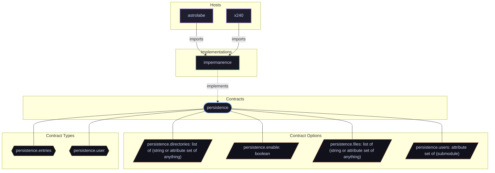

# Contract: `persistence`

Declarative state preservation across ephemeral reboots for system and user directories.

[← Back to Contracts Documentation](../CONTRACTS.md) | [← Back to Main README](../../README.md)

## Metadata

- **Contract Name**: `persistence`
- **Description**: Declarative state preservation across ephemeral reboots for system and user directories.
- **Definition File**: [`modules/contracts/persistence.nix`](../../modules/contracts/persistence.nix)

## Architecture Diagram

## Option Schema Definitions

| Option Path | Type | Default | Example | Description |
| :--- | :--- | :--- | :--- | :--- |
| `options.persistence.directories` | `list of (string or attribute set of anything)` | `[ ... ]` | `[ ... ]` | List of directory paths to persist across reboots, as absolute system paths under `/persist/system`. Can be string paths or attribute sets defining custom ownership and bind-mount modes. |
| `options.persistence.enable` | `boolean` | `1` | `1` | Whether to enable declarative filesystem persistence contract mapped to impermanence. |
| `options.persistence.files` | `list of (string or attribute set of anything)` | `[ ... ]` | `[ ... ]` | List of individual file paths to persist across reboots, as absolute system paths under `/persist/system`. Can be string paths or attribute sets defining custom ownership and bind-mount modes. |
| `options.persistence.users` | `attribute set of (submodule)` | `{ ... }` | `{ ... }` | Per-user persistence declarations keyed by username. `data` and `cache` root names are repository conventions, not upstream impermanence requirements. |

## Outputs

### Custom Submodule Types

| Type Name | Description | Docs |
| :--- | :--- | :--- |
| [`persistence.entries`](../lib/persistence.md#persistence.entries) | list of (string or attribute set of anything) | [More →](../lib/persistence.md#persistence.entries) |
| [`persistence.user`](../lib/persistence.md#persistence.user) | submodule | [More →](../lib/persistence.md#persistence.user) |

### Library Helpers

| Symbol | Description | Docs |
| :--- | :--- | :--- |
| [`flake.lib.persistence.types`](../lib/persistence.md#types) | Contract option constructor / binding helper | [More →](../lib/persistence.md#types) |
| [`flake.lib.persistence.entries`](../lib/persistence.md#entries) | Contract option constructor / binding helper | [More →](../lib/persistence.md#entries) |
| [`flake.lib.persistence.mkConfig`](../lib/persistence.md#mkConfig) | Contract option constructor / binding helper | [More →](../lib/persistence.md#mkConfig) |
| [`flake.lib.persistence.mkOption`](../lib/persistence.md#mkOption) | Contract option constructor / binding helper | [More →](../lib/persistence.md#mkOption) |

## Implementations

Providers satisfying the `persistence` contract capability:

| Implementation | Description | Docs |
| :--- | :--- | :--- |
| [`impermanence`](../implementations/impermanence.md) | Ephemeral root filesystem with persistent state bind-mounts via Impermanence. | [More →](../implementations/impermanence.md) |

## Contract Consumers

Modules configuring options under the `persistence` contract capability:

### Hosts

*No hosts configure this contract directly.*

### Implementations

*No implementations configure this contract.*

### Features

*No features configure this contract.*
