# Contract: `resources`

System resource limits, cgroup slices, memory/CPU quotas, and power-aware throttling.

[← Back to Contracts Documentation](../CONTRACTS.md) | [← Back to Main README](../../README.md)

## Metadata

- **Contract Name**: `resources`
- **Description**: System resource limits, cgroup slices, memory/CPU quotas, and power-aware throttling.
- **Definition File**: [`modules/contracts/resources.nix`](../../modules/contracts/resources.nix)

## Architecture Diagram

```mermaid
flowchart TD
    subgraph Hosts["Hosts"]
        urn__nixconf__onto__host__astrolabe["astrolabe"]:::hostNode
        urn__nixconf__onto__host__x240["x240"]:::hostNode
    end

    subgraph Contracts["Contracts"]
        urn__nixconf__onto__contract__backup(["backup"]):::contractNode
        urn__nixconf__onto__contract__default_user(["default-user"]):::contractNode
        urn__nixconf__onto__contract__home(["home"]):::contractNode
        urn__nixconf__onto__contract__persistence(["persistence"]):::contractNode
        urn__nixconf__onto__contract__resources(["resources"]):::contractNode
        urn__nixconf__onto__contract__reverse_proxy(["reverse-proxy"]):::contractNode
        urn__nixconf__onto__contract__secrets(["secrets"]):::contractNode
        urn__nixconf__onto__contract__wayland(["wayland"]):::contractNode
    end

    subgraph Features["Features"]
        urn__nixconf__onto__feature__ttyd["ttyd"]:::featureNode
        urn__nixconf__onto__feature__vaultwarden["vaultwarden"]:::featureNode
    end

    subgraph ContractTypes["Contract Types"]
        urn__nixconf__ast__type__resources_byteSize{{"resources.byteSize"}}:::typeNode
        urn__nixconf__ast__type__resources_cgroupWeight{{"resources.cgroupWeight"}}:::typeNode
        urn__nixconf__ast__type__resources_service{{"resources.service"}}:::typeNode
        urn__nixconf__ast__type__resources_slice{{"resources.slice"}}:::typeNode
    end

    subgraph OtherNodes["Other Entities"]
        urn__nixconf__ast__module__caddy["caddy"]
        urn__nixconf__ast__module__cgroups["cgroups"]
        urn__nixconf__ast__module__restic["restic"]
        urn__nixconf__ast__module__ttyd["ttyd"]
        urn__nixconf__ast__module__vaultwarden["vaultwarden"]
        urn__nixconf__ast__option__resources_defaultSlices_enable[/"resources.defaultSlices.enable: boolean"/]:::optNode
        urn__nixconf__ast__option__resources_enable[/"resources.enable: boolean"/]:::optNode
        urn__nixconf__ast__option__resources_services[/"resources.services: attribute set of (submodule)"/]:::optNode
        urn__nixconf__ast__option__resources_slices[/"resources.slices: attribute set of (submodule)"/]:::optNode
        urn__nixconf__onto__implementation__caddy["caddy"]:::implNode
        urn__nixconf__onto__implementation__cgroups["cgroups"]:::implNode
        urn__nixconf__onto__implementation__restic["restic"]:::implNode
        urn__nixconf__onto__primitive__contract["contract"]
        urn__nixconf__onto__primitive__feature["feature"]
        urn__nixconf__onto__primitive__implementation["implementation"]
    end


    urn__nixconf__ast__module__caddy ==>|"flowsTo"| urn__nixconf__ast__module__cgroups
    urn__nixconf__ast__module__caddy -->|"writes"| urn__nixconf__ast__option__resources_services
    urn__nixconf__ast__module__cgroups -.->|"reads"| urn__nixconf__ast__option__resources_defaultSlices_enable
    urn__nixconf__ast__module__cgroups -.->|"reads"| urn__nixconf__ast__option__resources_defaultSlices_enable
    urn__nixconf__ast__module__cgroups -.->|"reads"| urn__nixconf__ast__option__resources_enable
    urn__nixconf__ast__module__cgroups -.->|"reads"| urn__nixconf__ast__option__resources_enable
    urn__nixconf__ast__module__cgroups -.->|"reads"| urn__nixconf__ast__option__resources_services
    urn__nixconf__ast__module__cgroups -.->|"reads"| urn__nixconf__ast__option__resources_services
    urn__nixconf__ast__module__cgroups -.->|"reads"| urn__nixconf__ast__option__resources_slices
    urn__nixconf__ast__module__cgroups -.->|"reads"| urn__nixconf__ast__option__resources_slices
    urn__nixconf__ast__module__restic ==>|"flowsTo"| urn__nixconf__ast__module__cgroups
    urn__nixconf__ast__module__restic -->|"writes"| urn__nixconf__ast__option__resources_services
    urn__nixconf__ast__module__ttyd ==>|"flowsTo"| urn__nixconf__ast__module__caddy
    urn__nixconf__ast__module__ttyd ==>|"flowsTo"| urn__nixconf__ast__module__cgroups
    urn__nixconf__ast__module__ttyd -->|"writes"| urn__nixconf__ast__option__resources_services
    urn__nixconf__ast__module__vaultwarden ==>|"flowsTo"| urn__nixconf__ast__module__caddy
    urn__nixconf__ast__module__vaultwarden ==>|"flowsTo"| urn__nixconf__ast__module__cgroups
    urn__nixconf__ast__module__vaultwarden ==>|"flowsTo"| urn__nixconf__ast__module__restic
    urn__nixconf__ast__module__vaultwarden ==>|"flowsTo"| urn__nixconf__ast__module__restic
    urn__nixconf__ast__module__vaultwarden -->|"writes"| urn__nixconf__ast__option__resources_services
    urn__nixconf__ast__option__resources_services -.->|"typedBy"| urn__nixconf__ast__type__resources_service
    urn__nixconf__ast__option__resources_services -.->|"typedBy"| urn__nixconf__ast__type__resources_slice
    urn__nixconf__ast__option__resources_slices -.->|"typedBy"| urn__nixconf__ast__type__resources_service
    urn__nixconf__ast__option__resources_slices -.->|"typedBy"| urn__nixconf__ast__type__resources_slice
    urn__nixconf__onto__contract__resources --- urn__nixconf__ast__option__resources_defaultSlices_enable
    urn__nixconf__onto__contract__resources --- urn__nixconf__ast__option__resources_enable
    urn__nixconf__onto__contract__resources --- urn__nixconf__ast__option__resources_services
    urn__nixconf__onto__contract__resources --- urn__nixconf__ast__option__resources_slices
    urn__nixconf__onto__contract__resources --- urn__nixconf__ast__type__resources_byteSize
    urn__nixconf__onto__contract__resources --- urn__nixconf__ast__type__resources_cgroupWeight
    urn__nixconf__onto__contract__resources --- urn__nixconf__ast__type__resources_service
    urn__nixconf__onto__contract__resources --- urn__nixconf__ast__type__resources_slice
    urn__nixconf__onto__feature__ttyd -->|"outputs"| urn__nixconf__ast__module__ttyd
    urn__nixconf__onto__feature__ttyd -->|"consumes"| urn__nixconf__onto__contract__resources
    urn__nixconf__onto__feature__ttyd -->|"consumes"| urn__nixconf__onto__contract__reverse_proxy
    urn__nixconf__onto__feature__vaultwarden -->|"outputs"| urn__nixconf__ast__module__vaultwarden
    urn__nixconf__onto__feature__vaultwarden -->|"consumes"| urn__nixconf__onto__contract__backup
    urn__nixconf__onto__feature__vaultwarden -->|"consumes"| urn__nixconf__onto__contract__backup
    urn__nixconf__onto__feature__vaultwarden -->|"consumes"| urn__nixconf__onto__contract__persistence
    urn__nixconf__onto__feature__vaultwarden -->|"consumes"| urn__nixconf__onto__contract__persistence
    urn__nixconf__onto__feature__vaultwarden -->|"consumes"| urn__nixconf__onto__contract__resources
    urn__nixconf__onto__feature__vaultwarden -->|"consumes"| urn__nixconf__onto__contract__reverse_proxy
    urn__nixconf__onto__host__astrolabe -->|"consumes"| urn__nixconf__onto__contract__reverse_proxy
    urn__nixconf__onto__host__astrolabe -->|"imports"| urn__nixconf__onto__feature__ttyd
    urn__nixconf__onto__host__astrolabe -->|"imports"| urn__nixconf__onto__feature__vaultwarden
    urn__nixconf__onto__host__astrolabe -->|"imports"| urn__nixconf__onto__implementation__caddy
    urn__nixconf__onto__host__astrolabe -->|"imports"| urn__nixconf__onto__implementation__cgroups
    urn__nixconf__onto__host__astrolabe -->|"imports"| urn__nixconf__onto__implementation__restic
    urn__nixconf__onto__host__x240 -->|"consumes"| urn__nixconf__onto__contract__wayland
    urn__nixconf__onto__host__x240 -->|"imports"| urn__nixconf__onto__implementation__cgroups
    urn__nixconf__onto__implementation__caddy -->|"outputs"| urn__nixconf__ast__module__caddy
    urn__nixconf__onto__implementation__caddy -->|"consumes"| urn__nixconf__onto__contract__persistence
    urn__nixconf__onto__implementation__caddy -->|"consumes"| urn__nixconf__onto__contract__resources
    urn__nixconf__onto__implementation__caddy -->|"consumes"| urn__nixconf__onto__contract__reverse_proxy
    urn__nixconf__onto__implementation__caddy -.->|"implements"| urn__nixconf__onto__contract__reverse_proxy
    urn__nixconf__onto__implementation__caddy -.->|"implements"| urn__nixconf__onto__contract__reverse_proxy
    urn__nixconf__onto__implementation__cgroups -->|"outputs"| urn__nixconf__ast__module__cgroups
    urn__nixconf__onto__implementation__cgroups -.->|"implements"| urn__nixconf__onto__contract__resources
    urn__nixconf__onto__implementation__cgroups -.->|"implements"| urn__nixconf__onto__contract__resources
    urn__nixconf__onto__implementation__restic -->|"outputs"| urn__nixconf__ast__module__restic
    urn__nixconf__onto__implementation__restic -->|"consumes"| urn__nixconf__onto__contract__backup
    urn__nixconf__onto__implementation__restic -->|"consumes"| urn__nixconf__onto__contract__resources
    urn__nixconf__onto__implementation__restic -->|"consumes"| urn__nixconf__onto__contract__secrets
    urn__nixconf__onto__implementation__restic -.->|"implements"| urn__nixconf__onto__contract__backup
    urn__nixconf__onto__implementation__restic -.->|"implements"| urn__nixconf__onto__contract__backup
    urn__nixconf__onto__primitive__contract --- urn__nixconf__onto__contract__backup
    urn__nixconf__onto__primitive__contract --- urn__nixconf__onto__contract__default_user
    urn__nixconf__onto__primitive__contract --- urn__nixconf__onto__contract__home
    urn__nixconf__onto__primitive__contract --- urn__nixconf__onto__contract__persistence
    urn__nixconf__onto__primitive__contract --- urn__nixconf__onto__contract__resources
    urn__nixconf__onto__primitive__contract --- urn__nixconf__onto__contract__reverse_proxy
    urn__nixconf__onto__primitive__contract --- urn__nixconf__onto__contract__secrets
    urn__nixconf__onto__primitive__contract --- urn__nixconf__onto__contract__wayland
    urn__nixconf__onto__primitive__feature --- urn__nixconf__onto__feature__ttyd
    urn__nixconf__onto__primitive__feature --- urn__nixconf__onto__feature__vaultwarden
    urn__nixconf__onto__primitive__implementation --- urn__nixconf__onto__implementation__caddy
    urn__nixconf__onto__primitive__implementation --- urn__nixconf__onto__implementation__cgroups
    urn__nixconf__onto__primitive__implementation --- urn__nixconf__onto__implementation__restic

classDef hostNode fill:#1e1e2e,stroke:#cba6f7,stroke-width:2px,color:#cdd6f4;
classDef contractNode fill:#181825,stroke:#89b4fa,stroke-width:2px,color:#cdd6f4;
classDef implNode fill:#181825,stroke:#a6e3a1,stroke-width:2px,color:#cdd6f4;
classDef featureNode fill:#181825,stroke:#f38ba8,stroke-width:2px,color:#cdd6f4;
classDef libNode fill:#181825,stroke:#94e2d5,stroke-width:2px,color:#cdd6f4;
classDef optNode fill:#11111b,stroke:#fab387,stroke-width:1px,color:#cdd6f4;
classDef typeNode fill:#11111b,stroke:#f9e2af,stroke-width:1px,color:#cdd6f4;
classDef fnNode fill:#181825,stroke:#94e2d5,stroke-width:1px,color:#cdd6f4;
classDef pkgNode fill:#181825,stroke:#b4befe,stroke-width:1px,color:#cdd6f4;
classDef shellNode fill:#181825,stroke:#f5c2e7,stroke-width:1px,color:#cdd6f4;

```




## Option Schema Definitions

| Option Path | Type | Default | Example | Description |
| :--- | :--- | :--- | :--- | :--- |
| `options.resources.defaultSlices.enable` | `boolean` | `1` | *none* | Whether to automatically declare standard hierarchical resource slices (`system.slice`, `production.slice`, `services.slice`, and `background.slice`). |
| `options.resources.enable` | `boolean` | `1` | `1` | Whether to enable system resource allocation contract. |
| `options.resources.services` | `attribute set of (submodule)` | `{ ... }` | `{ ... }` | Attribute set of per-service resource policies and constraints mapped directly to individual systemd service unit configurations. |
| `options.resources.slices` | `attribute set of (submodule)` | `{ ... }` | `{ ... }` | Attribute set of hierarchical systemd slice definitions mapping directly to Linux cgroups v2 resource controllers (CPU, memory, IO, and task counts). |


## Outputs

### Custom Submodule Types

| Type Name | Description | Docs |
| :--- | :--- | :--- |
| [`resources.byteSize`](../lib/resources.md#resources.byteSize) | Size with units (e.g. '64M', '2G', '512K') | [More →](../lib/resources.md#resources.byteSize) |
| [`resources.cgroupWeight`](../lib/resources.md#resources.cgroupWeight) | Cgroup weight integer between 1 and 10000 | [More →](../lib/resources.md#resources.cgroupWeight) |
| [`resources.service`](../lib/resources.md#resources.service) | submodule | [More →](../lib/resources.md#resources.service) |
| [`resources.slice`](../lib/resources.md#resources.slice) | submodule | [More →](../lib/resources.md#resources.slice) |


### Library Helpers

| Symbol | Description | Docs |
| :--- | :--- | :--- |
| [`flake.lib.resources.mkOption`](../lib/resources.md#mkOption) | Contract option constructor / binding helper | [More →](../lib/resources.md#mkOption) |
| [`flake.lib.resources.mkConfig`](../lib/resources.md#mkConfig) | Contract option constructor / binding helper | [More →](../lib/resources.md#mkConfig) |
| [`flake.lib.resources.types`](../lib/resources.md#types) | Contract option constructor / binding helper | [More →](../lib/resources.md#types) |
| [`flake.lib.resources.defaultSlices`](../lib/resources.md#defaultSlices) | Contract option constructor / binding helper | [More →](../lib/resources.md#defaultSlices) |
| [`flake.lib.resources.profiles`](../lib/resources.md#profiles) | Contract option constructor / binding helper | [More →](../lib/resources.md#profiles) |


## Implementations

Providers satisfying the `resources` contract capability:

| Implementation | Description | Docs |
| :--- | :--- | :--- |
| [`cgroups`](../implementations/cgroups.md) | Systemd control groups slice hierarchy and resource quotas implementation. | [More →](../implementations/cgroups.md) |

## Contract Consumers

Modules configuring options under the `resources` contract capability:

### Hosts

*No hosts configure this contract directly.*

### Implementations

<details>
<summary><code><a href="../implementations/caddy.md">caddy</a></code></summary>

Configures options: *general contract configuration*

```nix
config = {

};

```

</details>


<details>
<summary><code><a href="../implementations/restic.md">restic</a></code></summary>

Configures options: *general contract configuration*

```nix
config = {

};

```

</details>


### Features

<details>
<summary><code><a href="../features/ttyd.md">ttyd</a></code></summary>

Configures options: *general contract configuration*

```nix
config = {

};

```

</details>


<details>
<summary><code><a href="../features/vaultwarden.md">vaultwarden</a></code></summary>

Configures options: *general contract configuration*

```nix
config = {

};

```

</details>

