# Contract: `reverse-proxy`

Declarative HTTP/TLS reverse proxy virtual host ingress and routing management.

[← Back to Contracts Documentation](README.md) | [← Back to Main README](../../README.md)

- **Contract**: `reverse-proxy`
- **Definition File**: [`modules/contracts/reverse-proxy.nix`](../../modules/contracts/reverse-proxy.nix)

```mermaid
flowchart LR
  urn__nixconf__ast__module__astrolabe["nixosModule/astrolabe"]:::defaultNode
    urn__nixconf__ast__module__astrolabe_disk["nixosModule/astrolabe-disk"]:::defaultNode
    urn__nixconf__ast__module__astrolabe_hardware["nixosModule/astrolabe-hardware"]:::defaultNode
    urn__nixconf__ast__module__astrolabe_packages["nixosModule/astrolabe-packages"]:::defaultNode
    urn__nixconf__ast__module__astrolabe_services["nixosModule/astrolabe-services"]:::defaultNode
    urn__nixconf__ast__module__astrolabe_system["nixosModule/astrolabe-system"]:::defaultNode
    urn__nixconf__ast__module__caddy["nixosModule/caddy"]:::defaultNode
    urn__nixconf__ast__module__ttyd["nixosModule/ttyd"]:::defaultNode
    urn__nixconf__ast__module__uchiyomi["nixosModule/uchiyomi"]:::defaultNode
    urn__nixconf__ast__module__vaultwarden["nixosModule/vaultwarden"]:::defaultNode
    urn__nixconf__ast__option__reverse_proxy_domain[/"reverse-proxy.domain"/]:::optNode
    urn__nixconf__ast__option__reverse_proxy_enable[/"reverse-proxy.enable"/]:::optNode
    urn__nixconf__ast__option__reverse_proxy_hosts[/"reverse-proxy.hosts"/]:::optNode
    urn__nixconf__ast__type__reverse_proxy_fqdn[["reverse-proxy.fqdn"]]:::typeNode
    urn__nixconf__ast__type__reverse_proxy_host[["reverse-proxy.host"]]:::typeNode
    urn__nixconf__eval__configuration__astrolabe(["nixosConfiguration/astrolabe"]):::hostNode
    urn__nixconf__onto__contract__backup{{"backup"}}:::contractNode
    urn__nixconf__onto__contract__persistence{{"persistence"}}:::contractNode
    urn__nixconf__onto__contract__reverse_proxy{{"reverse-proxy"}}:::contractNode
    urn__nixconf__onto__feature__disko("disko"):::featureNode
    urn__nixconf__onto__feature__git("git"):::featureNode
    urn__nixconf__onto__feature__locale("locale"):::featureNode
    urn__nixconf__onto__feature__nix("nix"):::featureNode
    urn__nixconf__onto__feature__ssh("ssh"):::featureNode
    urn__nixconf__onto__feature__ttyd("ttyd"):::featureNode
    urn__nixconf__onto__feature__uchiyomi("uchiyomi"):::featureNode
    urn__nixconf__onto__feature__vaultwarden("vaultwarden"):::featureNode
    urn__nixconf__onto__host__astrolabe(["astrolabe"]):::hostNode
    urn__nixconf__onto__implementation__caddy["caddy"]:::implNode
    urn__nixconf__onto__implementation__impermanence["impermanence"]:::implNode
    urn__nixconf__onto__implementation__lw["lw"]:::implNode
    urn__nixconf__onto__implementation__restic["restic"]:::implNode
    urn__nixconf__onto__implementation__sops["sops"]:::implNode

    urn__nixconf__ast__module__astrolabe_services -.->|flowsTo| urn__nixconf__ast__module__caddy
    urn__nixconf__ast__module__astrolabe_services -.->|writes| urn__nixconf__ast__option__reverse_proxy_domain
    urn__nixconf__ast__module__caddy -.->|reads| urn__nixconf__ast__option__reverse_proxy_domain
    urn__nixconf__ast__module__caddy -.->|reads| urn__nixconf__ast__option__reverse_proxy_hosts
    urn__nixconf__ast__module__ttyd -.->|flowsTo| urn__nixconf__ast__module__caddy
    urn__nixconf__ast__module__ttyd -.->|writes| urn__nixconf__ast__option__reverse_proxy_hosts
    urn__nixconf__ast__module__uchiyomi -.->|flowsTo| urn__nixconf__ast__module__caddy
    urn__nixconf__ast__module__uchiyomi -.->|writes| urn__nixconf__ast__option__reverse_proxy_hosts
    urn__nixconf__ast__module__vaultwarden -.->|flowsTo| urn__nixconf__ast__module__caddy
    urn__nixconf__ast__module__vaultwarden -.->|writes| urn__nixconf__ast__option__reverse_proxy_hosts
    urn__nixconf__ast__option__reverse_proxy_domain -.->|typedBy| urn__nixconf__ast__type__reverse_proxy_fqdn
    urn__nixconf__ast__option__reverse_proxy_hosts -.->|typedBy| urn__nixconf__ast__type__reverse_proxy_host
    urn__nixconf__eval__configuration__astrolabe -->|imports| urn__nixconf__ast__module__astrolabe_disk
    urn__nixconf__eval__configuration__astrolabe -->|imports| urn__nixconf__ast__module__astrolabe_hardware
    urn__nixconf__eval__configuration__astrolabe -->|imports| urn__nixconf__ast__module__astrolabe_packages
    urn__nixconf__eval__configuration__astrolabe -->|imports| urn__nixconf__ast__module__astrolabe_services
    urn__nixconf__eval__configuration__astrolabe -->|imports| urn__nixconf__ast__module__astrolabe_system
    urn__nixconf__eval__configuration__astrolabe -->|imports| urn__nixconf__ast__module__caddy
    urn__nixconf__eval__configuration__astrolabe -->|imports| urn__nixconf__ast__module__ttyd
    urn__nixconf__eval__configuration__astrolabe -->|imports| urn__nixconf__ast__module__uchiyomi
    urn__nixconf__eval__configuration__astrolabe -->|imports| urn__nixconf__ast__module__vaultwarden
    urn__nixconf__onto__contract__reverse_proxy -->|declares| urn__nixconf__ast__option__reverse_proxy_domain
    urn__nixconf__onto__contract__reverse_proxy -->|declares| urn__nixconf__ast__option__reverse_proxy_enable
    urn__nixconf__onto__contract__reverse_proxy -->|declares| urn__nixconf__ast__option__reverse_proxy_hosts
    urn__nixconf__onto__contract__reverse_proxy -->|declares| urn__nixconf__ast__type__reverse_proxy_fqdn
    urn__nixconf__onto__contract__reverse_proxy -->|declares| urn__nixconf__ast__type__reverse_proxy_host
    urn__nixconf__onto__feature__ssh -.->|consumes| urn__nixconf__onto__contract__persistence
    urn__nixconf__onto__feature__ttyd -->|outputs| urn__nixconf__ast__module__ttyd
    urn__nixconf__onto__feature__ttyd -.->|consumes| urn__nixconf__onto__contract__reverse_proxy
    urn__nixconf__onto__feature__uchiyomi -->|outputs| urn__nixconf__ast__module__uchiyomi
    urn__nixconf__onto__feature__uchiyomi -.->|consumes| urn__nixconf__onto__contract__backup
    urn__nixconf__onto__feature__uchiyomi -.->|consumes| urn__nixconf__onto__contract__persistence
    urn__nixconf__onto__feature__uchiyomi -.->|consumes| urn__nixconf__onto__contract__reverse_proxy
    urn__nixconf__onto__feature__vaultwarden -->|outputs| urn__nixconf__ast__module__vaultwarden
    urn__nixconf__onto__feature__vaultwarden -.->|consumes| urn__nixconf__onto__contract__backup
    urn__nixconf__onto__feature__vaultwarden -.->|consumes| urn__nixconf__onto__contract__persistence
    urn__nixconf__onto__feature__vaultwarden -.->|consumes| urn__nixconf__onto__contract__reverse_proxy
    urn__nixconf__onto__host__astrolabe -->|outputs| urn__nixconf__ast__module__astrolabe
    urn__nixconf__onto__host__astrolabe -->|outputs| urn__nixconf__ast__module__astrolabe_disk
    urn__nixconf__onto__host__astrolabe -->|outputs| urn__nixconf__ast__module__astrolabe_hardware
    urn__nixconf__onto__host__astrolabe -->|outputs| urn__nixconf__ast__module__astrolabe_packages
    urn__nixconf__onto__host__astrolabe -->|outputs| urn__nixconf__ast__module__astrolabe_services
    urn__nixconf__onto__host__astrolabe -->|outputs| urn__nixconf__ast__module__astrolabe_system
    urn__nixconf__onto__host__astrolabe -->|outputs| urn__nixconf__eval__configuration__astrolabe
    urn__nixconf__onto__host__astrolabe -.->|consumes| urn__nixconf__onto__contract__reverse_proxy
    urn__nixconf__onto__host__astrolabe -->|imports| urn__nixconf__onto__feature__disko
    urn__nixconf__onto__host__astrolabe -->|imports| urn__nixconf__onto__feature__git
    urn__nixconf__onto__host__astrolabe -->|imports| urn__nixconf__onto__feature__locale
    urn__nixconf__onto__host__astrolabe -->|imports| urn__nixconf__onto__feature__nix
    urn__nixconf__onto__host__astrolabe -->|imports| urn__nixconf__onto__feature__ssh
    urn__nixconf__onto__host__astrolabe -->|imports| urn__nixconf__onto__feature__ttyd
    urn__nixconf__onto__host__astrolabe -->|imports| urn__nixconf__onto__feature__uchiyomi
    urn__nixconf__onto__host__astrolabe -->|imports| urn__nixconf__onto__feature__vaultwarden
    urn__nixconf__onto__host__astrolabe -->|imports| urn__nixconf__onto__implementation__caddy
    urn__nixconf__onto__host__astrolabe -->|imports| urn__nixconf__onto__implementation__impermanence
    urn__nixconf__onto__host__astrolabe -->|imports| urn__nixconf__onto__implementation__lw
    urn__nixconf__onto__host__astrolabe -->|imports| urn__nixconf__onto__implementation__restic
    urn__nixconf__onto__host__astrolabe -->|imports| urn__nixconf__onto__implementation__sops
    urn__nixconf__onto__implementation__caddy -->|outputs| urn__nixconf__ast__module__caddy
    urn__nixconf__onto__implementation__caddy -.->|consumes| urn__nixconf__onto__contract__persistence
    urn__nixconf__onto__implementation__caddy ==>|implements| urn__nixconf__onto__contract__reverse_proxy
    urn__nixconf__onto__implementation__impermanence ==>|implements| urn__nixconf__onto__contract__persistence
    urn__nixconf__onto__implementation__lw -.->|consumes| urn__nixconf__onto__contract__persistence
    urn__nixconf__onto__implementation__restic ==>|implements| urn__nixconf__onto__contract__backup


    click urn__nixconf__ast__module__astrolabe href "../modules/astrolabe.md" "astrolabe"
    click urn__nixconf__ast__module__astrolabe_disk href "../modules/astrolabe-disk.md" "astrolabe-disk"
    click urn__nixconf__ast__module__astrolabe_hardware href "../modules/astrolabe-hardware.md" "astrolabe-hardware"
    click urn__nixconf__ast__module__astrolabe_packages href "../modules/astrolabe-packages.md" "astrolabe-packages"
    click urn__nixconf__ast__module__astrolabe_services href "../modules/astrolabe-services.md" "astrolabe-services"
    click urn__nixconf__ast__module__astrolabe_system href "../modules/astrolabe-system.md" "astrolabe-system"
    click urn__nixconf__ast__module__caddy href "../modules/caddy.md" "caddy"
    click urn__nixconf__ast__module__ttyd href "../modules/ttyd.md" "ttyd"
    click urn__nixconf__ast__module__uchiyomi href "../modules/uchiyomi.md" "uchiyomi"
    click urn__nixconf__ast__module__vaultwarden href "../modules/vaultwarden.md" "vaultwarden"
    click urn__nixconf__ast__option__reverse_proxy_domain href "reverse-proxy.md" "reverse-proxy.domain"
    click urn__nixconf__ast__option__reverse_proxy_enable href "reverse-proxy.md" "reverse-proxy.enable"
    click urn__nixconf__ast__option__reverse_proxy_hosts href "reverse-proxy.md" "reverse-proxy.hosts"
    click urn__nixconf__ast__type__reverse_proxy_fqdn href "reverse-proxy.md" "reverse-proxy.fqdn"
    click urn__nixconf__ast__type__reverse_proxy_host href "reverse-proxy.md" "reverse-proxy.host"
    click urn__nixconf__eval__configuration__astrolabe href "../hosts/astrolabe.md" "astrolabe"
    click urn__nixconf__onto__contract__backup href "backup.md" "backup"
    click urn__nixconf__onto__contract__persistence href "persistence.md" "persistence"
    click urn__nixconf__onto__contract__reverse_proxy href "reverse-proxy.md" "reverse-proxy"
    click urn__nixconf__onto__feature__disko href "../features/disko.md" "disko"
    click urn__nixconf__onto__feature__git href "../features/git.md" "git"
    click urn__nixconf__onto__feature__locale href "../features/locale.md" "locale"
    click urn__nixconf__onto__feature__nix href "../features/nix.md" "nix"
    click urn__nixconf__onto__feature__ssh href "../features/ssh.md" "ssh"
    click urn__nixconf__onto__feature__ttyd href "../features/ttyd.md" "ttyd"
    click urn__nixconf__onto__feature__uchiyomi href "../features/uchiyomi.md" "uchiyomi"
    click urn__nixconf__onto__feature__vaultwarden href "../features/vaultwarden.md" "vaultwarden"
    click urn__nixconf__onto__host__astrolabe href "../hosts/astrolabe.md" "astrolabe"
    click urn__nixconf__onto__implementation__caddy href "../implementations/caddy.md" "caddy"
    click urn__nixconf__onto__implementation__impermanence href "../implementations/impermanence.md" "impermanence"
    click urn__nixconf__onto__implementation__lw href "../implementations/lw.md" "lw"
    click urn__nixconf__onto__implementation__restic href "../implementations/restic.md" "restic"
    click urn__nixconf__onto__implementation__sops href "../implementations/sops.md" "sops"

  %% Semantic Visual Classes
  classDef hostNode fill:#1e293b,stroke:#38bdf8,stroke-width:2px,color:#f8fafc;
  classDef contractNode fill:#1e1b4b,stroke:#818cf8,stroke-width:2px,color:#f8fafc;
  classDef implNode fill:#0f172a,stroke:#34d399,stroke-width:2px,color:#f8fafc;
  classDef featureNode fill:#134e4a,stroke:#2dd4bf,stroke-width:2px,color:#f8fafc;
  classDef optNode fill:#422006,stroke:#facc15,stroke-width:1px,color:#fefce8;
  classDef typeNode fill:#3b0764,stroke:#c084fc,stroke-width:1px,color:#faf5ff;
  classDef pkgNode fill:#4c0519,stroke:#fb7185,stroke-width:1px,color:#fff1f2;
  classDef devShellNode fill:#451a03,stroke:#fb923c,stroke-width:1px,color:#fff7ed;
  classDef drvNode fill:#18181b,stroke:#a1a1aa,stroke-width:1px,color:#f4f4f5;
  classDef defaultNode fill:#1e293b,stroke:#64748b,stroke-width:1px,color:#f8fafc;
```

<details>
<summary>Architecture Diagram (click to expand)</summary>



</details>

## Outputs

### NixOS Modules

| Module | Description | Docs |
| :--- | :--- | :--- |
| [`reverse-proxy`](../modules/reverse-proxy.md) | Declarative HTTP/TLS reverse proxy virtual host ingress and routing management. | [More →](../modules/reverse-proxy.md) |

### Library Helpers

| Symbol | Type | Description | Docs |
| :--- | :--- | :--- | :--- |
| [`mkConfig`](../lib/reverse-proxy.md#mkConfig) | `reverse-proxy.mkConfig :: AttrSet -> AttrSet` | Auto-derived configuration binding helper for the 'reverse-proxy' contract. | [More →](../lib/reverse-proxy.md#mkConfig) |
| [`mkOption`](../lib/reverse-proxy.md#mkOption) | `reverse-proxy.mkOption :: AttrSet -> AttrSet` | Auto-derived option constructor for the 'reverse-proxy' contract. | [More →](../lib/reverse-proxy.md#mkOption) |

### Custom Types

- `fqdn`: Fully qualified domain name
- `host`: submodule

## Option Schema Definitions

| Option | Type | Default | Description |
| :--- | :--- | :--- | :--- |
| `reverse-proxy.domain` | `null or (Fully qualified domain name)` | *null* | Base root domain name used for virtual host construction. Services providing a subdomain prefix will be exposed as `<subdomain>.<domain>`. |
| `reverse-proxy.enable` | `boolean` | `false` | Whether to enable system reverse proxy contract. |
| `reverse-proxy.hosts` | `attribute set of (submodule)` | `{ }` | Attribute set of virtual host fully-qualified domain names (FQDN) mapped to upstream backend endpoints and proxy policies. |

## Fulfilling Implementations

Providers satisfying the `reverse-proxy` contract capability:

| Implementation | Description | Definition | Docs |
| :--- | :--- | :--- | :--- |
| [`caddy`](../implementations/caddy.md) | Automated TLS virtual host reverse proxy implementation using Caddy. | [`modules/implementations/caddy.nix`](../../modules/implementations/caddy.nix) | [More →](../implementations/caddy.md) |

## Contract Consumers

Modules and instances configuring options under the `reverse-proxy` contract capability:

### Hosts

<details>
<summary><code><a href="../hosts/astrolabe.md">astrolabe</a></code></summary>

**Configures options**: `reverse-proxy.domain`

```nix
# modules/hosts/astrolabe.nix
...
32: reverse-proxy.domain = "adje.app";
...
```

</details>


### Features

<details>
<summary><code><a href="../features/ttyd.md">ttyd</a></code></summary>

**Configures options**: `reverse-proxy.hosts`

```nix
# modules/features/ttyd.nix
...
55: (self.lib.reverse-proxy.mkConfig {inherit config cfg;})
...
```

</details>


<details>
<summary><code><a href="../features/uchiyomi.md">uchiyomi</a></code></summary>

**Configures options**: `reverse-proxy.hosts`

```nix
# modules/features/uchiyomi.nix
...
23: domain = config.reverse-proxy.domain or null;
...
210: (self.lib.reverse-proxy.mkConfig {inherit config cfg;})
...
```

</details>


<details>
<summary><code><a href="../features/vaultwarden.md">vaultwarden</a></code></summary>

**Configures options**: `reverse-proxy.hosts`

```nix
# modules/features/vaultwarden.nix
...
33: domain = config.reverse-proxy.domain or null;
...
42: (self.lib.reverse-proxy.mkConfig {inherit config cfg;})
...
```

</details>
