# Contract: `reverse-proxy`

Declarative HTTP/TLS reverse proxy virtual host ingress and routing management.

[← Back to Contracts Documentation](../CONTRACTS.md) | [← Back to Main README](../../README.md)

## Metadata

- **Contract Name**: `reverse-proxy`
- **Description**: Declarative HTTP/TLS reverse proxy virtual host ingress and routing management.
- **Definition File**: [`modules/contracts/reverse-proxy.nix`](../../modules/contracts/reverse-proxy.nix)

## Architecture Diagram

```mermaid
flowchart TD
    subgraph Hosts["Hosts"]
        urn__nixconf__onto__host__astrolabe["astrolabe"]:::hostNode
    end

    subgraph Contracts["Contracts"]
        urn__nixconf__onto__contract__backup(["backup"]):::contractNode
        urn__nixconf__onto__contract__default_user(["default-user"]):::contractNode
        urn__nixconf__onto__contract__home(["home"]):::contractNode
        urn__nixconf__onto__contract__persistence(["persistence"]):::contractNode
        urn__nixconf__onto__contract__resources(["resources"]):::contractNode
        urn__nixconf__onto__contract__reverse_proxy(["reverse-proxy"]):::contractNode
        urn__nixconf__onto__contract__secrets(["secrets"]):::contractNode
        urn__nixconf__onto__contract__wayland(["wayland"]):::contractNode
    end

    subgraph Features["Features"]
        urn__nixconf__onto__feature__disko["disko"]:::featureNode
        urn__nixconf__onto__feature__git["git"]:::featureNode
        urn__nixconf__onto__feature__locale["locale"]:::featureNode
        urn__nixconf__onto__feature__nix["nix"]:::featureNode
        urn__nixconf__onto__feature__ssh["ssh"]:::featureNode
        urn__nixconf__onto__feature__ttyd["ttyd"]:::featureNode
        urn__nixconf__onto__feature__vaultwarden["vaultwarden"]:::featureNode
    end

    subgraph ContractTypes["Contract Types"]
        urn__nixconf__ast__type__reverse_proxy_fqdn{{"reverse-proxy.fqdn"}}:::typeNode
        urn__nixconf__ast__type__reverse_proxy_host{{"reverse-proxy.host"}}:::typeNode
    end

    subgraph OtherNodes["Other Entities"]
        urn__nixconf__ast__module__astrolabe["astrolabe"]
        urn__nixconf__ast__module__astrolabe_disk["astrolabe-disk"]
        urn__nixconf__ast__module__astrolabe_hardware["astrolabe-hardware"]
        urn__nixconf__ast__module__astrolabe_packages["astrolabe-packages"]
        urn__nixconf__ast__module__astrolabe_services["astrolabe-services"]
        urn__nixconf__ast__module__astrolabe_system["astrolabe-system"]
        urn__nixconf__ast__module__caddy["caddy"]
        urn__nixconf__ast__module__ttyd["ttyd"]
        urn__nixconf__ast__module__vaultwarden["vaultwarden"]
        urn__nixconf__ast__option__reverse_proxy_domain[/"reverse-proxy.domain: null or (Fully qualified domain name)"/]:::optNode
        urn__nixconf__ast__option__reverse_proxy_enable[/"reverse-proxy.enable: boolean"/]:::optNode
        urn__nixconf__ast__option__reverse_proxy_hosts[/"reverse-proxy.hosts: attribute set of (submodule)"/]:::optNode
        urn__nixconf__eval__configuration__astrolabe["astrolabe"]
        urn__nixconf__onto__implementation__caddy["caddy"]:::implNode
        urn__nixconf__onto__implementation__cgroups["cgroups"]:::implNode
        urn__nixconf__onto__implementation__impermanence["impermanence"]:::implNode
        urn__nixconf__onto__implementation__lw["lw"]:::implNode
        urn__nixconf__onto__implementation__restic["restic"]:::implNode
        urn__nixconf__onto__implementation__sops["sops"]:::implNode
        urn__nixconf__onto__primitive__contract["contract"]
        urn__nixconf__onto__primitive__feature["feature"]
        urn__nixconf__onto__primitive__host["host"]
        urn__nixconf__onto__primitive__implementation["implementation"]
    end


    urn__nixconf__ast__module__astrolabe_services ==>|"flowsTo"| urn__nixconf__ast__module__caddy
    urn__nixconf__ast__module__astrolabe_services -->|"writes"| urn__nixconf__ast__option__reverse_proxy_domain
    urn__nixconf__ast__module__caddy -.->|"reads"| urn__nixconf__ast__option__reverse_proxy_domain
    urn__nixconf__ast__module__caddy -.->|"reads"| urn__nixconf__ast__option__reverse_proxy_enable
    urn__nixconf__ast__module__caddy -.->|"reads"| urn__nixconf__ast__option__reverse_proxy_hosts
    urn__nixconf__ast__module__caddy -->|"writes"| urn__nixconf__ast__option__reverse_proxy_enable
    urn__nixconf__ast__module__ttyd ==>|"flowsTo"| urn__nixconf__ast__module__caddy
    urn__nixconf__ast__module__ttyd -->|"writes"| urn__nixconf__ast__option__reverse_proxy_hosts
    urn__nixconf__ast__module__vaultwarden ==>|"flowsTo"| urn__nixconf__ast__module__caddy
    urn__nixconf__ast__module__vaultwarden -->|"writes"| urn__nixconf__ast__option__reverse_proxy_hosts
    urn__nixconf__ast__option__reverse_proxy_domain -.->|"typedBy"| urn__nixconf__ast__type__reverse_proxy_fqdn
    urn__nixconf__ast__option__reverse_proxy_hosts -.->|"typedBy"| urn__nixconf__ast__type__reverse_proxy_host
    urn__nixconf__eval__configuration__astrolabe -->|"imports"| urn__nixconf__ast__module__astrolabe_disk
    urn__nixconf__eval__configuration__astrolabe -->|"imports"| urn__nixconf__ast__module__astrolabe_hardware
    urn__nixconf__eval__configuration__astrolabe -->|"imports"| urn__nixconf__ast__module__astrolabe_packages
    urn__nixconf__eval__configuration__astrolabe -->|"imports"| urn__nixconf__ast__module__astrolabe_services
    urn__nixconf__eval__configuration__astrolabe -->|"imports"| urn__nixconf__ast__module__astrolabe_system
    urn__nixconf__eval__configuration__astrolabe -->|"imports"| urn__nixconf__ast__module__caddy
    urn__nixconf__eval__configuration__astrolabe -->|"imports"| urn__nixconf__ast__module__ttyd
    urn__nixconf__eval__configuration__astrolabe -->|"imports"| urn__nixconf__ast__module__vaultwarden
    urn__nixconf__onto__contract__reverse_proxy --- urn__nixconf__ast__option__reverse_proxy_domain
    urn__nixconf__onto__contract__reverse_proxy --- urn__nixconf__ast__option__reverse_proxy_enable
    urn__nixconf__onto__contract__reverse_proxy --- urn__nixconf__ast__option__reverse_proxy_hosts
    urn__nixconf__onto__contract__reverse_proxy --- urn__nixconf__ast__type__reverse_proxy_fqdn
    urn__nixconf__onto__contract__reverse_proxy --- urn__nixconf__ast__type__reverse_proxy_host
    urn__nixconf__onto__feature__git -->|"consumes"| urn__nixconf__onto__contract__home
    urn__nixconf__onto__feature__git -->|"consumes"| urn__nixconf__onto__contract__home
    urn__nixconf__onto__feature__locale -->|"consumes"| urn__nixconf__onto__contract__home
    urn__nixconf__onto__feature__nix -->|"consumes"| urn__nixconf__onto__contract__secrets
    urn__nixconf__onto__feature__ssh -->|"consumes"| urn__nixconf__onto__contract__persistence
    urn__nixconf__onto__feature__ssh -->|"consumes"| urn__nixconf__onto__contract__secrets
    urn__nixconf__onto__feature__ttyd -->|"outputs"| urn__nixconf__ast__module__ttyd
    urn__nixconf__onto__feature__ttyd -->|"consumes"| urn__nixconf__onto__contract__resources
    urn__nixconf__onto__feature__ttyd -->|"consumes"| urn__nixconf__onto__contract__reverse_proxy
    urn__nixconf__onto__feature__vaultwarden -->|"outputs"| urn__nixconf__ast__module__vaultwarden
    urn__nixconf__onto__feature__vaultwarden -->|"consumes"| urn__nixconf__onto__contract__backup
    urn__nixconf__onto__feature__vaultwarden -->|"consumes"| urn__nixconf__onto__contract__backup
    urn__nixconf__onto__feature__vaultwarden -->|"consumes"| urn__nixconf__onto__contract__persistence
    urn__nixconf__onto__feature__vaultwarden -->|"consumes"| urn__nixconf__onto__contract__persistence
    urn__nixconf__onto__feature__vaultwarden -->|"consumes"| urn__nixconf__onto__contract__resources
    urn__nixconf__onto__feature__vaultwarden -->|"consumes"| urn__nixconf__onto__contract__reverse_proxy
    urn__nixconf__onto__host__astrolabe -->|"outputs"| urn__nixconf__ast__module__astrolabe
    urn__nixconf__onto__host__astrolabe -->|"outputs"| urn__nixconf__ast__module__astrolabe_disk
    urn__nixconf__onto__host__astrolabe -->|"outputs"| urn__nixconf__ast__module__astrolabe_hardware
    urn__nixconf__onto__host__astrolabe -->|"outputs"| urn__nixconf__ast__module__astrolabe_packages
    urn__nixconf__onto__host__astrolabe -->|"outputs"| urn__nixconf__ast__module__astrolabe_services
    urn__nixconf__onto__host__astrolabe -->|"outputs"| urn__nixconf__ast__module__astrolabe_system
    urn__nixconf__onto__host__astrolabe -->|"outputs"| urn__nixconf__eval__configuration__astrolabe
    urn__nixconf__onto__host__astrolabe -->|"consumes"| urn__nixconf__onto__contract__reverse_proxy
    urn__nixconf__onto__host__astrolabe -->|"imports"| urn__nixconf__onto__feature__disko
    urn__nixconf__onto__host__astrolabe -->|"imports"| urn__nixconf__onto__feature__git
    urn__nixconf__onto__host__astrolabe -->|"imports"| urn__nixconf__onto__feature__locale
    urn__nixconf__onto__host__astrolabe -->|"imports"| urn__nixconf__onto__feature__nix
    urn__nixconf__onto__host__astrolabe -->|"imports"| urn__nixconf__onto__feature__ssh
    urn__nixconf__onto__host__astrolabe -->|"imports"| urn__nixconf__onto__feature__ttyd
    urn__nixconf__onto__host__astrolabe -->|"imports"| urn__nixconf__onto__feature__vaultwarden
    urn__nixconf__onto__host__astrolabe -->|"imports"| urn__nixconf__onto__implementation__caddy
    urn__nixconf__onto__host__astrolabe -->|"imports"| urn__nixconf__onto__implementation__cgroups
    urn__nixconf__onto__host__astrolabe -->|"imports"| urn__nixconf__onto__implementation__impermanence
    urn__nixconf__onto__host__astrolabe -->|"imports"| urn__nixconf__onto__implementation__lw
    urn__nixconf__onto__host__astrolabe -->|"imports"| urn__nixconf__onto__implementation__restic
    urn__nixconf__onto__host__astrolabe -->|"imports"| urn__nixconf__onto__implementation__sops
    urn__nixconf__onto__implementation__caddy -->|"outputs"| urn__nixconf__ast__module__caddy
    urn__nixconf__onto__implementation__caddy -->|"consumes"| urn__nixconf__onto__contract__persistence
    urn__nixconf__onto__implementation__caddy -->|"consumes"| urn__nixconf__onto__contract__resources
    urn__nixconf__onto__implementation__caddy -->|"consumes"| urn__nixconf__onto__contract__reverse_proxy
    urn__nixconf__onto__implementation__caddy -.->|"implements"| urn__nixconf__onto__contract__reverse_proxy
    urn__nixconf__onto__implementation__caddy -.->|"implements"| urn__nixconf__onto__contract__reverse_proxy
    urn__nixconf__onto__implementation__cgroups -.->|"implements"| urn__nixconf__onto__contract__resources
    urn__nixconf__onto__implementation__cgroups -.->|"implements"| urn__nixconf__onto__contract__resources
    urn__nixconf__onto__implementation__impermanence -.->|"implements"| urn__nixconf__onto__contract__persistence
    urn__nixconf__onto__implementation__impermanence -.->|"implements"| urn__nixconf__onto__contract__persistence
    urn__nixconf__onto__implementation__lw -->|"consumes"| urn__nixconf__onto__contract__default_user
    urn__nixconf__onto__implementation__lw -->|"consumes"| urn__nixconf__onto__contract__default_user
    urn__nixconf__onto__implementation__lw -->|"consumes"| urn__nixconf__onto__contract__default_user
    urn__nixconf__onto__implementation__lw -->|"consumes"| urn__nixconf__onto__contract__home
    urn__nixconf__onto__implementation__lw -->|"consumes"| urn__nixconf__onto__contract__persistence
    urn__nixconf__onto__implementation__lw -->|"consumes"| urn__nixconf__onto__contract__secrets
    urn__nixconf__onto__implementation__lw -.->|"implements"| urn__nixconf__onto__contract__default_user
    urn__nixconf__onto__implementation__lw -.->|"implements"| urn__nixconf__onto__contract__default_user
    urn__nixconf__onto__implementation__restic -->|"consumes"| urn__nixconf__onto__contract__backup
    urn__nixconf__onto__implementation__restic -->|"consumes"| urn__nixconf__onto__contract__resources
    urn__nixconf__onto__implementation__restic -->|"consumes"| urn__nixconf__onto__contract__secrets
    urn__nixconf__onto__implementation__restic -.->|"implements"| urn__nixconf__onto__contract__backup
    urn__nixconf__onto__implementation__restic -.->|"implements"| urn__nixconf__onto__contract__backup
    urn__nixconf__onto__implementation__sops -.->|"implements"| urn__nixconf__onto__contract__secrets
    urn__nixconf__onto__implementation__sops -.->|"implements"| urn__nixconf__onto__contract__secrets
    urn__nixconf__onto__primitive__contract --- urn__nixconf__onto__contract__backup
    urn__nixconf__onto__primitive__contract --- urn__nixconf__onto__contract__default_user
    urn__nixconf__onto__primitive__contract --- urn__nixconf__onto__contract__home
    urn__nixconf__onto__primitive__contract --- urn__nixconf__onto__contract__persistence
    urn__nixconf__onto__primitive__contract --- urn__nixconf__onto__contract__resources
    urn__nixconf__onto__primitive__contract --- urn__nixconf__onto__contract__reverse_proxy
    urn__nixconf__onto__primitive__contract --- urn__nixconf__onto__contract__secrets
    urn__nixconf__onto__primitive__contract --- urn__nixconf__onto__contract__wayland
    urn__nixconf__onto__primitive__feature --- urn__nixconf__onto__feature__disko
    urn__nixconf__onto__primitive__feature --- urn__nixconf__onto__feature__git
    urn__nixconf__onto__primitive__feature --- urn__nixconf__onto__feature__locale
    urn__nixconf__onto__primitive__feature --- urn__nixconf__onto__feature__nix
    urn__nixconf__onto__primitive__feature --- urn__nixconf__onto__feature__ssh
    urn__nixconf__onto__primitive__feature --- urn__nixconf__onto__feature__ttyd
    urn__nixconf__onto__primitive__feature --- urn__nixconf__onto__feature__vaultwarden
    urn__nixconf__onto__primitive__host --- urn__nixconf__onto__host__astrolabe
    urn__nixconf__onto__primitive__implementation --- urn__nixconf__onto__implementation__caddy
    urn__nixconf__onto__primitive__implementation --- urn__nixconf__onto__implementation__cgroups
    urn__nixconf__onto__primitive__implementation --- urn__nixconf__onto__implementation__impermanence
    urn__nixconf__onto__primitive__implementation --- urn__nixconf__onto__implementation__lw
    urn__nixconf__onto__primitive__implementation --- urn__nixconf__onto__implementation__restic
    urn__nixconf__onto__primitive__implementation --- urn__nixconf__onto__implementation__sops

classDef hostNode fill:#1e1e2e,stroke:#cba6f7,stroke-width:2px,color:#cdd6f4;
classDef contractNode fill:#181825,stroke:#89b4fa,stroke-width:2px,color:#cdd6f4;
classDef implNode fill:#181825,stroke:#a6e3a1,stroke-width:2px,color:#cdd6f4;
classDef featureNode fill:#181825,stroke:#f38ba8,stroke-width:2px,color:#cdd6f4;
classDef libNode fill:#181825,stroke:#94e2d5,stroke-width:2px,color:#cdd6f4;
classDef optNode fill:#11111b,stroke:#fab387,stroke-width:1px,color:#cdd6f4;
classDef typeNode fill:#11111b,stroke:#f9e2af,stroke-width:1px,color:#cdd6f4;
classDef fnNode fill:#181825,stroke:#94e2d5,stroke-width:1px,color:#cdd6f4;
classDef pkgNode fill:#181825,stroke:#b4befe,stroke-width:1px,color:#cdd6f4;
classDef shellNode fill:#181825,stroke:#f5c2e7,stroke-width:1px,color:#cdd6f4;

```




## Option Schema Definitions

| Option Path | Type | Default | Example | Description |
| :--- | :--- | :--- | :--- | :--- |
| `options.reverse-proxy.domain` | `null or (Fully qualified domain name)` | *null* | `adje.app` | Base root domain name used for virtual host construction. Services providing a subdomain prefix will be exposed as `<subdomain>.<domain>`. |
| `options.reverse-proxy.enable` | `boolean` | `` | `1` | Whether to enable system reverse proxy contract. |
| `options.reverse-proxy.hosts` | `attribute set of (submodule)` | `{ ... }` | `{ ... }` | Attribute set of virtual host fully-qualified domain names (FQDN) mapped to upstream backend endpoints and proxy policies. |


## Outputs

### Custom Submodule Types

| Type Name | Description | Docs |
| :--- | :--- | :--- |
| [`reverse-proxy.fqdn`](../lib/reverse-proxy.md#reverse-proxy.fqdn) | Fully qualified domain name | [More →](../lib/reverse-proxy.md#reverse-proxy.fqdn) |
| [`reverse-proxy.host`](../lib/reverse-proxy.md#reverse-proxy.host) | submodule | [More →](../lib/reverse-proxy.md#reverse-proxy.host) |


### Library Helpers

| Symbol | Description | Docs |
| :--- | :--- | :--- |
| [`flake.lib.reverse-proxy.mkOption`](../lib/reverse-proxy.md#mkOption) | Contract option constructor / binding helper | [More →](../lib/reverse-proxy.md#mkOption) |
| [`flake.lib.reverse-proxy.mkConfig`](../lib/reverse-proxy.md#mkConfig) | Contract option constructor / binding helper | [More →](../lib/reverse-proxy.md#mkConfig) |
| [`flake.lib.reverse-proxy.types`](../lib/reverse-proxy.md#types) | Contract option constructor / binding helper | [More →](../lib/reverse-proxy.md#types) |


## Implementations

Providers satisfying the `reverse-proxy` contract capability:

| Implementation | Description | Docs |
| :--- | :--- | :--- |
| [`caddy`](../implementations/caddy.md) | Automated TLS virtual host reverse proxy implementation using Caddy. | [More →](../implementations/caddy.md) |

## Contract Consumers

Modules configuring options under the `reverse-proxy` contract capability:

### Hosts

<details>
<summary><code><a href="../hosts/astrolabe.md">astrolabe</a></code></summary>

Configures options: *general contract configuration*

```nix
config = {

};

```

</details>


### Implementations

<details>
<summary><code><a href="../implementations/caddy.md">caddy</a></code></summary>

Configures options: *general contract configuration*

```nix
config = {

};

```

</details>


### Features

<details>
<summary><code><a href="../features/ttyd.md">ttyd</a></code></summary>

Configures options: *general contract configuration*

```nix
config = {

};

```

</details>


<details>
<summary><code><a href="../features/vaultwarden.md">vaultwarden</a></code></summary>

Configures options: *general contract configuration*

```nix
config = {

};

```

</details>

