# Contract: `secrets`

Declarative encrypted secrets provisioning, filesystem mounting, and permission management.

[← Back to Contracts Documentation](README.md) | [← Back to Main README](../../README.md)

- **Contract**: `secrets`
- **Definition File**: [`modules/contracts/secrets.nix`](../../modules/contracts/secrets.nix)

```mermaid
flowchart LR
  urn__nixconf__ast__module__lw["nixosModule/lw"]:::defaultNode
    urn__nixconf__ast__module__nix["nixosModule/nix"]:::defaultNode
    urn__nixconf__ast__module__restic["nixosModule/restic"]:::defaultNode
    urn__nixconf__ast__module__sops["nixosModule/sops"]:::defaultNode
    urn__nixconf__ast__module__ssh["nixosModule/ssh"]:::defaultNode
    urn__nixconf__ast__module__wifi_eduroam["nixosModule/wifi-eduroam"]:::defaultNode
    urn__nixconf__ast__option__secrets_defaultFile[/"secrets.defaultFile"/]:::optNode
    urn__nixconf__ast__option__secrets_enable[/"secrets.enable"/]:::optNode
    urn__nixconf__ast__option__secrets_files[/"secrets.files"/]:::optNode
    urn__nixconf__ast__type__secrets_secret[["secrets.secret"]]:::typeNode
    urn__nixconf__drv__devShell__master_ssh["devShell/master-ssh"]:::devShellNode
    urn__nixconf__drv__devShell__sops_admin["devShell/sops-admin"]:::devShellNode
    urn__nixconf__drv__devShell__sops_host["devShell/sops-host"]:::devShellNode
    urn__nixconf__onto__contract__backup{{"backup"}}:::contractNode
    urn__nixconf__onto__contract__default_user{{"default-user"}}:::contractNode
    urn__nixconf__onto__contract__home{{"home"}}:::contractNode
    urn__nixconf__onto__contract__persistence{{"persistence"}}:::contractNode
    urn__nixconf__onto__contract__secrets{{"secrets"}}:::contractNode
    urn__nixconf__onto__feature__nix("nix"):::featureNode
    urn__nixconf__onto__feature__ssh("ssh"):::featureNode
    urn__nixconf__onto__feature__wifi_eduroam("wifi-eduroam"):::featureNode
    urn__nixconf__onto__host__astrolabe(["astrolabe"]):::hostNode
    urn__nixconf__onto__host__x240(["x240"]):::hostNode
    urn__nixconf__onto__implementation__lw["lw"]:::implNode
    urn__nixconf__onto__implementation__restic["restic"]:::implNode
    urn__nixconf__onto__implementation__sops["sops"]:::implNode

    urn__nixconf__ast__module__lw -.->|flowsTo| urn__nixconf__ast__module__sops
    urn__nixconf__ast__module__lw -.->|writes| urn__nixconf__ast__option__secrets_files
    urn__nixconf__ast__module__nix -.->|flowsTo| urn__nixconf__ast__module__sops
    urn__nixconf__ast__module__nix -.->|writes| urn__nixconf__ast__option__secrets_files
    urn__nixconf__ast__module__restic -.->|flowsTo| urn__nixconf__ast__module__sops
    urn__nixconf__ast__module__restic -.->|writes| urn__nixconf__ast__option__secrets_files
    urn__nixconf__ast__module__sops -.->|reads| urn__nixconf__ast__option__secrets_files
    urn__nixconf__ast__module__ssh -.->|flowsTo| urn__nixconf__ast__module__sops
    urn__nixconf__ast__module__ssh -.->|writes| urn__nixconf__ast__option__secrets_files
    urn__nixconf__ast__module__wifi_eduroam -.->|flowsTo| urn__nixconf__ast__module__sops
    urn__nixconf__ast__module__wifi_eduroam -.->|writes| urn__nixconf__ast__option__secrets_files
    urn__nixconf__ast__option__secrets_files -.->|typedBy| urn__nixconf__ast__type__secrets_secret
    urn__nixconf__onto__contract__secrets -->|declares| urn__nixconf__ast__option__secrets_defaultFile
    urn__nixconf__onto__contract__secrets -->|declares| urn__nixconf__ast__option__secrets_enable
    urn__nixconf__onto__contract__secrets -->|declares| urn__nixconf__ast__option__secrets_files
    urn__nixconf__onto__contract__secrets -->|declares| urn__nixconf__ast__type__secrets_secret
    urn__nixconf__onto__feature__nix -->|outputs| urn__nixconf__ast__module__nix
    urn__nixconf__onto__feature__nix -.->|consumes| urn__nixconf__onto__contract__persistence
    urn__nixconf__onto__feature__nix -.->|consumes| urn__nixconf__onto__contract__secrets
    urn__nixconf__onto__feature__ssh -->|outputs| urn__nixconf__ast__module__ssh
    urn__nixconf__onto__feature__ssh -->|outputs| urn__nixconf__drv__devShell__master_ssh
    urn__nixconf__onto__feature__ssh -.->|consumes| urn__nixconf__onto__contract__persistence
    urn__nixconf__onto__feature__ssh -.->|consumes| urn__nixconf__onto__contract__secrets
    urn__nixconf__onto__feature__wifi_eduroam -->|outputs| urn__nixconf__ast__module__wifi_eduroam
    urn__nixconf__onto__feature__wifi_eduroam -.->|consumes| urn__nixconf__onto__contract__secrets
    urn__nixconf__onto__host__astrolabe -.->|consumes| urn__nixconf__onto__contract__persistence
    urn__nixconf__onto__host__astrolabe -->|imports| urn__nixconf__onto__feature__nix
    urn__nixconf__onto__host__astrolabe -->|imports| urn__nixconf__onto__feature__ssh
    urn__nixconf__onto__host__astrolabe -->|imports| urn__nixconf__onto__implementation__lw
    urn__nixconf__onto__host__astrolabe -->|imports| urn__nixconf__onto__implementation__restic
    urn__nixconf__onto__host__astrolabe -->|imports| urn__nixconf__onto__implementation__sops
    urn__nixconf__onto__host__x240 -->|imports| urn__nixconf__onto__feature__nix
    urn__nixconf__onto__host__x240 -->|imports| urn__nixconf__onto__feature__ssh
    urn__nixconf__onto__host__x240 -->|imports| urn__nixconf__onto__feature__wifi_eduroam
    urn__nixconf__onto__host__x240 -->|imports| urn__nixconf__onto__implementation__lw
    urn__nixconf__onto__host__x240 -->|imports| urn__nixconf__onto__implementation__sops
    urn__nixconf__onto__implementation__lw -->|outputs| urn__nixconf__ast__module__lw
    urn__nixconf__onto__implementation__lw -.->|consumes| urn__nixconf__onto__contract__default_user
    urn__nixconf__onto__implementation__lw -.->|consumes| urn__nixconf__onto__contract__home
    urn__nixconf__onto__implementation__lw -.->|consumes| urn__nixconf__onto__contract__persistence
    urn__nixconf__onto__implementation__lw -.->|consumes| urn__nixconf__onto__contract__secrets
    urn__nixconf__onto__implementation__lw ==>|implements| urn__nixconf__onto__contract__default_user
    urn__nixconf__onto__implementation__restic -->|outputs| urn__nixconf__ast__module__restic
    urn__nixconf__onto__implementation__restic -.->|consumes| urn__nixconf__onto__contract__secrets
    urn__nixconf__onto__implementation__restic ==>|implements| urn__nixconf__onto__contract__backup
    urn__nixconf__onto__implementation__sops -->|outputs| urn__nixconf__ast__module__sops
    urn__nixconf__onto__implementation__sops -->|outputs| urn__nixconf__drv__devShell__sops_admin
    urn__nixconf__onto__implementation__sops -->|outputs| urn__nixconf__drv__devShell__sops_host
    urn__nixconf__onto__implementation__sops ==>|implements| urn__nixconf__onto__contract__secrets


    click urn__nixconf__ast__module__lw href "../modules/lw.md" "lw"
    click urn__nixconf__ast__module__nix href "../modules/nix.md" "nix"
    click urn__nixconf__ast__module__restic href "../modules/restic.md" "restic"
    click urn__nixconf__ast__module__sops href "../modules/sops.md" "sops"
    click urn__nixconf__ast__module__ssh href "../modules/ssh.md" "ssh"
    click urn__nixconf__ast__module__wifi_eduroam href "../modules/wifi-eduroam.md" "wifi-eduroam"
    click urn__nixconf__ast__option__secrets_defaultFile href "secrets.md" "secrets.defaultFile"
    click urn__nixconf__ast__option__secrets_enable href "secrets.md" "secrets.enable"
    click urn__nixconf__ast__option__secrets_files href "secrets.md" "secrets.files"
    click urn__nixconf__ast__type__secrets_secret href "secrets.md" "secrets.secret"
    click urn__nixconf__drv__devShell__master_ssh href "../devshells.md#master-ssh" "master-ssh"
    click urn__nixconf__drv__devShell__sops_admin href "../devshells.md#sops-admin" "sops-admin"
    click urn__nixconf__drv__devShell__sops_host href "../devshells.md#sops-host" "sops-host"
    click urn__nixconf__onto__contract__backup href "backup.md" "backup"
    click urn__nixconf__onto__contract__default_user href "default-user.md" "default-user"
    click urn__nixconf__onto__contract__home href "home.md" "home"
    click urn__nixconf__onto__contract__persistence href "persistence.md" "persistence"
    click urn__nixconf__onto__contract__secrets href "secrets.md" "secrets"
    click urn__nixconf__onto__feature__nix href "../features/nix.md" "nix"
    click urn__nixconf__onto__feature__ssh href "../features/ssh.md" "ssh"
    click urn__nixconf__onto__feature__wifi_eduroam href "../features/wifi-eduroam.md" "wifi-eduroam"
    click urn__nixconf__onto__host__astrolabe href "../hosts/astrolabe.md" "astrolabe"
    click urn__nixconf__onto__host__x240 href "../hosts/x240.md" "x240"
    click urn__nixconf__onto__implementation__lw href "../implementations/lw.md" "lw"
    click urn__nixconf__onto__implementation__restic href "../implementations/restic.md" "restic"
    click urn__nixconf__onto__implementation__sops href "../implementations/sops.md" "sops"

  %% Semantic Visual Classes
  classDef hostNode fill:#1e293b,stroke:#38bdf8,stroke-width:2px,color:#f8fafc;
  classDef contractNode fill:#1e1b4b,stroke:#818cf8,stroke-width:2px,color:#f8fafc;
  classDef implNode fill:#0f172a,stroke:#34d399,stroke-width:2px,color:#f8fafc;
  classDef featureNode fill:#134e4a,stroke:#2dd4bf,stroke-width:2px,color:#f8fafc;
  classDef optNode fill:#422006,stroke:#facc15,stroke-width:1px,color:#fefce8;
  classDef typeNode fill:#3b0764,stroke:#c084fc,stroke-width:1px,color:#faf5ff;
  classDef pkgNode fill:#4c0519,stroke:#fb7185,stroke-width:1px,color:#fff1f2;
  classDef devShellNode fill:#451a03,stroke:#fb923c,stroke-width:1px,color:#fff7ed;
  classDef drvNode fill:#18181b,stroke:#a1a1aa,stroke-width:1px,color:#f4f4f5;
  classDef defaultNode fill:#1e293b,stroke:#64748b,stroke-width:1px,color:#f8fafc;
```

<details>
<summary>Architecture Diagram (click to expand)</summary>



</details>

## Outputs

### NixOS Modules

| Module | Description | Docs |
| :--- | :--- | :--- |
| [`secrets`](../modules/secrets.md) | Declarative encrypted secrets provisioning, filesystem mounting, and permission management. | [More →](../modules/secrets.md) |

### Library Helpers

| Symbol | Type | Description | Docs |
| :--- | :--- | :--- | :--- |
| [`mkConfig`](../lib/secrets.md#mkConfig) | `secrets.mkConfig :: AttrSet -> AttrSet` | Auto-derived configuration binding helper for the 'secrets' contract. | [More →](../lib/secrets.md#mkConfig) |
| [`mkOption`](../lib/secrets.md#mkOption) | `secrets.mkOption :: AttrSet -> AttrSet` | Auto-derived option constructor for the 'secrets' contract. | [More →](../lib/secrets.md#mkOption) |

### Custom Types

- `secret`: submodule

## Option Schema Definitions

| Option | Type | Default | Description |
| :--- | :--- | :--- | :--- |
| `secrets.defaultFile` | `null or absolute path` | *null* | Default YAML/JSON file containing encrypted secrets for this host. Can be overridden on a per-secret basis by consumer features. |
| `secrets.enable` | `boolean` | `true` | Whether to enable system secrets management contract. |
| `secrets.files` | `attribute set of (submodule)` | `{ }` | Attribute set of declarative secret items required by system services. Mapped to the active secrets provider implementation (e.g. SOPS). |

## Fulfilling Implementations

Providers satisfying the `secrets` contract capability:

| Implementation | Description | Definition | Docs |
| :--- | :--- | :--- | :--- |
| [`sops`](../implementations/sops.md) | Declarative encrypted secrets provisioning using SOPS and age keys. | [`modules/implementations/sops.nix`](../../modules/implementations/sops.nix) | [More →](../implementations/sops.md) |

## Contract Consumers

Modules and instances configuring options under the `secrets` contract capability:


### Implementations

<details>
<summary><code><a href="../implementations/lw.md">lw</a></code></summary>

**Configures options**: `secrets.files`

```nix
# modules/implementations/lw.nix
...
63: secrets.files.default-user-password-hash = {
64: file = ../../secrets/users/default.yaml;
65: key = "passwordHash";
66: neededForUsers = true;
...
94: hashedPasswordFile = config.secrets.files.default-user-password-hash.path;
...
98: hashedPasswordFile = config.secrets.files.default-user-password-hash.path;
...
```

</details>


<details>
<summary><code><a href="../implementations/restic.md">restic</a></code></summary>

**Configures options**: `secrets.files`

```nix
# modules/implementations/restic.nix
...
41: secrets.files = {
42: restic-env = lib.mkIf (resticCfg.environmentFile == null) {
43: file = ../../secrets/backup/restic.yaml;
44: key = "env";
...
58: else config.secrets.files.restic-env.path;
...
62: else config.secrets.files.restic-password.path;
...
```

</details>


### Features

<details>
<summary><code><a href="../features/nix.md">nix</a></code></summary>

**Configures options**: `secrets.files`

```nix
# modules/features/nix.nix
...
28: secrets.files = lib.mkIf config.nix.cachixWatchStore {
29: cachix-token = {
30: file = ../../secrets/cachix/cachix.yaml;
31: key = "token";
...
62: cachixTokenFile = config.secrets.files.cachix-token.path;
...
```

</details>


<details>
<summary><code><a href="../features/ssh.md">ssh</a></code></summary>

**Configures options**: `secrets.files`

```nix
# modules/features/ssh.nix
...
80: secrets.files =
81: lib.listToAttrs (map (name: {
82: name = "ssh/public/${name}";
83: value = {
...
149: if [ ! -s /etc/ssh/ssh_host_ed25519_key ] || ! ${pkgs.diffutils}/bin/cmp -s /etc/ssh/ssh_host_ed25519_key ${config.secrets.files."ssh/host-key".path}; then
...
151: install -m 600 ${config.secrets.files."ssh/host-key".path} /etc/ssh/ssh_host_ed25519_key
...
171: AuthorizedKeysFile /etc/ssh/authorized_keys.d/%u ${config.secrets.files."ssh/public/master".path}
...
```

</details>


<details>
<summary><code><a href="../features/wifi-eduroam.md">wifi-eduroam</a></code></summary>

**Configures options**: `secrets.files`

```nix
# modules/features/wifi.nix
...
81: secrets.files = {
82: ${usernameSecret} = {
83: file = cfg.secretFile;
84: key = cfg.usernameKey;
...
```

</details>
