# Contract: `secrets`

Declarative encrypted secrets provisioning, filesystem mounting, and permission management.

[← Back to Contracts Documentation](../CONTRACTS.md) | [← Back to Main README](../../README.md)

## Metadata

- **Contract Name**: `secrets`
- **Description**: Declarative encrypted secrets provisioning, filesystem mounting, and permission management.
- **Definition File**: [`modules/contracts/secrets.nix`](../../modules/contracts/secrets.nix)

## Architecture Diagram

```mermaid
flowchart TD
    subgraph Hosts["Hosts"]
        host__astrolabe["astrolabe"]:::hostNode
        host__x240["x240"]:::hostNode
    end

    subgraph Contracts["Contracts"]
        contract__backup(["backup"]):::contractNode
        contract__default_user(["default-user"]):::contractNode
        contract__home(["home"]):::contractNode
        contract__persistence(["persistence"]):::contractNode
        contract__resources(["resources"]):::contractNode
        contract__secrets(["secrets"]):::contractNode
    end

    subgraph Implementations["Implementations"]
        impl__lw["lw"]:::implNode
        impl__restic["restic"]:::implNode
        impl__sops["sops"]:::implNode
    end

    subgraph Features["Features"]
        feature__nix["nix"]:::featureNode
        feature__ssh["ssh"]:::featureNode
        feature__wifi_eduroam["wifi-eduroam"]:::featureNode
    end

    subgraph ContractOptions["Contract Options"]
        opt__secrets_defaultFile[/"secrets.defaultFile: null or absolute path"/]:::optNode
        opt__secrets_enable[/"secrets.enable: boolean"/]:::optNode
        opt__secrets_files[/"secrets.files: attribute set of (submodule)"/]:::optNode
    end

    subgraph ContractTypes["Contract Types"]
        type__secrets_secret{{"secrets.secret"}}:::typeNode
    end


    host__astrolabe -->|"imports"| impl__lw
    host__astrolabe -->|"imports"| impl__restic
    host__astrolabe -->|"imports"| impl__sops
    host__astrolabe -->|"imports"| feature__nix
    host__astrolabe -->|"imports"| feature__ssh
    host__x240 -->|"imports"| impl__lw
    host__x240 -->|"imports"| impl__sops
    host__x240 -->|"imports"| feature__nix
    host__x240 -->|"imports"| feature__ssh
    host__x240 -->|"imports"| feature__wifi_eduroam
    impl__lw -.->|"implements"| contract__default_user
    impl__restic -.->|"implements"| contract__backup
    impl__sops -.->|"implements"| contract__secrets
    feature__nix -->|"consumes (secrets.files)"| contract__secrets
    feature__ssh -->|"consumes (default-user.enable, default-user.username)"| contract__default_user
    feature__ssh -->|"consumes (persistence.files, persistence.enable)"| contract__persistence
    feature__ssh -->|"consumes (secrets.files)"| contract__secrets
    feature__wifi_eduroam -->|"consumes (secrets.files)"| contract__secrets
    impl__lw -->|"consumes (home.users)"| contract__home
    impl__lw -->|"consumes (persistence.users)"| contract__persistence
    impl__lw -->|"consumes (secrets.files.default-user-password-hash, secrets.files)"| contract__secrets
    impl__restic -->|"consumes (resources.services.restic-backups-main, resources.enable, resources.services)"| contract__resources
    impl__restic -->|"consumes (secrets.files)"| contract__secrets
    impl__sops -->|"consumes (secrets.defaultFile, secrets.enable, secrets.files)"| contract__secrets
    contract__secrets --- opt__secrets_defaultFile
    contract__secrets --- opt__secrets_enable
    contract__secrets --- opt__secrets_files
    contract__secrets --- type__secrets_secret

classDef hostNode fill:#1e1e2e,stroke:#cba6f7,stroke-width:2px,color:#cdd6f4;
classDef contractNode fill:#181825,stroke:#89b4fa,stroke-width:2px,color:#cdd6f4;
classDef implNode fill:#181825,stroke:#a6e3a1,stroke-width:2px,color:#cdd6f4;
classDef featureNode fill:#181825,stroke:#f38ba8,stroke-width:2px,color:#cdd6f4;
classDef libNode fill:#181825,stroke:#94e2d5,stroke-width:2px,color:#cdd6f4;
classDef optNode fill:#11111b,stroke:#fab387,stroke-width:1px,color:#cdd6f4;
classDef typeNode fill:#11111b,stroke:#f9e2af,stroke-width:1px,color:#cdd6f4;
classDef fnNode fill:#181825,stroke:#94e2d5,stroke-width:1px,color:#cdd6f4;
classDef pkgNode fill:#181825,stroke:#b4befe,stroke-width:1px,color:#cdd6f4;
classDef shellNode fill:#181825,stroke:#f5c2e7,stroke-width:1px,color:#cdd6f4;

```




## Option Schema Definitions

| Option Path | Type | Default | Example | Description |
| :--- | :--- | :--- | :--- | :--- |
| `options.secrets.defaultFile` | `null or absolute path` | *null* | `{ ... }` | Default YAML/JSON file containing encrypted secrets for this host. Can be overridden on a per-secret basis by consumer features. |
| `options.secrets.enable` | `boolean` | `1` | `1` | Whether to enable system secrets management contract. |
| `options.secrets.files` | `attribute set of (submodule)` | `{ ... }` | `{ ... }` | Attribute set of declarative secret items required by system services. Mapped to the active secrets provider implementation (e.g. SOPS). |


## Outputs

### Custom Submodule Types

| Type Name | Description | Docs |
| :--- | :--- | :--- |
| [`secrets.secret`](../lib/secrets.md#secrets.secret) | submodule | [More →](../lib/secrets.md#secrets.secret) |


### Library Helpers

| Symbol | Description | Docs |
| :--- | :--- | :--- |
| [`flake.lib.secrets.mkOption`](../lib/secrets.md#mkOption) | Contract option constructor / binding helper | [More →](../lib/secrets.md#mkOption) |
| [`flake.lib.secrets.mkConfig`](../lib/secrets.md#mkConfig) | Contract option constructor / binding helper | [More →](../lib/secrets.md#mkConfig) |
| [`flake.lib.secrets.types`](../lib/secrets.md#types) | Contract option constructor / binding helper | [More →](../lib/secrets.md#types) |


## Implementations

Providers satisfying the `secrets` contract capability:

| Implementation | Description | Docs |
| :--- | :--- | :--- |
| [`sops`](../implementations/sops.md) | Declarative encrypted secrets provisioning using SOPS and age keys. | [More →](../implementations/sops.md) |

## Contract Consumers

Modules configuring options under the `secrets` contract capability:

### Hosts

*No hosts configure this contract directly.*

### Implementations

<details>
<summary><code><a href="../implementations/lw.md">lw</a></code></summary>

Configures options: `secrets.files.default-user-password-hash`, `secrets.files`

```nix
secrets.files.default-user-password-hash = {
  file = ../../secrets/users/default.yaml;
  key = "passwordHash";
  neededForUsers = true;
};

hashedPasswordFile = config.secrets.files.default-user-password-hash.path;
```

</details>


<details>
<summary><code><a href="../implementations/restic.md">restic</a></code></summary>

Configures options: `secrets.files`

```nix
secrets.files = {
  restic-env = lib.mkIf (resticCfg.environmentFile == null) {
    file = ../../secrets/backup/restic.yaml;
    key = "env";
  };

  restic-password = lib.mkIf (resticCfg.passwordFile == null) {
    file = ../../secrets/backup/restic.yaml;
    key = "password";
  };
};

else config.secrets.files.restic-env.path;

else config.secrets.files.restic-password.path;
```

</details>


<details>
<summary><code><a href="../implementations/sops.md">sops</a></code></summary>

Configures options: `secrets.defaultFile`, `secrets.enable`, `secrets.files`

```nix
meta.description = "Host-level development shell configured to decrypt local host SOPS secrets.";

config = lib.mkIf (config.secrets.enable or false) {
  sops.age.keyFile = lib.mkDefault defaultAgeKeyFile;
  sops.defaultSopsFile = lib.mkIf (config.secrets.defaultFile != null) config.secrets.defaultFile;

  sops.secrets =
    lib.mapAttrs (_: s: {
      sopsFile =
        if s.file != null
        then s.file
        else config.sops.defaultSopsFile;
      inherit (s) key owner group mode neededForUsers;
    })
    config.secrets.files;

  system.extraDependencies = lib.concatLists [
    (lib.optional cfg.prebuildAdminShell self.devShells.${pkgs.system}.sops-admin)
    (lib.optional cfg.prebuildHostShell (self.lib.sops.mkHostShell {
      inherit pkgs;
      keyFile = config.sops.age.keyFile;
    }))
  ];
};
```

</details>


### Features

<details>
<summary><code><a href="../features/nix.md">nix</a></code></summary>

Configures options: `secrets.files`

```nix
secrets.files = lib.mkIf config.nix.cachixWatchStore {
  cachix-token = {
    file = ../../secrets/cachix/cachix.yaml;
    key = "token";
  };
};

cachixTokenFile = config.secrets.files.cachix-token.path;
```

</details>


<details>
<summary><code><a href="../features/ssh.md">ssh</a></code></summary>

Configures options: `secrets.files`

```nix
secrets.files =
  lib.listToAttrs (map (name: {
      name = "ssh/public/${name}";
      value = {
        file = ../../secrets/ssh/public.yaml;
        key = name;
        mode = "0444";
      };
    })
    publicKeys)

if [ ! -s /etc/ssh/ssh_host_ed25519_key ] || ! ${pkgs.diffutils}/bin/cmp -s /etc/ssh/ssh_host_ed25519_key ${config.secrets.files."ssh/host-key".path}; then

install -m 600 ${config.secrets.files."ssh/host-key".path} /etc/ssh/ssh_host_ed25519_key

AuthorizedKeysFile /etc/ssh/authorized_keys.d/%u ${config.secrets.files."ssh/public/master".path}
```

</details>


<details>
<summary><code><a href="../features/wifi-eduroam.md">wifi-eduroam</a></code></summary>

Configures options: `secrets.files`

```nix
secrets.files = {
  ${usernameSecret} = {
    file = cfg.secretFile;
    key = cfg.usernameKey;
  };
  ${passwordSecret} = {
    file = cfg.secretFile;
    key = cfg.passwordKey;
  };
};
```

</details>

