# Contract: `storage`

Declarative multi-provider storage contract separating open driver definitions, logical providers, host/shared slices, and mount requests.

[← Back to Contracts Documentation](README.md) | [← Back to Main README](../../README.md)

- **Contract**: `storage`
- **Definition File**: [`modules/contracts/storage/default.nix`](../../modules/contracts/storage/default.nix)

```mermaid
flowchart LR
  urn__nixconf__ast__module__copyparty["nixosModule/copyparty"]:::defaultNode
    urn__nixconf__ast__module__rclone["nixosModule/rclone"]:::defaultNode
    urn__nixconf__ast__module__restic["nixosModule/restic"]:::defaultNode
    urn__nixconf__ast__module__snapshot["nixosModule/snapshot"]:::defaultNode
    urn__nixconf__ast__module__uchiyomi["nixosModule/uchiyomi"]:::defaultNode
    urn__nixconf__ast__option__storage_activeSlices[/"storage.activeSlices"/]:::optNode
    urn__nixconf__ast__option__storage_driftCheck_enable[/"storage.driftCheck.enable"/]:::optNode
    urn__nixconf__ast__option__storage_driftCheck_onCalendar[/"storage.driftCheck.onCalendar"/]:::optNode
    urn__nixconf__ast__option__storage_drivers[/"storage.drivers"/]:::optNode
    urn__nixconf__ast__option__storage_enable[/"storage.enable"/]:::optNode
    urn__nixconf__ast__option__storage_mounts[/"storage.mounts"/]:::optNode
    urn__nixconf__ast__option__storage_providers[/"storage.providers"/]:::optNode
    urn__nixconf__ast__option__storage_slices[/"storage.slices"/]:::optNode
    urn__nixconf__ast__type__storage_driver[["storage.driver"]]:::typeNode
    urn__nixconf__ast__type__storage_mount[["storage.mount"]]:::typeNode
    urn__nixconf__ast__type__storage_provider[["storage.provider"]]:::typeNode
    urn__nixconf__ast__type__storage_slice[["storage.slice"]]:::typeNode
    urn__nixconf__drv__devShell__storage_admin["devShell/storage-admin"]:::devShellNode
    urn__nixconf__drv__package__bw[("package/bw")]:::pkgNode
    urn__nixconf__drv__package__storage[("package/storage")]:::pkgNode
    urn__nixconf__onto__contract__backup{{"backup"}}:::contractNode
    urn__nixconf__onto__contract__monitoring{{"monitoring"}}:::contractNode
    urn__nixconf__onto__contract__persistence{{"persistence"}}:::contractNode
    urn__nixconf__onto__contract__reverse_proxy{{"reverse-proxy"}}:::contractNode
    urn__nixconf__onto__contract__secrets{{"secrets"}}:::contractNode
    urn__nixconf__onto__contract__storage{{"storage"}}:::contractNode
    urn__nixconf__onto__feature__copyparty("copyparty"):::featureNode
    urn__nixconf__onto__feature__snapshot("snapshot"):::featureNode
    urn__nixconf__onto__feature__uchiyomi("uchiyomi"):::featureNode
    urn__nixconf__onto__host__astrolabe(["astrolabe"]):::hostNode
    urn__nixconf__onto__host__x240(["x240"]):::hostNode
    urn__nixconf__onto__implementation__rclone["rclone"]:::implNode
    urn__nixconf__onto__implementation__restic["restic"]:::implNode

    urn__nixconf__ast__module__copyparty -.->|flowsTo| urn__nixconf__ast__module__rclone
    urn__nixconf__ast__module__copyparty -.->|flowsTo| urn__nixconf__ast__module__restic
    urn__nixconf__ast__module__copyparty -.->|writes| urn__nixconf__ast__option__storage_enable
    urn__nixconf__ast__module__copyparty -.->|writes| urn__nixconf__ast__option__storage_mounts
    urn__nixconf__ast__module__rclone -.->|flowsTo| urn__nixconf__ast__module__restic
    urn__nixconf__ast__module__rclone -.->|reads| urn__nixconf__ast__option__storage_activeSlices
    urn__nixconf__ast__module__rclone -.->|reads| urn__nixconf__ast__option__storage_enable
    urn__nixconf__ast__module__rclone -.->|reads| urn__nixconf__ast__option__storage_mounts
    urn__nixconf__ast__module__restic -.->|flowsTo| urn__nixconf__ast__module__rclone
    urn__nixconf__ast__module__restic -.->|writes| urn__nixconf__ast__option__storage_activeSlices
    urn__nixconf__ast__module__snapshot -.->|flowsTo| urn__nixconf__ast__module__rclone
    urn__nixconf__ast__module__snapshot -.->|writes| urn__nixconf__ast__option__storage_activeSlices
    urn__nixconf__ast__module__uchiyomi -.->|flowsTo| urn__nixconf__ast__module__rclone
    urn__nixconf__ast__module__uchiyomi -.->|flowsTo| urn__nixconf__ast__module__restic
    urn__nixconf__ast__module__uchiyomi -.->|writes| urn__nixconf__ast__option__storage_enable
    urn__nixconf__ast__module__uchiyomi -.->|writes| urn__nixconf__ast__option__storage_mounts
    urn__nixconf__ast__option__storage_drivers -.->|typedBy| urn__nixconf__ast__type__storage_driver
    urn__nixconf__ast__option__storage_drivers -.->|typedBy| urn__nixconf__ast__type__storage_mount
    urn__nixconf__ast__option__storage_drivers -.->|typedBy| urn__nixconf__ast__type__storage_provider
    urn__nixconf__ast__option__storage_drivers -.->|typedBy| urn__nixconf__ast__type__storage_slice
    urn__nixconf__ast__option__storage_mounts -.->|typedBy| urn__nixconf__ast__type__storage_driver
    urn__nixconf__ast__option__storage_mounts -.->|typedBy| urn__nixconf__ast__type__storage_mount
    urn__nixconf__ast__option__storage_mounts -.->|typedBy| urn__nixconf__ast__type__storage_provider
    urn__nixconf__ast__option__storage_mounts -.->|typedBy| urn__nixconf__ast__type__storage_slice
    urn__nixconf__ast__option__storage_providers -.->|typedBy| urn__nixconf__ast__type__storage_driver
    urn__nixconf__ast__option__storage_providers -.->|typedBy| urn__nixconf__ast__type__storage_mount
    urn__nixconf__ast__option__storage_providers -.->|typedBy| urn__nixconf__ast__type__storage_provider
    urn__nixconf__ast__option__storage_providers -.->|typedBy| urn__nixconf__ast__type__storage_slice
    urn__nixconf__ast__option__storage_slices -.->|typedBy| urn__nixconf__ast__type__storage_driver
    urn__nixconf__ast__option__storage_slices -.->|typedBy| urn__nixconf__ast__type__storage_mount
    urn__nixconf__ast__option__storage_slices -.->|typedBy| urn__nixconf__ast__type__storage_provider
    urn__nixconf__ast__option__storage_slices -.->|typedBy| urn__nixconf__ast__type__storage_slice
    urn__nixconf__drv__devShell__storage_admin -->|dependsOn| urn__nixconf__drv__package__bw
    urn__nixconf__drv__devShell__storage_admin -->|dependsOn| urn__nixconf__drv__package__storage
    urn__nixconf__onto__contract__storage -->|declares| urn__nixconf__ast__option__storage_activeSlices
    urn__nixconf__onto__contract__storage -->|declares| urn__nixconf__ast__option__storage_driftCheck_enable
    urn__nixconf__onto__contract__storage -->|declares| urn__nixconf__ast__option__storage_driftCheck_onCalendar
    urn__nixconf__onto__contract__storage -->|declares| urn__nixconf__ast__option__storage_drivers
    urn__nixconf__onto__contract__storage -->|declares| urn__nixconf__ast__option__storage_enable
    urn__nixconf__onto__contract__storage -->|declares| urn__nixconf__ast__option__storage_mounts
    urn__nixconf__onto__contract__storage -->|declares| urn__nixconf__ast__option__storage_providers
    urn__nixconf__onto__contract__storage -->|declares| urn__nixconf__ast__option__storage_slices
    urn__nixconf__onto__contract__storage -->|declares| urn__nixconf__ast__type__storage_driver
    urn__nixconf__onto__contract__storage -->|declares| urn__nixconf__ast__type__storage_mount
    urn__nixconf__onto__contract__storage -->|declares| urn__nixconf__ast__type__storage_provider
    urn__nixconf__onto__contract__storage -->|declares| urn__nixconf__ast__type__storage_slice
    urn__nixconf__onto__contract__storage -->|outputs| urn__nixconf__drv__devShell__storage_admin
    urn__nixconf__onto__contract__storage -->|outputs| urn__nixconf__drv__package__storage
    urn__nixconf__onto__feature__copyparty -->|outputs| urn__nixconf__ast__module__copyparty
    urn__nixconf__onto__feature__copyparty -.->|consumes| urn__nixconf__onto__contract__backup
    urn__nixconf__onto__feature__copyparty -.->|consumes| urn__nixconf__onto__contract__monitoring
    urn__nixconf__onto__feature__copyparty -.->|consumes| urn__nixconf__onto__contract__persistence
    urn__nixconf__onto__feature__copyparty -.->|consumes| urn__nixconf__onto__contract__reverse_proxy
    urn__nixconf__onto__feature__copyparty -.->|consumes| urn__nixconf__onto__contract__storage
    urn__nixconf__onto__feature__snapshot -->|outputs| urn__nixconf__ast__module__snapshot
    urn__nixconf__onto__feature__snapshot -.->|consumes| urn__nixconf__onto__contract__monitoring
    urn__nixconf__onto__feature__snapshot -.->|consumes| urn__nixconf__onto__contract__secrets
    urn__nixconf__onto__feature__snapshot -.->|consumes| urn__nixconf__onto__contract__storage
    urn__nixconf__onto__feature__uchiyomi -->|outputs| urn__nixconf__ast__module__uchiyomi
    urn__nixconf__onto__feature__uchiyomi -.->|consumes| urn__nixconf__onto__contract__backup
    urn__nixconf__onto__feature__uchiyomi -.->|consumes| urn__nixconf__onto__contract__monitoring
    urn__nixconf__onto__feature__uchiyomi -.->|consumes| urn__nixconf__onto__contract__persistence
    urn__nixconf__onto__feature__uchiyomi -.->|consumes| urn__nixconf__onto__contract__reverse_proxy
    urn__nixconf__onto__feature__uchiyomi -.->|consumes| urn__nixconf__onto__contract__storage
    urn__nixconf__onto__host__astrolabe -.->|consumes| urn__nixconf__onto__contract__monitoring
    urn__nixconf__onto__host__astrolabe -.->|consumes| urn__nixconf__onto__contract__persistence
    urn__nixconf__onto__host__astrolabe -.->|consumes| urn__nixconf__onto__contract__reverse_proxy
    urn__nixconf__onto__host__astrolabe -->|imports| urn__nixconf__onto__feature__copyparty
    urn__nixconf__onto__host__astrolabe -->|imports| urn__nixconf__onto__feature__snapshot
    urn__nixconf__onto__host__astrolabe -->|imports| urn__nixconf__onto__feature__uchiyomi
    urn__nixconf__onto__host__astrolabe -->|imports| urn__nixconf__onto__implementation__rclone
    urn__nixconf__onto__host__astrolabe -->|imports| urn__nixconf__onto__implementation__restic
    urn__nixconf__onto__host__x240 -.->|consumes| urn__nixconf__onto__contract__backup
    urn__nixconf__onto__host__x240 -.->|consumes| urn__nixconf__onto__contract__monitoring
    urn__nixconf__onto__host__x240 -.->|consumes| urn__nixconf__onto__contract__secrets
    urn__nixconf__onto__host__x240 -->|imports| urn__nixconf__onto__implementation__rclone
    urn__nixconf__onto__host__x240 -->|imports| urn__nixconf__onto__implementation__restic
    urn__nixconf__onto__implementation__rclone -->|outputs| urn__nixconf__ast__module__rclone
    urn__nixconf__onto__implementation__rclone -.->|consumes| urn__nixconf__onto__contract__backup
    urn__nixconf__onto__implementation__rclone -.->|consumes| urn__nixconf__onto__contract__monitoring
    urn__nixconf__onto__implementation__rclone -.->|consumes| urn__nixconf__onto__contract__persistence
    urn__nixconf__onto__implementation__rclone -.->|consumes| urn__nixconf__onto__contract__secrets
    urn__nixconf__onto__implementation__rclone ==>|implements| urn__nixconf__onto__contract__storage
    urn__nixconf__onto__implementation__restic -->|outputs| urn__nixconf__ast__module__restic
    urn__nixconf__onto__implementation__restic -.->|consumes| urn__nixconf__onto__contract__backup
    urn__nixconf__onto__implementation__restic -.->|consumes| urn__nixconf__onto__contract__monitoring
    urn__nixconf__onto__implementation__restic -.->|consumes| urn__nixconf__onto__contract__persistence
    urn__nixconf__onto__implementation__restic -.->|consumes| urn__nixconf__onto__contract__secrets
    urn__nixconf__onto__implementation__restic -.->|consumes| urn__nixconf__onto__contract__storage
    urn__nixconf__onto__implementation__restic ==>|implements| urn__nixconf__onto__contract__backup


    click urn__nixconf__ast__module__copyparty href "../modules/copyparty.md" "copyparty"
    click urn__nixconf__ast__module__rclone href "../modules/rclone.md" "rclone"
    click urn__nixconf__ast__module__restic href "../modules/restic.md" "restic"
    click urn__nixconf__ast__module__snapshot href "../modules/snapshot.md" "snapshot"
    click urn__nixconf__ast__module__uchiyomi href "../modules/uchiyomi.md" "uchiyomi"
    click urn__nixconf__ast__option__storage_activeSlices href "storage.md" "storage.activeSlices"
    click urn__nixconf__ast__option__storage_driftCheck_enable href "storage.md" "storage.driftCheck.enable"
    click urn__nixconf__ast__option__storage_driftCheck_onCalendar href "storage.md" "storage.driftCheck.onCalendar"
    click urn__nixconf__ast__option__storage_drivers href "storage.md" "storage.drivers"
    click urn__nixconf__ast__option__storage_enable href "storage.md" "storage.enable"
    click urn__nixconf__ast__option__storage_mounts href "storage.md" "storage.mounts"
    click urn__nixconf__ast__option__storage_providers href "storage.md" "storage.providers"
    click urn__nixconf__ast__option__storage_slices href "storage.md" "storage.slices"
    click urn__nixconf__ast__type__storage_driver href "storage.md" "storage.driver"
    click urn__nixconf__ast__type__storage_mount href "storage.md" "storage.mount"
    click urn__nixconf__ast__type__storage_provider href "storage.md" "storage.provider"
    click urn__nixconf__ast__type__storage_slice href "storage.md" "storage.slice"
    click urn__nixconf__drv__devShell__storage_admin href "../devshells.md#storage-admin" "storage-admin"
    click urn__nixconf__drv__package__bw href "../packages.md#bw" "bw"
    click urn__nixconf__drv__package__storage href "../packages.md#storage" "storage"
    click urn__nixconf__onto__contract__backup href "backup.md" "backup"
    click urn__nixconf__onto__contract__monitoring href "monitoring.md" "monitoring"
    click urn__nixconf__onto__contract__persistence href "persistence.md" "persistence"
    click urn__nixconf__onto__contract__reverse_proxy href "reverse-proxy.md" "reverse-proxy"
    click urn__nixconf__onto__contract__secrets href "secrets.md" "secrets"
    click urn__nixconf__onto__contract__storage href "storage.md" "storage"
    click urn__nixconf__onto__feature__copyparty href "../features/copyparty.md" "copyparty"
    click urn__nixconf__onto__feature__snapshot href "../features/snapshot.md" "snapshot"
    click urn__nixconf__onto__feature__uchiyomi href "../features/uchiyomi.md" "uchiyomi"
    click urn__nixconf__onto__host__astrolabe href "../hosts/astrolabe.md" "astrolabe"
    click urn__nixconf__onto__host__x240 href "../hosts/x240.md" "x240"
    click urn__nixconf__onto__implementation__rclone href "../implementations/rclone.md" "rclone"
    click urn__nixconf__onto__implementation__restic href "../implementations/restic.md" "restic"

  %% Semantic Visual Classes
  classDef hostNode fill:#1e293b,stroke:#38bdf8,stroke-width:2px,color:#f8fafc;
  classDef contractNode fill:#1e1b4b,stroke:#818cf8,stroke-width:2px,color:#f8fafc;
  classDef implNode fill:#0f172a,stroke:#34d399,stroke-width:2px,color:#f8fafc;
  classDef featureNode fill:#134e4a,stroke:#2dd4bf,stroke-width:2px,color:#f8fafc;
  classDef optNode fill:#422006,stroke:#facc15,stroke-width:1px,color:#fefce8;
  classDef typeNode fill:#3b0764,stroke:#c084fc,stroke-width:1px,color:#faf5ff;
  classDef pkgNode fill:#4c0519,stroke:#fb7185,stroke-width:1px,color:#fff1f2;
  classDef devShellNode fill:#451a03,stroke:#fb923c,stroke-width:1px,color:#fff7ed;
  classDef drvNode fill:#18181b,stroke:#a1a1aa,stroke-width:1px,color:#f4f4f5;
  classDef defaultNode fill:#1e293b,stroke:#64748b,stroke-width:1px,color:#f8fafc;
```

<details>
<summary>Architecture Diagram (click to expand)</summary>



</details>

## Outputs

### NixOS Modules

| Module | Description | Docs |
| :--- | :--- | :--- |
| [`storage`](../modules/storage.md) | Declarative multi-provider storage contract separating open driver definitions, logical providers, host/shared slices, and mount requests. | [More →](../modules/storage.md) |

### Packages

| Package | Command | Description | Docs |
| :--- | :--- | :--- | :--- |
| [`storage`](../packages.md#storage) | `nix run .#storage` | Declarative multi-provider storage reconciler and drift checker across all fleet hosts. | [More →](../packages.md#storage) |

### Development Shells

| Development Shell | Command | Description | Docs |
| :--- | :--- | :--- | :--- |
| [`storage-admin`](../devshells.md#storage-admin) | `nix develop .#storage-admin` | Administrative storage reconciliation shell unlocking SOPS_AGE_KEY via Bitwarden and exposing nixconf-storage. | [More →](../devshells.md#storage-admin) |

### Library Helpers

| Symbol | Type | Description | Docs |
| :--- | :--- | :--- | :--- |
| [`evalDriverSettings`](../lib/storage.md#evalDriverSettings) | `evalDriverSettings :: { driver :: Driver, providerName :: String, providerCfg :: Provider } -> AttrSet` | Evaluates a storage provider instance's `settings` attribute set against its driver's `settingsModule`, returning typed settings and defaults. | [More →](../lib/storage.md#evalDriverSettings) |
| [`mkConfig`](../lib/storage.md#mkConfig) | `storage.mkConfig :: AttrSet -> AttrSet` | Auto-derived configuration binding helper for the 'storage' contract. | [More →](../lib/storage.md#mkConfig) |
| [`mkOption`](../lib/storage.md#mkOption) | `storage.mkOption :: AttrSet -> AttrSet` | Auto-derived option constructor for the 'storage' contract. | [More →](../lib/storage.md#mkOption) |
| [`resolveHostStorage`](../lib/storage.md#resolveHostStorage) | `resolveHostStorage :: { storageCfg :: AttrSet, hostName :: String, placeholders? :: (String -> String -> String) } -> AttrSet` | Resolves all providers, slices, mounts, deduplicated SOPS secrets, and reconciler payloads for a single host configuration. | [More →](../lib/storage.md#resolveHostStorage) |
| [`resolveSlice`](../lib/storage.md#resolveSlice) | `resolveSlice :: { storageCfg :: AttrSet, sliceName :: String, hostName :: String, placeholders? :: (String -> String -> String), visited? :: [String] } -> AttrSet` | Recursively resolves a logical slice (`direct`, `crypt`, or `union` across `shared` or `per-host` scope) for a given host into SOPS secret requirements, rclone remote definitions, protocol endpoints, and provider reconciliation items. | [More →](../lib/storage.md#resolveSlice) |

### Custom Types

- `driver`: submodule
- `mount`: submodule
- `provider`: submodule
- `slice`: submodule

## Option Schema Definitions

| Option | Type | Default | Description |
| :--- | :--- | :--- | :--- |
| `storage.activeSlices` | `list of string` | `[ ]` | Additional non-mounted slices required on this host (such as direct `restic` backup targets). |
| `storage.driftCheck.enable` | `boolean` | `false` | Whether to enable periodic drift verification for declared storage providers and SOPS secret stores. |
| `storage.driftCheck.onCalendar` | `string` | `"daily"` | Systemd OnCalendar expression controlling periodic storage drift checks. |
| `storage.drivers` | `attribute set of (submodule)` | `{ }` | Open registry of storage driver modules implementing `settingsModule` and `resolveSlice` (pre-seeded with built-in drivers). |
| `storage.enable` | `boolean` | `false` | Whether to enable declarative multi-provider storage management. |
| `storage.mounts` | `attribute set of (submodule)` | `{ }` | Declarative POSIX mount requests consumed by storage implementations (`implementation.rclone`). |
| `storage.providers` | `attribute set of (submodule)` | `{ }` | Named storage provider instances parameterized by an open `driver` and isolated per-instance SOPS secret store. |
| `storage.slices` | `attribute set of (submodule)` | `{ }` | Logical storage slices across direct providers, rclone crypt layers, and union tiers, with `shared` or `per-host` scoping. |

## Fulfilling Implementations

Providers satisfying the `storage` contract capability:

| Implementation | Description | Definition | Docs |
| :--- | :--- | :--- | :--- |
| [`rclone`](../implementations/rclone.md) | Declarative multi-provider storage mounts, crypt/union tiering, and rclone configuration provisioning. | [`modules/implementations/rclone/default.nix`](../../modules/implementations/rclone/default.nix) | [More →](../implementations/rclone.md) |

## Contract Consumers

Modules and instances configuring options under the `storage` contract capability:


### Implementations

<details>
<summary><code><a href="../implementations/restic.md">restic</a></code></summary>

**Configures options**: `storage.activeSlices`

```nix
# modules/implementations/restic/default.nix
...
31: storageLib = self.lib.storage;
...
56: storage.activeSlices = jobs.activeSlices;
...
```

</details>


### Features

<details>
<summary><code><a href="../features/copyparty.md">copyparty</a></code></summary>

**Configures options**: `storage.enable`, `storage.mounts`

```nix
# modules/features/copyparty.nix
...
94: if cfg.storage.enable && cfg.storage.mountPoint != null
...
95: then "${cfg.storage.mountPoint}/files"
...
103: if cfg.storage.enable && cfg.storage.mountPoint != null
...
104: then "${cfg.storage.mountPoint}/drop"
...
204: storage = lib.mkIf cfg.enableGdrive {
205: enable = lib.mkDefault true;
206: mounts.gdrive = {
207: enable = true;
...
225: ++ lib.optional cfg.storage.enable "d ${cfg.storage.mountPoint} 0755 ${cfg.user} ${cfg.group} -"
...
235: ++ lib.optionals cfg.storage.enable ["rclone-config.service" "copyparty-storage-prep.service"];
...
236: wants = lib.optionals cfg.storage.enable ["rclone-config.service" "copyparty-storage-prep.service"];
...
270: slice=${lib.escapeShellArg cfg.storage.slice}
...
289: vm.allowedFailedUnits = lib.optional cfg.storage.enable "copyparty-storage-prep.service";
...
315: (self.lib.storage.mkConfig {inherit config cfg;})
...
```

</details>


<details>
<summary><code><a href="../features/snapshot.md">snapshot</a></code></summary>

**Configures options**: `storage.activeSlices`

```nix
# modules/features/snapshot.nix
...
101: description = "Storage slice name (`storage.slices.<name>`) backing this snapshot target.";
...
128: if (config.storage.slices or {}) ? ${tCfg.slice}
...
130: (self.lib.storage.resolveSlice {
131: storageCfg = config.storage;
132: sliceName = tCfg.slice;
133: inherit hostName;
...
319: description = "Named remote snapshot targets backed by `storage.slices`, systemd timers, and `restic forget --prune` retention policies.";
...
330: storage.activeSlices = lib.unique (lib.mapAttrsToList (_: t: t.slice) enabledTargets);
...
398: assertion = lib.all (t: config.storage.slices ? ${t.slice}) (builtins.attrValues enabledTargets);
...
402: assertion = lib.all (t: builtins.elem t.slice config.storage.activeSlices) (builtins.attrValues enabledTargets);
...
403: message = "Enabled host snapshot target slices must be registered in `storage.activeSlices`.";
...
```

</details>


<details>
<summary><code><a href="../features/uchiyomi.md">uchiyomi</a></code></summary>

**Configures options**: `storage.enable`, `storage.mounts`

```nix
# modules/features/uchiyomi.nix
...
57: if cfg.storage.enable && cfg.storage.mountPoint != null
...
58: then "${cfg.storage.mountPoint}/library"
...
66: if cfg.storage.enable && cfg.storage.mountPoint != null
...
67: then "${cfg.storage.mountPoint}/downloads"
...
130: ++ lib.optional cfg.storage.enable "uchiyomi-storage-prep.service";
...
213: ++ lib.optional cfg.storage.enable "d ${cfg.storage.mountPoint} 0755 root root -"
...
214: ++ lib.optionals (!cfg.storage.enable) [
...
248: slice=${lib.escapeShellArg cfg.storage.slice}
...
263: ++ lib.optional (c == "${backend}-uchiyomi" && cfg.storage.enable) "uchiyomi-storage-prep.service";
...
266: ++ lib.optional (c == "${backend}-uchiyomi" && cfg.storage.enable) "uchiyomi-storage-prep.service";
...
269: unitConfig.RequiresMountsFor = [cfg.storage.mountPoint];
...
275: (self.lib.storage.mkConfig {inherit config cfg;})
...
```

</details>
