# Contract: `wayland`

Wayland compositor registration, session targets, and graphical environment management.

[← Back to Contracts Documentation](README.md) | [← Back to Main README](../../README.md)

- **Contract**: `wayland`
- **Definition File**: [`modules/contracts/wayland.nix`](../../modules/contracts/wayland.nix)

```mermaid
flowchart LR
  urn__nixconf__ast__module__labwc["nixosModule/labwc"]:::defaultNode
    urn__nixconf__ast__module__uwsm["nixosModule/uwsm"]:::defaultNode
    urn__nixconf__ast__option__wayland_compositors[/"wayland.compositors"/]:::optNode
    urn__nixconf__ast__option__wayland_enable[/"wayland.enable"/]:::optNode
    urn__nixconf__ast__type__wayland_compositor[["wayland.compositor"]]:::typeNode
    urn__nixconf__onto__contract__home{{"home"}}:::contractNode
    urn__nixconf__onto__contract__persistence{{"persistence"}}:::contractNode
    urn__nixconf__onto__contract__wayland{{"wayland"}}:::contractNode
    urn__nixconf__onto__feature__labwc("labwc"):::featureNode
    urn__nixconf__onto__host__x240(["x240"]):::hostNode
    urn__nixconf__onto__implementation__uwsm["uwsm"]:::implNode

    urn__nixconf__ast__module__labwc -.->|flowsTo| urn__nixconf__ast__module__uwsm
    urn__nixconf__ast__module__labwc -.->|writes| urn__nixconf__ast__option__wayland_compositors
    urn__nixconf__ast__module__uwsm -.->|reads| urn__nixconf__ast__option__wayland_compositors
    urn__nixconf__ast__option__wayland_compositors -.->|typedBy| urn__nixconf__ast__type__wayland_compositor
    urn__nixconf__onto__contract__wayland -->|declares| urn__nixconf__ast__option__wayland_compositors
    urn__nixconf__onto__contract__wayland -->|declares| urn__nixconf__ast__option__wayland_enable
    urn__nixconf__onto__contract__wayland -->|declares| urn__nixconf__ast__type__wayland_compositor
    urn__nixconf__onto__feature__labwc -->|outputs| urn__nixconf__ast__module__labwc
    urn__nixconf__onto__feature__labwc -.->|consumes| urn__nixconf__onto__contract__home
    urn__nixconf__onto__feature__labwc -.->|consumes| urn__nixconf__onto__contract__persistence
    urn__nixconf__onto__feature__labwc -.->|consumes| urn__nixconf__onto__contract__wayland
    urn__nixconf__onto__host__x240 -->|imports| urn__nixconf__onto__feature__labwc
    urn__nixconf__onto__host__x240 -->|imports| urn__nixconf__onto__implementation__uwsm
    urn__nixconf__onto__implementation__uwsm -->|outputs| urn__nixconf__ast__module__uwsm
    urn__nixconf__onto__implementation__uwsm ==>|implements| urn__nixconf__onto__contract__wayland


    click urn__nixconf__ast__module__labwc href "../modules/labwc.md" "labwc"
    click urn__nixconf__ast__module__uwsm href "../modules/uwsm.md" "uwsm"
    click urn__nixconf__ast__option__wayland_compositors href "wayland.md" "wayland.compositors"
    click urn__nixconf__ast__option__wayland_enable href "wayland.md" "wayland.enable"
    click urn__nixconf__ast__type__wayland_compositor href "wayland.md" "wayland.compositor"
    click urn__nixconf__onto__contract__home href "home.md" "home"
    click urn__nixconf__onto__contract__persistence href "persistence.md" "persistence"
    click urn__nixconf__onto__contract__wayland href "wayland.md" "wayland"
    click urn__nixconf__onto__feature__labwc href "../features/labwc.md" "labwc"
    click urn__nixconf__onto__host__x240 href "../hosts/x240.md" "x240"
    click urn__nixconf__onto__implementation__uwsm href "../implementations/uwsm.md" "uwsm"

  %% Semantic Visual Classes
  classDef hostNode fill:#1e293b,stroke:#38bdf8,stroke-width:2px,color:#f8fafc;
  classDef contractNode fill:#1e1b4b,stroke:#818cf8,stroke-width:2px,color:#f8fafc;
  classDef implNode fill:#0f172a,stroke:#34d399,stroke-width:2px,color:#f8fafc;
  classDef featureNode fill:#134e4a,stroke:#2dd4bf,stroke-width:2px,color:#f8fafc;
  classDef optNode fill:#422006,stroke:#facc15,stroke-width:1px,color:#fefce8;
  classDef typeNode fill:#3b0764,stroke:#c084fc,stroke-width:1px,color:#faf5ff;
  classDef pkgNode fill:#4c0519,stroke:#fb7185,stroke-width:1px,color:#fff1f2;
  classDef devShellNode fill:#451a03,stroke:#fb923c,stroke-width:1px,color:#fff7ed;
  classDef drvNode fill:#18181b,stroke:#a1a1aa,stroke-width:1px,color:#f4f4f5;
  classDef defaultNode fill:#1e293b,stroke:#64748b,stroke-width:1px,color:#f8fafc;
```

<details>
<summary>Architecture Diagram (click to expand)</summary>



</details>

## Outputs

### NixOS Modules

| Module | Description | Docs |
| :--- | :--- | :--- |
| [`wayland`](../modules/wayland.md) | Wayland compositor registration, session targets, and graphical environment management. | [More →](../modules/wayland.md) |

### Library Helpers

| Symbol | Type | Description | Docs |
| :--- | :--- | :--- | :--- |
| [`mkConfig`](../lib/wayland.md#mkConfig) | `wayland.mkConfig :: AttrSet -> AttrSet` | Auto-derived configuration binding helper for the 'wayland' contract. | [More →](../lib/wayland.md#mkConfig) |
| [`mkOption`](../lib/wayland.md#mkOption) | `wayland.mkOption :: AttrSet -> AttrSet` | Auto-derived option constructor for the 'wayland' contract. | [More →](../lib/wayland.md#mkOption) |

### Custom Types

- `compositor`: submodule

## Option Schema Definitions

| Option | Type | Default | Description |
| :--- | :--- | :--- | :--- |
| `wayland.compositors` | `attribute set of (submodule)` | `{ }` | Declarative Wayland compositor registrations managed by the session manager. |
| `wayland.enable` | `boolean` | `false` | Whether to enable system-level Wayland session orchestration. When enabled, Wayland compositor backends (such as UWSM) will configure systemd graphical session targets, environment variables, and startup units. |

## Fulfilling Implementations

Providers satisfying the `wayland` contract capability:

| Implementation | Description | Definition | Docs |
| :--- | :--- | :--- | :--- |
| [`uwsm`](../implementations/uwsm.md) | Universal Wayland Session Manager integration for desktop environments. | [`modules/implementations/uwsm.nix`](../../modules/implementations/uwsm.nix) | [More →](../implementations/uwsm.md) |

## Contract Consumers

Modules and instances configuring options under the `wayland` contract capability:


### Features

<details>
<summary><code><a href="../features/labwc.md">labwc</a></code></summary>

**Configures options**: `wayland.compositors`

```nix
# modules/features/labwc.nix
...
98: wayland.compositors.labwc = {
99: prettyName = "Labwc";
100: comment = "Labwc Wayland compositor";
101: binPath = lib.getExe pkgs.labwc;
...
```

</details>
