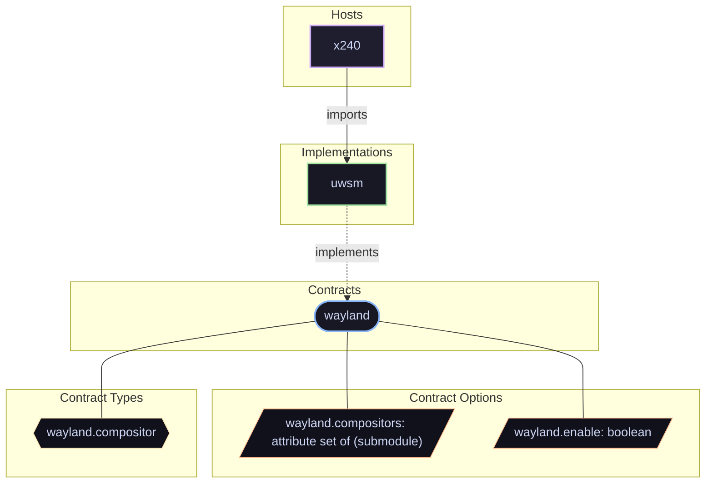

# Contract: `wayland`

Wayland compositor registration, session targets, and graphical environment management.

[← Back to Contracts Documentation](../CONTRACTS.md) | [← Back to Main README](../../README.md)

## Metadata

- **Contract Name**: `wayland`
- **Description**: Wayland compositor registration, session targets, and graphical environment management.
- **Definition File**: [`modules/contracts/wayland.nix`](../../modules/contracts/wayland.nix)

## Architecture Diagram

## Option Schema Definitions

| Option Path | Type | Default | Example | Description |
| :--- | :--- | :--- | :--- | :--- |
| `options.wayland.compositors` | `attribute set of (submodule)` | `{ ... }` | `{ ... }` | Declarative Wayland compositor registrations managed by the session manager. |
| `options.wayland.enable` | `boolean` | `` | `1` | Whether to enable system-level Wayland session orchestration. When enabled, Wayland compositor backends (such as UWSM) will configure systemd graphical session targets, environment variables, and startup units. |

## Outputs

### Custom Submodule Types

| Type Name | Description | Docs |
| :--- | :--- | :--- |
| [`wayland.compositor`](../lib/wayland.md#wayland.compositor) | submodule | [More →](../lib/wayland.md#wayland.compositor) |

### Library Helpers

| Symbol | Description | Docs |
| :--- | :--- | :--- |
| [`flake.lib.wayland.mkOption`](../lib/wayland.md#mkOption) | Contract option constructor / binding helper | [More →](../lib/wayland.md#mkOption) |
| [`flake.lib.wayland.mkConfig`](../lib/wayland.md#mkConfig) | Contract option constructor / binding helper | [More →](../lib/wayland.md#mkConfig) |
| [`flake.lib.wayland.types`](../lib/wayland.md#types) | Contract option constructor / binding helper | [More →](../lib/wayland.md#types) |

## Implementations

Providers satisfying the `wayland` contract capability:

| Implementation | Description | Docs |
| :--- | :--- | :--- |
| [`uwsm`](../implementations/uwsm.md) | Universal Wayland Session Manager integration for desktop environments. | [More →](../implementations/uwsm.md) |

## Contract Consumers

Modules configuring options under the `wayland` contract capability:

### Hosts

*No hosts configure this contract directly.*

### Implementations

*No implementations configure this contract.*

### Features

*No features configure this contract.*
