# Contract: `wayland`

Wayland compositor registration, session targets, and graphical environment management.

[← Back to Contracts Documentation](../CONTRACTS.md) | [← Back to Main README](../../README.md)

## Metadata

- **Contract Name**: `wayland`
- **Description**: Wayland compositor registration, session targets, and graphical environment management.
- **Definition File**: [`modules/contracts/wayland.nix`](../../modules/contracts/wayland.nix)

## Architecture Diagram

```mermaid
flowchart TD
    subgraph Hosts["Hosts"]
        host__x240["x240"]:::hostNode
    end

    subgraph Contracts["Contracts"]
        contract__home(["home"]):::contractNode
        contract__persistence(["persistence"]):::contractNode
        contract__wayland(["wayland"]):::contractNode
    end

    subgraph Implementations["Implementations"]
        impl__cgroups["cgroups"]:::implNode
        impl__hjem["hjem"]:::implNode
        impl__impermanence["impermanence"]:::implNode
        impl__lw["lw"]:::implNode
        impl__sops["sops"]:::implNode
        impl__uwsm["uwsm"]:::implNode
    end

    subgraph Features["Features"]
        feature__antigravity["antigravity"]:::featureNode
        feature__audio["audio"]:::featureNode
        feature__bitwarden["bitwarden"]:::featureNode
        feature__cursor["cursor"]:::featureNode
        feature__direnv["direnv"]:::featureNode
        feature__disko["disko"]:::featureNode
        feature__dolphin["dolphin"]:::featureNode
        feature__fonts["fonts"]:::featureNode
        feature__foot["foot"]:::featureNode
        feature__git["git"]:::featureNode
        feature__greetd["greetd"]:::featureNode
        feature__labwc["labwc"]:::featureNode
        feature__locale["locale"]:::featureNode
        feature__nix["nix"]:::featureNode
        feature__noctalia["noctalia"]:::featureNode
        feature__ssh["ssh"]:::featureNode
        feature__tack["tack"]:::featureNode
        feature__vivaldi["vivaldi"]:::featureNode
        feature__vscode["vscode"]:::featureNode
        feature__wifi_eduroam["wifi-eduroam"]:::featureNode
    end

    subgraph ContractOptions["Contract Options"]
        opt__wayland_compositors[/"wayland.compositors: attribute set of (submodule)"/]:::optNode
        opt__wayland_enable[/"wayland.enable: boolean"/]:::optNode
    end

    subgraph ContractTypes["Contract Types"]
        type__wayland_compositor{{"wayland.compositor"}}:::typeNode
    end


    host__x240 -->|"imports"| impl__cgroups
    host__x240 -->|"imports"| impl__hjem
    host__x240 -->|"imports"| impl__impermanence
    host__x240 -->|"imports"| impl__lw
    host__x240 -->|"imports"| impl__sops
    host__x240 -->|"imports"| impl__uwsm
    host__x240 -->|"imports"| feature__antigravity
    host__x240 -->|"imports"| feature__audio
    host__x240 -->|"imports"| feature__bitwarden
    host__x240 -->|"imports"| feature__cursor
    host__x240 -->|"imports"| feature__direnv
    host__x240 -->|"imports"| feature__disko
    host__x240 -->|"imports"| feature__dolphin
    host__x240 -->|"imports"| feature__fonts
    host__x240 -->|"imports"| feature__foot
    host__x240 -->|"imports"| feature__git
    host__x240 -->|"imports"| feature__greetd
    host__x240 -->|"imports"| feature__labwc
    host__x240 -->|"imports"| feature__locale
    host__x240 -->|"imports"| feature__nix
    host__x240 -->|"imports"| feature__noctalia
    host__x240 -->|"imports"| feature__ssh
    host__x240 -->|"imports"| feature__tack
    host__x240 -->|"imports"| feature__vivaldi
    host__x240 -->|"imports"| feature__vscode
    host__x240 -->|"imports"| feature__wifi_eduroam
    impl__hjem -.->|"implements"| contract__home
    impl__impermanence -.->|"implements"| contract__persistence
    impl__uwsm -.->|"implements"| contract__wayland
    host__x240 -->|"consumes (wayland.enable)"| contract__wayland
    feature__antigravity -->|"consumes (persistence.users)"| contract__persistence
    feature__bitwarden -->|"consumes (persistence.users)"| contract__persistence
    feature__direnv -->|"consumes (persistence.users)"| contract__persistence
    feature__dolphin -->|"consumes (persistence.users)"| contract__persistence
    feature__foot -->|"consumes (home.shared, home.users)"| contract__home
    feature__foot -->|"consumes (persistence.users)"| contract__persistence
    feature__git -->|"consumes (home.users, home.shared)"| contract__home
    feature__labwc -->|"consumes (home.shared.xdg.config, home.users, home.shared)"| contract__home
    feature__labwc -->|"consumes (persistence.users)"| contract__persistence
    feature__labwc -->|"consumes (wayland.compositors.labwc, wayland.compositors)"| contract__wayland
    feature__locale -->|"consumes (home.shared.sessionVariables, home.shared)"| contract__home
    feature__noctalia -->|"consumes (persistence.users)"| contract__persistence
    feature__ssh -->|"consumes (persistence.files, persistence.enable)"| contract__persistence
    feature__vivaldi -->|"consumes (persistence.users)"| contract__persistence
    feature__vscode -->|"consumes (persistence.users)"| contract__persistence
    impl__hjem -->|"consumes (home.enable)"| contract__home
    impl__impermanence -->|"consumes (persistence.users)"| contract__persistence
    impl__lw -->|"consumes (home.users)"| contract__home
    impl__lw -->|"consumes (persistence.users)"| contract__persistence
    impl__uwsm -->|"consumes (wayland.compositors, wayland.enable)"| contract__wayland
    contract__wayland --- opt__wayland_compositors
    contract__wayland --- opt__wayland_enable
    contract__wayland --- type__wayland_compositor

classDef hostNode fill:#1e1e2e,stroke:#cba6f7,stroke-width:2px,color:#cdd6f4;
classDef contractNode fill:#181825,stroke:#89b4fa,stroke-width:2px,color:#cdd6f4;
classDef implNode fill:#181825,stroke:#a6e3a1,stroke-width:2px,color:#cdd6f4;
classDef featureNode fill:#181825,stroke:#f38ba8,stroke-width:2px,color:#cdd6f4;
classDef libNode fill:#181825,stroke:#94e2d5,stroke-width:2px,color:#cdd6f4;
classDef optNode fill:#11111b,stroke:#fab387,stroke-width:1px,color:#cdd6f4;
classDef typeNode fill:#11111b,stroke:#f9e2af,stroke-width:1px,color:#cdd6f4;
classDef fnNode fill:#181825,stroke:#94e2d5,stroke-width:1px,color:#cdd6f4;
classDef pkgNode fill:#181825,stroke:#b4befe,stroke-width:1px,color:#cdd6f4;
classDef shellNode fill:#181825,stroke:#f5c2e7,stroke-width:1px,color:#cdd6f4;

```




## Option Schema Definitions

| Option Path | Type | Default | Example | Description |
| :--- | :--- | :--- | :--- | :--- |
| `options.wayland.compositors` | `attribute set of (submodule)` | `{ ... }` | `{ ... }` | Declarative Wayland compositor registrations managed by the session manager. |
| `options.wayland.enable` | `boolean` | `` | `1` | Whether to enable system-level Wayland session orchestration. When enabled, Wayland compositor backends (such as UWSM) will configure systemd graphical session targets, environment variables, and startup units. |


## Outputs

### Custom Submodule Types

| Type Name | Description | Docs |
| :--- | :--- | :--- |
| [`wayland.compositor`](../lib/wayland.md#wayland.compositor) | submodule | [More →](../lib/wayland.md#wayland.compositor) |


### Library Helpers

| Symbol | Description | Docs |
| :--- | :--- | :--- |
| [`flake.lib.wayland.mkOption`](../lib/wayland.md#mkOption) | Contract option constructor / binding helper | [More →](../lib/wayland.md#mkOption) |
| [`flake.lib.wayland.mkConfig`](../lib/wayland.md#mkConfig) | Contract option constructor / binding helper | [More →](../lib/wayland.md#mkConfig) |
| [`flake.lib.wayland.types`](../lib/wayland.md#types) | Contract option constructor / binding helper | [More →](../lib/wayland.md#types) |


## Implementations

Providers satisfying the `wayland` contract capability:

| Implementation | Description | Docs |
| :--- | :--- | :--- |
| [`uwsm`](../implementations/uwsm.md) | Universal Wayland Session Manager integration for desktop environments. | [More →](../implementations/uwsm.md) |

## Contract Consumers

Modules configuring options under the `wayland` contract capability:

### Hosts

<details>
<summary><code><a href="../hosts/x240.md">x240</a></code></summary>

Configures options: `wayland.enable`

```nix
wayland.enable = true;
```

</details>


### Implementations

<details>
<summary><code><a href="../implementations/uwsm.md">uwsm</a></code></summary>

Configures options: `wayland.compositors`, `wayland.enable`

```nix
config = lib.mkIf (config.wayland.enable or false) {
  programs.uwsm = {
    enable = true;
    waylandCompositors =
      lib.mapAttrs (_: c: {
        inherit (c) prettyName comment binPath;
      })
      config.wayland.compositors;
  };
};
```

</details>


### Features

<details>
<summary><code><a href="../features/labwc.md">labwc</a></code></summary>

Configures options: `wayland.compositors.labwc`, `wayland.compositors`

```nix
wayland.compositors.labwc = {
  prettyName = "Labwc";
  comment = "Labwc Wayland compositor";
  binPath = lib.getExe pkgs.labwc;
};
```

</details>

