# Feature: `cosmic`

Next-generation COSMIC desktop environment and greeter.

[← Back to Features Documentation](../FEATURES.md) | [← Back to Main README](../../README.md)

## Metadata

- **Feature Name**: `cosmic`
- **Description**: Next-generation COSMIC desktop environment and greeter.
- **Definition File**: [`modules/features/cosmic.nix`](../../modules/features/cosmic.nix)

## Architecture Diagram

```mermaid
flowchart TD
    subgraph Contracts["Contracts"]
        contract__persistence(["persistence"]):::contractNode
    end

    subgraph Implementations["Implementations"]
        impl__caddy["caddy"]:::implNode
        impl__impermanence["impermanence"]:::implNode
        impl__lw["lw"]:::implNode
    end

    subgraph Features["Features"]
        feature__antigravity["antigravity"]:::featureNode
        feature__bitwarden["bitwarden"]:::featureNode
        feature__cosmic["cosmic"]:::featureNode
        feature__direnv["direnv"]:::featureNode
        feature__dolphin["dolphin"]:::featureNode
        feature__foot["foot"]:::featureNode
        feature__helium["helium"]:::featureNode
        feature__labwc["labwc"]:::featureNode
        feature__noctalia["noctalia"]:::featureNode
        feature__ssh["ssh"]:::featureNode
        feature__vaultwarden["vaultwarden"]:::featureNode
        feature__vivaldi["vivaldi"]:::featureNode
        feature__vscode["vscode"]:::featureNode
    end

    subgraph ContractOptions["Contract Options"]
        opt__persistence_directories[/"persistence.directories: list of (string or attribute set of anything)"/]:::optNode
        opt__persistence_enable[/"persistence.enable: boolean"/]:::optNode
        opt__persistence_files[/"persistence.files: list of (string or attribute set of anything)"/]:::optNode
        opt__persistence_users[/"persistence.users: attribute set of (submodule)"/]:::optNode
    end

    subgraph ContractTypes["Contract Types"]
        type__persistence_entries{{"persistence.entries"}}:::typeNode
        type__persistence_user{{"persistence.user"}}:::typeNode
    end


    impl__impermanence -.->|"implements"| contract__persistence
    feature__antigravity -->|"consumes (persistence.users)"| contract__persistence
    feature__bitwarden -->|"consumes (persistence.users)"| contract__persistence
    feature__cosmic -->|"consumes (persistence.users, persistence.directories)"| contract__persistence
    feature__direnv -->|"consumes (persistence.users)"| contract__persistence
    feature__dolphin -->|"consumes (persistence.users)"| contract__persistence
    feature__foot -->|"consumes (persistence.users)"| contract__persistence
    feature__helium -->|"consumes (persistence.users)"| contract__persistence
    feature__labwc -->|"consumes (persistence.users)"| contract__persistence
    feature__noctalia -->|"consumes (persistence.users)"| contract__persistence
    feature__ssh -->|"consumes (persistence.files, persistence.enable)"| contract__persistence
    feature__vaultwarden -->|"consumes (persistence.enable)"| contract__persistence
    feature__vivaldi -->|"consumes (persistence.users)"| contract__persistence
    feature__vscode -->|"consumes (persistence.users)"| contract__persistence
    impl__caddy -->|"consumes (persistence.directories, persistence.enable)"| contract__persistence
    impl__impermanence -->|"consumes (persistence.users)"| contract__persistence
    impl__lw -->|"consumes (persistence.users)"| contract__persistence
    contract__persistence --- opt__persistence_directories
    contract__persistence --- opt__persistence_enable
    contract__persistence --- opt__persistence_files
    contract__persistence --- opt__persistence_users
    contract__persistence --- type__persistence_entries
    contract__persistence --- type__persistence_user

classDef hostNode fill:#1e1e2e,stroke:#cba6f7,stroke-width:2px,color:#cdd6f4;
classDef contractNode fill:#181825,stroke:#89b4fa,stroke-width:2px,color:#cdd6f4;
classDef implNode fill:#181825,stroke:#a6e3a1,stroke-width:2px,color:#cdd6f4;
classDef featureNode fill:#181825,stroke:#f38ba8,stroke-width:2px,color:#cdd6f4;
classDef libNode fill:#181825,stroke:#94e2d5,stroke-width:2px,color:#cdd6f4;
classDef optNode fill:#11111b,stroke:#fab387,stroke-width:1px,color:#cdd6f4;
classDef typeNode fill:#11111b,stroke:#f9e2af,stroke-width:1px,color:#cdd6f4;
classDef fnNode fill:#181825,stroke:#94e2d5,stroke-width:1px,color:#cdd6f4;
classDef pkgNode fill:#181825,stroke:#b4befe,stroke-width:1px,color:#cdd6f4;
classDef shellNode fill:#181825,stroke:#f5c2e7,stroke-width:1px,color:#cdd6f4;

```




## Outputs

### NixOS Modules

| Module Attribute | Description | Docs |
| :--- | :--- | :--- |
| [`cosmic`](../modules/cosmic.md) | System service module exported by `cosmic` | [More →](../modules/cosmic.md) |


### Executable Packages

*No executable packages exported.*

### Development Shells

*No development shells exported.*

### Library Helpers

*No library helpers exported.*


## Consumed Contracts

Capability contracts configured by this feature:

<details>
<summary><code><a href="../contracts/persistence.md">persistence</a></code></summary>

Configures options: `persistence.users`, `persistence.directories`

```nix
persistence.users = lib.mkIf config.cosmic.enable (lib.mapAttrs (_: _: {
  data.directories = [
    ".config/cosmic"
    ".config/dconf"
    ".local/state/cosmic"
    ".local/state/cosmic-comp"
  ];
  cache.directories = [".cache/cosmic-settings"];
}) (lib.filterAttrs (_: u: u.isNormalUser or false) config.users.users));

persistence.directories = lib.mkIf config.services.displayManager.cosmic-greeter.enable [
  "/var/lib/cosmic-greeter"
];
```

</details>

