# Feature: `cosmic`

Next-generation COSMIC desktop environment and greeter.

[← Back to Features Documentation](../FEATURES.md) | [← Back to Main README](../../README.md)

## Metadata

- **Feature Name**: `cosmic`
- **Description**: Next-generation COSMIC desktop environment and greeter.
- **Definition File**: [`modules/features/cosmic.nix`](../../modules/features/cosmic.nix)

## Architecture Diagram

```mermaid
flowchart TD
    subgraph Features["Features"]
        urn__nixconf__onto__feature__antigravity["antigravity"]:::featureNode
        urn__nixconf__onto__feature__audio["audio"]:::featureNode
        urn__nixconf__onto__feature__bitwarden["bitwarden"]:::featureNode
        urn__nixconf__onto__feature__cosmic["cosmic"]:::featureNode
        urn__nixconf__onto__feature__cursor["cursor"]:::featureNode
        urn__nixconf__onto__feature__direnv["direnv"]:::featureNode
        urn__nixconf__onto__feature__disko["disko"]:::featureNode
        urn__nixconf__onto__feature__dolphin["dolphin"]:::featureNode
        urn__nixconf__onto__feature__fonts["fonts"]:::featureNode
        urn__nixconf__onto__feature__foot["foot"]:::featureNode
        urn__nixconf__onto__feature__git["git"]:::featureNode
        urn__nixconf__onto__feature__greetd["greetd"]:::featureNode
        urn__nixconf__onto__feature__helium["helium"]:::featureNode
        urn__nixconf__onto__feature__labwc["labwc"]:::featureNode
        urn__nixconf__onto__feature__locale["locale"]:::featureNode
        urn__nixconf__onto__feature__nix["nix"]:::featureNode
        urn__nixconf__onto__feature__noctalia["noctalia"]:::featureNode
        urn__nixconf__onto__feature__ssh["ssh"]:::featureNode
        urn__nixconf__onto__feature__tack["tack"]:::featureNode
        urn__nixconf__onto__feature__ttyd["ttyd"]:::featureNode
        urn__nixconf__onto__feature__user["user"]:::featureNode
        urn__nixconf__onto__feature__vaultwarden["vaultwarden"]:::featureNode
        urn__nixconf__onto__feature__vivaldi["vivaldi"]:::featureNode
        urn__nixconf__onto__feature__vscode["vscode"]:::featureNode
        urn__nixconf__onto__feature__wifi_eduroam["wifi-eduroam"]:::featureNode
    end

    subgraph OtherNodes["Other Entities"]
        urn__nixconf__ast__module__cosmic["cosmic"]
        urn__nixconf__onto__primitive__feature["feature"]
    end


    urn__nixconf__onto__feature__cosmic -->|"outputs"| urn__nixconf__ast__module__cosmic
    urn__nixconf__onto__primitive__feature --- urn__nixconf__onto__feature__antigravity
    urn__nixconf__onto__primitive__feature --- urn__nixconf__onto__feature__audio
    urn__nixconf__onto__primitive__feature --- urn__nixconf__onto__feature__bitwarden
    urn__nixconf__onto__primitive__feature --- urn__nixconf__onto__feature__cosmic
    urn__nixconf__onto__primitive__feature --- urn__nixconf__onto__feature__cursor
    urn__nixconf__onto__primitive__feature --- urn__nixconf__onto__feature__direnv
    urn__nixconf__onto__primitive__feature --- urn__nixconf__onto__feature__disko
    urn__nixconf__onto__primitive__feature --- urn__nixconf__onto__feature__dolphin
    urn__nixconf__onto__primitive__feature --- urn__nixconf__onto__feature__fonts
    urn__nixconf__onto__primitive__feature --- urn__nixconf__onto__feature__foot
    urn__nixconf__onto__primitive__feature --- urn__nixconf__onto__feature__git
    urn__nixconf__onto__primitive__feature --- urn__nixconf__onto__feature__greetd
    urn__nixconf__onto__primitive__feature --- urn__nixconf__onto__feature__helium
    urn__nixconf__onto__primitive__feature --- urn__nixconf__onto__feature__labwc
    urn__nixconf__onto__primitive__feature --- urn__nixconf__onto__feature__locale
    urn__nixconf__onto__primitive__feature --- urn__nixconf__onto__feature__nix
    urn__nixconf__onto__primitive__feature --- urn__nixconf__onto__feature__noctalia
    urn__nixconf__onto__primitive__feature --- urn__nixconf__onto__feature__ssh
    urn__nixconf__onto__primitive__feature --- urn__nixconf__onto__feature__tack
    urn__nixconf__onto__primitive__feature --- urn__nixconf__onto__feature__ttyd
    urn__nixconf__onto__primitive__feature --- urn__nixconf__onto__feature__user
    urn__nixconf__onto__primitive__feature --- urn__nixconf__onto__feature__vaultwarden
    urn__nixconf__onto__primitive__feature --- urn__nixconf__onto__feature__vivaldi
    urn__nixconf__onto__primitive__feature --- urn__nixconf__onto__feature__vscode
    urn__nixconf__onto__primitive__feature --- urn__nixconf__onto__feature__wifi_eduroam

classDef hostNode fill:#1e1e2e,stroke:#cba6f7,stroke-width:2px,color:#cdd6f4;
classDef contractNode fill:#181825,stroke:#89b4fa,stroke-width:2px,color:#cdd6f4;
classDef implNode fill:#181825,stroke:#a6e3a1,stroke-width:2px,color:#cdd6f4;
classDef featureNode fill:#181825,stroke:#f38ba8,stroke-width:2px,color:#cdd6f4;
classDef libNode fill:#181825,stroke:#94e2d5,stroke-width:2px,color:#cdd6f4;
classDef optNode fill:#11111b,stroke:#fab387,stroke-width:1px,color:#cdd6f4;
classDef typeNode fill:#11111b,stroke:#f9e2af,stroke-width:1px,color:#cdd6f4;
classDef fnNode fill:#181825,stroke:#94e2d5,stroke-width:1px,color:#cdd6f4;
classDef pkgNode fill:#181825,stroke:#b4befe,stroke-width:1px,color:#cdd6f4;
classDef shellNode fill:#181825,stroke:#f5c2e7,stroke-width:1px,color:#cdd6f4;

```

## Outputs

### NixOS Modules

| Module Attribute | Description | Docs |
| :--- | :--- | :--- |
| [`cosmic`](../modules/cosmic.md) | System service module exported by `cosmic` | [More →](../modules/cosmic.md) |

### Executable Packages

*No executable packages exported.*

### Development Shells

*No development shells exported.*

### Library Helpers

*No library helpers exported.*

## Consumed Contracts

Contracts configured by this feature:

*No contracts consumed by this feature.*
