# Feature: `cursor`

XCursor theme configuration and icon assets.

[← Back to Features Documentation](../FEATURES.md) | [← Back to Main README](../../README.md)

## Metadata

- **Feature Name**: `cursor`
- **Description**: XCursor theme configuration and icon assets.
- **Definition File**: [`modules/features/cursor.nix`](../../modules/features/cursor.nix)

## Architecture Diagram

```mermaid
flowchart TD
    subgraph Hosts["Hosts"]
        host__x240["x240"]:::hostNode
    end

    subgraph Contracts["Contracts"]
        contract__wayland(["wayland"]):::contractNode
    end

    subgraph Implementations["Implementations"]
        impl__cgroups["cgroups"]:::implNode
        impl__hjem["hjem"]:::implNode
        impl__impermanence["impermanence"]:::implNode
        impl__lw["lw"]:::implNode
        impl__sops["sops"]:::implNode
        impl__uwsm["uwsm"]:::implNode
    end

    subgraph Features["Features"]
        feature__antigravity["antigravity"]:::featureNode
        feature__audio["audio"]:::featureNode
        feature__bitwarden["bitwarden"]:::featureNode
        feature__cursor["cursor"]:::featureNode
        feature__direnv["direnv"]:::featureNode
        feature__disko["disko"]:::featureNode
        feature__dolphin["dolphin"]:::featureNode
        feature__fonts["fonts"]:::featureNode
        feature__foot["foot"]:::featureNode
        feature__git["git"]:::featureNode
        feature__greetd["greetd"]:::featureNode
        feature__labwc["labwc"]:::featureNode
        feature__locale["locale"]:::featureNode
        feature__nix["nix"]:::featureNode
        feature__noctalia["noctalia"]:::featureNode
        feature__ssh["ssh"]:::featureNode
        feature__tack["tack"]:::featureNode
        feature__vivaldi["vivaldi"]:::featureNode
        feature__vscode["vscode"]:::featureNode
        feature__wifi_eduroam["wifi-eduroam"]:::featureNode
    end


    host__x240 -->|"imports"| impl__cgroups
    host__x240 -->|"imports"| impl__hjem
    host__x240 -->|"imports"| impl__impermanence
    host__x240 -->|"imports"| impl__lw
    host__x240 -->|"imports"| impl__sops
    host__x240 -->|"imports"| impl__uwsm
    host__x240 -->|"imports"| feature__antigravity
    host__x240 -->|"imports"| feature__audio
    host__x240 -->|"imports"| feature__bitwarden
    host__x240 -->|"imports"| feature__cursor
    host__x240 -->|"imports"| feature__direnv
    host__x240 -->|"imports"| feature__disko
    host__x240 -->|"imports"| feature__dolphin
    host__x240 -->|"imports"| feature__fonts
    host__x240 -->|"imports"| feature__foot
    host__x240 -->|"imports"| feature__git
    host__x240 -->|"imports"| feature__greetd
    host__x240 -->|"imports"| feature__labwc
    host__x240 -->|"imports"| feature__locale
    host__x240 -->|"imports"| feature__nix
    host__x240 -->|"imports"| feature__noctalia
    host__x240 -->|"imports"| feature__ssh
    host__x240 -->|"imports"| feature__tack
    host__x240 -->|"imports"| feature__vivaldi
    host__x240 -->|"imports"| feature__vscode
    host__x240 -->|"imports"| feature__wifi_eduroam
    impl__uwsm -.->|"implements"| contract__wayland
    host__x240 -->|"consumes (wayland.enable)"| contract__wayland
    feature__labwc -->|"consumes (wayland.compositors.labwc, wayland.compositors)"| contract__wayland
    impl__uwsm -->|"consumes (wayland.compositors, wayland.enable)"| contract__wayland

classDef hostNode fill:#1e1e2e,stroke:#cba6f7,stroke-width:2px,color:#cdd6f4;
classDef contractNode fill:#181825,stroke:#89b4fa,stroke-width:2px,color:#cdd6f4;
classDef implNode fill:#181825,stroke:#a6e3a1,stroke-width:2px,color:#cdd6f4;
classDef featureNode fill:#181825,stroke:#f38ba8,stroke-width:2px,color:#cdd6f4;
classDef libNode fill:#181825,stroke:#94e2d5,stroke-width:2px,color:#cdd6f4;
classDef optNode fill:#11111b,stroke:#fab387,stroke-width:1px,color:#cdd6f4;
classDef typeNode fill:#11111b,stroke:#f9e2af,stroke-width:1px,color:#cdd6f4;
classDef fnNode fill:#181825,stroke:#94e2d5,stroke-width:1px,color:#cdd6f4;
classDef pkgNode fill:#181825,stroke:#b4befe,stroke-width:1px,color:#cdd6f4;
classDef shellNode fill:#181825,stroke:#f5c2e7,stroke-width:1px,color:#cdd6f4;

```

## Outputs

### NixOS Modules

| Module Attribute | Description | Docs |
| :--- | :--- | :--- |
| [`cursor`](../modules/cursor.md) | System service module exported by `cursor` | [More →](../modules/cursor.md) |

### Executable Packages

*No executable packages exported.*

### Development Shells

*No development shells exported.*

### Library Helpers

*No library helpers exported.*

## Consumed Contracts

Capability contracts configured by this feature:

*No contracts consumed by this feature.*
