# Feature: `git`

Git version control system, global/per-user configuration, and Bitwarden SSH key agent shell.

[← Back to Features Documentation](../FEATURES.md) | [← Back to Main README](../../README.md)

## Metadata

- **Feature Name**: `git`
- **Description**: Git version control system, global/per-user configuration, and Bitwarden SSH key agent shell.
- **Definition File**: [`modules/features/git.nix`](../../modules/features/git.nix)

## Architecture Diagram

```mermaid
flowchart TD
    subgraph Hosts["Hosts"]
        host__astrolabe["astrolabe"]:::hostNode
        host__x240["x240"]:::hostNode
    end

    subgraph Contracts["Contracts"]
        contract__default_user(["default-user"]):::contractNode
        contract__home(["home"]):::contractNode
        contract__reverse_proxy(["reverse-proxy"]):::contractNode
        contract__wayland(["wayland"]):::contractNode
    end

    subgraph Implementations["Implementations"]
        impl__caddy["caddy"]:::implNode
        impl__cgroups["cgroups"]:::implNode
        impl__hjem["hjem"]:::implNode
        impl__impermanence["impermanence"]:::implNode
        impl__lw["lw"]:::implNode
        impl__restic["restic"]:::implNode
        impl__sops["sops"]:::implNode
        impl__uwsm["uwsm"]:::implNode
    end

    subgraph Features["Features"]
        feature__antigravity["antigravity"]:::featureNode
        feature__audio["audio"]:::featureNode
        feature__bitwarden["bitwarden"]:::featureNode
        feature__cursor["cursor"]:::featureNode
        feature__direnv["direnv"]:::featureNode
        feature__disko["disko"]:::featureNode
        feature__dolphin["dolphin"]:::featureNode
        feature__fonts["fonts"]:::featureNode
        feature__foot["foot"]:::featureNode
        feature__git["git"]:::featureNode
        feature__greetd["greetd"]:::featureNode
        feature__helium["helium"]:::featureNode
        feature__labwc["labwc"]:::featureNode
        feature__locale["locale"]:::featureNode
        feature__nix["nix"]:::featureNode
        feature__noctalia["noctalia"]:::featureNode
        feature__ssh["ssh"]:::featureNode
        feature__tack["tack"]:::featureNode
        feature__ttyd["ttyd"]:::featureNode
        feature__vaultwarden["vaultwarden"]:::featureNode
        feature__vivaldi["vivaldi"]:::featureNode
        feature__vscode["vscode"]:::featureNode
        feature__wifi_eduroam["wifi-eduroam"]:::featureNode
    end

    subgraph ContractOptions["Contract Options"]
        opt__default_user_email[/"default-user.email: string"/]:::optNode
        opt__default_user_enable[/"default-user.enable: boolean"/]:::optNode
        opt__default_user_fullName[/"default-user.fullName: null or string"/]:::optNode
        opt__default_user_githubUsername[/"default-user.githubUsername: string"/]:::optNode
        opt__default_user_modules[/"default-user.modules: list of module"/]:::optNode
        opt__default_user_username[/"default-user.username: string"/]:::optNode
        opt__home_enable[/"home.enable: boolean"/]:::optNode
        opt__home_shared[/"home.shared: submodule"/]:::optNode
        opt__home_users[/"home.users: attribute set of (submodule)"/]:::optNode
    end

    subgraph ContractTypes["Contract Types"]
        type__home_file{{"home.file"}}:::typeNode
        type__home_files{{"home.files"}}:::typeNode
        type__home_relativeHomePath{{"home.relativeHomePath"}}:::typeNode
        type__home_userHome{{"home.userHome"}}:::typeNode
        type__home_xdg{{"home.xdg"}}:::typeNode
    end


    host__astrolabe -->|"imports"| impl__caddy
    host__astrolabe -->|"imports"| impl__cgroups
    host__astrolabe -->|"imports"| impl__impermanence
    host__astrolabe -->|"imports"| impl__lw
    host__astrolabe -->|"imports"| impl__restic
    host__astrolabe -->|"imports"| impl__sops
    host__astrolabe -->|"imports"| feature__disko
    host__astrolabe -->|"imports"| feature__git
    host__astrolabe -->|"imports"| feature__locale
    host__astrolabe -->|"imports"| feature__nix
    host__astrolabe -->|"imports"| feature__ssh
    host__astrolabe -->|"imports"| feature__ttyd
    host__astrolabe -->|"imports"| feature__vaultwarden
    host__x240 -->|"imports"| impl__cgroups
    host__x240 -->|"imports"| impl__hjem
    host__x240 -->|"imports"| impl__impermanence
    host__x240 -->|"imports"| impl__lw
    host__x240 -->|"imports"| impl__sops
    host__x240 -->|"imports"| impl__uwsm
    host__x240 -->|"imports"| feature__antigravity
    host__x240 -->|"imports"| feature__audio
    host__x240 -->|"imports"| feature__bitwarden
    host__x240 -->|"imports"| feature__cursor
    host__x240 -->|"imports"| feature__direnv
    host__x240 -->|"imports"| feature__disko
    host__x240 -->|"imports"| feature__dolphin
    host__x240 -->|"imports"| feature__fonts
    host__x240 -->|"imports"| feature__foot
    host__x240 -->|"imports"| feature__git
    host__x240 -->|"imports"| feature__greetd
    host__x240 -->|"imports"| feature__labwc
    host__x240 -->|"imports"| feature__locale
    host__x240 -->|"imports"| feature__nix
    host__x240 -->|"imports"| feature__noctalia
    host__x240 -->|"imports"| feature__ssh
    host__x240 -->|"imports"| feature__tack
    host__x240 -->|"imports"| feature__vivaldi
    host__x240 -->|"imports"| feature__vscode
    host__x240 -->|"imports"| feature__wifi_eduroam
    impl__caddy -.->|"implements"| contract__reverse_proxy
    impl__hjem -.->|"implements"| contract__home
    impl__lw -.->|"implements"| contract__default_user
    impl__uwsm -.->|"implements"| contract__wayland
    host__astrolabe -->|"consumes (reverse-proxy.domain)"| contract__reverse_proxy
    host__x240 -->|"consumes (wayland.enable)"| contract__wayland
    feature__foot -->|"consumes (home.shared, home.users)"| contract__home
    feature__git -->|"consumes"| contract__default_user
    feature__git -->|"consumes (home.users, home.shared)"| contract__home
    feature__helium -->|"consumes (home.shared, home.users)"| contract__home
    feature__labwc -->|"consumes (home.shared.xdg.config, home.users, home.shared)"| contract__home
    feature__labwc -->|"consumes (wayland.compositors.labwc, wayland.compositors)"| contract__wayland
    feature__locale -->|"consumes (home.shared.sessionVariables, home.shared)"| contract__home
    feature__ssh -->|"consumes (default-user.enable, default-user.username)"| contract__default_user
    feature__ttyd -->|"consumes (reverse-proxy.enable)"| contract__reverse_proxy
    feature__vaultwarden -->|"consumes (reverse-proxy.domain)"| contract__reverse_proxy
    impl__hjem -->|"consumes (home.enable)"| contract__home
    impl__lw -->|"consumes (home.users)"| contract__home
    impl__uwsm -->|"consumes (wayland.compositors, wayland.enable)"| contract__wayland
    contract__default_user --- opt__default_user_email
    contract__default_user --- opt__default_user_enable
    contract__default_user --- opt__default_user_fullName
    contract__default_user --- opt__default_user_githubUsername
    contract__default_user --- opt__default_user_modules
    contract__default_user --- opt__default_user_username
    contract__home --- opt__home_enable
    contract__home --- opt__home_shared
    contract__home --- opt__home_users
    contract__home --- type__home_file
    contract__home --- type__home_files
    contract__home --- type__home_relativeHomePath
    contract__home --- type__home_userHome
    contract__home --- type__home_xdg

classDef hostNode fill:#1e1e2e,stroke:#cba6f7,stroke-width:2px,color:#cdd6f4;
classDef contractNode fill:#181825,stroke:#89b4fa,stroke-width:2px,color:#cdd6f4;
classDef implNode fill:#181825,stroke:#a6e3a1,stroke-width:2px,color:#cdd6f4;
classDef featureNode fill:#181825,stroke:#f38ba8,stroke-width:2px,color:#cdd6f4;
classDef libNode fill:#181825,stroke:#94e2d5,stroke-width:2px,color:#cdd6f4;
classDef optNode fill:#11111b,stroke:#fab387,stroke-width:1px,color:#cdd6f4;
classDef typeNode fill:#11111b,stroke:#f9e2af,stroke-width:1px,color:#cdd6f4;
classDef fnNode fill:#181825,stroke:#94e2d5,stroke-width:1px,color:#cdd6f4;
classDef pkgNode fill:#181825,stroke:#b4befe,stroke-width:1px,color:#cdd6f4;
classDef shellNode fill:#181825,stroke:#f5c2e7,stroke-width:1px,color:#cdd6f4;

```




## Outputs

### NixOS Modules

| Module Attribute | Description | Docs |
| :--- | :--- | :--- |
| [`git`](../modules/git.md) | System service module exported by `git` | [More →](../modules/git.md) |


### Executable Packages

| Package Attribute | Command | Description | Docs |
| :--- | :--- | :--- | :--- |
| [`git`](../PACKAGES.md#git) | `nix run .#git` | Executable application package | [More →](../PACKAGES.md#git) |


### Development Shells

| Shell Attribute | Command | Description | Docs |
| :--- | :--- | :--- | :--- |
| [`github-ssh`](../DEVSHELLS.md#github-ssh) | `nix develop .#github-ssh` | Interactive development shell | [More →](../DEVSHELLS.md#github-ssh) |


### Library Helpers

*No library helpers exported.*


## Consumed Contracts

Capability contracts configured by this feature:

<details>
<summary><code><a href="../contracts/default-user.md">default-user</a></code></summary>

Configures options: `default-user.email`, `default-user.enable`, `default-user.githubUsername`, `default-user.username`

```nix
git.users = lib.mkIf (config.default-user.enable or false) {
  ${config.default-user.username}.settings.user = {
    name = config.default-user.githubUsername;
    email = config.default-user.email;
  };
};
```

</details>


<details>
<summary><code><a href="../contracts/home.md">home</a></code></summary>

Configures options: `home.users`, `home.shared`

```nix
home.shared.xdg.config."git/config" = {
  generator = lib.generators.toINI {};
  value = cfg.settings;
};

home.users = lib.mapAttrs (userName: uCfg:
  lib.mkIf (uCfg.enable != false) {
    xdg.config."git/config" = {
      generator = lib.generators.toINI {};
      value = lib.recursiveUpdate cfg.settings uCfg.settings;
    };
  })
```

</details>

