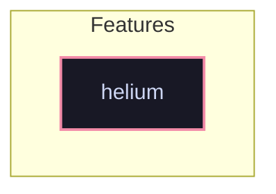

# Feature: `helium`

Helium web browser with custom runtime flags and enterprise policy management.

[← Back to Features Documentation](../FEATURES.md) | [← Back to Main README](../../README.md)

## Metadata

- **Feature Name**: `helium`
- **Description**: Helium web browser with custom runtime flags and enterprise policy management.
- **Definition File**: [`modules/features/helium.nix`](../../modules/features/helium.nix)

## Architecture Diagram

## Outputs

### NixOS Modules

| Module Attribute | Description | Docs |
| :--- | :--- | :--- |
| [`helium`](../modules/helium.md) | System service module exported by `helium` | [More →](../modules/helium.md) |

### Executable Packages

*No executable packages exported.*

### Development Shells

*No development shells exported.*

### Library Helpers

*No library helpers exported.*

## Consumed Contracts

Capability contracts configured by this feature:

*No contracts consumed by this feature.*
