# Feature: `helium`

Helium web browser with custom runtime flags and enterprise policy management.

[← Back to Features Documentation](../FEATURES.md) | [← Back to Main README](../../README.md)

## Metadata

- **Feature Name**: `helium`
- **Description**: Helium web browser with custom runtime flags and enterprise policy management.
- **Definition File**: [`modules/features/helium.nix`](../../modules/features/helium.nix)

## Architecture Diagram

```mermaid
flowchart TD
    subgraph Contracts["Contracts"]
        contract__home(["home"]):::contractNode
        contract__persistence(["persistence"]):::contractNode
    end

    subgraph Implementations["Implementations"]
        impl__caddy["caddy"]:::implNode
        impl__hjem["hjem"]:::implNode
        impl__impermanence["impermanence"]:::implNode
        impl__lw["lw"]:::implNode
    end

    subgraph Features["Features"]
        feature__antigravity["antigravity"]:::featureNode
        feature__bitwarden["bitwarden"]:::featureNode
        feature__cosmic["cosmic"]:::featureNode
        feature__direnv["direnv"]:::featureNode
        feature__dolphin["dolphin"]:::featureNode
        feature__foot["foot"]:::featureNode
        feature__git["git"]:::featureNode
        feature__helium["helium"]:::featureNode
        feature__labwc["labwc"]:::featureNode
        feature__locale["locale"]:::featureNode
        feature__noctalia["noctalia"]:::featureNode
        feature__ssh["ssh"]:::featureNode
        feature__vaultwarden["vaultwarden"]:::featureNode
        feature__vivaldi["vivaldi"]:::featureNode
        feature__vscode["vscode"]:::featureNode
    end

    subgraph ContractOptions["Contract Options"]
        opt__home_enable[/"home.enable: boolean"/]:::optNode
        opt__home_shared[/"home.shared: submodule"/]:::optNode
        opt__home_users[/"home.users: attribute set of (submodule)"/]:::optNode
        opt__persistence_directories[/"persistence.directories: list of (string or attribute set of anything)"/]:::optNode
        opt__persistence_enable[/"persistence.enable: boolean"/]:::optNode
        opt__persistence_files[/"persistence.files: list of (string or attribute set of anything)"/]:::optNode
        opt__persistence_users[/"persistence.users: attribute set of (submodule)"/]:::optNode
    end

    subgraph ContractTypes["Contract Types"]
        type__home_file{{"home.file"}}:::typeNode
        type__home_files{{"home.files"}}:::typeNode
        type__home_relativeHomePath{{"home.relativeHomePath"}}:::typeNode
        type__home_userHome{{"home.userHome"}}:::typeNode
        type__home_xdg{{"home.xdg"}}:::typeNode
        type__persistence_entries{{"persistence.entries"}}:::typeNode
        type__persistence_user{{"persistence.user"}}:::typeNode
    end


    impl__hjem -.->|"implements"| contract__home
    impl__impermanence -.->|"implements"| contract__persistence
    feature__antigravity -->|"consumes (persistence.users)"| contract__persistence
    feature__bitwarden -->|"consumes (persistence.users)"| contract__persistence
    feature__cosmic -->|"consumes (persistence.users, persistence.directories)"| contract__persistence
    feature__direnv -->|"consumes (persistence.users)"| contract__persistence
    feature__dolphin -->|"consumes (persistence.users)"| contract__persistence
    feature__foot -->|"consumes (home.shared, home.users)"| contract__home
    feature__foot -->|"consumes (persistence.users)"| contract__persistence
    feature__git -->|"consumes (home.users, home.shared)"| contract__home
    feature__helium -->|"consumes (home.shared, home.users)"| contract__home
    feature__helium -->|"consumes (persistence.users)"| contract__persistence
    feature__labwc -->|"consumes (home.shared.xdg.config, home.users, home.shared)"| contract__home
    feature__labwc -->|"consumes (persistence.users)"| contract__persistence
    feature__locale -->|"consumes (home.shared.sessionVariables, home.shared)"| contract__home
    feature__noctalia -->|"consumes (persistence.users)"| contract__persistence
    feature__ssh -->|"consumes (persistence.files, persistence.enable)"| contract__persistence
    feature__vaultwarden -->|"consumes (persistence.enable)"| contract__persistence
    feature__vivaldi -->|"consumes (persistence.users)"| contract__persistence
    feature__vscode -->|"consumes (persistence.users)"| contract__persistence
    impl__caddy -->|"consumes (persistence.directories, persistence.enable)"| contract__persistence
    impl__hjem -->|"consumes (home.enable)"| contract__home
    impl__impermanence -->|"consumes (persistence.users)"| contract__persistence
    impl__lw -->|"consumes (home.users)"| contract__home
    impl__lw -->|"consumes (persistence.users)"| contract__persistence
    contract__home --- opt__home_enable
    contract__home --- opt__home_shared
    contract__home --- opt__home_users
    contract__persistence --- opt__persistence_directories
    contract__persistence --- opt__persistence_enable
    contract__persistence --- opt__persistence_files
    contract__persistence --- opt__persistence_users
    contract__home --- type__home_file
    contract__home --- type__home_files
    contract__home --- type__home_relativeHomePath
    contract__home --- type__home_userHome
    contract__home --- type__home_xdg
    contract__persistence --- type__persistence_entries
    contract__persistence --- type__persistence_user

classDef hostNode fill:#1e1e2e,stroke:#cba6f7,stroke-width:2px,color:#cdd6f4;
classDef contractNode fill:#181825,stroke:#89b4fa,stroke-width:2px,color:#cdd6f4;
classDef implNode fill:#181825,stroke:#a6e3a1,stroke-width:2px,color:#cdd6f4;
classDef featureNode fill:#181825,stroke:#f38ba8,stroke-width:2px,color:#cdd6f4;
classDef libNode fill:#181825,stroke:#94e2d5,stroke-width:2px,color:#cdd6f4;
classDef optNode fill:#11111b,stroke:#fab387,stroke-width:1px,color:#cdd6f4;
classDef typeNode fill:#11111b,stroke:#f9e2af,stroke-width:1px,color:#cdd6f4;
classDef fnNode fill:#181825,stroke:#94e2d5,stroke-width:1px,color:#cdd6f4;
classDef pkgNode fill:#181825,stroke:#b4befe,stroke-width:1px,color:#cdd6f4;
classDef shellNode fill:#181825,stroke:#f5c2e7,stroke-width:1px,color:#cdd6f4;

```




## Outputs

### NixOS Modules

| Module Attribute | Description | Docs |
| :--- | :--- | :--- |
| [`helium`](../modules/helium.md) | System service module exported by `helium` | [More →](../modules/helium.md) |


### Executable Packages

*No executable packages exported.*

### Development Shells

*No development shells exported.*

### Library Helpers

*No library helpers exported.*


## Consumed Contracts

Capability contracts configured by this feature:

<details>
<summary><code><a href="../contracts/home.md">home</a></code></summary>

Configures options: `home.shared`, `home.users`

```nix
home.shared = lib.mkIf (cfg.flags != []) {
  files = {
    ".config/helium-browser-flags.conf".text = lib.concatStringsSep "\n" cfg.flags;
  };
};

home.users = lib.mapAttrs (userName: uCfg:
  lib.mkIf (uCfg.flags != null) {
    files.".config/helium-browser-flags.conf".text = lib.concatStringsSep "\n" uCfg.flags;
  })
```

</details>


<details>
<summary><code><a href="../contracts/persistence.md">persistence</a></code></summary>

Configures options: `persistence.users`

```nix
persistence.users = self.lib.user.forNormalUsers config (_: _: {
  data.directories = [".config/net.imput.helium"];
});
```

</details>

