# Feature: `helium`

Helium web browser with custom runtime flags and enterprise policy management.

[← Back to Features Documentation](README.md) | [← Back to Main README](../../README.md)

- **Feature**: `helium`
- **Definition File**: [`modules/features/helium.nix`](../../modules/features/helium.nix)

```mermaid
flowchart LR
  urn__nixconf__ast__module__helium["nixosModule/helium"]:::defaultNode
    urn__nixconf__onto__feature__helium("helium"):::featureNode

    urn__nixconf__onto__feature__helium -->|outputs| urn__nixconf__ast__module__helium


    click urn__nixconf__ast__module__helium href "../modules/helium.md" "helium"
    click urn__nixconf__onto__feature__helium href "helium.md" "helium"

  %% Semantic Visual Classes
  classDef hostNode fill:#1e293b,stroke:#38bdf8,stroke-width:2px,color:#f8fafc;
  classDef contractNode fill:#1e1b4b,stroke:#818cf8,stroke-width:2px,color:#f8fafc;
  classDef implNode fill:#0f172a,stroke:#34d399,stroke-width:2px,color:#f8fafc;
  classDef featureNode fill:#134e4a,stroke:#2dd4bf,stroke-width:2px,color:#f8fafc;
  classDef optNode fill:#422006,stroke:#facc15,stroke-width:1px,color:#fefce8;
  classDef typeNode fill:#3b0764,stroke:#c084fc,stroke-width:1px,color:#faf5ff;
  classDef pkgNode fill:#4c0519,stroke:#fb7185,stroke-width:1px,color:#fff1f2;
  classDef devShellNode fill:#451a03,stroke:#fb923c,stroke-width:1px,color:#fff7ed;
  classDef drvNode fill:#18181b,stroke:#a1a1aa,stroke-width:1px,color:#f4f4f5;
  classDef defaultNode fill:#1e293b,stroke:#64748b,stroke-width:1px,color:#f8fafc;
```

Architecture Diagram (click to expand)

## Outputs

### NixOS Modules

| Module | Description | Docs |
| :--- | :--- | :--- |
| [`helium`](../modules/helium.md) | Helium web browser with custom runtime flags and enterprise policy management. | [More →](../modules/helium.md) |
