# Feature: `nix`

Nix package manager daemon settings, binary caches, garbage collection, and nix-ld.

[← Back to Features Documentation](../FEATURES.md) | [← Back to Main README](../../README.md)

## Metadata

- **Feature Name**: `nix`
- **Description**: Nix package manager daemon settings, binary caches, garbage collection, and nix-ld.
- **Definition File**: [`modules/features/nix.nix`](../../modules/features/nix.nix)

## Architecture Diagram

```mermaid
flowchart TD
    subgraph Hosts["Hosts"]
        host__astrolabe["astrolabe"]:::hostNode
        host__x240["x240"]:::hostNode
    end

    subgraph Contracts["Contracts"]
        contract__reverse_proxy(["reverse-proxy"]):::contractNode
        contract__secrets(["secrets"]):::contractNode
        contract__wayland(["wayland"]):::contractNode
    end

    subgraph Implementations["Implementations"]
        impl__caddy["caddy"]:::implNode
        impl__cgroups["cgroups"]:::implNode
        impl__hjem["hjem"]:::implNode
        impl__impermanence["impermanence"]:::implNode
        impl__lw["lw"]:::implNode
        impl__restic["restic"]:::implNode
        impl__sops["sops"]:::implNode
        impl__uwsm["uwsm"]:::implNode
    end

    subgraph Features["Features"]
        feature__antigravity["antigravity"]:::featureNode
        feature__audio["audio"]:::featureNode
        feature__bitwarden["bitwarden"]:::featureNode
        feature__cursor["cursor"]:::featureNode
        feature__direnv["direnv"]:::featureNode
        feature__disko["disko"]:::featureNode
        feature__dolphin["dolphin"]:::featureNode
        feature__fonts["fonts"]:::featureNode
        feature__foot["foot"]:::featureNode
        feature__git["git"]:::featureNode
        feature__greetd["greetd"]:::featureNode
        feature__labwc["labwc"]:::featureNode
        feature__locale["locale"]:::featureNode
        feature__nix["nix"]:::featureNode
        feature__noctalia["noctalia"]:::featureNode
        feature__ssh["ssh"]:::featureNode
        feature__tack["tack"]:::featureNode
        feature__ttyd["ttyd"]:::featureNode
        feature__vaultwarden["vaultwarden"]:::featureNode
        feature__vivaldi["vivaldi"]:::featureNode
        feature__vscode["vscode"]:::featureNode
        feature__wifi_eduroam["wifi-eduroam"]:::featureNode
    end

    subgraph ContractOptions["Contract Options"]
        opt__secrets_defaultFile[/"secrets.defaultFile: null or absolute path"/]:::optNode
        opt__secrets_enable[/"secrets.enable: boolean"/]:::optNode
        opt__secrets_files[/"secrets.files: attribute set of (submodule)"/]:::optNode
    end

    subgraph ContractTypes["Contract Types"]
        type__secrets_secret{{"secrets.secret"}}:::typeNode
    end


    host__astrolabe -->|"imports"| impl__caddy
    host__astrolabe -->|"imports"| impl__cgroups
    host__astrolabe -->|"imports"| impl__impermanence
    host__astrolabe -->|"imports"| impl__lw
    host__astrolabe -->|"imports"| impl__restic
    host__astrolabe -->|"imports"| impl__sops
    host__astrolabe -->|"imports"| feature__disko
    host__astrolabe -->|"imports"| feature__git
    host__astrolabe -->|"imports"| feature__locale
    host__astrolabe -->|"imports"| feature__nix
    host__astrolabe -->|"imports"| feature__ssh
    host__astrolabe -->|"imports"| feature__ttyd
    host__astrolabe -->|"imports"| feature__vaultwarden
    host__x240 -->|"imports"| impl__cgroups
    host__x240 -->|"imports"| impl__hjem
    host__x240 -->|"imports"| impl__impermanence
    host__x240 -->|"imports"| impl__lw
    host__x240 -->|"imports"| impl__sops
    host__x240 -->|"imports"| impl__uwsm
    host__x240 -->|"imports"| feature__antigravity
    host__x240 -->|"imports"| feature__audio
    host__x240 -->|"imports"| feature__bitwarden
    host__x240 -->|"imports"| feature__cursor
    host__x240 -->|"imports"| feature__direnv
    host__x240 -->|"imports"| feature__disko
    host__x240 -->|"imports"| feature__dolphin
    host__x240 -->|"imports"| feature__fonts
    host__x240 -->|"imports"| feature__foot
    host__x240 -->|"imports"| feature__git
    host__x240 -->|"imports"| feature__greetd
    host__x240 -->|"imports"| feature__labwc
    host__x240 -->|"imports"| feature__locale
    host__x240 -->|"imports"| feature__nix
    host__x240 -->|"imports"| feature__noctalia
    host__x240 -->|"imports"| feature__ssh
    host__x240 -->|"imports"| feature__tack
    host__x240 -->|"imports"| feature__vivaldi
    host__x240 -->|"imports"| feature__vscode
    host__x240 -->|"imports"| feature__wifi_eduroam
    impl__caddy -.->|"implements"| contract__reverse_proxy
    impl__sops -.->|"implements"| contract__secrets
    impl__uwsm -.->|"implements"| contract__wayland
    host__astrolabe -->|"consumes (reverse-proxy.domain)"| contract__reverse_proxy
    host__x240 -->|"consumes (wayland.enable)"| contract__wayland
    feature__labwc -->|"consumes (wayland.compositors.labwc, wayland.compositors)"| contract__wayland
    feature__nix -->|"consumes (secrets.files)"| contract__secrets
    feature__ssh -->|"consumes (secrets.files)"| contract__secrets
    feature__ttyd -->|"consumes (reverse-proxy.enable)"| contract__reverse_proxy
    feature__vaultwarden -->|"consumes (reverse-proxy.domain)"| contract__reverse_proxy
    feature__wifi_eduroam -->|"consumes (secrets.files)"| contract__secrets
    impl__lw -->|"consumes (secrets.files.default-user-password-hash, secrets.files)"| contract__secrets
    impl__restic -->|"consumes (secrets.files)"| contract__secrets
    impl__sops -->|"consumes (secrets.defaultFile, secrets.enable, secrets.files)"| contract__secrets
    impl__uwsm -->|"consumes (wayland.compositors, wayland.enable)"| contract__wayland
    contract__secrets --- opt__secrets_defaultFile
    contract__secrets --- opt__secrets_enable
    contract__secrets --- opt__secrets_files
    contract__secrets --- type__secrets_secret

classDef hostNode fill:#1e1e2e,stroke:#cba6f7,stroke-width:2px,color:#cdd6f4;
classDef contractNode fill:#181825,stroke:#89b4fa,stroke-width:2px,color:#cdd6f4;
classDef implNode fill:#181825,stroke:#a6e3a1,stroke-width:2px,color:#cdd6f4;
classDef featureNode fill:#181825,stroke:#f38ba8,stroke-width:2px,color:#cdd6f4;
classDef libNode fill:#181825,stroke:#94e2d5,stroke-width:2px,color:#cdd6f4;
classDef optNode fill:#11111b,stroke:#fab387,stroke-width:1px,color:#cdd6f4;
classDef typeNode fill:#11111b,stroke:#f9e2af,stroke-width:1px,color:#cdd6f4;
classDef fnNode fill:#181825,stroke:#94e2d5,stroke-width:1px,color:#cdd6f4;
classDef pkgNode fill:#181825,stroke:#b4befe,stroke-width:1px,color:#cdd6f4;
classDef shellNode fill:#181825,stroke:#f5c2e7,stroke-width:1px,color:#cdd6f4;

```




## Outputs

### NixOS Modules

| Module Attribute | Description | Docs |
| :--- | :--- | :--- |
| [`nix`](../modules/nix.md) | System service module exported by `nix` | [More →](../modules/nix.md) |


### Executable Packages

*No executable packages exported.*

### Development Shells

*No development shells exported.*

### Library Helpers

*No library helpers exported.*


## Consumed Contracts

Capability contracts configured by this feature:

<details>
<summary><code><a href="../contracts/secrets.md">secrets</a></code></summary>

Configures options: `secrets.files`

```nix
secrets.files = lib.mkIf config.nix.cachixWatchStore {
  cachix-token = {
    file = ../../secrets/cachix/cachix.yaml;
    key = "token";
  };
};

cachixTokenFile = config.secrets.files.cachix-token.path;
```

</details>

