# Feature: `ttyd`

Web terminal server bridging browser sessions to system shells via ttyd.

[← Back to Features Documentation](../FEATURES.md) | [← Back to Main README](../../README.md)

## Metadata

- **Feature Name**: `ttyd`
- **Description**: Web terminal server bridging browser sessions to system shells via ttyd.
- **Definition File**: [`modules/features/ttyd.nix`](../../modules/features/ttyd.nix)

## Architecture Diagram

```mermaid
flowchart LR
  urn__nixconf__ast__module__astrolabe["nixosModule/astrolabe"]:::defaultNode
    urn__nixconf__ast__module__astrolabe_disk["nixosModule/astrolabe-disk"]:::defaultNode
    urn__nixconf__ast__module__astrolabe_hardware["nixosModule/astrolabe-hardware"]:::defaultNode
    urn__nixconf__ast__module__astrolabe_packages["nixosModule/astrolabe-packages"]:::defaultNode
    urn__nixconf__ast__module__astrolabe_services["nixosModule/astrolabe-services"]:::defaultNode
    urn__nixconf__ast__module__astrolabe_system["nixosModule/astrolabe-system"]:::defaultNode
    urn__nixconf__ast__module__caddy["nixosModule/caddy"]:::defaultNode
    urn__nixconf__ast__module__ttyd["nixosModule/ttyd"]:::defaultNode
    urn__nixconf__ast__option__reverse_proxy_domain[/"reverse-proxy.domain"/]:::optNode
    urn__nixconf__ast__option__reverse_proxy_enable[/"reverse-proxy.enable"/]:::optNode
    urn__nixconf__ast__option__reverse_proxy_hosts[/"reverse-proxy.hosts"/]:::optNode
    urn__nixconf__ast__type__reverse_proxy_fqdn[["reverse-proxy.fqdn"]]:::typeNode
    urn__nixconf__ast__type__reverse_proxy_host[["reverse-proxy.host"]]:::typeNode
    urn__nixconf__eval__configuration__astrolabe(["nixosConfiguration/astrolabe"]):::hostNode
    urn__nixconf__onto__contract__reverse_proxy{{"reverse-proxy"}}:::contractNode
    urn__nixconf__onto__feature__antigravity("antigravity"):::featureNode
    urn__nixconf__onto__feature__audio("audio"):::featureNode
    urn__nixconf__onto__feature__bitwarden("bitwarden"):::featureNode
    urn__nixconf__onto__feature__cosmic("cosmic"):::featureNode
    urn__nixconf__onto__feature__cursor("cursor"):::featureNode
    urn__nixconf__onto__feature__direnv("direnv"):::featureNode
    urn__nixconf__onto__feature__disko("disko"):::featureNode
    urn__nixconf__onto__feature__docker("docker"):::featureNode
    urn__nixconf__onto__feature__dolphin("dolphin"):::featureNode
    urn__nixconf__onto__feature__fonts("fonts"):::featureNode
    urn__nixconf__onto__feature__foot("foot"):::featureNode
    urn__nixconf__onto__feature__git("git"):::featureNode
    urn__nixconf__onto__feature__greetd("greetd"):::featureNode
    urn__nixconf__onto__feature__helium("helium"):::featureNode
    urn__nixconf__onto__feature__labwc("labwc"):::featureNode
    urn__nixconf__onto__feature__locale("locale"):::featureNode
    urn__nixconf__onto__feature__nix("nix"):::featureNode
    urn__nixconf__onto__feature__noctalia("noctalia"):::featureNode
    urn__nixconf__onto__feature__ssh("ssh"):::featureNode
    urn__nixconf__onto__feature__tack("tack"):::featureNode
    urn__nixconf__onto__feature__ttyd("ttyd"):::featureNode
    urn__nixconf__onto__feature__uchiyomi("uchiyomi"):::featureNode
    urn__nixconf__onto__feature__user("user"):::featureNode
    urn__nixconf__onto__feature__vaultwarden("vaultwarden"):::featureNode
    urn__nixconf__onto__feature__vivaldi("vivaldi"):::featureNode
    urn__nixconf__onto__feature__vscode("vscode"):::featureNode
    urn__nixconf__onto__feature__wifi_eduroam("wifi-eduroam"):::featureNode
    urn__nixconf__onto__host__astrolabe(["astrolabe"]):::hostNode
    urn__nixconf__onto__implementation__caddy["caddy"]:::implNode
    urn__nixconf__onto__implementation__impermanence["impermanence"]:::implNode
    urn__nixconf__onto__implementation__lw["lw"]:::implNode
    urn__nixconf__onto__implementation__restic["restic"]:::implNode
    urn__nixconf__onto__implementation__sops["sops"]:::implNode
    urn__nixconf__onto__primitive__contract["contract"]:::defaultNode
    urn__nixconf__onto__primitive__feature["feature"]:::defaultNode
    urn__nixconf__onto__primitive__host["host"]:::defaultNode

    urn__nixconf__ast__module__astrolabe_services -.->|flowsTo| urn__nixconf__ast__module__caddy
    urn__nixconf__ast__module__astrolabe_services -.->|writes| urn__nixconf__ast__option__reverse_proxy_domain
    urn__nixconf__ast__module__caddy -.->|reads| urn__nixconf__ast__option__reverse_proxy_domain
    urn__nixconf__ast__module__caddy -.->|reads| urn__nixconf__ast__option__reverse_proxy_hosts
    urn__nixconf__ast__module__ttyd -.->|flowsTo| urn__nixconf__ast__module__caddy
    urn__nixconf__ast__module__ttyd -.->|writes| urn__nixconf__ast__option__reverse_proxy_hosts
    urn__nixconf__ast__option__reverse_proxy_domain -.->|typedBy| urn__nixconf__ast__type__reverse_proxy_fqdn
    urn__nixconf__ast__option__reverse_proxy_hosts -.->|typedBy| urn__nixconf__ast__type__reverse_proxy_host
    urn__nixconf__eval__configuration__astrolabe -->|imports| urn__nixconf__ast__module__astrolabe_disk
    urn__nixconf__eval__configuration__astrolabe -->|imports| urn__nixconf__ast__module__astrolabe_hardware
    urn__nixconf__eval__configuration__astrolabe -->|imports| urn__nixconf__ast__module__astrolabe_packages
    urn__nixconf__eval__configuration__astrolabe -->|imports| urn__nixconf__ast__module__astrolabe_services
    urn__nixconf__eval__configuration__astrolabe -->|imports| urn__nixconf__ast__module__astrolabe_system
    urn__nixconf__eval__configuration__astrolabe -->|imports| urn__nixconf__ast__module__caddy
    urn__nixconf__eval__configuration__astrolabe -->|imports| urn__nixconf__ast__module__ttyd
    urn__nixconf__onto__contract__reverse_proxy -->|declares| urn__nixconf__ast__option__reverse_proxy_domain
    urn__nixconf__onto__contract__reverse_proxy -->|declares| urn__nixconf__ast__option__reverse_proxy_enable
    urn__nixconf__onto__contract__reverse_proxy -->|declares| urn__nixconf__ast__option__reverse_proxy_hosts
    urn__nixconf__onto__contract__reverse_proxy -->|declares| urn__nixconf__ast__type__reverse_proxy_fqdn
    urn__nixconf__onto__contract__reverse_proxy -->|declares| urn__nixconf__ast__type__reverse_proxy_host
    urn__nixconf__onto__feature__ttyd -->|outputs| urn__nixconf__ast__module__ttyd
    urn__nixconf__onto__feature__ttyd -.->|consumes| urn__nixconf__onto__contract__reverse_proxy
    urn__nixconf__onto__feature__uchiyomi -.->|consumes| urn__nixconf__onto__contract__reverse_proxy
    urn__nixconf__onto__feature__vaultwarden -.->|consumes| urn__nixconf__onto__contract__reverse_proxy
    urn__nixconf__onto__host__astrolabe -->|outputs| urn__nixconf__ast__module__astrolabe
    urn__nixconf__onto__host__astrolabe -->|outputs| urn__nixconf__ast__module__astrolabe_disk
    urn__nixconf__onto__host__astrolabe -->|outputs| urn__nixconf__ast__module__astrolabe_hardware
    urn__nixconf__onto__host__astrolabe -->|outputs| urn__nixconf__ast__module__astrolabe_packages
    urn__nixconf__onto__host__astrolabe -->|outputs| urn__nixconf__ast__module__astrolabe_services
    urn__nixconf__onto__host__astrolabe -->|outputs| urn__nixconf__ast__module__astrolabe_system
    urn__nixconf__onto__host__astrolabe -->|outputs| urn__nixconf__eval__configuration__astrolabe
    urn__nixconf__onto__host__astrolabe -.->|consumes| urn__nixconf__onto__contract__reverse_proxy
    urn__nixconf__onto__host__astrolabe -->|imports| urn__nixconf__onto__feature__disko
    urn__nixconf__onto__host__astrolabe -->|imports| urn__nixconf__onto__feature__git
    urn__nixconf__onto__host__astrolabe -->|imports| urn__nixconf__onto__feature__locale
    urn__nixconf__onto__host__astrolabe -->|imports| urn__nixconf__onto__feature__nix
    urn__nixconf__onto__host__astrolabe -->|imports| urn__nixconf__onto__feature__ssh
    urn__nixconf__onto__host__astrolabe -->|imports| urn__nixconf__onto__feature__ttyd
    urn__nixconf__onto__host__astrolabe -->|imports| urn__nixconf__onto__feature__uchiyomi
    urn__nixconf__onto__host__astrolabe -->|imports| urn__nixconf__onto__feature__vaultwarden
    urn__nixconf__onto__host__astrolabe -->|imports| urn__nixconf__onto__implementation__caddy
    urn__nixconf__onto__host__astrolabe -->|imports| urn__nixconf__onto__implementation__impermanence
    urn__nixconf__onto__host__astrolabe -->|imports| urn__nixconf__onto__implementation__lw
    urn__nixconf__onto__host__astrolabe -->|imports| urn__nixconf__onto__implementation__restic
    urn__nixconf__onto__host__astrolabe -->|imports| urn__nixconf__onto__implementation__sops
    urn__nixconf__onto__implementation__caddy -->|outputs| urn__nixconf__ast__module__caddy
    urn__nixconf__onto__implementation__caddy ==>|implements| urn__nixconf__onto__contract__reverse_proxy
    urn__nixconf__onto__primitive__contract -->|contains| urn__nixconf__onto__contract__reverse_proxy
    urn__nixconf__onto__primitive__feature -->|contains| urn__nixconf__onto__feature__antigravity
    urn__nixconf__onto__primitive__feature -->|contains| urn__nixconf__onto__feature__audio
    urn__nixconf__onto__primitive__feature -->|contains| urn__nixconf__onto__feature__bitwarden
    urn__nixconf__onto__primitive__feature -->|contains| urn__nixconf__onto__feature__cosmic
    urn__nixconf__onto__primitive__feature -->|contains| urn__nixconf__onto__feature__cursor
    urn__nixconf__onto__primitive__feature -->|contains| urn__nixconf__onto__feature__direnv
    urn__nixconf__onto__primitive__feature -->|contains| urn__nixconf__onto__feature__disko
    urn__nixconf__onto__primitive__feature -->|contains| urn__nixconf__onto__feature__docker
    urn__nixconf__onto__primitive__feature -->|contains| urn__nixconf__onto__feature__dolphin
    urn__nixconf__onto__primitive__feature -->|contains| urn__nixconf__onto__feature__fonts
    urn__nixconf__onto__primitive__feature -->|contains| urn__nixconf__onto__feature__foot
    urn__nixconf__onto__primitive__feature -->|contains| urn__nixconf__onto__feature__git
    urn__nixconf__onto__primitive__feature -->|contains| urn__nixconf__onto__feature__greetd
    urn__nixconf__onto__primitive__feature -->|contains| urn__nixconf__onto__feature__helium
    urn__nixconf__onto__primitive__feature -->|contains| urn__nixconf__onto__feature__labwc
    urn__nixconf__onto__primitive__feature -->|contains| urn__nixconf__onto__feature__locale
    urn__nixconf__onto__primitive__feature -->|contains| urn__nixconf__onto__feature__nix
    urn__nixconf__onto__primitive__feature -->|contains| urn__nixconf__onto__feature__noctalia
    urn__nixconf__onto__primitive__feature -->|contains| urn__nixconf__onto__feature__ssh
    urn__nixconf__onto__primitive__feature -->|contains| urn__nixconf__onto__feature__tack
    urn__nixconf__onto__primitive__feature -->|contains| urn__nixconf__onto__feature__ttyd
    urn__nixconf__onto__primitive__feature -->|contains| urn__nixconf__onto__feature__uchiyomi
    urn__nixconf__onto__primitive__feature -->|contains| urn__nixconf__onto__feature__user
    urn__nixconf__onto__primitive__feature -->|contains| urn__nixconf__onto__feature__vaultwarden
    urn__nixconf__onto__primitive__feature -->|contains| urn__nixconf__onto__feature__vivaldi
    urn__nixconf__onto__primitive__feature -->|contains| urn__nixconf__onto__feature__vscode
    urn__nixconf__onto__primitive__feature -->|contains| urn__nixconf__onto__feature__wifi_eduroam
    urn__nixconf__onto__primitive__host -->|contains| urn__nixconf__onto__host__astrolabe


    click urn__nixconf__ast__module__astrolabe href "../modules/astrolabe.md" "astrolabe"
    click urn__nixconf__ast__module__astrolabe_disk href "../modules/astrolabe-disk.md" "astrolabe-disk"
    click urn__nixconf__ast__module__astrolabe_hardware href "../modules/astrolabe-hardware.md" "astrolabe-hardware"
    click urn__nixconf__ast__module__astrolabe_packages href "../modules/astrolabe-packages.md" "astrolabe-packages"
    click urn__nixconf__ast__module__astrolabe_services href "../modules/astrolabe-services.md" "astrolabe-services"
    click urn__nixconf__ast__module__astrolabe_system href "../modules/astrolabe-system.md" "astrolabe-system"
    click urn__nixconf__ast__module__caddy href "../modules/caddy.md" "caddy"
    click urn__nixconf__ast__module__ttyd href "../modules/ttyd.md" "ttyd"
    click urn__nixconf__eval__configuration__astrolabe href "../hosts/astrolabe.md" "astrolabe"
    click urn__nixconf__onto__contract__reverse_proxy href "../contracts/reverse-proxy.md" "reverse-proxy"
    click urn__nixconf__onto__feature__antigravity href "../features/antigravity.md" "antigravity"
    click urn__nixconf__onto__feature__audio href "../features/audio.md" "audio"
    click urn__nixconf__onto__feature__bitwarden href "../features/bitwarden.md" "bitwarden"
    click urn__nixconf__onto__feature__cosmic href "../features/cosmic.md" "cosmic"
    click urn__nixconf__onto__feature__cursor href "../features/cursor.md" "cursor"
    click urn__nixconf__onto__feature__direnv href "../features/direnv.md" "direnv"
    click urn__nixconf__onto__feature__disko href "../features/disko.md" "disko"
    click urn__nixconf__onto__feature__docker href "../features/docker.md" "docker"
    click urn__nixconf__onto__feature__dolphin href "../features/dolphin.md" "dolphin"
    click urn__nixconf__onto__feature__fonts href "../features/fonts.md" "fonts"
    click urn__nixconf__onto__feature__foot href "../features/foot.md" "foot"
    click urn__nixconf__onto__feature__git href "../features/git.md" "git"
    click urn__nixconf__onto__feature__greetd href "../features/greetd.md" "greetd"
    click urn__nixconf__onto__feature__helium href "../features/helium.md" "helium"
    click urn__nixconf__onto__feature__labwc href "../features/labwc.md" "labwc"
    click urn__nixconf__onto__feature__locale href "../features/locale.md" "locale"
    click urn__nixconf__onto__feature__nix href "../features/nix.md" "nix"
    click urn__nixconf__onto__feature__noctalia href "../features/noctalia.md" "noctalia"
    click urn__nixconf__onto__feature__ssh href "../features/ssh.md" "ssh"
    click urn__nixconf__onto__feature__tack href "../features/tack.md" "tack"
    click urn__nixconf__onto__feature__ttyd href "../features/ttyd.md" "ttyd"
    click urn__nixconf__onto__feature__uchiyomi href "../features/uchiyomi.md" "uchiyomi"
    click urn__nixconf__onto__feature__user href "../features/user.md" "user"
    click urn__nixconf__onto__feature__vaultwarden href "../features/vaultwarden.md" "vaultwarden"
    click urn__nixconf__onto__feature__vivaldi href "../features/vivaldi.md" "vivaldi"
    click urn__nixconf__onto__feature__vscode href "../features/vscode.md" "vscode"
    click urn__nixconf__onto__feature__wifi_eduroam href "../features/wifi-eduroam.md" "wifi-eduroam"
    click urn__nixconf__onto__host__astrolabe href "../hosts/astrolabe.md" "astrolabe"
    click urn__nixconf__onto__implementation__caddy href "../implementations/caddy.md" "caddy"
    click urn__nixconf__onto__implementation__impermanence href "../implementations/impermanence.md" "impermanence"
    click urn__nixconf__onto__implementation__lw href "../implementations/lw.md" "lw"
    click urn__nixconf__onto__implementation__restic href "../implementations/restic.md" "restic"
    click urn__nixconf__onto__implementation__sops href "../implementations/sops.md" "sops"

  %% Semantic Visual Classes
  classDef hostNode fill:#1e293b,stroke:#38bdf8,stroke-width:2px,color:#f8fafc;
  classDef contractNode fill:#1e1b4b,stroke:#818cf8,stroke-width:2px,color:#f8fafc;
  classDef implNode fill:#0f172a,stroke:#34d399,stroke-width:2px,color:#f8fafc;
  classDef featureNode fill:#134e4a,stroke:#2dd4bf,stroke-width:2px,color:#f8fafc;
  classDef optNode fill:#422006,stroke:#facc15,stroke-width:1px,color:#fefce8;
  classDef typeNode fill:#3b0764,stroke:#c084fc,stroke-width:1px,color:#faf5ff;
  classDef pkgNode fill:#4c0519,stroke:#fb7185,stroke-width:1px,color:#fff1f2;
  classDef devShellNode fill:#451a03,stroke:#fb923c,stroke-width:1px,color:#fff7ed;
  classDef drvNode fill:#18181b,stroke:#a1a1aa,stroke-width:1px,color:#f4f4f5;
  classDef defaultNode fill:#1e293b,stroke:#64748b,stroke-width:1px,color:#f8fafc;
```




## Outputs

### NixOS Modules

| Module | Description | Details |
| :--- | :--- | :--- |
| [`ttyd`](../modules/ttyd.md) | System service module exported by `ttyd` | [More →](../modules/ttyd.md) |

### Executable Packages

*No packages exported.*

### Development Shells

*No development shells exported.*

### Library Helpers

*No library symbols exported.*

## Consumed Contracts

Contracts configured by this feature:

<details>
<summary><code><a href="../contracts/reverse-proxy.md">reverse-proxy</a></code></summary>

Configures options: *general capability bindings*

```nix
config = {

};

```

</details>

