# Feature: `ttyd`

Web terminal server bridging browser sessions to system shells via ttyd.

[← Back to Features Documentation](../FEATURES.md) | [← Back to Main README](../../README.md)

## Metadata

- **Feature Name**: `ttyd`
- **Description**: Web terminal server bridging browser sessions to system shells via ttyd.
- **Definition File**: [`modules/features/ttyd.nix`](../../modules/features/ttyd.nix)

## Architecture Diagram

```mermaid
flowchart TD
    subgraph Hosts["Hosts"]
        host__astrolabe["astrolabe"]:::hostNode
    end

    subgraph Contracts["Contracts"]
        contract__resources(["resources"]):::contractNode
        contract__reverse_proxy(["reverse-proxy"]):::contractNode
    end

    subgraph Implementations["Implementations"]
        impl__caddy["caddy"]:::implNode
        impl__cgroups["cgroups"]:::implNode
        impl__impermanence["impermanence"]:::implNode
        impl__lw["lw"]:::implNode
        impl__restic["restic"]:::implNode
        impl__sops["sops"]:::implNode
    end

    subgraph Features["Features"]
        feature__disko["disko"]:::featureNode
        feature__git["git"]:::featureNode
        feature__locale["locale"]:::featureNode
        feature__nix["nix"]:::featureNode
        feature__ssh["ssh"]:::featureNode
        feature__ttyd["ttyd"]:::featureNode
        feature__vaultwarden["vaultwarden"]:::featureNode
    end

    subgraph ContractOptions["Contract Options"]
        opt__resources_defaultSlices_enable[/"resources.defaultSlices.enable: boolean"/]:::optNode
        opt__resources_enable[/"resources.enable: boolean"/]:::optNode
        opt__resources_services[/"resources.services: attribute set of (submodule)"/]:::optNode
        opt__resources_slices[/"resources.slices: attribute set of (submodule)"/]:::optNode
        opt__reverse_proxy_domain[/"reverse-proxy.domain: null or (Fully qualified domain name)"/]:::optNode
        opt__reverse_proxy_enable[/"reverse-proxy.enable: boolean"/]:::optNode
        opt__reverse_proxy_hosts[/"reverse-proxy.hosts: attribute set of (submodule)"/]:::optNode
    end

    subgraph ContractTypes["Contract Types"]
        type__resources_byteSize{{"resources.byteSize"}}:::typeNode
        type__resources_cgroupWeight{{"resources.cgroupWeight"}}:::typeNode
        type__resources_service{{"resources.service"}}:::typeNode
        type__resources_slice{{"resources.slice"}}:::typeNode
        type__reverse_proxy_fqdn{{"reverse-proxy.fqdn"}}:::typeNode
        type__reverse_proxy_host{{"reverse-proxy.host"}}:::typeNode
    end


    host__astrolabe -->|"imports"| impl__caddy
    host__astrolabe -->|"imports"| impl__cgroups
    host__astrolabe -->|"imports"| impl__impermanence
    host__astrolabe -->|"imports"| impl__lw
    host__astrolabe -->|"imports"| impl__restic
    host__astrolabe -->|"imports"| impl__sops
    host__astrolabe -->|"imports"| feature__disko
    host__astrolabe -->|"imports"| feature__git
    host__astrolabe -->|"imports"| feature__locale
    host__astrolabe -->|"imports"| feature__nix
    host__astrolabe -->|"imports"| feature__ssh
    host__astrolabe -->|"imports"| feature__ttyd
    host__astrolabe -->|"imports"| feature__vaultwarden
    impl__caddy -.->|"implements"| contract__reverse_proxy
    impl__cgroups -.->|"implements"| contract__resources
    host__astrolabe -->|"consumes (reverse-proxy.domain)"| contract__reverse_proxy
    feature__ttyd -->|"consumes (resources.enable)"| contract__resources
    feature__ttyd -->|"consumes (reverse-proxy.enable)"| contract__reverse_proxy
    feature__vaultwarden -->|"consumes (resources.enable)"| contract__resources
    feature__vaultwarden -->|"consumes (reverse-proxy.domain)"| contract__reverse_proxy
    impl__caddy -->|"consumes (resources.services.caddy, resources.enable, resources.services)"| contract__resources
    impl__cgroups -->|"consumes (resources.enable)"| contract__resources
    impl__restic -->|"consumes (resources.services.restic-backups-main, resources.enable, resources.services)"| contract__resources
    contract__resources --- opt__resources_defaultSlices_enable
    contract__resources --- opt__resources_enable
    contract__resources --- opt__resources_services
    contract__resources --- opt__resources_slices
    contract__reverse_proxy --- opt__reverse_proxy_domain
    contract__reverse_proxy --- opt__reverse_proxy_enable
    contract__reverse_proxy --- opt__reverse_proxy_hosts
    contract__resources --- type__resources_byteSize
    contract__resources --- type__resources_cgroupWeight
    contract__resources --- type__resources_service
    contract__resources --- type__resources_slice
    contract__reverse_proxy --- type__reverse_proxy_fqdn
    contract__reverse_proxy --- type__reverse_proxy_host

classDef hostNode fill:#1e1e2e,stroke:#cba6f7,stroke-width:2px,color:#cdd6f4;
classDef contractNode fill:#181825,stroke:#89b4fa,stroke-width:2px,color:#cdd6f4;
classDef implNode fill:#181825,stroke:#a6e3a1,stroke-width:2px,color:#cdd6f4;
classDef featureNode fill:#181825,stroke:#f38ba8,stroke-width:2px,color:#cdd6f4;
classDef libNode fill:#181825,stroke:#94e2d5,stroke-width:2px,color:#cdd6f4;
classDef optNode fill:#11111b,stroke:#fab387,stroke-width:1px,color:#cdd6f4;
classDef typeNode fill:#11111b,stroke:#f9e2af,stroke-width:1px,color:#cdd6f4;
classDef fnNode fill:#181825,stroke:#94e2d5,stroke-width:1px,color:#cdd6f4;
classDef pkgNode fill:#181825,stroke:#b4befe,stroke-width:1px,color:#cdd6f4;
classDef shellNode fill:#181825,stroke:#f5c2e7,stroke-width:1px,color:#cdd6f4;

```




## Outputs

### NixOS Modules

| Module Attribute | Description | Docs |
| :--- | :--- | :--- |
| [`ttyd`](../modules/ttyd.md) | System service module exported by `ttyd` | [More →](../modules/ttyd.md) |


### Executable Packages

*No executable packages exported.*

### Development Shells

*No development shells exported.*

### Library Helpers

*No library helpers exported.*


## Consumed Contracts

Capability contracts configured by this feature:

<details>
<summary><code><a href="../contracts/resources.md">resources</a></code></summary>

Configures options: `resources.enable`

```nix
// self.lib.resources.mkOption {
  profile = "standard";
  memory.high = "256M";
  memory.max = "512M";
}

(self.lib.resources.mkConfig {
  inherit config cfg;
  serviceName = "ttyd-web";
})
```

</details>


<details>
<summary><code><a href="../contracts/reverse-proxy.md">reverse-proxy</a></code></summary>

Configures options: `reverse-proxy.enable`

```nix
// self.lib.reverse-proxy.mkOption {
  subdomain = "ttyd";
  port = 7681;
  basicAuth = {admin = "$2a$14$vYmK17NeNy4sdgvOm6SAheSigD5Lnus70w8aJfQgLBceSG0hlVrPK";};
}

(self.lib.reverse-proxy.mkConfig {inherit config cfg;})
```

</details>

