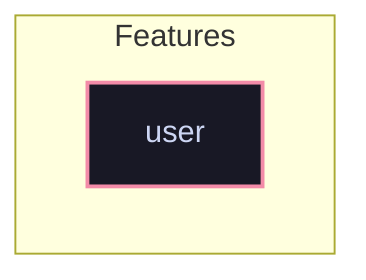

# Feature: `user`

Normal user account helper functions and querying utilities.

[← Back to Features Documentation](../FEATURES.md) | [← Back to Main README](../../README.md)

## Metadata

- **Feature Name**: `user`
- **Description**: Normal user account helper functions and querying utilities.
- **Definition File**: [`modules/features/user.nix`](../../modules/features/user.nix)

## Architecture Diagram

## Outputs

### NixOS Modules

*No NixOS modules exported.*

### Executable Packages

*No executable packages exported.*

### Development Shells

*No development shells exported.*

### Library Helpers

| Symbol | Description | Docs |
| :--- | :--- | :--- |
| [`flake.lib.user.forNormalUsers`](../lib/user.md#forNormalUsers) | Library helper symbol | [More →](../lib/user.md#forNormalUsers) |
| [`flake.lib.user.normalUserNames`](../lib/user.md#normalUserNames) | Library helper symbol | [More →](../lib/user.md#normalUserNames) |
| [`flake.lib.user.normalUsers`](../lib/user.md#normalUsers) | Library helper symbol | [More →](../lib/user.md#normalUsers) |

## Consumed Contracts

Capability contracts configured by this feature:

*No contracts consumed by this feature.*
