# Feature: `vaultwarden`

Self-hosted Bitwarden compatible password manager server.

[← Back to Features Documentation](../FEATURES.md) | [← Back to Main README](../../README.md)

## Metadata

- **Feature Name**: `vaultwarden`
- **Description**: Self-hosted Bitwarden compatible password manager server.
- **Definition File**: [`modules/features/vaultwarden.nix`](../../modules/features/vaultwarden.nix)

## Architecture Diagram

```mermaid
flowchart TD
    subgraph Hosts["Hosts"]
        host__astrolabe["astrolabe"]:::hostNode
    end

    subgraph Contracts["Contracts"]
        contract__backup(["backup"]):::contractNode
        contract__persistence(["persistence"]):::contractNode
        contract__resources(["resources"]):::contractNode
        contract__reverse_proxy(["reverse-proxy"]):::contractNode
    end

    subgraph Implementations["Implementations"]
        impl__caddy["caddy"]:::implNode
        impl__cgroups["cgroups"]:::implNode
        impl__impermanence["impermanence"]:::implNode
        impl__lw["lw"]:::implNode
        impl__restic["restic"]:::implNode
        impl__sops["sops"]:::implNode
    end

    subgraph Features["Features"]
        feature__antigravity["antigravity"]:::featureNode
        feature__bitwarden["bitwarden"]:::featureNode
        feature__cosmic["cosmic"]:::featureNode
        feature__direnv["direnv"]:::featureNode
        feature__disko["disko"]:::featureNode
        feature__dolphin["dolphin"]:::featureNode
        feature__foot["foot"]:::featureNode
        feature__git["git"]:::featureNode
        feature__helium["helium"]:::featureNode
        feature__labwc["labwc"]:::featureNode
        feature__locale["locale"]:::featureNode
        feature__nix["nix"]:::featureNode
        feature__noctalia["noctalia"]:::featureNode
        feature__ssh["ssh"]:::featureNode
        feature__ttyd["ttyd"]:::featureNode
        feature__vaultwarden["vaultwarden"]:::featureNode
        feature__vivaldi["vivaldi"]:::featureNode
        feature__vscode["vscode"]:::featureNode
    end

    subgraph Libraries["Libraries"]
        lib__backup(["lib: backup"]):::libNode
        lib__persistence(["lib: persistence"]):::libNode
        lib__resources(["lib: resources"]):::libNode
        lib__reverse_proxy(["lib: reverse-proxy"]):::libNode
    end

    subgraph ContractOptions["Contract Options"]
        opt__backup_enable[/"backup.enable: boolean"/]:::optNode
        opt__backup_exclude[/"backup.exclude: list of string"/]:::optNode
        opt__backup_paths[/"backup.paths: list of absolute path"/]:::optNode
        opt__backup_pruneOpts[/"backup.pruneOpts: list of string"/]:::optNode
        opt__backup_timerConfig[/"backup.timerConfig: attribute set of anything"/]:::optNode
        opt__persistence_directories[/"persistence.directories: list of (string or attribute set of anything)"/]:::optNode
        opt__persistence_enable[/"persistence.enable: boolean"/]:::optNode
        opt__persistence_files[/"persistence.files: list of (string or attribute set of anything)"/]:::optNode
        opt__persistence_users[/"persistence.users: attribute set of (submodule)"/]:::optNode
        opt__resources_defaultSlices_enable[/"resources.defaultSlices.enable: boolean"/]:::optNode
        opt__resources_enable[/"resources.enable: boolean"/]:::optNode
        opt__resources_services[/"resources.services: attribute set of (submodule)"/]:::optNode
        opt__resources_slices[/"resources.slices: attribute set of (submodule)"/]:::optNode
        opt__reverse_proxy_domain[/"reverse-proxy.domain: null or (Fully qualified domain name)"/]:::optNode
        opt__reverse_proxy_enable[/"reverse-proxy.enable: boolean"/]:::optNode
        opt__reverse_proxy_hosts[/"reverse-proxy.hosts: attribute set of (submodule)"/]:::optNode
    end

    subgraph ContractTypes["Contract Types"]
        type__persistence_entries{{"persistence.entries"}}:::typeNode
        type__persistence_user{{"persistence.user"}}:::typeNode
        type__resources_byteSize{{"resources.byteSize"}}:::typeNode
        type__resources_cgroupWeight{{"resources.cgroupWeight"}}:::typeNode
        type__resources_service{{"resources.service"}}:::typeNode
        type__resources_slice{{"resources.slice"}}:::typeNode
        type__reverse_proxy_fqdn{{"reverse-proxy.fqdn"}}:::typeNode
        type__reverse_proxy_host{{"reverse-proxy.host"}}:::typeNode
    end


    host__astrolabe -->|"imports"| impl__caddy
    host__astrolabe -->|"imports"| impl__cgroups
    host__astrolabe -->|"imports"| impl__impermanence
    host__astrolabe -->|"imports"| impl__lw
    host__astrolabe -->|"imports"| impl__restic
    host__astrolabe -->|"imports"| impl__sops
    host__astrolabe -->|"imports"| feature__disko
    host__astrolabe -->|"imports"| feature__git
    host__astrolabe -->|"imports"| feature__locale
    host__astrolabe -->|"imports"| feature__nix
    host__astrolabe -->|"imports"| feature__ssh
    host__astrolabe -->|"imports"| feature__ttyd
    host__astrolabe -->|"imports"| feature__vaultwarden
    impl__caddy -.->|"implements"| contract__reverse_proxy
    impl__cgroups -.->|"implements"| contract__resources
    impl__impermanence -.->|"implements"| contract__persistence
    impl__restic -.->|"implements"| contract__backup
    host__astrolabe -->|"consumes (reverse-proxy.domain)"| contract__reverse_proxy
    feature__antigravity -->|"consumes (persistence.users)"| contract__persistence
    feature__bitwarden -->|"consumes (persistence.users)"| contract__persistence
    feature__cosmic -->|"consumes (persistence.users, persistence.directories)"| contract__persistence
    feature__direnv -->|"consumes (persistence.users)"| contract__persistence
    feature__dolphin -->|"consumes (persistence.users)"| contract__persistence
    feature__foot -->|"consumes (persistence.users)"| contract__persistence
    feature__helium -->|"consumes (persistence.users)"| contract__persistence
    feature__labwc -->|"consumes (persistence.users)"| contract__persistence
    feature__noctalia -->|"consumes (persistence.users)"| contract__persistence
    feature__ssh -->|"consumes (persistence.files, persistence.enable)"| contract__persistence
    feature__ttyd -->|"consumes (resources.enable)"| contract__resources
    feature__ttyd -->|"consumes (reverse-proxy.enable)"| contract__reverse_proxy
    feature__vaultwarden -->|"consumes (backup.enable)"| contract__backup
    feature__vaultwarden -->|"consumes (persistence.enable)"| contract__persistence
    feature__vaultwarden -->|"consumes (resources.enable)"| contract__resources
    feature__vaultwarden -->|"consumes (reverse-proxy.domain)"| contract__reverse_proxy
    feature__vivaldi -->|"consumes (persistence.users)"| contract__persistence
    feature__vscode -->|"consumes (persistence.users)"| contract__persistence
    impl__caddy -->|"consumes (persistence.directories, persistence.enable)"| contract__persistence
    impl__caddy -->|"consumes (resources.services.caddy, resources.enable, resources.services)"| contract__resources
    impl__cgroups -->|"consumes (resources.enable)"| contract__resources
    impl__impermanence -->|"consumes (persistence.users)"| contract__persistence
    impl__lw -->|"consumes (persistence.users)"| contract__persistence
    impl__restic -->|"consumes (resources.services.restic-backups-main, resources.enable, resources.services)"| contract__resources
    contract__backup -.->|"provides"| lib__backup
    contract__persistence -.->|"provides"| lib__persistence
    contract__resources -.->|"provides"| lib__resources
    contract__reverse_proxy -.->|"provides"| lib__reverse_proxy
    contract__backup --- opt__backup_enable
    contract__backup --- opt__backup_exclude
    contract__backup --- opt__backup_paths
    contract__backup --- opt__backup_pruneOpts
    contract__backup --- opt__backup_timerConfig
    contract__persistence --- opt__persistence_directories
    contract__persistence --- opt__persistence_enable
    contract__persistence --- opt__persistence_files
    contract__persistence --- opt__persistence_users
    contract__resources --- opt__resources_defaultSlices_enable
    contract__resources --- opt__resources_enable
    contract__resources --- opt__resources_services
    contract__resources --- opt__resources_slices
    contract__reverse_proxy --- opt__reverse_proxy_domain
    contract__reverse_proxy --- opt__reverse_proxy_enable
    contract__reverse_proxy --- opt__reverse_proxy_hosts
    contract__persistence --- type__persistence_entries
    contract__persistence --- type__persistence_user
    contract__resources --- type__resources_byteSize
    contract__resources --- type__resources_cgroupWeight
    contract__resources --- type__resources_service
    contract__resources --- type__resources_slice
    contract__reverse_proxy --- type__reverse_proxy_fqdn
    contract__reverse_proxy --- type__reverse_proxy_host

classDef hostNode fill:#1e1e2e,stroke:#cba6f7,stroke-width:2px,color:#cdd6f4;
classDef contractNode fill:#181825,stroke:#89b4fa,stroke-width:2px,color:#cdd6f4;
classDef implNode fill:#181825,stroke:#a6e3a1,stroke-width:2px,color:#cdd6f4;
classDef featureNode fill:#181825,stroke:#f38ba8,stroke-width:2px,color:#cdd6f4;
classDef libNode fill:#181825,stroke:#94e2d5,stroke-width:2px,color:#cdd6f4;
classDef optNode fill:#11111b,stroke:#fab387,stroke-width:1px,color:#cdd6f4;
classDef typeNode fill:#11111b,stroke:#f9e2af,stroke-width:1px,color:#cdd6f4;
classDef fnNode fill:#181825,stroke:#94e2d5,stroke-width:1px,color:#cdd6f4;
classDef pkgNode fill:#181825,stroke:#b4befe,stroke-width:1px,color:#cdd6f4;
classDef shellNode fill:#181825,stroke:#f5c2e7,stroke-width:1px,color:#cdd6f4;

```




## Outputs

### NixOS Modules

| Module Attribute | Description | Docs |
| :--- | :--- | :--- |
| [`vaultwarden`](../modules/vaultwarden.md) | System service module exported by `vaultwarden` | [More →](../modules/vaultwarden.md) |


### Executable Packages

*No executable packages exported.*

### Development Shells

*No development shells exported.*

### Library Helpers

*No library helpers exported.*


## Consumed Contracts

Capability contracts configured by this feature:

<details>
<summary><code><a href="../contracts/backup.md">backup</a></code></summary>

Configures options: `backup.enable`

```nix
// self.lib.backup.mkOption {
  paths = ["/var/lib/vaultwarden"];
};

(self.lib.backup.mkConfig {inherit config cfg;})
```

</details>


<details>
<summary><code><a href="../contracts/persistence.md">persistence</a></code></summary>

Configures options: `persistence.enable`

```nix
// self.lib.persistence.mkOption {
  directories = ["/var/lib/vaultwarden"];
}

(self.lib.persistence.mkConfig {inherit config cfg;})
```

</details>


<details>
<summary><code><a href="../contracts/resources.md">resources</a></code></summary>

Configures options: `resources.enable`

```nix
// self.lib.resources.mkOption {
  profile = "critical";
  memory.guarantee = "64M";
  memory.limit = "512M";
}

(self.lib.resources.mkConfig {
  inherit config cfg;
  serviceName = "vaultwarden";
})
```

</details>


<details>
<summary><code><a href="../contracts/reverse-proxy.md">reverse-proxy</a></code></summary>

Configures options: `reverse-proxy.domain`

```nix
// self.lib.reverse-proxy.mkOption {
  subdomain = "vaultwarden";
  port = 8222;
}

domain = config.reverse-proxy.domain or null;

(self.lib.reverse-proxy.mkConfig {inherit config cfg;})
```

</details>

