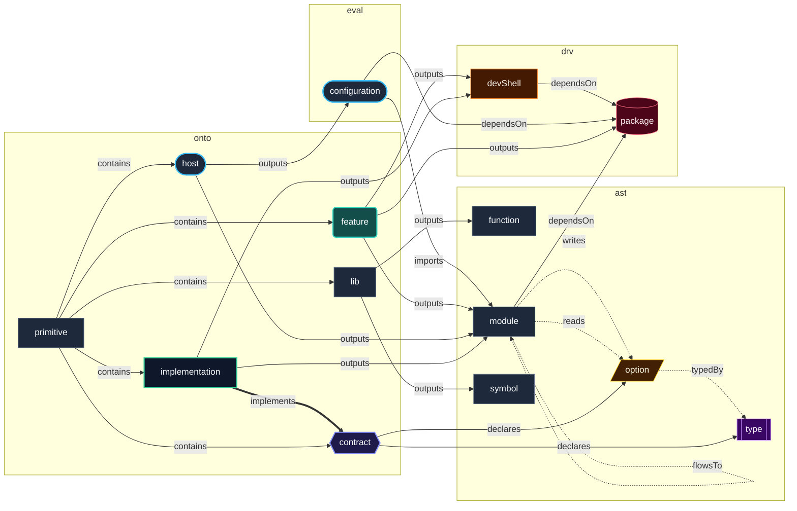

# Semantic Code Property Graph

Unified pure-Nix graph merging ontological intent, syntax, evaluation, and derivation strata, powering diagrams and cross-references.

[← Back to Main README](../README.md)

## Metrics

| Dimension | Value | Description |
| :--- | :--- | :--- |
| **Nodes** | 224 | Discrete architectural entities tracked across ontology, AST syntax, evaluation, and derivations. |
| **Edges** | 440 | Typed semantic directed edges connecting graph entities. |
| **Relations** | 10 | Unique relation kinds expressing dependencies, flows, definitions, and bindings. |
| **Node kinds** | 14 | Structural node classifications (e.g. host, contract, feature, module, option, package). |
| **Strata** | 4 | Orthogonal graph evaluation layers (Ontology, AST, Evaluation, Derivation). |

## Strata

| Stratum | Name | Nodes | Description |
| :--- | :--- | :--- | :--- |
| `ast` | Syntactic Structure | 147 | Modules, options, types, and library symbols as declared in Nix expressions. |
| `drv` | Derivation Substrate | 11 | Packages, development shells, and their store-level dependencies. |
| `eval` | Operational Fixpoint | 2 | Evaluated NixOS configurations, option definitions, and data dependences. |
| `onto` | Ontological Intent | 64 | Primitives and their declared instances: what the repository intends to exist. |

## Graph Schema

Every distinct `(kind, relation, kind)` triple observed in the graph, clustered by stratum:



## Relations

| Relation | Strata | Edges | Meaning | Grounding |
| :--- | :--- | :--- | :--- | :--- |
| `contains` | `onto` | 58 | Lexical parent-child containment. | Primitives containing their declared instances. |
| `declares` | `ast` | 36 | Interface specification declaration. | Contracts declaring public options and custom types. |
| `dependsOn` | `drv` | 23 | Software package dependency. | Modules and devShells depending on executable packages. |
| `documents` | — | 0 | Documentation attachment. | Docstrings attached to library symbols. |
| `flowsTo` | `eval` | 45 | End-to-end data dependence channel. | Option writers connected to the implementations consuming them. |
| `implements` | `onto` | 7 | Contract fulfillment. | Primitive relationships such as `implementation.<name>.contract`. |
| `imports` | `eval` | 67 | Compilation unit composition. | Evaluated NixOS configurations importing concrete NixOS modules. |
| `outputs` | `ast` | 116 | Flake artifact emission. | Primitive instances emitting configurations, modules, packages, devShells, and functions. |
| `reads` | `eval` | 22 | Option value inspection (use / load). | Implementations reading contract options. |
| `typedBy` | `ast` | 11 | Option type-system binding. | Contract options bound to custom submodule types. |
| `writes` | `eval` | 55 | Option value definition (def / store). | Module definitions extracted via `definitionsWithLocations`. |

## Node Kinds

| Kind | Strata | Nodes | Example URN | Description |
| :--- | :--- | :--- | :--- | :--- |
| `configuration` | `eval` | 2 | `urn:nixconf:eval:configuration:astrolabe` | Evaluated NixOS configurations on `flake.nixosConfigurations`. |
| `contract` | `onto` | 7 | `urn:nixconf:onto:contract:backup` | Typed contract interfaces. |
| `devShell` | `drv` | 4 | `urn:nixconf:drv:devShell:github-ssh` | Development shells exported on `flake.devShells`. |
| `feature` | `onto` | 27 | `urn:nixconf:onto:feature:antigravity` | Reusable system and desktop capability bundles. |
| `function` | `ast` | 40 | `urn:nixconf:ast:function:backup.mkConfig` | Library functions with RFC 145 docstring metadata. |
| `host` | `onto` | 2 | `urn:nixconf:onto:host:astrolabe` | Target machines evaluated into NixOS systems. |
| `implementation` | `onto` | 7 | `urn:nixconf:onto:implementation:caddy` | Concrete providers fulfilling contracts. |
| `lib` | `onto` | 15 | `urn:nixconf:onto:lib:backup` | Library namespaces grouping functions and symbols. |
| `module` | `ast` | 58 | `urn:nixconf:ast:module:antigravity` | NixOS modules exported on `flake.nixosModules`. |
| `option` | `ast` | 25 | `urn:nixconf:ast:option:backup.enable` | Public contract options with types and descriptions. |
| `package` | `drv` | 7 | `urn:nixconf:drv:package:antigravity` | Packages exported on `flake.packages`. |
| `primitive` | `onto` | 6 | `urn:nixconf:onto:primitive:contract` | Meta-primitives defining how instances are declared and exported. |
| `symbol` | `ast` | 13 | `urn:nixconf:ast:symbol:backup.defaultPruneOpts` | Non-function library values and constants. |
| `type` | `ast` | 11 | `urn:nixconf:ast:type:home.file` | Custom option types declared by contracts and features. |

## Querying & Inspecting the Graph

Graph algorithms, traversal engines, and Mermaid exporters are implemented as pure Nix functions in [flake.lib.graph](lib/graph.md).

### Pure Nix Query API

- `graphLib.getNeighborhood { graph, nodeId, depth }`: Extracts the local subgraph within `depth` hops of `nodeId`.
- `graphLib.filterGraph { nodeFilter, edgeFilter } graph`: Applies arbitrary predicate filters to prune nodes and relations.
- `graphLib.findConsumers { graph, contractId }`: Returns all features and host configurations writing options under a contract.
- `graphLib.forwardSlice { cpg, nodeId, maxDepth }`: Computes all reachable downstream dependencies from a given node.
- `graphLib.backwardSlice { cpg, nodeId, maxDepth }`: Computes all upstream providers and writers influencing a node.

### CLI Tools

```bash
# Output the full Semantic Code Property Graph as JSON directly
nix run .#nixconf-json

# Summary of nodes, edges and relation counts
nix run .#docs -- --json | jq '{nodes: (.nodes | length), edges: (.edges | length)}'

# Inspect every option write with source file provenance
nix run .#docs -- --json | jq '.edges[] | select(.relation == "writes") | {source, target, file: .meta.file}'

# Render the Mermaid neighborhood of a specific entity
nix run .#docs -- --subgraph urn:nixconf:onto:contract:backup
```

### Evaluation Queries

```bash
# Forward slice from a configuration (reachable dependencies)
nix eval --json --apply 'l: builtins.attrNames (l.graph.forwardSlice { cpg = l.graph.buildCPG {}; nodeId = "urn:nixconf:eval:configuration:astrolabe"; maxDepth = 2; }).nodes' .#lib

# Backward slice from an option (writers and consumers)
nix eval --json --apply 'l: builtins.attrNames (l.graph.backwardSlice { cpg = l.graph.buildCPG {}; nodeId = "urn:nixconf:ast:option:backup.enable"; maxDepth = 2; }).nodes' .#lib
```
