# Host: `astrolabe`

Headless VPS Server (adje.app public edge and core services).

[← Back to Hosts Documentation](../HOSTS.md) | [← Back to Main README](../../README.md)

## Metadata

- **Target Host**: `astrolabe`
- **Description**: Headless VPS Server (adje.app public edge and core services).
- **Architecture**: `x86_64-linux`
- **State Version**: `25.11`
- **Definition File**: [`modules/hosts/astrolabe.nix`](../../modules/hosts/astrolabe.nix)

## Host Architecture Diagram

```mermaid
flowchart TD
    subgraph Hosts["Hosts"]
        host__astrolabe["astrolabe"]:::hostNode
        host__x240["x240"]:::hostNode
    end

    subgraph Contracts["Contracts"]
        contract__backup(["backup"]):::contractNode
        contract__default_user(["default-user"]):::contractNode
        contract__home(["home"]):::contractNode
        contract__persistence(["persistence"]):::contractNode
        contract__resources(["resources"]):::contractNode
        contract__reverse_proxy(["reverse-proxy"]):::contractNode
        contract__secrets(["secrets"]):::contractNode
    end

    subgraph Implementations["Implementations"]
        impl__caddy["caddy"]:::implNode
        impl__cgroups["cgroups"]:::implNode
        impl__impermanence["impermanence"]:::implNode
        impl__lw["lw"]:::implNode
        impl__restic["restic"]:::implNode
        impl__sops["sops"]:::implNode
    end

    subgraph Features["Features"]
        feature__disko["disko"]:::featureNode
        feature__git["git"]:::featureNode
        feature__locale["locale"]:::featureNode
        feature__nix["nix"]:::featureNode
        feature__ssh["ssh"]:::featureNode
        feature__ttyd["ttyd"]:::featureNode
        feature__vaultwarden["vaultwarden"]:::featureNode
    end

    subgraph ContractOptions["Contract Options"]
        opt__reverse_proxy_domain[/"reverse-proxy.domain: null or (Fully qualified domain name)"/]:::optNode
        opt__reverse_proxy_enable[/"reverse-proxy.enable: boolean"/]:::optNode
        opt__reverse_proxy_hosts[/"reverse-proxy.hosts: attribute set of (submodule)"/]:::optNode
    end

    subgraph ContractTypes["Contract Types"]
        type__reverse_proxy_fqdn{{"reverse-proxy.fqdn"}}:::typeNode
        type__reverse_proxy_host{{"reverse-proxy.host"}}:::typeNode
    end


    host__astrolabe -->|"imports"| impl__caddy
    host__astrolabe -->|"imports"| impl__cgroups
    host__astrolabe -->|"imports"| impl__impermanence
    host__astrolabe -->|"imports"| impl__lw
    host__astrolabe -->|"imports"| impl__restic
    host__astrolabe -->|"imports"| impl__sops
    host__astrolabe -->|"imports"| feature__disko
    host__astrolabe -->|"imports"| feature__git
    host__astrolabe -->|"imports"| feature__locale
    host__astrolabe -->|"imports"| feature__nix
    host__astrolabe -->|"imports"| feature__ssh
    host__astrolabe -->|"imports"| feature__ttyd
    host__astrolabe -->|"imports"| feature__vaultwarden
    host__x240 -->|"imports"| impl__cgroups
    host__x240 -->|"imports"| impl__impermanence
    host__x240 -->|"imports"| impl__lw
    host__x240 -->|"imports"| impl__sops
    host__x240 -->|"imports"| feature__disko
    host__x240 -->|"imports"| feature__git
    host__x240 -->|"imports"| feature__locale
    host__x240 -->|"imports"| feature__nix
    host__x240 -->|"imports"| feature__ssh
    impl__caddy -.->|"implements"| contract__reverse_proxy
    impl__cgroups -.->|"implements"| contract__resources
    impl__impermanence -.->|"implements"| contract__persistence
    impl__lw -.->|"implements"| contract__default_user
    impl__restic -.->|"implements"| contract__backup
    impl__sops -.->|"implements"| contract__secrets
    host__astrolabe -->|"consumes (reverse-proxy.domain)"| contract__reverse_proxy
    feature__git -->|"consumes"| contract__default_user
    feature__git -->|"consumes (home.users, home.shared)"| contract__home
    feature__locale -->|"consumes (home.shared.sessionVariables, home.shared)"| contract__home
    feature__nix -->|"consumes (secrets.files)"| contract__secrets
    feature__ssh -->|"consumes (default-user.enable, default-user.username)"| contract__default_user
    feature__ssh -->|"consumes (persistence.files, persistence.enable)"| contract__persistence
    feature__ssh -->|"consumes (secrets.files)"| contract__secrets
    feature__ttyd -->|"consumes (resources.enable)"| contract__resources
    feature__ttyd -->|"consumes (reverse-proxy.enable)"| contract__reverse_proxy
    feature__vaultwarden -->|"consumes (backup.enable)"| contract__backup
    feature__vaultwarden -->|"consumes (persistence.enable)"| contract__persistence
    feature__vaultwarden -->|"consumes (resources.enable)"| contract__resources
    feature__vaultwarden -->|"consumes (reverse-proxy.domain)"| contract__reverse_proxy
    impl__caddy -->|"consumes (persistence.directories, persistence.enable)"| contract__persistence
    impl__caddy -->|"consumes (resources.services.caddy, resources.enable, resources.services)"| contract__resources
    impl__cgroups -->|"consumes (resources.enable)"| contract__resources
    impl__impermanence -->|"consumes (persistence.users)"| contract__persistence
    impl__lw -->|"consumes (home.users)"| contract__home
    impl__lw -->|"consumes (persistence.users)"| contract__persistence
    impl__lw -->|"consumes (secrets.files.default-user-password-hash, secrets.files)"| contract__secrets
    impl__restic -->|"consumes (resources.services.restic-backups-main, resources.enable, resources.services)"| contract__resources
    impl__restic -->|"consumes (secrets.files)"| contract__secrets
    impl__sops -->|"consumes (secrets.defaultFile, secrets.enable, secrets.files)"| contract__secrets
    contract__reverse_proxy --- opt__reverse_proxy_domain
    contract__reverse_proxy --- opt__reverse_proxy_enable
    contract__reverse_proxy --- opt__reverse_proxy_hosts
    contract__reverse_proxy --- type__reverse_proxy_fqdn
    contract__reverse_proxy --- type__reverse_proxy_host

classDef hostNode fill:#1e1e2e,stroke:#cba6f7,stroke-width:2px,color:#cdd6f4;
classDef contractNode fill:#181825,stroke:#89b4fa,stroke-width:2px,color:#cdd6f4;
classDef implNode fill:#181825,stroke:#a6e3a1,stroke-width:2px,color:#cdd6f4;
classDef featureNode fill:#181825,stroke:#f38ba8,stroke-width:2px,color:#cdd6f4;
classDef libNode fill:#181825,stroke:#94e2d5,stroke-width:2px,color:#cdd6f4;
classDef optNode fill:#11111b,stroke:#fab387,stroke-width:1px,color:#cdd6f4;
classDef typeNode fill:#11111b,stroke:#f9e2af,stroke-width:1px,color:#cdd6f4;
classDef fnNode fill:#181825,stroke:#94e2d5,stroke-width:1px,color:#cdd6f4;
classDef pkgNode fill:#181825,stroke:#b4befe,stroke-width:1px,color:#cdd6f4;
classDef shellNode fill:#181825,stroke:#f5c2e7,stroke-width:1px,color:#cdd6f4;

```




## Active Contracts

The following capability contracts are materialized on `astrolabe` through its active implementation providers:

| Contract | Description | Implementation | Description |
| :--- | :--- | :--- | :--- |
| [`reverse-proxy`](../contracts/reverse-proxy.md) | Declarative HTTP/TLS reverse proxy virtual host ingress and routing management. | [`caddy`](../implementations/caddy.md) | Automated TLS virtual host reverse proxy implementation using Caddy. |
| [`resources`](../contracts/resources.md) | System resource limits, cgroup slices, memory/CPU quotas, and power-aware throttling. | [`cgroups`](../implementations/cgroups.md) | Systemd control groups slice hierarchy and resource quotas implementation. |
| [`persistence`](../contracts/persistence.md) | Declarative state preservation across ephemeral reboots for system and user directories. | [`impermanence`](../implementations/impermanence.md) | Ephemeral root filesystem with persistent state bind-mounts via Impermanence. |
| [`default-user`](../contracts/default-user.md) | Default primary user account identification, credentials, and configuration injection. | [`lw`](../implementations/lw.md) | Primary human user account orchestration and identity provisioning. |
| [`backup`](../contracts/backup.md) | Automated snapshot backup configuration, inclusion paths, exclusions, and retention rules. | [`restic`](../implementations/restic.md) | Automated encrypted remote backups using Restic and systemd timers. |
| [`secrets`](../contracts/secrets.md) | Declarative encrypted secrets provisioning, filesystem mounting, and permission management. | [`sops`](../implementations/sops.md) | Declarative encrypted secrets provisioning using SOPS and age keys. |

## Enabled Features

The following system and desktop features are imported by `astrolabe`:

| Feature | Description | Outputs |
| :--- | :--- | :--- |
| [`disko`](../features/disko.md) | Declarative disk partitioning and filesystem layouts via Disko. | disko |
| [`git`](../features/git.md) | Git version control system, global/per-user configuration, and Bitwarden SSH key agent shell. | git, git |
| [`locale`](../features/locale.md) | System internationalization, time zone, and language locale configuration. | locale |
| [`nix`](../features/nix.md) | Nix package manager daemon settings, binary caches, garbage collection, and nix-ld. | nix |
| [`ssh`](../features/ssh.md) | OpenSSH server daemon hardening, authorized key distribution, and master SSH key agent shell. | ssh |
| [`ttyd`](../features/ttyd.md) | Web terminal server bridging browser sessions to system shells via ttyd. | ttyd |
| [`vaultwarden`](../features/vaultwarden.md) | Self-hosted Bitwarden compatible password manager server. | vaultwarden |

## Storage & Filesystem Layout

Evaluated partition table and Btrfs subvolumes generated by Disko:

```text
/dev/sda (GPT)
├── ESP (512M, vfat) -> /boot
├── biosBoot (1M)
├── root (100%, btrfs)
    ├── @ (subvol) -> /
    ├── @nix (subvol) -> /nix
    ├── @persist (subvol) -> /persist

```

Evaluated persisted directories and state preserved across boots by Impermanence:

```text
/persist
├── system/
  ├── /var/lib/caddy/
  ├── /etc/ssh/ssh_host_ed25519_key
  ├── /etc/ssh/ssh_host_ed25519_key.pub
  ├── /etc/ssh/ssh_host_rsa_key
  ├── /etc/ssh/ssh_host_rsa_key.pub
  └── users/
      └── lw/
      ├── data/
        ├── .gnupg
        ├── .ssh
        ├── Documents
        ├── Downloads
        ├── Projects
        ├── nixconf
```

## Host Submodules

Host-specific configuration submodules partitioning hardware, disks, and local system services:

| Submodule Attribute | Description | Docs |
| :--- | :--- | :--- |
| [`astrolabe-disk`](../modules/astrolabe-disk.md) | Host configuration submodule | [More →](../modules/astrolabe-disk.md) |
| [`astrolabe-hardware`](../modules/astrolabe-hardware.md) | Host configuration submodule | [More →](../modules/astrolabe-hardware.md) |
| [`astrolabe-packages`](../modules/astrolabe-packages.md) | Host configuration submodule | [More →](../modules/astrolabe-packages.md) |
| [`astrolabe-services`](../modules/astrolabe-services.md) | Host configuration submodule | [More →](../modules/astrolabe-services.md) |
| [`astrolabe-system`](../modules/astrolabe-system.md) | Host configuration submodule | [More →](../modules/astrolabe-system.md) |

<details>
<summary><code>astrolabe-disk</code></summary>

```nix
astrolabe-disk = {...}: {
  imports = [
    self.nixosModules.disko
    self.nixosModules.impermanence
  ];

  config =
    self.lib.disko.mkLayout {
      device = "/dev/sda";
      espSize = "512M";
      biosBootSize = "1M";
    }
    // {
      zramSwap.enable = true;
    };
};
```

</details>


<details>
<summary><code>astrolabe-hardware</code></summary>

```nix
astrolabe-hardware = {
  modulesPath,
  lib,
  ...
}: {
  imports = [
    (modulesPath + "/installer/scan/not-detected.nix")
    (modulesPath + "/profiles/qemu-guest.nix")
  ];

  config = {
    nixpkgs.hostPlatform = lib.mkDefault "x86_64-linux";
    boot.loader.grub = {
      enable = true;
      efiSupport = true;
      efiInstallAsRemovable = true;
      device = "/dev/sda";
    };
  };
};
```

</details>


<details>
<summary><code>astrolabe-packages</code></summary>

```nix
astrolabe-packages = {pkgs, ...}: {
  environment.systemPackages = with pkgs; [
    nano
    rsync
    btop
  ];
};
```

</details>


<details>
<summary><code>astrolabe-services</code></summary>

```nix
astrolabe-services = {...}: {
  imports = [
    self.nixosModules.caddy
    self.nixosModules.restic
    self.nixosModules.vaultwarden
    self.nixosModules.ttyd
  ];

  config = {
    reverse-proxy.domain = "adje.app";
    services.resticBackup.repository = "s3:https://s3.eu-central-003.backblazeb2.com/cyclostyle-docker";
  };
};
```

</details>


<details>
<summary><code>astrolabe-system</code></summary>

```nix
astrolabe-system = {
  imports = [
    self.nixosModules.contracts
    self.nixosModules.sops
    self.nixosModules.lw
    self.nixosModules.cgroups
    self.nixosModules.nix
    self.nixosModules.locale
    self.nixosModules.ssh
    self.nixosModules.git
  ];

  config = {
    networking.hostName = "astrolabe";
    system.stateVersion = "25.11";
  };
};
```

</details>


## Installation

### Track 1: Remote Automated Provisioning via `nixos-anywhere`

```bash
nix run github:nix-community/nixos-anywhere -- \
  --flake .#astrolabe \
  --copy-secret /path/to/key.txt /persist/var/lib/sops-nix/key.txt \
  root@<TARGET-IP>
```

### Track 2: Local Installation from Live ISO

```bash
nix --extra-experimental-features 'nix-command flakes' run github:nix-community/disko -- \
  --mode zap_create_mount \
  --flake .#astrolabe

nixos-install --flake .#astrolabe --no-root-passwd
```

### Track 3: Routine Maintenance & Activation

```bash
# Local rebuild
sudo nixos-rebuild switch --flake .#astrolabe

# Remote rebuild over SSH
nixos-rebuild switch --flake .#astrolabe --target-host root@<TARGET-IP>
```
