# Host: `x240`

ThinkPad Laptop Workstation (Desktop graphical workstation).

[← Back to Hosts Documentation](../HOSTS.md) | [← Back to Main README](../../README.md)

## Metadata

- **Target Host**: `x240`
- **Description**: ThinkPad Laptop Workstation (Desktop graphical workstation).
- **Architecture**: `x86_64-linux`
- **State Version**: `25.11`
- **Definition File**: [`modules/hosts/x240.nix`](../../modules/hosts/x240.nix)

## Host Architecture Diagram

```mermaid
flowchart TD
    subgraph Hosts["Hosts"]
        host__astrolabe["astrolabe"]:::hostNode
        host__x240["x240"]:::hostNode
    end

    subgraph Contracts["Contracts"]
        contract__default_user(["default-user"]):::contractNode
        contract__home(["home"]):::contractNode
        contract__persistence(["persistence"]):::contractNode
        contract__resources(["resources"]):::contractNode
        contract__secrets(["secrets"]):::contractNode
        contract__wayland(["wayland"]):::contractNode
    end

    subgraph Implementations["Implementations"]
        impl__cgroups["cgroups"]:::implNode
        impl__hjem["hjem"]:::implNode
        impl__impermanence["impermanence"]:::implNode
        impl__lw["lw"]:::implNode
        impl__sops["sops"]:::implNode
        impl__uwsm["uwsm"]:::implNode
    end

    subgraph Features["Features"]
        feature__antigravity["antigravity"]:::featureNode
        feature__audio["audio"]:::featureNode
        feature__bitwarden["bitwarden"]:::featureNode
        feature__cursor["cursor"]:::featureNode
        feature__direnv["direnv"]:::featureNode
        feature__disko["disko"]:::featureNode
        feature__dolphin["dolphin"]:::featureNode
        feature__fonts["fonts"]:::featureNode
        feature__foot["foot"]:::featureNode
        feature__git["git"]:::featureNode
        feature__greetd["greetd"]:::featureNode
        feature__labwc["labwc"]:::featureNode
        feature__locale["locale"]:::featureNode
        feature__nix["nix"]:::featureNode
        feature__noctalia["noctalia"]:::featureNode
        feature__ssh["ssh"]:::featureNode
        feature__tack["tack"]:::featureNode
        feature__vivaldi["vivaldi"]:::featureNode
        feature__vscode["vscode"]:::featureNode
        feature__wifi_eduroam["wifi-eduroam"]:::featureNode
    end

    subgraph Libraries["Libraries"]
        lib__bitwarden(["lib: bitwarden"]):::libNode
        lib__disko(["lib: disko"]):::libNode
        lib__lw(["lib: lw"]):::libNode
        lib__sops(["lib: sops"]):::libNode
        lib__wayland(["lib: wayland"]):::libNode
    end

    subgraph ContractOptions["Contract Options"]
        opt__wayland_compositors[/"wayland.compositors: attribute set of (submodule)"/]:::optNode
        opt__wayland_enable[/"wayland.enable: boolean"/]:::optNode
    end

    subgraph ContractTypes["Contract Types"]
        type__wayland_compositor{{"wayland.compositor"}}:::typeNode
    end


    host__astrolabe -->|"imports"| impl__cgroups
    host__astrolabe -->|"imports"| impl__impermanence
    host__astrolabe -->|"imports"| impl__lw
    host__astrolabe -->|"imports"| impl__sops
    host__astrolabe -->|"imports"| feature__disko
    host__astrolabe -->|"imports"| feature__git
    host__astrolabe -->|"imports"| feature__locale
    host__astrolabe -->|"imports"| feature__nix
    host__astrolabe -->|"imports"| feature__ssh
    host__x240 -->|"imports"| impl__cgroups
    host__x240 -->|"imports"| impl__hjem
    host__x240 -->|"imports"| impl__impermanence
    host__x240 -->|"imports"| impl__lw
    host__x240 -->|"imports"| impl__sops
    host__x240 -->|"imports"| impl__uwsm
    host__x240 -->|"imports"| feature__antigravity
    host__x240 -->|"imports"| feature__audio
    host__x240 -->|"imports"| feature__bitwarden
    host__x240 -->|"imports"| feature__cursor
    host__x240 -->|"imports"| feature__direnv
    host__x240 -->|"imports"| feature__disko
    host__x240 -->|"imports"| feature__dolphin
    host__x240 -->|"imports"| feature__fonts
    host__x240 -->|"imports"| feature__foot
    host__x240 -->|"imports"| feature__git
    host__x240 -->|"imports"| feature__greetd
    host__x240 -->|"imports"| feature__labwc
    host__x240 -->|"imports"| feature__locale
    host__x240 -->|"imports"| feature__nix
    host__x240 -->|"imports"| feature__noctalia
    host__x240 -->|"imports"| feature__ssh
    host__x240 -->|"imports"| feature__tack
    host__x240 -->|"imports"| feature__vivaldi
    host__x240 -->|"imports"| feature__vscode
    host__x240 -->|"imports"| feature__wifi_eduroam
    impl__cgroups -.->|"implements"| contract__resources
    impl__hjem -.->|"implements"| contract__home
    impl__impermanence -.->|"implements"| contract__persistence
    impl__lw -.->|"implements"| contract__default_user
    impl__sops -.->|"implements"| contract__secrets
    impl__uwsm -.->|"implements"| contract__wayland
    host__x240 -->|"consumes (wayland.enable)"| contract__wayland
    feature__antigravity -->|"consumes (persistence.users)"| contract__persistence
    feature__bitwarden -->|"consumes (persistence.users)"| contract__persistence
    feature__direnv -->|"consumes (persistence.users)"| contract__persistence
    feature__dolphin -->|"consumes (persistence.users)"| contract__persistence
    feature__foot -->|"consumes (home.shared, home.users)"| contract__home
    feature__foot -->|"consumes (persistence.users)"| contract__persistence
    feature__git -->|"consumes"| contract__default_user
    feature__git -->|"consumes (home.users, home.shared)"| contract__home
    feature__labwc -->|"consumes (home.shared.xdg.config, home.users, home.shared)"| contract__home
    feature__labwc -->|"consumes (persistence.users)"| contract__persistence
    feature__labwc -->|"consumes (wayland.compositors.labwc, wayland.compositors)"| contract__wayland
    feature__locale -->|"consumes (home.shared.sessionVariables, home.shared)"| contract__home
    feature__nix -->|"consumes (secrets.files)"| contract__secrets
    feature__noctalia -->|"consumes (persistence.users)"| contract__persistence
    feature__ssh -->|"consumes (default-user.enable, default-user.username)"| contract__default_user
    feature__ssh -->|"consumes (persistence.files, persistence.enable)"| contract__persistence
    feature__ssh -->|"consumes (secrets.files)"| contract__secrets
    feature__vivaldi -->|"consumes (persistence.users)"| contract__persistence
    feature__vscode -->|"consumes (persistence.users)"| contract__persistence
    feature__wifi_eduroam -->|"consumes (secrets.files)"| contract__secrets
    impl__cgroups -->|"consumes (resources.enable)"| contract__resources
    impl__hjem -->|"consumes (home.enable)"| contract__home
    impl__impermanence -->|"consumes (persistence.users)"| contract__persistence
    impl__lw -->|"consumes (home.users)"| contract__home
    impl__lw -->|"consumes (persistence.users)"| contract__persistence
    impl__lw -->|"consumes (secrets.files.default-user-password-hash, secrets.files)"| contract__secrets
    impl__sops -->|"consumes (secrets.defaultFile, secrets.enable, secrets.files)"| contract__secrets
    impl__uwsm -->|"consumes (wayland.compositors, wayland.enable)"| contract__wayland
    contract__wayland -.->|"provides"| lib__wayland
    impl__lw -.->|"provides"| lib__lw
    impl__sops -.->|"provides"| lib__sops
    feature__bitwarden -.->|"provides"| lib__bitwarden
    feature__disko -.->|"provides"| lib__disko
    contract__wayland --- opt__wayland_compositors
    contract__wayland --- opt__wayland_enable
    contract__wayland --- type__wayland_compositor

classDef hostNode fill:#1e1e2e,stroke:#cba6f7,stroke-width:2px,color:#cdd6f4;
classDef contractNode fill:#181825,stroke:#89b4fa,stroke-width:2px,color:#cdd6f4;
classDef implNode fill:#181825,stroke:#a6e3a1,stroke-width:2px,color:#cdd6f4;
classDef featureNode fill:#181825,stroke:#f38ba8,stroke-width:2px,color:#cdd6f4;
classDef libNode fill:#181825,stroke:#94e2d5,stroke-width:2px,color:#cdd6f4;
classDef optNode fill:#11111b,stroke:#fab387,stroke-width:1px,color:#cdd6f4;
classDef typeNode fill:#11111b,stroke:#f9e2af,stroke-width:1px,color:#cdd6f4;
classDef fnNode fill:#181825,stroke:#94e2d5,stroke-width:1px,color:#cdd6f4;
classDef pkgNode fill:#181825,stroke:#b4befe,stroke-width:1px,color:#cdd6f4;
classDef shellNode fill:#181825,stroke:#f5c2e7,stroke-width:1px,color:#cdd6f4;

```




## Active Contracts

The following capability contracts are materialized on `x240` through its active implementation providers:

| Contract | Description | Implementation | Description |
| :--- | :--- | :--- | :--- |
| [`resources`](../contracts/resources.md) | System resource limits, cgroup slices, memory/CPU quotas, and power-aware throttling. | [`cgroups`](../implementations/cgroups.md) | Systemd control groups slice hierarchy and resource quotas implementation. |
| [`home`](../contracts/home.md) | Declarative user home dotfile tree, XDG directory specifications, and session environment. | [`hjem`](../implementations/hjem.md) | Lightweight declarative home directory files and XDG environment manager. |
| [`persistence`](../contracts/persistence.md) | Declarative state preservation across ephemeral reboots for system and user directories. | [`impermanence`](../implementations/impermanence.md) | Ephemeral root filesystem with persistent state bind-mounts via Impermanence. |
| [`default-user`](../contracts/default-user.md) | Default primary user account identification, credentials, and configuration injection. | [`lw`](../implementations/lw.md) | Primary human user account orchestration and identity provisioning. |
| [`secrets`](../contracts/secrets.md) | Declarative encrypted secrets provisioning, filesystem mounting, and permission management. | [`sops`](../implementations/sops.md) | Declarative encrypted secrets provisioning using SOPS and age keys. |
| [`wayland`](../contracts/wayland.md) | Wayland compositor registration, session targets, and graphical environment management. | [`uwsm`](../implementations/uwsm.md) | Universal Wayland Session Manager integration for desktop environments. |

## Enabled Features

The following system and desktop features are imported by `x240`:

| Feature | Description | Outputs |
| :--- | :--- | :--- |
| [`antigravity`](../features/antigravity.md) | Google Antigravity IDE, agentic workflow tools, and CLI runtime. | antigravity, antigravity-cli, antigravity-ide, antigravity, antigravity-cli, antigravity-ide |
| [`audio`](../features/audio.md) | PipeWire sound server and real-time audio processing stack. | audio |
| [`bitwarden`](../features/bitwarden.md) | Bitwarden password manager CLI wrapper, desktop application, and vault retrieval helpers. | bitwarden-desktop, bw, bw |
| [`cursor`](../features/cursor.md) | XCursor theme configuration and icon assets. | cursor |
| [`direnv`](../features/direnv.md) | Per-directory declarative shell environment integration via nix-direnv. | direnv |
| [`disko`](../features/disko.md) | Declarative disk partitioning and filesystem layouts via Disko. | disko |
| [`dolphin`](../features/dolphin.md) | KDE Dolphin file manager with Wayland integration and isolated runtime plugins. | dolphin, dolphin |
| [`fonts`](../features/fonts.md) | System typography and developer monospace font packages. | fonts |
| [`foot`](../features/foot.md) | Fast, lightweight Wayland terminal emulator with server-client architecture. | foot, foot |
| [`git`](../features/git.md) | Git version control system, global/per-user configuration, and Bitwarden SSH key agent shell. | git, git |
| [`greetd`](../features/greetd.md) | Lightweight console greeter and graphical session launcher via tuigreet. | greetd |
| [`labwc`](../features/labwc.md) | Labwc stacking Wayland compositor with window manager keybindings and XDG autostart. | labwc |
| [`locale`](../features/locale.md) | System internationalization, time zone, and language locale configuration. | locale |
| [`nix`](../features/nix.md) | Nix package manager daemon settings, binary caches, garbage collection, and nix-ld. | nix |
| [`noctalia`](../features/noctalia.md) | Noctalia shell environment, status bar, app launcher, and wallpaper manager. | noctalia |
| [`ssh`](../features/ssh.md) | OpenSSH server daemon hardening, authorized key distribution, and master SSH key agent shell. | ssh |
| [`tack`](../features/tack.md) | Flake input pinning and lockfile orchestration tool. | tack |
| [`vivaldi`](../features/vivaldi.md) | Vivaldi web browser with Widevine and proprietary media codecs. | vivaldi |
| [`vscode`](../features/vscode.md) | Visual Studio Code editor environment and persistence. | vscode |
| [`wifi-eduroam`](../features/wifi-eduroam.md) | Eduroam WPA2-Enterprise 802.1X wireless networking integration via NetworkManager. | wifi-eduroam |

## Storage & Filesystem Layout

Evaluated partition table and Btrfs subvolumes generated by Disko:

```text
/dev/disk/by-id/ata-Samsung_SSD_850_EVO_500GB_S21JNSAG400208P (GPT)
├── bios (1M)
├── esp (1G, vfat) -> /boot
├── root (100%, lvm_pv)
├── swap (16G, swap)

```

Evaluated persisted directories and state preserved across boots by Impermanence:

```text
/persist
├── system/
  ├── /etc/ssh/ssh_host_ed25519_key
  ├── /etc/ssh/ssh_host_ed25519_key.pub
  ├── /etc/ssh/ssh_host_rsa_key
  ├── /etc/ssh/ssh_host_rsa_key.pub
  └── users/
      └── lw/
      ├── data/
        ├── .antigravity-ide
        ├── .config/Bitwarden CLI
        ├── .config/Code
        ├── .config/dolphinrc
        ├── .config/foot
        ├── .config/labwc
        ├── .config/noctalia
        ├── .config/vivaldi
        ├── .gemini
        ├── .gnupg
        ├── .local/share/dolphin
        ├── .local/state/noctalia
        ├── .ssh
        ├── .vscode
        ├── Documents
        ├── Downloads
        ├── Pictures/Wallpapers
        ├── Projects
        ├── nixconf
      └── cache/
        ├── .cache/direnv
        ├── .cache/vivaldi
```

## Host Submodules

Host-specific configuration submodules partitioning hardware, disks, and local system services:

| Submodule Attribute | Description | Docs |
| :--- | :--- | :--- |
| [`x240-desktop`](../modules/x240-desktop.md) | Host configuration submodule | [More →](../modules/x240-desktop.md) |
| [`x240-desktop-features`](../modules/x240-desktop-features.md) | Host configuration submodule | [More →](../modules/x240-desktop-features.md) |
| [`x240-disk`](../modules/x240-disk.md) | Host configuration submodule | [More →](../modules/x240-disk.md) |
| [`x240-hardware`](../modules/x240-hardware.md) | Host configuration submodule | [More →](../modules/x240-hardware.md) |
| [`x240-packages`](../modules/x240-packages.md) | Host configuration submodule | [More →](../modules/x240-packages.md) |
| [`x240-system`](../modules/x240-system.md) | Host configuration submodule | [More →](../modules/x240-system.md) |
| [`x240-system-features`](../modules/x240-system-features.md) | Host configuration submodule | [More →](../modules/x240-system-features.md) |

<details>
<summary><code>x240-desktop</code></summary>

```nix
x240-desktop = {...}: {
  imports = [
    self.nixosModules.uwsm
    self.nixosModules.fonts
    self.nixosModules.labwc
    self.nixosModules.noctalia
    self.nixosModules.audio
    self.nixosModules.cursor
    self.nixosModules.greetd
    self.nixosModules.x240-desktop-features
  ];

  config = {
    wayland.enable = true;
    environment.sessionVariables = {
      XKB_DEFAULT_LAYOUT = keyboardLayout;
      XKB_DEFAULT_VARIANT = "";
    };
  };
};
```

</details>


<details>
<summary><code>x240-desktop-features</code></summary>

```nix
x240-desktop-features = {...}: {
  imports = [
    self.nixosModules.dolphin
    self.nixosModules.foot
    self.nixosModules.vivaldi
    self.nixosModules.vscode
    self.nixosModules.antigravity-ide
  ];
};
```

</details>


<details>
<summary><code>x240-disk</code></summary>

```nix
x240-disk = {...}: {
  imports = [
    self.nixosModules.disko
    self.nixosModules.impermanence
  ];

  config =
    self.lib.disko.mkLayout {
      device = "/dev/disk/by-id/ata-Samsung_SSD_850_EVO_500GB_S21JNSAG400208P";
      swapSize = "16G";
      swapResume = true;
    }
    // {
      zramSwap.enable = true;
    };
};
```

</details>


<details>
<summary><code>x240-hardware</code></summary>

```nix
x240-hardware = {
  config,
  lib,
  modulesPath,
  ...
}: {
  imports = [(modulesPath + "/installer/scan/not-detected.nix")];

  config = {
    boot.initrd.availableKernelModules = [
      "xhci_pci"
      "ehci_pci"
      "ahci"
      "usb_storage"
      "sd_mod"
      "rtsx_pci_sdmmc"
    ];
    boot.initrd.kernelModules = [];
    boot.kernelModules = [];
    boot.extraModulePackages = [];
    boot.loader.grub = {
      enable = true;
      useOSProber = true;
    };
    hardware.cpu.intel.updateMicrocode = lib.mkDefault config.hardware.enableRedistributableFirmware;
    nixpkgs.hostPlatform = lib.mkDefault "x86_64-linux";
  };
};
```

</details>


<details>
<summary><code>x240-packages</code></summary>

```nix
x240-packages = {pkgs, ...}: {
  environment.systemPackages = with pkgs; [
    curl
    wl-clipboard
    alejandra
    btop
    jq
  ];
};
```

</details>


<details>
<summary><code>x240-system</code></summary>

```nix
x240-system = {
  config,
  lib,
  ...
}: {
  imports = [
    self.nixosModules.contracts
    self.nixosModules.sops
    self.nixosModules.lw
    self.nixosModules.hjem
    self.nixosModules.nix
    self.nixosModules.locale
    self.nixosModules.x240-system-features
  ];

  config = {
    console.keyMap = keyboardLayout;
    networking.hostName = "x240";
    networking.networkmanager.enable = true;
    nix.settings = {
      build-cores = cores - 1;
      cores = cores - 1;
    };
    system.configurationRevision = self.rev or self.dirtyRev or "unknown";
    system.stateVersion = "25.11";
  };
};
```

</details>


<details>
<summary><code>x240-system-features</code></summary>

```nix
x240-system-features = {...}: {
  imports = [
    self.nixosModules.direnv
    self.nixosModules.wifi-eduroam
    self.nixosModules.git
    self.nixosModules.tack
    self.nixosModules.bw
    self.nixosModules.ssh
    self.nixosModules.cgroups
  ];
};
```

</details>


## Installation

### Track 1: Remote Automated Provisioning via `nixos-anywhere`

```bash
nix run github:nix-community/nixos-anywhere -- \
  --flake .#x240 \
  --copy-secret /path/to/key.txt /persist/var/lib/sops-nix/key.txt \
  root@<TARGET-IP>
```

### Track 2: Local Installation from Live ISO

```bash
nix --extra-experimental-features 'nix-command flakes' run github:nix-community/disko -- \
  --mode zap_create_mount \
  --flake .#x240

nixos-install --flake .#x240 --no-root-passwd
```

### Track 3: Routine Maintenance & Activation

```bash
# Local rebuild
sudo nixos-rebuild switch --flake .#x240

# Remote rebuild over SSH
nixos-rebuild switch --flake .#x240 --target-host root@<TARGET-IP>
```
