# Implementation: `hjem`

Lightweight declarative home directory files and XDG environment manager.

[← Back to Implementations Documentation](../IMPLEMENTATIONS.md) | [← Back to Main README](../../README.md)

## Metadata

- **Provider Name**: `hjem`
- **Contract Satisfied**: [`home`](../contracts/home.md)
- **Contract Description**: Declarative user home dotfile tree, XDG directory specifications, and session environment.
- **Source File**: [`modules/implementations/hjem.nix`](../../modules/implementations/hjem.nix)

## Architecture Diagram

```mermaid
flowchart TD
    subgraph Hosts["Hosts"]
        host__x240["x240"]:::hostNode
    end

    subgraph Contracts["Contracts"]
        contract__home(["home"]):::contractNode
        contract__wayland(["wayland"]):::contractNode
    end

    subgraph Implementations["Implementations"]
        impl__cgroups["cgroups"]:::implNode
        impl__hjem["hjem"]:::implNode
        impl__impermanence["impermanence"]:::implNode
        impl__lw["lw"]:::implNode
        impl__sops["sops"]:::implNode
        impl__uwsm["uwsm"]:::implNode
    end

    subgraph Features["Features"]
        feature__antigravity["antigravity"]:::featureNode
        feature__audio["audio"]:::featureNode
        feature__bitwarden["bitwarden"]:::featureNode
        feature__cursor["cursor"]:::featureNode
        feature__direnv["direnv"]:::featureNode
        feature__disko["disko"]:::featureNode
        feature__dolphin["dolphin"]:::featureNode
        feature__fonts["fonts"]:::featureNode
        feature__foot["foot"]:::featureNode
        feature__git["git"]:::featureNode
        feature__greetd["greetd"]:::featureNode
        feature__helium["helium"]:::featureNode
        feature__labwc["labwc"]:::featureNode
        feature__locale["locale"]:::featureNode
        feature__nix["nix"]:::featureNode
        feature__noctalia["noctalia"]:::featureNode
        feature__ssh["ssh"]:::featureNode
        feature__tack["tack"]:::featureNode
        feature__vivaldi["vivaldi"]:::featureNode
        feature__vscode["vscode"]:::featureNode
        feature__wifi_eduroam["wifi-eduroam"]:::featureNode
    end

    subgraph ContractOptions["Contract Options"]
        opt__home_enable[/"home.enable: boolean"/]:::optNode
        opt__home_shared[/"home.shared: submodule"/]:::optNode
        opt__home_users[/"home.users: attribute set of (submodule)"/]:::optNode
    end

    subgraph ContractTypes["Contract Types"]
        type__home_file{{"home.file"}}:::typeNode
        type__home_files{{"home.files"}}:::typeNode
        type__home_relativeHomePath{{"home.relativeHomePath"}}:::typeNode
        type__home_userHome{{"home.userHome"}}:::typeNode
        type__home_xdg{{"home.xdg"}}:::typeNode
    end


    host__x240 -->|"imports"| impl__cgroups
    host__x240 -->|"imports"| impl__hjem
    host__x240 -->|"imports"| impl__impermanence
    host__x240 -->|"imports"| impl__lw
    host__x240 -->|"imports"| impl__sops
    host__x240 -->|"imports"| impl__uwsm
    host__x240 -->|"imports"| feature__antigravity
    host__x240 -->|"imports"| feature__audio
    host__x240 -->|"imports"| feature__bitwarden
    host__x240 -->|"imports"| feature__cursor
    host__x240 -->|"imports"| feature__direnv
    host__x240 -->|"imports"| feature__disko
    host__x240 -->|"imports"| feature__dolphin
    host__x240 -->|"imports"| feature__fonts
    host__x240 -->|"imports"| feature__foot
    host__x240 -->|"imports"| feature__git
    host__x240 -->|"imports"| feature__greetd
    host__x240 -->|"imports"| feature__labwc
    host__x240 -->|"imports"| feature__locale
    host__x240 -->|"imports"| feature__nix
    host__x240 -->|"imports"| feature__noctalia
    host__x240 -->|"imports"| feature__ssh
    host__x240 -->|"imports"| feature__tack
    host__x240 -->|"imports"| feature__vivaldi
    host__x240 -->|"imports"| feature__vscode
    host__x240 -->|"imports"| feature__wifi_eduroam
    impl__hjem -.->|"implements"| contract__home
    impl__uwsm -.->|"implements"| contract__wayland
    host__x240 -->|"consumes (wayland.enable)"| contract__wayland
    feature__foot -->|"consumes (home.shared, home.users)"| contract__home
    feature__git -->|"consumes (home.users, home.shared)"| contract__home
    feature__helium -->|"consumes (home.shared, home.users)"| contract__home
    feature__labwc -->|"consumes (home.shared.xdg.config, home.users, home.shared)"| contract__home
    feature__labwc -->|"consumes (wayland.compositors.labwc, wayland.compositors)"| contract__wayland
    feature__locale -->|"consumes (home.shared.sessionVariables, home.shared)"| contract__home
    impl__hjem -->|"consumes (home.enable)"| contract__home
    impl__lw -->|"consumes (home.users)"| contract__home
    impl__uwsm -->|"consumes (wayland.compositors, wayland.enable)"| contract__wayland
    contract__home --- opt__home_enable
    contract__home --- opt__home_shared
    contract__home --- opt__home_users
    contract__home --- type__home_file
    contract__home --- type__home_files
    contract__home --- type__home_relativeHomePath
    contract__home --- type__home_userHome
    contract__home --- type__home_xdg

classDef hostNode fill:#1e1e2e,stroke:#cba6f7,stroke-width:2px,color:#cdd6f4;
classDef contractNode fill:#181825,stroke:#89b4fa,stroke-width:2px,color:#cdd6f4;
classDef implNode fill:#181825,stroke:#a6e3a1,stroke-width:2px,color:#cdd6f4;
classDef featureNode fill:#181825,stroke:#f38ba8,stroke-width:2px,color:#cdd6f4;
classDef libNode fill:#181825,stroke:#94e2d5,stroke-width:2px,color:#cdd6f4;
classDef optNode fill:#11111b,stroke:#fab387,stroke-width:1px,color:#cdd6f4;
classDef typeNode fill:#11111b,stroke:#f9e2af,stroke-width:1px,color:#cdd6f4;
classDef fnNode fill:#181825,stroke:#94e2d5,stroke-width:1px,color:#cdd6f4;
classDef pkgNode fill:#181825,stroke:#b4befe,stroke-width:1px,color:#cdd6f4;
classDef shellNode fill:#181825,stroke:#f5c2e7,stroke-width:1px,color:#cdd6f4;

```




## Outputs

### NixOS Modules

| Module Attribute | Description | Docs |
| :--- | :--- | :--- |
| [`hjem`](../modules/hjem.md) | Provider module satisfying `home` contract | [More →](../modules/hjem.md) |

### Executable Packages

*No executable packages exported.*

### Development Shells

*No development shells exported.*

### Library Helpers

*No library helpers exported.*

## Importing Hosts

Hosts enabling this provider to fulfill the [`home`](../contracts/home.md) contract capability:

- [`x240`](../hosts/x240.md) (`x86_64-linux`): ThinkPad Laptop Workstation (Desktop graphical workstation).

## Consumed Contracts

Capability contracts configured by this implementation:

<details>
<summary><code><a href="../contracts/home.md">home</a></code></summary>

Configures options: `home.enable`

```nix
enable = home.enable;

packages = homeCfg.shared.packages ++ home.packages;

files = mapFiles (homeCfg.shared.files // home.files);

cache.files = mapFiles (homeCfg.shared.xdg.cache // home.xdg.cache);

config.files = mapFiles (homeCfg.shared.xdg.config // home.xdg.config);

data.files = mapFiles (homeCfg.shared.xdg.data // home.xdg.data);

state.files = mapFiles (homeCfg.shared.xdg.state // home.xdg.state);

environment.sessionVariables = homeCfg.shared.sessionVariables // home.sessionVariables;

systemd.services = homeCfg.shared.systemd.services // home.systemd.services;
```

</details>

