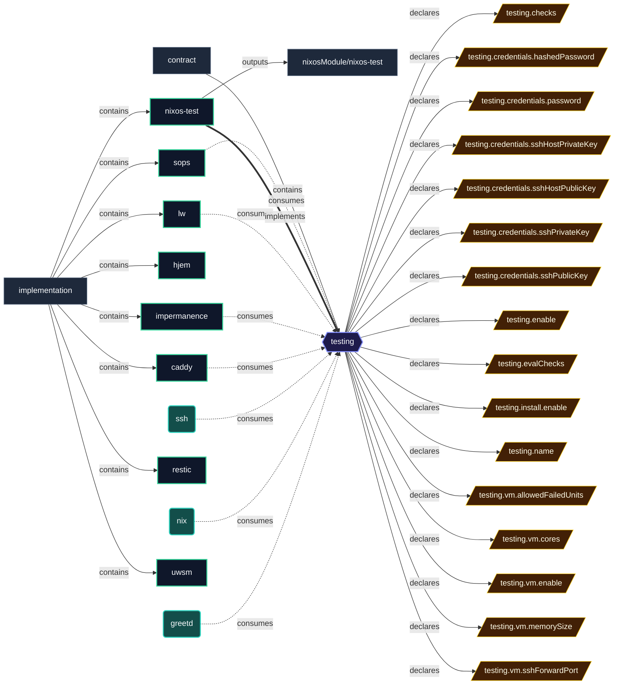

# Implementation: `nixos-test`

Host verification through the NixOS test driver: built-in essentials, QEMU VM sizing, and Disko install tests.

[← Back to Implementations Documentation](../IMPLEMENTATIONS.md) | [← Back to Main README](../../README.md)

## Metadata

- **Provider Name**: `nixos-test`
- **Contract Satisfied**: [`testing`](../contracts/testing.md)
- **Contract Description**: Declarative host verification: evaluation-time essentials, runtime VM checks, and test stand-ins for secrets.
- **Source File**: [`modules/implementations/nixos-test.nix`](../../modules/implementations/nixos-test.nix)

## Architecture Diagram

## Outputs

### NixOS Modules

| Module | Description | Details |
| :--- | :--- | :--- |
| [`nixos-test`](../modules/nixos-test.md) | Provider module satisfying `testing` contract | [More →](../modules/nixos-test.md) |

### Executable Packages

*No packages exported.*

### Development Shells

*No development shells exported.*

### Library Helpers

*No library symbols exported.*

## Importing Hosts

Hosts enabling this provider to fulfill the [`testing`](../contracts/testing.md) contract:

*Not currently imported by any host.*

## Consumed Contracts

Contracts configured by this implementation:

*No external contracts consumed by this implementation.*
