# Implementation: `nixos-test`

Host verification through the NixOS test driver: built-in essentials, QEMU VM sizing, and Disko install tests.

[← Back to Implementations Documentation](README.md) | [← Back to Main README](../../README.md)

- **Implementation**: `nixos-test`
- **Fulfills Contract**: [`testing`](../contracts/testing.md)
- **Definition File**: [`modules/implementations/nixos-test.nix`](../../modules/implementations/nixos-test.nix)

```mermaid
flowchart LR
  urn__nixconf__ast__module__nixos_test["nixosModule/nixos-test"]:::defaultNode
    urn__nixconf__ast__option__testing_checks[/"testing.checks"/]:::optNode
    urn__nixconf__ast__option__testing_credentials_hashedPassword[/"testing.credentials.hashedPassword"/]:::optNode
    urn__nixconf__ast__option__testing_credentials_password[/"testing.credentials.password"/]:::optNode
    urn__nixconf__ast__option__testing_credentials_sshHostPrivateKey[/"testing.credentials.sshHostPrivateKey"/]:::optNode
    urn__nixconf__ast__option__testing_credentials_sshHostPublicKey[/"testing.credentials.sshHostPublicKey"/]:::optNode
    urn__nixconf__ast__option__testing_credentials_sshPrivateKey[/"testing.credentials.sshPrivateKey"/]:::optNode
    urn__nixconf__ast__option__testing_credentials_sshPublicKey[/"testing.credentials.sshPublicKey"/]:::optNode
    urn__nixconf__ast__option__testing_enable[/"testing.enable"/]:::optNode
    urn__nixconf__ast__option__testing_evalChecks[/"testing.evalChecks"/]:::optNode
    urn__nixconf__ast__option__testing_install_enable[/"testing.install.enable"/]:::optNode
    urn__nixconf__ast__option__testing_name[/"testing.name"/]:::optNode
    urn__nixconf__ast__option__testing_vm_allowedFailedUnits[/"testing.vm.allowedFailedUnits"/]:::optNode
    urn__nixconf__ast__option__testing_vm_cores[/"testing.vm.cores"/]:::optNode
    urn__nixconf__ast__option__testing_vm_enable[/"testing.vm.enable"/]:::optNode
    urn__nixconf__ast__option__testing_vm_memorySize[/"testing.vm.memorySize"/]:::optNode
    urn__nixconf__ast__option__testing_vm_sshForwardPort[/"testing.vm.sshForwardPort"/]:::optNode
    urn__nixconf__onto__contract__testing{{"testing"}}:::contractNode
    urn__nixconf__onto__feature__nix("nix"):::featureNode
    urn__nixconf__onto__feature__ssh("ssh"):::featureNode
    urn__nixconf__onto__feature__uchiyomi("uchiyomi"):::featureNode
    urn__nixconf__onto__host__astrolabe(["astrolabe"]):::hostNode
    urn__nixconf__onto__host__x240(["x240"]):::hostNode
    urn__nixconf__onto__implementation__impermanence["impermanence"]:::implNode
    urn__nixconf__onto__implementation__lw["lw"]:::implNode
    urn__nixconf__onto__implementation__nixos_test["nixos-test"]:::implNode
    urn__nixconf__onto__implementation__restic["restic"]:::implNode
    urn__nixconf__onto__implementation__sops["sops"]:::implNode

    urn__nixconf__onto__contract__testing -->|declares| urn__nixconf__ast__option__testing_checks
    urn__nixconf__onto__contract__testing -->|declares| urn__nixconf__ast__option__testing_credentials_hashedPassword
    urn__nixconf__onto__contract__testing -->|declares| urn__nixconf__ast__option__testing_credentials_password
    urn__nixconf__onto__contract__testing -->|declares| urn__nixconf__ast__option__testing_credentials_sshHostPrivateKey
    urn__nixconf__onto__contract__testing -->|declares| urn__nixconf__ast__option__testing_credentials_sshHostPublicKey
    urn__nixconf__onto__contract__testing -->|declares| urn__nixconf__ast__option__testing_credentials_sshPrivateKey
    urn__nixconf__onto__contract__testing -->|declares| urn__nixconf__ast__option__testing_credentials_sshPublicKey
    urn__nixconf__onto__contract__testing -->|declares| urn__nixconf__ast__option__testing_enable
    urn__nixconf__onto__contract__testing -->|declares| urn__nixconf__ast__option__testing_evalChecks
    urn__nixconf__onto__contract__testing -->|declares| urn__nixconf__ast__option__testing_install_enable
    urn__nixconf__onto__contract__testing -->|declares| urn__nixconf__ast__option__testing_name
    urn__nixconf__onto__contract__testing -->|declares| urn__nixconf__ast__option__testing_vm_allowedFailedUnits
    urn__nixconf__onto__contract__testing -->|declares| urn__nixconf__ast__option__testing_vm_cores
    urn__nixconf__onto__contract__testing -->|declares| urn__nixconf__ast__option__testing_vm_enable
    urn__nixconf__onto__contract__testing -->|declares| urn__nixconf__ast__option__testing_vm_memorySize
    urn__nixconf__onto__contract__testing -->|declares| urn__nixconf__ast__option__testing_vm_sshForwardPort
    urn__nixconf__onto__feature__nix -.->|consumes| urn__nixconf__onto__contract__testing
    urn__nixconf__onto__feature__ssh -.->|consumes| urn__nixconf__onto__contract__testing
    urn__nixconf__onto__feature__uchiyomi -.->|consumes| urn__nixconf__onto__contract__testing
    urn__nixconf__onto__host__astrolabe -.->|consumes| urn__nixconf__onto__contract__testing
    urn__nixconf__onto__host__astrolabe -->|imports| urn__nixconf__onto__feature__nix
    urn__nixconf__onto__host__astrolabe -->|imports| urn__nixconf__onto__feature__ssh
    urn__nixconf__onto__host__astrolabe -->|imports| urn__nixconf__onto__feature__uchiyomi
    urn__nixconf__onto__host__astrolabe -->|imports| urn__nixconf__onto__implementation__impermanence
    urn__nixconf__onto__host__astrolabe -->|imports| urn__nixconf__onto__implementation__lw
    urn__nixconf__onto__host__astrolabe -->|imports| urn__nixconf__onto__implementation__restic
    urn__nixconf__onto__host__astrolabe -->|imports| urn__nixconf__onto__implementation__sops
    urn__nixconf__onto__host__x240 -.->|consumes| urn__nixconf__onto__contract__testing
    urn__nixconf__onto__host__x240 -->|imports| urn__nixconf__onto__feature__nix
    urn__nixconf__onto__host__x240 -->|imports| urn__nixconf__onto__feature__ssh
    urn__nixconf__onto__host__x240 -->|imports| urn__nixconf__onto__implementation__impermanence
    urn__nixconf__onto__host__x240 -->|imports| urn__nixconf__onto__implementation__lw
    urn__nixconf__onto__host__x240 -->|imports| urn__nixconf__onto__implementation__sops
    urn__nixconf__onto__implementation__impermanence -.->|consumes| urn__nixconf__onto__contract__testing
    urn__nixconf__onto__implementation__lw -.->|consumes| urn__nixconf__onto__contract__testing
    urn__nixconf__onto__implementation__nixos_test -->|outputs| urn__nixconf__ast__module__nixos_test
    urn__nixconf__onto__implementation__nixos_test ==>|implements| urn__nixconf__onto__contract__testing
    urn__nixconf__onto__implementation__restic -.->|consumes| urn__nixconf__onto__contract__testing
    urn__nixconf__onto__implementation__sops -.->|consumes| urn__nixconf__onto__contract__testing


    click urn__nixconf__ast__module__nixos_test href "../modules/nixos-test.md" "nixos-test"
    click urn__nixconf__ast__option__testing_checks href "../contracts/testing.md" "testing.checks"
    click urn__nixconf__ast__option__testing_credentials_hashedPassword href "../contracts/testing.md" "testing.credentials.hashedPassword"
    click urn__nixconf__ast__option__testing_credentials_password href "../contracts/testing.md" "testing.credentials.password"
    click urn__nixconf__ast__option__testing_credentials_sshHostPrivateKey href "../contracts/testing.md" "testing.credentials.sshHostPrivateKey"
    click urn__nixconf__ast__option__testing_credentials_sshHostPublicKey href "../contracts/testing.md" "testing.credentials.sshHostPublicKey"
    click urn__nixconf__ast__option__testing_credentials_sshPrivateKey href "../contracts/testing.md" "testing.credentials.sshPrivateKey"
    click urn__nixconf__ast__option__testing_credentials_sshPublicKey href "../contracts/testing.md" "testing.credentials.sshPublicKey"
    click urn__nixconf__ast__option__testing_enable href "../contracts/testing.md" "testing.enable"
    click urn__nixconf__ast__option__testing_evalChecks href "../contracts/testing.md" "testing.evalChecks"
    click urn__nixconf__ast__option__testing_install_enable href "../contracts/testing.md" "testing.install.enable"
    click urn__nixconf__ast__option__testing_name href "../contracts/testing.md" "testing.name"
    click urn__nixconf__ast__option__testing_vm_allowedFailedUnits href "../contracts/testing.md" "testing.vm.allowedFailedUnits"
    click urn__nixconf__ast__option__testing_vm_cores href "../contracts/testing.md" "testing.vm.cores"
    click urn__nixconf__ast__option__testing_vm_enable href "../contracts/testing.md" "testing.vm.enable"
    click urn__nixconf__ast__option__testing_vm_memorySize href "../contracts/testing.md" "testing.vm.memorySize"
    click urn__nixconf__ast__option__testing_vm_sshForwardPort href "../contracts/testing.md" "testing.vm.sshForwardPort"
    click urn__nixconf__onto__contract__testing href "../contracts/testing.md" "testing"
    click urn__nixconf__onto__feature__nix href "../features/nix.md" "nix"
    click urn__nixconf__onto__feature__ssh href "../features/ssh.md" "ssh"
    click urn__nixconf__onto__feature__uchiyomi href "../features/uchiyomi.md" "uchiyomi"
    click urn__nixconf__onto__host__astrolabe href "../hosts/astrolabe.md" "astrolabe"
    click urn__nixconf__onto__host__x240 href "../hosts/x240.md" "x240"
    click urn__nixconf__onto__implementation__impermanence href "impermanence.md" "impermanence"
    click urn__nixconf__onto__implementation__lw href "lw.md" "lw"
    click urn__nixconf__onto__implementation__nixos_test href "nixos-test.md" "nixos-test"
    click urn__nixconf__onto__implementation__restic href "restic.md" "restic"
    click urn__nixconf__onto__implementation__sops href "sops.md" "sops"

  %% Semantic Visual Classes
  classDef hostNode fill:#1e293b,stroke:#38bdf8,stroke-width:2px,color:#f8fafc;
  classDef contractNode fill:#1e1b4b,stroke:#818cf8,stroke-width:2px,color:#f8fafc;
  classDef implNode fill:#0f172a,stroke:#34d399,stroke-width:2px,color:#f8fafc;
  classDef featureNode fill:#134e4a,stroke:#2dd4bf,stroke-width:2px,color:#f8fafc;
  classDef optNode fill:#422006,stroke:#facc15,stroke-width:1px,color:#fefce8;
  classDef typeNode fill:#3b0764,stroke:#c084fc,stroke-width:1px,color:#faf5ff;
  classDef pkgNode fill:#4c0519,stroke:#fb7185,stroke-width:1px,color:#fff1f2;
  classDef devShellNode fill:#451a03,stroke:#fb923c,stroke-width:1px,color:#fff7ed;
  classDef drvNode fill:#18181b,stroke:#a1a1aa,stroke-width:1px,color:#f4f4f5;
  classDef defaultNode fill:#1e293b,stroke:#64748b,stroke-width:1px,color:#f8fafc;
```

Architecture Diagram (click to expand)

## Outputs

### NixOS Modules

| Module | Description | Docs |
| :--- | :--- | :--- |
| [`nixos-test`](../modules/nixos-test.md) | Host verification through the NixOS test driver: built-in essentials, QEMU VM sizing, and Disko install tests. | [More →](../modules/nixos-test.md) |
