# Implementation: `restic`

Automated encrypted remote backups using Restic and systemd timers.

[← Back to Implementations Documentation](../IMPLEMENTATIONS.md) | [← Back to Main README](../../README.md)

## Metadata

- **Provider Name**: `restic`
- **Contract Satisfied**: [`backup`](../contracts/backup.md)
- **Contract Description**: Automated snapshot backup configuration, inclusion paths, exclusions, and retention rules.
- **Source File**: [`modules/implementations/restic.nix`](../../modules/implementations/restic.nix)

## Architecture Diagram

```mermaid
flowchart TD
    subgraph Hosts["Hosts"]
        host__astrolabe["astrolabe"]:::hostNode
    end

    subgraph Contracts["Contracts"]
        contract__backup(["backup"]):::contractNode
        contract__resources(["resources"]):::contractNode
        contract__reverse_proxy(["reverse-proxy"]):::contractNode
        contract__secrets(["secrets"]):::contractNode
    end

    subgraph Implementations["Implementations"]
        impl__caddy["caddy"]:::implNode
        impl__cgroups["cgroups"]:::implNode
        impl__impermanence["impermanence"]:::implNode
        impl__lw["lw"]:::implNode
        impl__restic["restic"]:::implNode
        impl__sops["sops"]:::implNode
    end

    subgraph Features["Features"]
        feature__disko["disko"]:::featureNode
        feature__git["git"]:::featureNode
        feature__locale["locale"]:::featureNode
        feature__nix["nix"]:::featureNode
        feature__ssh["ssh"]:::featureNode
        feature__ttyd["ttyd"]:::featureNode
        feature__vaultwarden["vaultwarden"]:::featureNode
        feature__wifi_eduroam["wifi-eduroam"]:::featureNode
    end

    subgraph Libraries["Libraries"]
        lib__backup(["lib: backup"]):::libNode
        lib__resources(["lib: resources"]):::libNode
        lib__secrets(["lib: secrets"]):::libNode
    end

    subgraph ContractOptions["Contract Options"]
        opt__backup_enable[/"backup.enable: boolean"/]:::optNode
        opt__backup_exclude[/"backup.exclude: list of string"/]:::optNode
        opt__backup_paths[/"backup.paths: list of absolute path"/]:::optNode
        opt__backup_pruneOpts[/"backup.pruneOpts: list of string"/]:::optNode
        opt__backup_timerConfig[/"backup.timerConfig: attribute set of anything"/]:::optNode
        opt__resources_defaultSlices_enable[/"resources.defaultSlices.enable: boolean"/]:::optNode
        opt__resources_enable[/"resources.enable: boolean"/]:::optNode
        opt__resources_services[/"resources.services: attribute set of (submodule)"/]:::optNode
        opt__resources_slices[/"resources.slices: attribute set of (submodule)"/]:::optNode
        opt__secrets_defaultFile[/"secrets.defaultFile: null or absolute path"/]:::optNode
        opt__secrets_enable[/"secrets.enable: boolean"/]:::optNode
        opt__secrets_files[/"secrets.files: attribute set of (submodule)"/]:::optNode
    end

    subgraph ContractTypes["Contract Types"]
        type__resources_byteSize{{"resources.byteSize"}}:::typeNode
        type__resources_cgroupWeight{{"resources.cgroupWeight"}}:::typeNode
        type__resources_service{{"resources.service"}}:::typeNode
        type__resources_slice{{"resources.slice"}}:::typeNode
        type__secrets_secret{{"secrets.secret"}}:::typeNode
    end


    host__astrolabe -->|"imports"| impl__caddy
    host__astrolabe -->|"imports"| impl__cgroups
    host__astrolabe -->|"imports"| impl__impermanence
    host__astrolabe -->|"imports"| impl__lw
    host__astrolabe -->|"imports"| impl__restic
    host__astrolabe -->|"imports"| impl__sops
    host__astrolabe -->|"imports"| feature__disko
    host__astrolabe -->|"imports"| feature__git
    host__astrolabe -->|"imports"| feature__locale
    host__astrolabe -->|"imports"| feature__nix
    host__astrolabe -->|"imports"| feature__ssh
    host__astrolabe -->|"imports"| feature__ttyd
    host__astrolabe -->|"imports"| feature__vaultwarden
    impl__caddy -.->|"implements"| contract__reverse_proxy
    impl__cgroups -.->|"implements"| contract__resources
    impl__restic -.->|"implements"| contract__backup
    impl__sops -.->|"implements"| contract__secrets
    host__astrolabe -->|"consumes (reverse-proxy.domain)"| contract__reverse_proxy
    feature__nix -->|"consumes (secrets.files)"| contract__secrets
    feature__ssh -->|"consumes (secrets.files)"| contract__secrets
    feature__ttyd -->|"consumes (resources.enable)"| contract__resources
    feature__ttyd -->|"consumes (reverse-proxy.enable)"| contract__reverse_proxy
    feature__vaultwarden -->|"consumes (backup.enable)"| contract__backup
    feature__vaultwarden -->|"consumes (resources.enable)"| contract__resources
    feature__vaultwarden -->|"consumes (reverse-proxy.domain)"| contract__reverse_proxy
    feature__wifi_eduroam -->|"consumes (secrets.files)"| contract__secrets
    impl__caddy -->|"consumes (resources.services.caddy, resources.enable, resources.services)"| contract__resources
    impl__cgroups -->|"consumes (resources.enable)"| contract__resources
    impl__lw -->|"consumes (secrets.files.default-user-password-hash, secrets.files)"| contract__secrets
    impl__restic -->|"consumes (resources.services.restic-backups-main, resources.enable, resources.services)"| contract__resources
    impl__restic -->|"consumes (secrets.files)"| contract__secrets
    impl__sops -->|"consumes (secrets.defaultFile, secrets.enable, secrets.files)"| contract__secrets
    contract__backup -.->|"provides"| lib__backup
    contract__resources -.->|"provides"| lib__resources
    contract__secrets -.->|"provides"| lib__secrets
    contract__backup --- opt__backup_enable
    contract__backup --- opt__backup_exclude
    contract__backup --- opt__backup_paths
    contract__backup --- opt__backup_pruneOpts
    contract__backup --- opt__backup_timerConfig
    contract__resources --- opt__resources_defaultSlices_enable
    contract__resources --- opt__resources_enable
    contract__resources --- opt__resources_services
    contract__resources --- opt__resources_slices
    contract__secrets --- opt__secrets_defaultFile
    contract__secrets --- opt__secrets_enable
    contract__secrets --- opt__secrets_files
    contract__resources --- type__resources_byteSize
    contract__resources --- type__resources_cgroupWeight
    contract__resources --- type__resources_service
    contract__resources --- type__resources_slice
    contract__secrets --- type__secrets_secret

classDef hostNode fill:#1e1e2e,stroke:#cba6f7,stroke-width:2px,color:#cdd6f4;
classDef contractNode fill:#181825,stroke:#89b4fa,stroke-width:2px,color:#cdd6f4;
classDef implNode fill:#181825,stroke:#a6e3a1,stroke-width:2px,color:#cdd6f4;
classDef featureNode fill:#181825,stroke:#f38ba8,stroke-width:2px,color:#cdd6f4;
classDef libNode fill:#181825,stroke:#94e2d5,stroke-width:2px,color:#cdd6f4;
classDef optNode fill:#11111b,stroke:#fab387,stroke-width:1px,color:#cdd6f4;
classDef typeNode fill:#11111b,stroke:#f9e2af,stroke-width:1px,color:#cdd6f4;
classDef fnNode fill:#181825,stroke:#94e2d5,stroke-width:1px,color:#cdd6f4;
classDef pkgNode fill:#181825,stroke:#b4befe,stroke-width:1px,color:#cdd6f4;
classDef shellNode fill:#181825,stroke:#f5c2e7,stroke-width:1px,color:#cdd6f4;

```




## Outputs

### NixOS Modules

| Module Attribute | Description | Docs |
| :--- | :--- | :--- |
| [`restic`](../modules/restic.md) | Provider module satisfying `backup` contract | [More →](../modules/restic.md) |

### Executable Packages

*No executable packages exported.*

### Development Shells

*No development shells exported.*

### Library Helpers

*No library helpers exported.*

## Importing Hosts

Hosts enabling this provider to fulfill the [`backup`](../contracts/backup.md) contract capability:

- [`astrolabe`](../hosts/astrolabe.md) (`x86_64-linux`): Headless VPS Server (adje.app public edge and core services).

## Consumed Contracts

Capability contracts configured by this implementation:

<details>
<summary><code><a href="../contracts/resources.md">resources</a></code></summary>

Configures options: `resources.services.restic-backups-main`, `resources.enable`, `resources.services`

```nix
resources.services.restic-backups-main = lib.mkIf (config.resources.enable or false) {
  profile = "background";
  memory.high = "512M";
  battery = {
    throttleOnBattery = true;
    pauseOnBattery = true;
  };
};
```

</details>


<details>
<summary><code><a href="../contracts/secrets.md">secrets</a></code></summary>

Configures options: `secrets.files`

```nix
secrets.files = {
  restic-env = lib.mkIf (resticCfg.environmentFile == null) {
    file = ../../secrets/backup/restic.yaml;
    key = "env";
  };

  restic-password = lib.mkIf (resticCfg.passwordFile == null) {
    file = ../../secrets/backup/restic.yaml;
    key = "password";
  };
};

else config.secrets.files.restic-env.path;

else config.secrets.files.restic-password.path;
```

</details>

