# Implementation: `restic`

Automated encrypted remote backups using Restic and systemd timers.

[← Back to Implementations Documentation](../IMPLEMENTATIONS.md) | [← Back to Main README](../../README.md)

## Metadata

- **Provider Name**: `restic`
- **Contract Satisfied**: [`backup`](../contracts/backup.md)
- **Contract Description**: Automated snapshot backup configuration, inclusion paths, exclusions, and retention rules.
- **Source File**: [`modules/implementations/restic.nix`](../../modules/implementations/restic.nix)

## Architecture Diagram

```mermaid
flowchart LR
  urn__nixconf__ast__module__astrolabe["nixosModule/astrolabe"]:::defaultNode
    urn__nixconf__ast__module__astrolabe_disk["nixosModule/astrolabe-disk"]:::defaultNode
    urn__nixconf__ast__module__astrolabe_hardware["nixosModule/astrolabe-hardware"]:::defaultNode
    urn__nixconf__ast__module__astrolabe_packages["nixosModule/astrolabe-packages"]:::defaultNode
    urn__nixconf__ast__module__astrolabe_services["nixosModule/astrolabe-services"]:::defaultNode
    urn__nixconf__ast__module__astrolabe_system["nixosModule/astrolabe-system"]:::defaultNode
    urn__nixconf__ast__module__restic["nixosModule/restic"]:::defaultNode
    urn__nixconf__ast__module__sops["nixosModule/sops"]:::defaultNode
    urn__nixconf__ast__module__vaultwarden["nixosModule/vaultwarden"]:::defaultNode
    urn__nixconf__ast__option__backup_enable[/"backup.enable"/]:::optNode
    urn__nixconf__ast__option__backup_exclude[/"backup.exclude"/]:::optNode
    urn__nixconf__ast__option__backup_paths[/"backup.paths"/]:::optNode
    urn__nixconf__ast__option__backup_pruneOpts[/"backup.pruneOpts"/]:::optNode
    urn__nixconf__ast__option__backup_timerConfig[/"backup.timerConfig"/]:::optNode
    urn__nixconf__ast__option__secrets_defaultFile[/"secrets.defaultFile"/]:::optNode
    urn__nixconf__ast__option__secrets_enable[/"secrets.enable"/]:::optNode
    urn__nixconf__ast__option__secrets_files[/"secrets.files"/]:::optNode
    urn__nixconf__ast__type__secrets_secret[["secrets.secret"]]:::typeNode
    urn__nixconf__eval__configuration__astrolabe(["nixosConfiguration/astrolabe"]):::hostNode
    urn__nixconf__onto__contract__backup{{"backup"}}:::contractNode
    urn__nixconf__onto__contract__reverse_proxy{{"reverse-proxy"}}:::contractNode
    urn__nixconf__onto__contract__secrets{{"secrets"}}:::contractNode
    urn__nixconf__onto__feature__disko("disko"):::featureNode
    urn__nixconf__onto__feature__git("git"):::featureNode
    urn__nixconf__onto__feature__locale("locale"):::featureNode
    urn__nixconf__onto__feature__nix("nix"):::featureNode
    urn__nixconf__onto__feature__ssh("ssh"):::featureNode
    urn__nixconf__onto__feature__ttyd("ttyd"):::featureNode
    urn__nixconf__onto__feature__vaultwarden("vaultwarden"):::featureNode
    urn__nixconf__onto__feature__wifi_eduroam("wifi-eduroam"):::featureNode
    urn__nixconf__onto__host__astrolabe(["astrolabe"]):::hostNode
    urn__nixconf__onto__implementation__caddy["caddy"]:::implNode
    urn__nixconf__onto__implementation__hjem["hjem"]:::implNode
    urn__nixconf__onto__implementation__impermanence["impermanence"]:::implNode
    urn__nixconf__onto__implementation__lw["lw"]:::implNode
    urn__nixconf__onto__implementation__restic["restic"]:::implNode
    urn__nixconf__onto__implementation__sops["sops"]:::implNode
    urn__nixconf__onto__implementation__uwsm["uwsm"]:::implNode
    urn__nixconf__onto__primitive__contract["contract"]:::defaultNode
    urn__nixconf__onto__primitive__host["host"]:::defaultNode
    urn__nixconf__onto__primitive__implementation["implementation"]:::defaultNode

    urn__nixconf__ast__module__restic -.->|flowsTo| urn__nixconf__ast__module__sops
    urn__nixconf__ast__module__restic -.->|reads| urn__nixconf__ast__option__backup_exclude
    urn__nixconf__ast__module__restic -.->|reads| urn__nixconf__ast__option__backup_paths
    urn__nixconf__ast__module__restic -.->|writes| urn__nixconf__ast__option__secrets_files
    urn__nixconf__ast__module__sops -.->|reads| urn__nixconf__ast__option__secrets_files
    urn__nixconf__ast__module__vaultwarden -.->|flowsTo| urn__nixconf__ast__module__restic
    urn__nixconf__ast__module__vaultwarden -.->|writes| urn__nixconf__ast__option__backup_exclude
    urn__nixconf__ast__module__vaultwarden -.->|writes| urn__nixconf__ast__option__backup_paths
    urn__nixconf__ast__option__secrets_files -.->|typedBy| urn__nixconf__ast__type__secrets_secret
    urn__nixconf__eval__configuration__astrolabe -->|imports| urn__nixconf__ast__module__astrolabe_disk
    urn__nixconf__eval__configuration__astrolabe -->|imports| urn__nixconf__ast__module__astrolabe_hardware
    urn__nixconf__eval__configuration__astrolabe -->|imports| urn__nixconf__ast__module__astrolabe_packages
    urn__nixconf__eval__configuration__astrolabe -->|imports| urn__nixconf__ast__module__astrolabe_services
    urn__nixconf__eval__configuration__astrolabe -->|imports| urn__nixconf__ast__module__astrolabe_system
    urn__nixconf__eval__configuration__astrolabe -->|imports| urn__nixconf__ast__module__restic
    urn__nixconf__eval__configuration__astrolabe -->|imports| urn__nixconf__ast__module__sops
    urn__nixconf__eval__configuration__astrolabe -->|imports| urn__nixconf__ast__module__vaultwarden
    urn__nixconf__onto__contract__backup -->|declares| urn__nixconf__ast__option__backup_enable
    urn__nixconf__onto__contract__backup -->|declares| urn__nixconf__ast__option__backup_exclude
    urn__nixconf__onto__contract__backup -->|declares| urn__nixconf__ast__option__backup_paths
    urn__nixconf__onto__contract__backup -->|declares| urn__nixconf__ast__option__backup_pruneOpts
    urn__nixconf__onto__contract__backup -->|declares| urn__nixconf__ast__option__backup_timerConfig
    urn__nixconf__onto__contract__secrets -->|declares| urn__nixconf__ast__option__secrets_defaultFile
    urn__nixconf__onto__contract__secrets -->|declares| urn__nixconf__ast__option__secrets_enable
    urn__nixconf__onto__contract__secrets -->|declares| urn__nixconf__ast__option__secrets_files
    urn__nixconf__onto__contract__secrets -->|declares| urn__nixconf__ast__type__secrets_secret
    urn__nixconf__onto__feature__nix -.->|consumes| urn__nixconf__onto__contract__secrets
    urn__nixconf__onto__feature__ssh -.->|consumes| urn__nixconf__onto__contract__secrets
    urn__nixconf__onto__feature__ttyd -.->|consumes| urn__nixconf__onto__contract__reverse_proxy
    urn__nixconf__onto__feature__vaultwarden -->|outputs| urn__nixconf__ast__module__vaultwarden
    urn__nixconf__onto__feature__vaultwarden -.->|consumes| urn__nixconf__onto__contract__backup
    urn__nixconf__onto__feature__vaultwarden -.->|consumes| urn__nixconf__onto__contract__reverse_proxy
    urn__nixconf__onto__feature__wifi_eduroam -.->|consumes| urn__nixconf__onto__contract__secrets
    urn__nixconf__onto__host__astrolabe -->|outputs| urn__nixconf__ast__module__astrolabe
    urn__nixconf__onto__host__astrolabe -->|outputs| urn__nixconf__ast__module__astrolabe_disk
    urn__nixconf__onto__host__astrolabe -->|outputs| urn__nixconf__ast__module__astrolabe_hardware
    urn__nixconf__onto__host__astrolabe -->|outputs| urn__nixconf__ast__module__astrolabe_packages
    urn__nixconf__onto__host__astrolabe -->|outputs| urn__nixconf__ast__module__astrolabe_services
    urn__nixconf__onto__host__astrolabe -->|outputs| urn__nixconf__ast__module__astrolabe_system
    urn__nixconf__onto__host__astrolabe -->|outputs| urn__nixconf__eval__configuration__astrolabe
    urn__nixconf__onto__host__astrolabe -.->|consumes| urn__nixconf__onto__contract__reverse_proxy
    urn__nixconf__onto__host__astrolabe -->|imports| urn__nixconf__onto__feature__disko
    urn__nixconf__onto__host__astrolabe -->|imports| urn__nixconf__onto__feature__git
    urn__nixconf__onto__host__astrolabe -->|imports| urn__nixconf__onto__feature__locale
    urn__nixconf__onto__host__astrolabe -->|imports| urn__nixconf__onto__feature__nix
    urn__nixconf__onto__host__astrolabe -->|imports| urn__nixconf__onto__feature__ssh
    urn__nixconf__onto__host__astrolabe -->|imports| urn__nixconf__onto__feature__ttyd
    urn__nixconf__onto__host__astrolabe -->|imports| urn__nixconf__onto__feature__vaultwarden
    urn__nixconf__onto__host__astrolabe -->|imports| urn__nixconf__onto__implementation__caddy
    urn__nixconf__onto__host__astrolabe -->|imports| urn__nixconf__onto__implementation__impermanence
    urn__nixconf__onto__host__astrolabe -->|imports| urn__nixconf__onto__implementation__lw
    urn__nixconf__onto__host__astrolabe -->|imports| urn__nixconf__onto__implementation__restic
    urn__nixconf__onto__host__astrolabe -->|imports| urn__nixconf__onto__implementation__sops
    urn__nixconf__onto__implementation__caddy ==>|implements| urn__nixconf__onto__contract__reverse_proxy
    urn__nixconf__onto__implementation__lw -.->|consumes| urn__nixconf__onto__contract__secrets
    urn__nixconf__onto__implementation__restic -->|outputs| urn__nixconf__ast__module__restic
    urn__nixconf__onto__implementation__restic -.->|consumes| urn__nixconf__onto__contract__secrets
    urn__nixconf__onto__implementation__restic ==>|implements| urn__nixconf__onto__contract__backup
    urn__nixconf__onto__implementation__sops -->|outputs| urn__nixconf__ast__module__sops
    urn__nixconf__onto__implementation__sops ==>|implements| urn__nixconf__onto__contract__secrets
    urn__nixconf__onto__primitive__contract -->|contains| urn__nixconf__onto__contract__backup
    urn__nixconf__onto__primitive__contract -->|contains| urn__nixconf__onto__contract__reverse_proxy
    urn__nixconf__onto__primitive__contract -->|contains| urn__nixconf__onto__contract__secrets
    urn__nixconf__onto__primitive__host -->|contains| urn__nixconf__onto__host__astrolabe
    urn__nixconf__onto__primitive__implementation -->|contains| urn__nixconf__onto__implementation__caddy
    urn__nixconf__onto__primitive__implementation -->|contains| urn__nixconf__onto__implementation__hjem
    urn__nixconf__onto__primitive__implementation -->|contains| urn__nixconf__onto__implementation__impermanence
    urn__nixconf__onto__primitive__implementation -->|contains| urn__nixconf__onto__implementation__lw
    urn__nixconf__onto__primitive__implementation -->|contains| urn__nixconf__onto__implementation__restic
    urn__nixconf__onto__primitive__implementation -->|contains| urn__nixconf__onto__implementation__sops
    urn__nixconf__onto__primitive__implementation -->|contains| urn__nixconf__onto__implementation__uwsm


    click urn__nixconf__ast__module__astrolabe href "../modules/astrolabe.md" "astrolabe"
    click urn__nixconf__ast__module__astrolabe_disk href "../modules/astrolabe-disk.md" "astrolabe-disk"
    click urn__nixconf__ast__module__astrolabe_hardware href "../modules/astrolabe-hardware.md" "astrolabe-hardware"
    click urn__nixconf__ast__module__astrolabe_packages href "../modules/astrolabe-packages.md" "astrolabe-packages"
    click urn__nixconf__ast__module__astrolabe_services href "../modules/astrolabe-services.md" "astrolabe-services"
    click urn__nixconf__ast__module__astrolabe_system href "../modules/astrolabe-system.md" "astrolabe-system"
    click urn__nixconf__ast__module__restic href "../modules/restic.md" "restic"
    click urn__nixconf__ast__module__sops href "../modules/sops.md" "sops"
    click urn__nixconf__ast__module__vaultwarden href "../modules/vaultwarden.md" "vaultwarden"
    click urn__nixconf__eval__configuration__astrolabe href "../hosts/astrolabe.md" "astrolabe"
    click urn__nixconf__onto__contract__backup href "../contracts/backup.md" "backup"
    click urn__nixconf__onto__contract__reverse_proxy href "../contracts/reverse-proxy.md" "reverse-proxy"
    click urn__nixconf__onto__contract__secrets href "../contracts/secrets.md" "secrets"
    click urn__nixconf__onto__feature__disko href "../features/disko.md" "disko"
    click urn__nixconf__onto__feature__git href "../features/git.md" "git"
    click urn__nixconf__onto__feature__locale href "../features/locale.md" "locale"
    click urn__nixconf__onto__feature__nix href "../features/nix.md" "nix"
    click urn__nixconf__onto__feature__ssh href "../features/ssh.md" "ssh"
    click urn__nixconf__onto__feature__ttyd href "../features/ttyd.md" "ttyd"
    click urn__nixconf__onto__feature__vaultwarden href "../features/vaultwarden.md" "vaultwarden"
    click urn__nixconf__onto__feature__wifi_eduroam href "../features/wifi-eduroam.md" "wifi-eduroam"
    click urn__nixconf__onto__host__astrolabe href "../hosts/astrolabe.md" "astrolabe"
    click urn__nixconf__onto__implementation__caddy href "../implementations/caddy.md" "caddy"
    click urn__nixconf__onto__implementation__hjem href "../implementations/hjem.md" "hjem"
    click urn__nixconf__onto__implementation__impermanence href "../implementations/impermanence.md" "impermanence"
    click urn__nixconf__onto__implementation__lw href "../implementations/lw.md" "lw"
    click urn__nixconf__onto__implementation__restic href "../implementations/restic.md" "restic"
    click urn__nixconf__onto__implementation__sops href "../implementations/sops.md" "sops"
    click urn__nixconf__onto__implementation__uwsm href "../implementations/uwsm.md" "uwsm"

  %% Semantic Visual Classes
  classDef hostNode fill:#1e293b,stroke:#38bdf8,stroke-width:2px,color:#f8fafc;
  classDef contractNode fill:#1e1b4b,stroke:#818cf8,stroke-width:2px,color:#f8fafc;
  classDef implNode fill:#0f172a,stroke:#34d399,stroke-width:2px,color:#f8fafc;
  classDef featureNode fill:#134e4a,stroke:#2dd4bf,stroke-width:2px,color:#f8fafc;
  classDef optNode fill:#422006,stroke:#facc15,stroke-width:1px,color:#fefce8;
  classDef typeNode fill:#3b0764,stroke:#c084fc,stroke-width:1px,color:#faf5ff;
  classDef pkgNode fill:#4c0519,stroke:#fb7185,stroke-width:1px,color:#fff1f2;
  classDef devShellNode fill:#451a03,stroke:#fb923c,stroke-width:1px,color:#fff7ed;
  classDef drvNode fill:#18181b,stroke:#a1a1aa,stroke-width:1px,color:#f4f4f5;
  classDef defaultNode fill:#1e293b,stroke:#64748b,stroke-width:1px,color:#f8fafc;
```




## Outputs

### NixOS Modules

| Module | Description | Details |
| :--- | :--- | :--- |
| [`restic`](../modules/restic.md) | Provider module satisfying `backup` contract | [More →](../modules/restic.md) |

### Executable Packages

*No packages exported.*

### Development Shells

*No development shells exported.*

### Library Helpers

*No library symbols exported.*

## Importing Hosts

Hosts enabling this provider to fulfill the [`backup`](../contracts/backup.md) contract:

- [`astrolabe`](../hosts/astrolabe.md) (`x86_64-linux`): Headless VPS Server (adje.app public edge and core services).

## Consumed Contracts

Contracts configured by this implementation:

<details>
<summary><code><a href="../contracts/secrets.md">secrets</a></code></summary>

Configures options: *general capability bindings*

```nix
config = {

};

```

</details>

