# Library: `attic`

Self-hosted Attic Nix binary cache server with content-defined chunking deduplication, local storage, and automatic LRU garbage collection.

[← Back to Library Documentation](README.md) | [← Back to Main README](../../README.md)

- **Library**: `flake.lib.attic`
- **Definition File**: [`modules/features/attic.nix`](../../modules/features/attic.nix)

```mermaid
flowchart LR
  urn__nixconf__ast__symbol__attic_cacheConfig["attic.cacheConfig"]:::defaultNode
    urn__nixconf__onto__lib__attic["attic"]:::defaultNode

    urn__nixconf__onto__lib__attic -->|outputs| urn__nixconf__ast__symbol__attic_cacheConfig


    click urn__nixconf__ast__symbol__attic_cacheConfig href "attic.md" "attic.cacheConfig"
    click urn__nixconf__onto__lib__attic href "attic.md" "attic"

  %% Semantic Visual Classes
  classDef hostNode fill:#1e293b,stroke:#38bdf8,stroke-width:2px,color:#f8fafc;
  classDef contractNode fill:#1e1b4b,stroke:#818cf8,stroke-width:2px,color:#f8fafc;
  classDef implNode fill:#0f172a,stroke:#34d399,stroke-width:2px,color:#f8fafc;
  classDef featureNode fill:#134e4a,stroke:#2dd4bf,stroke-width:2px,color:#f8fafc;
  classDef optNode fill:#422006,stroke:#facc15,stroke-width:1px,color:#fefce8;
  classDef typeNode fill:#3b0764,stroke:#c084fc,stroke-width:1px,color:#faf5ff;
  classDef pkgNode fill:#4c0519,stroke:#fb7185,stroke-width:1px,color:#fff1f2;
  classDef devShellNode fill:#451a03,stroke:#fb923c,stroke-width:1px,color:#fff7ed;
  classDef drvNode fill:#18181b,stroke:#a1a1aa,stroke-width:1px,color:#f4f4f5;
  classDef defaultNode fill:#1e293b,stroke:#64748b,stroke-width:1px,color:#f8fafc;
```

<details>
<summary>Architecture Diagram (click to expand)</summary>



</details>

## Usage

This library namespace can be consumed both internally within repository modules and externally by downstream flakes.

### Internal Usage

```nix
{ self, lib, pkgs, ... }: {
  example = self.lib.attic.cacheConfig;
}
```

### External Usage

```nix
{
  inputs.nixconf.url = "github:LW-54/nixconf";

  outputs = { self, nixconf, ... }: {
    example = nixconf.lib.attic.cacheConfig;
  };
}
```

## Exported Symbols

<a id="cacheConfig"></a>
### `cacheConfig`

Public Attic binary cache connection metadata shared across NixOS hosts and GitHub Actions workflows.

Run `just attic-bootstrap` on `astrolabe` after deploying to populate `publicKey`, upload `SOPS_AGE_KEY` to GitHub, and write the encrypted push token to `secrets/ci/attic.yaml`.

#### Type

```
cacheConfig :: { endpoint :: String, cache :: String, publicKey :: Null | String }
```
