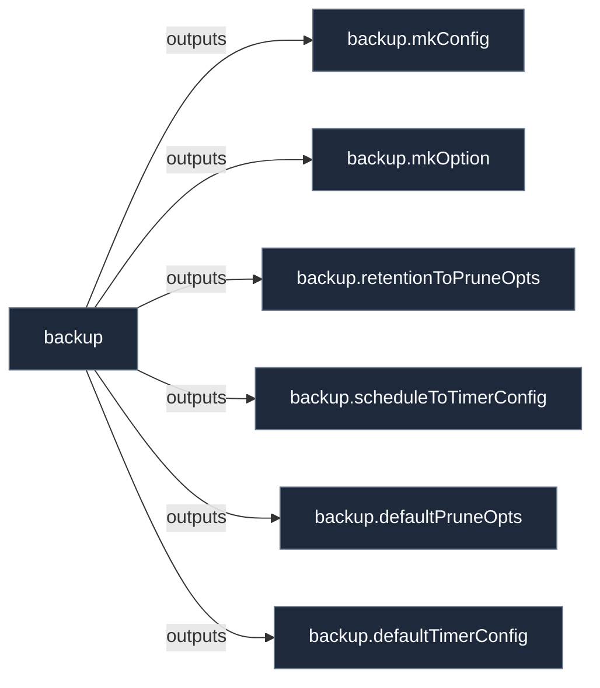

# Library: `backup`

Library helpers and constructors for the 'backup' contract.

[← Back to Library Documentation](README.md) | [← Back to Main README](../../README.md)

- **Library**: `flake.lib.backup`
- **Definition File**: [`modules/contracts/backup/default.nix`](../../modules/contracts/backup/default.nix)

<details>
<summary>Architecture Diagram (click to expand)</summary>



</details>

## Usage

This library namespace can be consumed both internally within repository modules and externally by downstream flakes.

### Internal Usage

```nix
{ self, lib, pkgs, ... }: {
  example = self.lib.backup.defaultPruneOpts;
}
```

### External Usage

```nix
{
  inputs.nixconf.url = "github:LW-54/nixconf";

  outputs = { self, nixconf, ... }: {
    example = nixconf.lib.backup.defaultPruneOpts;
  };
}
```

## Exported Symbols

<a id="defaultPruneOpts"></a>
### `defaultPruneOpts`

Default restic snapshot retention arguments (`--keep-daily 7 --keep-weekly 4 --keep-monthly 6`).

#### Type

```
defaultPruneOpts :: [String]
```

<a id="defaultTimerConfig"></a>
### `defaultTimerConfig`

Default systemd timer configuration (`hourly`) for backup jobs.

#### Type

```
defaultTimerConfig :: Attrs
```

<a id="mkConfig"></a>
### `mkConfig`

Auto-derived configuration binding helper for the 'backup' contract.

#### Inputs

- `cfg`: Configuration binding parameter for the 'backup' contract.
- `name`: Configuration binding parameter for the 'backup' contract.

#### Type

```
backup.mkConfig :: AttrSet -> AttrSet
```

#### Examples

```nix
backup.mkConfig { inherit config cfg; }
```

<a id="mkOption"></a>
### `mkOption`

Auto-derived option constructor for the 'backup' contract.

#### Inputs

- `autoRestore`: Submodule option parameter for the 'backup' contract.
- `beforeUnits`: Submodule option parameter for the 'backup' contract.
- `destinationOverrides`: Submodule option parameter for the 'backup' contract.
- `destinations`: Submodule option parameter for the 'backup' contract.
- `enable`: Submodule option parameter for the 'backup' contract.
- `exclude`: Submodule option parameter for the 'backup' contract.
- `paths`: Submodule option parameter for the 'backup' contract.
- `scope`: Submodule option parameter for the 'backup' contract.

#### Type

```
backup.mkOption :: AttrSet -> AttrSet
```

#### Examples

```nix
backup.mkOption { ... }
```

<a id="retentionToPruneOpts"></a>
### `retentionToPruneOpts`

Convert a structured retention policy attrset into `restic forget --prune` CLI flags.

#### Type

```
retentionToPruneOpts :: Retention -> [String]
```

<a id="scheduleToTimerConfig"></a>
### `scheduleToTimerConfig`

Convert a structured backup schedule attrset into systemd `timerConfig` attributes.

#### Type

```
scheduleToTimerConfig :: Schedule -> Attrs
```

<a id="types"></a>
### `types`

Custom option types declared under this library namespace:

- `destination`: submodule
- `destinationOverride`: submodule
- `retention`: submodule
- `schedule`: submodule
- `unit`: submodule
