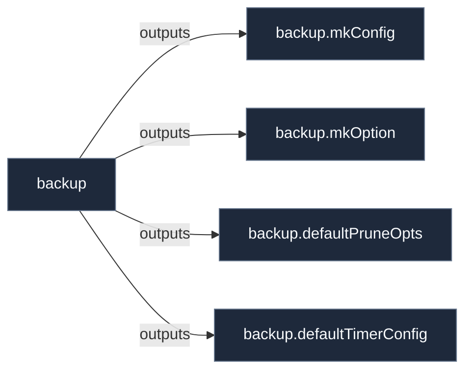

# Library: `backup`

Library helpers and constructors for the 'backup' contract.

[← Back to Library Documentation](README.md) | [← Back to Main README](../../README.md)

- **Library**: `flake.lib.backup`
- **Definition File**: [`modules/contracts/backup.nix`](../../modules/contracts/backup.nix)

<details>
<summary>Architecture Diagram (click to expand)</summary>



</details>

## Usage

This library namespace can be consumed both internally within repository modules and externally by downstream flakes.

### Internal Usage

```nix
{ self, lib, pkgs, ... }: {
  example = self.lib.backup.defaultPruneOpts;
}
```

### External Usage

```nix
{
  inputs.nixconf.url = "github:LW-54/nixconf";

  outputs = { self, nixconf, ... }: {
    example = nixconf.lib.backup.defaultPruneOpts;
  };
}
```

## Exported Symbols

<a id="defaultPruneOpts"></a>
### `defaultPruneOpts`

Default snapshot retention rules passed to the backup backend pruning command.
Preserves 7 daily, 4 weekly, and 12 monthly snapshots.

#### Type

```
defaultPruneOpts :: [String]
```

<a id="defaultTimerConfig"></a>
### `defaultTimerConfig`

Default systemd timer configuration for automated backup operations.
Executes daily at 04:00 with persistent timer catch-up.

#### Type

```
defaultTimerConfig :: AttrSet
```

<a id="mkConfig"></a>
### `mkConfig`

Auto-derived configuration binding helper for the 'backup' contract.

#### Inputs

- `cfg`: Configuration binding parameter for the 'backup' contract.
- `config`: Configuration binding parameter for the 'backup' contract.

#### Type

```
backup.mkConfig :: AttrSet -> AttrSet
```

#### Examples

```nix
backup.mkConfig { inherit config cfg; }
```

<a id="mkOption"></a>
### `mkOption`

Auto-derived option constructor for the 'backup' contract.

#### Inputs

- `args`: Service-specific options to include.

#### Type

```
backup.mkOption :: AttrSet -> AttrSet
```

#### Examples

```nix
backup.mkOption { ... }
```
