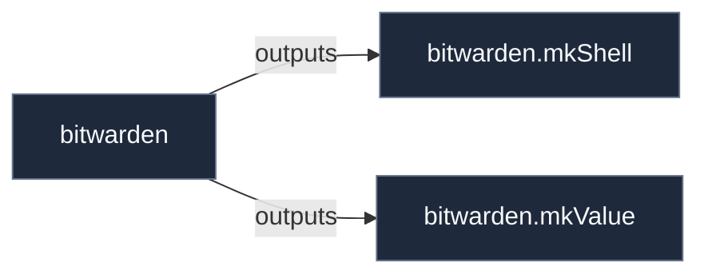

# Library: `bitwarden`

Bitwarden password manager CLI wrapper, desktop application, and vault retrieval helpers.

[← Back to Library Documentation](README.md) | [← Back to Main README](../../README.md)

- **Library**: `flake.lib.bitwarden`
- **Definition File**: [`modules/features/bitwarden.nix`](../../modules/features/bitwarden.nix)

<details>
<summary>Architecture Diagram (click to expand)</summary>



</details>

## Usage

This library namespace can be consumed both internally within repository modules and externally by downstream flakes.

### Internal Usage

```nix
{ self, lib, pkgs, ... }: {
  example = self.lib.bitwarden.mkShell;
}
```

### External Usage

```nix
{
  inputs.nixconf.url = "github:LW-54/nixconf";

  outputs = { self, nixconf, ... }: {
    example = nixconf.lib.bitwarden.mkShell;
  };
}
```

## Exported Symbols

<a id="mkShell"></a>
### `mkShell`

Creates a development shell pre-configured with Bitwarden CLI and jq for secrets manipulation.

#### Inputs

- `pkgs`: Package set supplying jq and shell dependencies.
- `bw`: Wrapped Bitwarden CLI package derivation.

#### Type

```
mkShell :: AttrSet -> Derivation
```

#### Examples

```nix
bitwarden.mkShell {
  inherit pkgs;
  bw = pkgs.bitwarden-cli;
}
```

<a id="mkValue"></a>
### `mkValue`

Generates a bash snippet that retrieves and optionally exports a Bitwarden vault value via jq.

#### Inputs

- `itemId`: Bitwarden vault item UUID.
- `jqFilter`: jq filter expression extracting the required field.
- `variable`: Environment variable name to store the secret into (optional).
- `exportVariable`: Whether to export the assigned environment variable (default: true).
- `bw`: Path or executable name for Bitwarden CLI binary (default: "bw").
- `jq`: Path or executable name for jq binary (default: "jq").

#### Type

```
mkValue :: AttrSet -> String
```

#### Examples

```nix
bitwarden.mkValue {
  itemId = "00000000-0000-0000-0000-000000000000";
  jqFilter = ".login.password";
}
```
