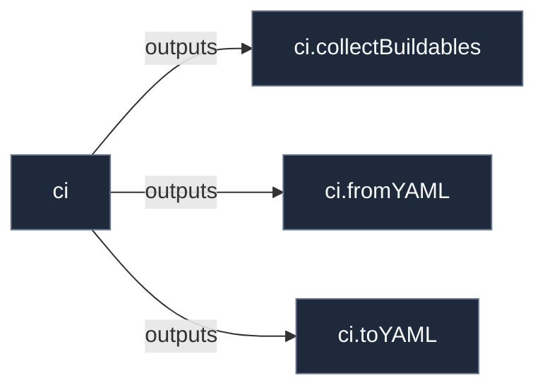

# Library: `ci`

Continuous integration workflow helpers, YAML serialization, and derivation collection utilities.

[← Back to Library Documentation](README.md) | [← Back to Main README](../../README.md)

- **Library**: `flake.lib.ci`
- **Definition File**: [`meta/ci/lib.nix`](../../meta/ci/lib.nix)

<details>
<summary>Architecture Diagram (click to expand)</summary>



</details>

## Usage

This library namespace can be consumed both internally within repository modules and externally by downstream flakes.

### Internal Usage

```nix
{ self, lib, pkgs, ... }: {
  example = self.lib.ci.collectBuildables;
}
```

### External Usage

```nix
{
  inputs.nixconf.url = "github:LW-54/nixconf";

  outputs = { self, nixconf, ... }: {
    example = nixconf.lib.ci.collectBuildables;
  };
}
```

## Exported Symbols

<a id="collectBuildables"></a>
### `collectBuildables`

Universally walks all outputs in self to collect buildable derivations for a system.

#### Inputs

- `system`: System architecture string (e.g. "x86_64-linux").

#### Type

```
collectBuildables :: String -> AttrSet
```

<a id="fromYAML"></a>
### `fromYAML`

Parses raw YAML text into a Nix attribute set via remarshal.

#### Inputs

- `pkgs`: Package set providing the remarshal tool.
- `str`: Raw YAML string content to parse.

#### Type

```
fromYAML :: Pkgs -> String -> AttrSet
```

<a id="toYAML"></a>
### `toYAML`

Compiles and formats YAML with yamlfmt, pre-linting with actionlint.

#### Inputs

- `pkgs`: Package set providing yamlfmt and actionlint.
- `name`: Workflow name string used for output file naming.
- `data`: Native Nix attribute set or raw YAML string representing the workflow.

#### Type

```
toYAML :: Pkgs -> String -> (AttrSet | String) -> Derivation
```
